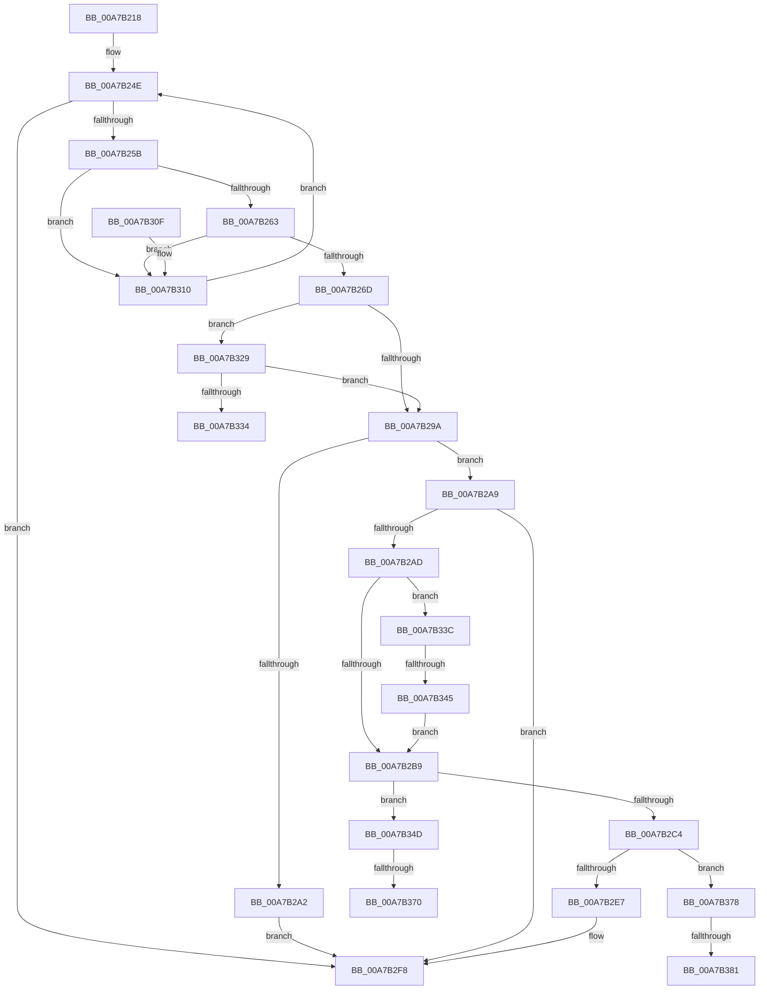

# ExpParseEfiPath

- RVA: `0x00A7B218`–`0x00A7B386` (길이 `366` bytes)
- VA: `0x0000000140A7B218`
- 실행 섹션: `PAGE`
- PDB 이름 있음: `예`; PDB Function 태그: `예`
- unwind 정보 RVA: `0x000B65D4`
- 디코드: `107`개 명령, `366/366` bytes 표시
- 미해석 바이트: `0` (있으면 어셈블리에 `.byte`로 보존)

> 이 문서는 커널 이미지의 기계어와 PDB 기호를 분석해 생성했습니다. 4번과 5번은 함수 원형과 자료형을 바이너리 사용 방식에서 추정한 C 해석이며 원본 소스 복구 결과는 아닙니다.

## 1. Dependencies

- 직접 호출 지점: **3**; 고유 호출 대상: **2**
- 직접 호출자로 확인된 함수: **1**
- RIP 상대 이미지 참조: **0**

### Outgoing calls
- `0x00A7B2D5` → [ExAllocatePool2](../../poolcode/B8/ExAllocatePool2_function_00B820F0.md) (function, `0x00B820F0`)
- `0x00A7B2F0` → [memcpy](../../text/6C/memcpy_function_006C6840.md) (function, `0x006C6840`)
- `0x00A7B35D` → [ExAllocatePool2](../../poolcode/B8/ExAllocatePool2_function_00B820F0.md) (function, `0x00B820F0`)

### Direct callers
- [ExpTranslateEfiPath](ExpTranslateEfiPath_function_00A7AF84.md) at `0x00A7AFF7`

### Static image references
- 디코드된 RIP-relative 메모리 참조가 없습니다.

## 2. Other-region calls and transfers

- 다른 실행 섹션으로 향하는 call: **3**
  - `0x00A7B2D5` → [ExAllocatePool2](../../poolcode/B8/ExAllocatePool2_function_00B820F0.md) (`PAGE` → `POOLCODE`)
  - `0x00A7B2F0` → [memcpy](../../text/6C/memcpy_function_006C6840.md) (`PAGE` → `.text`)
  - `0x00A7B35D` → [ExAllocatePool2](../../poolcode/B8/ExAllocatePool2_function_00B820F0.md) (`PAGE` → `POOLCODE`)
- call이 아닌 외부 분기/꼬리 이동: **6**
  - `0x00A7B337` → [sub_00B4259E](../B4/Unknown_function_00B4259E.md) (`tail-transfer`)
  - `0x00A7B33F` → [sub_00B4259E + 0xE6](../B4/Unknown_function_00B4259E.md) (`tail-transfer`)
  - `0x00A7B36A` → [sub_00B4259E + 0xBF](../B4/Unknown_function_00B4259E.md) (`tail-transfer`)
  - `0x00A7B373` → [sub_00B4259E + 0x63](../B4/Unknown_function_00B4259E.md) (`tail-transfer`)
  - `0x00A7B37B` → [sub_00B4259E + 0xB5](../B4/Unknown_function_00B4259E.md) (`tail-transfer`)
  - `0x00A7B381` → [sub_00B4259E + 0xBF](../B4/Unknown_function_00B4259E.md) (`tail-transfer`)

## 3. Assembly (complete function range)

```asm
00A7B218  48 89 5C 24 08                  mov qword ptr [rsp + 8], rbx
00A7B21D  4C 89 44 24 18                  mov qword ptr [rsp + 0x18], r8
00A7B222  48 89 54 24 10                  mov qword ptr [rsp + 0x10], rdx
00A7B227  55                              push rbp
00A7B228  56                              push rsi
00A7B229  57                              push rdi
00A7B22A  41 54                           push r12
00A7B22C  41 55                           push r13
00A7B22E  41 56                           push r14
00A7B230  41 57                           push r15
00A7B232  48 83 EC 20                     sub rsp, 0x20
00A7B236  33 FF                           xor edi, edi
00A7B238  4D 8B F8                        mov r15, r8
00A7B23B  44 8B E7                        mov r12d, edi
00A7B23E  8B F7                           mov esi, edi
00A7B240  48 8B EA                        mov rbp, rdx
00A7B243  4C 8B D1                        mov r10, rcx
00A7B246  BB 0D 00 00 C0                  mov ebx, 0xc000000d
00A7B24B  41 B3 01                        mov r11b, 1
00A7B24E  41 8A 02                        mov al, byte ptr [r10]
00A7B251  24 7F                           and al, 0x7f
00A7B253  3C 7F                           cmp al, 0x7f
00A7B255  0F 84 9D 00 00 00               je 0x140a7b2f8
00A7B25B  3C 04                           cmp al, 4
00A7B25D  0F 85 AD 00 00 00               jne 0x140a7b310
00A7B263  45 38 5A 01                     cmp byte ptr [r10 + 1], r11b
00A7B267  0F 85 A3 00 00 00               jne 0x140a7b310
00A7B26D  41 0F B6 42 02                  movzx eax, byte ptr [r10 + 2]
00A7B272  4D 8B EA                        mov r13, r10
00A7B275  41 0F B6 4A 03                  movzx ecx, byte ptr [r10 + 3]
00A7B27A  44 8B F0                        mov r14d, eax
00A7B27D  C1 E1 08                        shl ecx, 8
00A7B280  8B DF                           mov ebx, edi
00A7B282  44 0B F1                        or r14d, ecx
00A7B285  48 0B C8                        or rcx, rax
00A7B288  4C 03 D1                        add r10, rcx
00A7B28B  41 8A 0A                        mov cl, byte ptr [r10]
00A7B28E  8A C1                           mov al, cl
00A7B290  24 7F                           and al, 0x7f
00A7B292  3C 04                           cmp al, 4
00A7B294  0F 84 8F 00 00 00               je 0x140a7b329
00A7B29A  80 E1 7F                        and cl, 0x7f
00A7B29D  80 F9 7F                        cmp cl, 0x7f
00A7B2A0  74 07                           je 0x140a7b2a9
00A7B2A2  BB 0D 00 00 C0                  mov ebx, 0xc000000d
00A7B2A7  EB 4F                           jmp 0x140a7b2f8
00A7B2A9  85 DB                           test ebx, ebx
00A7B2AB  78 4B                           js 0x140a7b2f8
00A7B2AD  41 8A 45 29                     mov al, byte ptr [r13 + 0x29]
00A7B2B1  3C 02                           cmp al, 2
00A7B2B3  0F 85 83 00 00 00               jne 0x140a7b33c
00A7B2B9  45 88 19                        mov byte ptr [r9], r11b
00A7B2BC  85 F6                           test esi, esi
00A7B2BE  0F 85 89 00 00 00               jne 0x140a7b34d
00A7B2C4  41 B8 45 6E 76 72               mov r8d, 0x72766e45
00A7B2CA  41 8B D6                        mov edx, r14d
00A7B2CD  B9 40 00 00 00                  mov ecx, 0x40
00A7B2D2  41 8B F6                        mov esi, r14d
00A7B2D5  E8 16 6E 10 00                  call 0x140b820f0
00A7B2DA  48 89 45 00                     mov qword ptr [rbp], rax
00A7B2DE  48 85 C0                        test rax, rax
00A7B2E1  0F 84 91 00 00 00               je 0x140a7b378
00A7B2E7  44 8B C6                        mov r8d, esi
00A7B2EA  49 8B D5                        mov rdx, r13
00A7B2ED  48 8B C8                        mov rcx, rax
00A7B2F0  E8 4B B5 C4 FF                  call 0x1406c6840
00A7B2F5  49 89 3F                        mov qword ptr [r15], rdi
00A7B2F8  8B C3                           mov eax, ebx
00A7B2FA  48 8B 5C 24 60                  mov rbx, qword ptr [rsp + 0x60]
00A7B2FF  48 83 C4 20                     add rsp, 0x20
00A7B303  41 5F                           pop r15
00A7B305  41 5E                           pop r14
00A7B307  41 5D                           pop r13
00A7B309  41 5C                           pop r12
00A7B30B  5F                              pop rdi
00A7B30C  5E                              pop rsi
00A7B30D  5D                              pop rbp
00A7B30E  C3                              ret
00A7B30F  CC                              int3
00A7B310  41 0F B6 4A 03                  movzx ecx, byte ptr [r10 + 3]
00A7B315  41 0F B6 42 02                  movzx eax, byte ptr [r10 + 2]
00A7B31A  48 C1 E1 08                     shl rcx, 8
00A7B31E  48 0B C8                        or rcx, rax
00A7B321  4C 03 D1                        add r10, rcx
00A7B324  E9 25 FF FF FF                  jmp 0x140a7b24e
00A7B329  41 80 7A 01 04                  cmp byte ptr [r10 + 1], 4
00A7B32E  0F 85 66 FF FF FF               jne 0x140a7b29a
00A7B334  4D 8B E2                        mov r12, r10
00A7B337  E9 62 72 0C 00                  jmp 0x140b4259e
00A7B33C  41 3A C3                        cmp al, r11b
00A7B33F  0F 85 3F 73 0C 00               jne 0x140b42684
00A7B345  44 8A DF                        mov r11b, dil
00A7B348  E9 6C FF FF FF                  jmp 0x140a7b2b9
00A7B34D  83 C6 02                        add esi, 2
00A7B350  B9 40 00 00 00                  mov ecx, 0x40
00A7B355  8B D6                           mov edx, esi
00A7B357  41 B8 45 6E 76 72               mov r8d, 0x72766e45
00A7B35D  E8 8E 6D 10 00                  call 0x140b820f0
00A7B362  33 C9                           xor ecx, ecx
00A7B364  48 8B F8                        mov rdi, rax
00A7B367  48 85 C0                        test rax, rax
00A7B36A  0F 84 ED 72 0C 00               je 0x140b4265d
00A7B370  44 8B F9                        mov r15d, ecx
00A7B373  E9 89 72 0C 00                  jmp 0x140b42601
00A7B378  48 85 FF                        test rdi, rdi
00A7B37B  0F 85 D2 72 0C 00               jne 0x140b42653
00A7B381  E9 D7 72 0C 00                  jmp 0x140b4265d
```

## 4. C-style interpretation (structured pseudocode)

```c
__int64 __fastcall ExpParseEfiPath(__int64 a1, __int64 a2, __int64 a3, __int64 a4)
{
    __int64 result;
    __int64 v_r10;
    __int64 v_r14;
    __int64 v_rdi;
    __int64 v_rsi;
    __int64 v_rsp;
    unsigned __int64 v_stack_p10;
    unsigned __int64 v_stack_p18;
    unsigned __int64 v_stack_p8;

    v_stack_p8 = v_rbx;
    v_stack_p18 = a3;
    v_stack_p10 = a2;
    v_rsp = (v_rsp) - (32);
    v_rdi = 0;
loc_00A7B24E:
    result = (unsigned __int8)((*(unsigned __int8 *)(a1)) & (127));
    if (((unsigned __int8)(result)) == 127) goto loc_00A7B2F8;
    if (((unsigned __int8)(result)) != 4) goto loc_00A7B310;
    if ((*(unsigned __int8 *)(a1 + 1)) != 1) goto loc_00A7B310;
    a1 = (unsigned int)((*(unsigned __int8 *)(a1 + 3)) << (8));
    v_r14 = (unsigned int)(((unsigned int)((unsigned int)(*(unsigned __int8 *)(a1 + 2)))) | ((unsigned int)(a1)));
    a1 = (a1) | (*(unsigned __int8 *)(a1 + 2));
    v_r10 = (a1) + (a1);
    result = (unsigned __int8)(((unsigned __int8)(*(unsigned __int8 *)(v_r10))) & (127));
    if (((unsigned __int8)(result)) == 4) goto loc_00A7B329;
loc_00A7B29A:
    a1 = (unsigned __int8)((*(unsigned __int8 *)(v_r10)) & (127));
    if (((unsigned __int8)(a1)) == 127) goto loc_00A7B2A9;
    goto loc_00A7B2F8;
loc_00A7B2A9:
    if (sign_flag) goto loc_00A7B2F8;
    if (((unsigned __int8)(*(unsigned __int8 *)(a1 + 41))) != 2) goto loc_00A7B33C;
loc_00A7B2B9:
    *(unsigned __int8 *)(a4) = 1;
    if (0 != 0) goto loc_00A7B34D;
    result = ExAllocatePool2(64, (unsigned int)((unsigned int)(v_r14)), (unsigned int)(0x72766E45ULL), a4);
    *(unsigned __int64 *)(a2) = result;
    if (result == 0) goto loc_00A7B378;
    result = memcpy(result, a1, (unsigned int)((unsigned int)((unsigned int)((unsigned int)(v_r14)))), a4);
    *(unsigned __int64 *)(a3) = 0;
loc_00A7B2F8:
    v_rsp = (v_rsp) + (32);
    return (unsigned int)((unsigned int)((unsigned int)(0xC000000DULL)));
loc_00A7B310:
    a1 = (*(unsigned __int8 *)(v_r10 + 3)) << (8);
    a1 = (a1) | (*(unsigned __int8 *)(v_r10 + 2));
    v_r10 = (v_r10) + (a1);
    goto loc_00A7B24E;
loc_00A7B329:
    if ((*(unsigned __int8 *)(v_r10 + 1)) != 4) goto loc_00A7B29A;
loc_00A7B33C:
    goto loc_00A7B2B9;
loc_00A7B34D:
    v_rsi = (unsigned int)(((unsigned int)((unsigned int)(v_r14))) + (2));
    result = ExAllocatePool2(64, (unsigned int)((unsigned int)(v_rsi)), (unsigned int)(0x72766E45ULL), a4);
    a1 = 0;
loc_00A7B378:
}
```

## 5. (Beta) C Style

```c
int64_t ExpParseEfiPath(void *Arg1, void *Arg2, void *Arg3, void *Arg4)
{
    uint8_t *arg1 = (uint8_t *)Arg1;
    uint8_t *arg2 = (uint8_t *)Arg2;
    uint8_t *arg3 = (uint8_t *)Arg3;
    uint8_t *arg4 = (uint8_t *)Arg4;

    int64_t result;
    int64_t local_r10;
    int64_t local_r14;
    int64_t local_rdi;
    int64_t local_rsi;
    int64_t local_rsp;
    uint64_t v_stack_p10;
    uint64_t v_stack_p18;
    uint64_t v_stack_p8;

    v_stack_p8 = local_rbx;
    v_stack_p18 = Arg3;
    v_stack_p10 = Arg2;
    local_rsp = (local_rsp) - (32);
    local_rdi = 0;
loc_00A7B24E:
    result = (uint8_t)((*(uint8_t *)(arg1)) & (127));
    if (((uint8_t)(result)) == 127) goto loc_00A7B2F8;
    if (((uint8_t)(result)) != 4) goto loc_00A7B310;
    if ((*(uint8_t *)(arg1 + 0x1)) != 1) goto loc_00A7B310;
    Arg1 = (uint32_t)((*(uint8_t *)(arg1 + 0x3)) << (8));
    local_r14 = (uint32_t)(((uint32_t)((uint32_t)(*(uint8_t *)(arg1 + 0x2)))) | ((uint32_t)(Arg1)));
    Arg1 = (Arg1) | (*(uint8_t *)(arg1 + 0x2));
    local_r10 = (Arg1) + (Arg1);
    result = (uint8_t)(((uint8_t)(*(uint8_t *)(local_r10))) & (127));
    if (((uint8_t)(result)) == 4) goto loc_00A7B329;
loc_00A7B29A:
    Arg1 = (uint8_t)((*(uint8_t *)(local_r10)) & (127));
    if (((uint8_t)(Arg1)) == 127) goto loc_00A7B2A9;
    goto loc_00A7B2F8;
loc_00A7B2A9:
    if (sign_flag) goto loc_00A7B2F8;
    if (((uint8_t)(*(uint8_t *)(arg1 + 0x29))) != 2) goto loc_00A7B33C;
loc_00A7B2B9:
    *(uint8_t *)(arg4) = 1;
    if (0 != 0) goto loc_00A7B34D;
    result = ExAllocatePool2(64, (uint32_t)((uint32_t)(local_r14)), (uint32_t)(0x72766E45ULL), Arg4);
    *(uint64_t *)(arg2) = result;
    if (result == 0) goto loc_00A7B378;
    result = memcpy(result, Arg1, (uint32_t)((uint32_t)((uint32_t)((uint32_t)(local_r14)))), Arg4);
    *(uint64_t *)(arg3) = 0;
loc_00A7B2F8:
    local_rsp = (local_rsp) + (32);
    return (uint32_t)((uint32_t)((uint32_t)(0xC000000DULL)));
loc_00A7B310:
    Arg1 = (*(uint8_t *)(local_r10 + 0x3)) << (8);
    Arg1 = (Arg1) | (*(uint8_t *)(local_r10 + 0x2));
    local_r10 = (local_r10) + (Arg1);
    goto loc_00A7B24E;
loc_00A7B329:
    if ((*(uint8_t *)(local_r10 + 0x1)) != 4) goto loc_00A7B29A;
loc_00A7B33C:
    goto loc_00A7B2B9;
loc_00A7B34D:
    local_rsi = (uint32_t)(((uint32_t)((uint32_t)(local_r14))) + (2));
    result = ExAllocatePool2(64, (uint32_t)((uint32_t)(local_rsi)), (uint32_t)(0x72766E45ULL), Arg4);
    Arg1 = 0;
loc_00A7B378:
}
```

### 관측된 메모리 오프셋

구조체 형식이 확인되지 않은 접근은 인자 기준의 오프셋으로만 기록했습니다.

| 기준 인자 | 오프셋 표현 | 폭 (bit) | 접근 |
|---|---:|---:|---|
| `Arg1` | `+ 0x0` | `8` | `R` |
| `Arg1` | `+ 0x1` | `8` | `R` |
| `Arg1` | `+ 0x2` | `8` | `R` |
| `Arg1` | `+ 0x3` | `8` | `R` |
| `Arg1` | `+ 0x29` | `8` | `R` |
| `Arg2` | `+ 0x0` | `64` | `W` |
| `Arg3` | `+ 0x0` | `64` | `W` |
| `Arg4` | `+ 0x0` | `8` | `W` |

## 6. Execution-region graph

[열기: 2D/3D 그래프와 함수 탐색 컨트롤 패널](../../../control-panel.html?section=page&rva=0x00A7B218&view=graph)

- 2D 그래프는 위에서 아래로 흐르고, 3D 그래프는 빈 공간을 드래그해 회전합니다. Shift+드래그는 이동, 휠은 확대·축소, 함수 노드 선택은 대상 보고서 이동입니다.

### Static fallback


