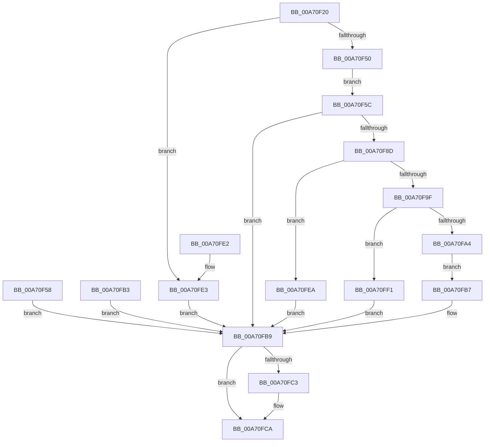

# ExpQueryChannelInformation

- RVA: `0x00A70F20`–`0x00A70FF8` (길이 `216` bytes)
- VA: `0x0000000140A70F20`
- 실행 섹션: `PAGE`
- PDB 이름 있음: `예`; PDB Function 태그: `아니요`
- unwind 정보 RVA: `0x000B5214`
- 디코드: `62`개 명령, `216/216` bytes 표시
- 미해석 바이트: `0` (있으면 어셈블리에 `.byte`로 보존)

> 이 문서는 커널 이미지의 기계어와 PDB 기호를 분석해 생성했습니다. 4번과 5번은 함수 원형과 자료형을 바이너리 사용 방식에서 추정한 C 해석이며 원본 소스 복구 결과는 아닙니다.

## 1. Dependencies

- 직접 호출 지점: **4**; 고유 호출 대상: **4**
- 직접 호출자로 확인된 함수: **1**
- RIP 상대 이미지 참조: **0**

### Outgoing calls
- `0x00A70F6C` → [MmGetProcessPartitionId](../../text/47/MmGetProcessPartitionId_function_0047BB44.md) (function, `0x0047BB44`)
- `0x00A70F82` → [MmGetChannelInformation](MmGetChannelInformation_function_00A71000.md) (function, `0x00A71000`)
- `0x00A70FAC` → [memcpy](../../text/6C/memcpy_function_006C6840.md) (function, `0x006C6840`)
- `0x00A70FC5` → [ExFreePoolWithTag](../../poolcode/B8/ExFreePoolWithTag_function_00B82870.md) (function, `0x00B82870`)

### Direct callers
- [ExpQuerySystemInformation](../A5/ExpQuerySystemInformation_function_00A57858.md) at `0x00A59F82`

### Static image references
- 디코드된 RIP-relative 메모리 참조가 없습니다.

## 2. Other-region calls and transfers

- 다른 실행 섹션으로 향하는 call: **3**
  - `0x00A70F6C` → [MmGetProcessPartitionId](../../text/47/MmGetProcessPartitionId_function_0047BB44.md) (`PAGE` → `.text`)
  - `0x00A70FAC` → [memcpy](../../text/6C/memcpy_function_006C6840.md) (`PAGE` → `.text`)
  - `0x00A70FC5` → [ExFreePoolWithTag](../../poolcode/B8/ExFreePoolWithTag_function_00B82870.md) (`PAGE` → `POOLCODE`)
- 별도 외부 분기/꼬리 이동을 확인하지 못했습니다.

## 3. Assembly (complete function range)

```asm
00A70F20  48 8B C4                        mov rax, rsp
00A70F23  48 89 58 08                     mov qword ptr [rax + 8], rbx
00A70F27  48 89 70 10                     mov qword ptr [rax + 0x10], rsi
00A70F2B  48 89 78 18                     mov qword ptr [rax + 0x18], rdi
00A70F2F  41 56                           push r14
00A70F31  48 83 EC 40                     sub rsp, 0x40
00A70F35  4D 8B F0                        mov r14, r8
00A70F38  8B F2                           mov esi, edx
00A70F3A  48 8B F9                        mov rdi, rcx
00A70F3D  48 83 60 E0 00                  and qword ptr [rax - 0x20], 0
00A70F42  48 83 60 20 00                  and qword ptr [rax + 0x20], 0
00A70F47  83 FA 04                        cmp edx, 4
00A70F4A  0F 82 93 00 00 00               jb 0x140a70fe3
00A70F50  8B 01                           mov eax, dword ptr [rcx]
00A70F52  89 44 24 24                     mov dword ptr [rsp + 0x24], eax
00A70F56  EB 04                           jmp 0x140a70f5c
00A70F58  8B D8                           mov ebx, eax
00A70F5A  EB 5D                           jmp 0x140a70fb9
00A70F5C  65 48 8B 04 25 88 01 00 00      mov rax, qword ptr gs:[0x188]
00A70F65  48 8B 88 B8 00 00 00            mov rcx, qword ptr [rax + 0xb8]
00A70F6C  E8 D3 AB A0 FF                  call 0x14047bb44
00A70F71  4C 8D 4C 24 28                  lea r9, [rsp + 0x28]
00A70F76  4C 8D 44 24 68                  lea r8, [rsp + 0x68]
00A70F7B  8B 54 24 24                     mov edx, dword ptr [rsp + 0x24]
00A70F7F  0F B7 C8                        movzx ecx, ax
00A70F82  E8 79 00 00 00                  call 0x140a71000
00A70F87  8B D8                           mov ebx, eax
00A70F89  85 C0                           test eax, eax
00A70F8B  78 2C                           js 0x140a70fb9
00A70F8D  4C 8B 44 24 28                  mov r8, qword ptr [rsp + 0x28]
00A70F92  45 89 06                        mov dword ptr [r14], r8d
00A70F95  B8 FF FF FF FF                  mov eax, 0xffffffff
00A70F9A  4C 3B C0                        cmp r8, rax
00A70F9D  77 4B                           ja 0x140a70fea
00A70F9F  49 3B F0                        cmp rsi, r8
00A70FA2  72 4D                           jb 0x140a70ff1
00A70FA4  48 8B 54 24 68                  mov rdx, qword ptr [rsp + 0x68]
00A70FA9  48 8B CF                        mov rcx, rdi
00A70FAC  E8 8F 58 C5 FF                  call 0x1406c6840
00A70FB1  EB 04                           jmp 0x140a70fb7
00A70FB3  8B D8                           mov ebx, eax
00A70FB5  EB 02                           jmp 0x140a70fb9
00A70FB7  33 DB                           xor ebx, ebx
00A70FB9  48 8B 4C 24 68                  mov rcx, qword ptr [rsp + 0x68]
00A70FBE  48 85 C9                        test rcx, rcx
00A70FC1  74 07                           je 0x140a70fca
00A70FC3  33 D2                           xor edx, edx
00A70FC5  E8 A6 18 11 00                  call 0x140b82870
00A70FCA  8B C3                           mov eax, ebx
00A70FCC  48 8B 5C 24 50                  mov rbx, qword ptr [rsp + 0x50]
00A70FD1  48 8B 74 24 58                  mov rsi, qword ptr [rsp + 0x58]
00A70FD6  48 8B 7C 24 60                  mov rdi, qword ptr [rsp + 0x60]
00A70FDB  48 83 C4 40                     add rsp, 0x40
00A70FDF  41 5E                           pop r14
00A70FE1  C3                              ret
00A70FE2  CC                              int3
00A70FE3  BB 06 02 00 C0                  mov ebx, 0xc0000206
00A70FE8  EB CF                           jmp 0x140a70fb9
00A70FEA  BB 9A 00 00 C0                  mov ebx, 0xc000009a
00A70FEF  EB C8                           jmp 0x140a70fb9
00A70FF1  BB 23 00 00 C0                  mov ebx, 0xc0000023
00A70FF6  EB C1                           jmp 0x140a70fb9
```

## 4. C-style interpretation (structured pseudocode)

```c
__int64 __fastcall ExpQueryChannelInformation(__int64 a1, int a2, __int64 a3)
{
    __int64 result;
    __int64 v_rbx;
    __int64 v_rsp;
    unsigned __int64 v_stack_m20;
    unsigned int v_stack_m24;
    unsigned __int64 v_stack_p10;
    unsigned __int64 v_stack_p18;
    unsigned __int64 v_stack_p20;
    unsigned __int64 v_stack_p8;

    *(unsigned __int64 *)(v_rsp + 8) = v_rbx;
    *(unsigned __int64 *)(v_rsp + 16) = v_rsi;
    *(unsigned __int64 *)(v_rsp + 24) = v_rdi;
    v_rsp = (v_rsp) - (64);
    if (a2 < 4) goto loc_00A70FE3;
    v_stack_m24 = (unsigned int)((unsigned int)(*(unsigned int *)(a1)));
    goto loc_00A70F5C;
loc_00A70F5C:
    result = MmGetProcessPartitionId(*(unsigned __int64 *)(*(unsigned __int64 *)(gs_base + (0 + 392)) + 184), a2, a3, a4);
    result = MmGetChannelInformation((unsigned __int16)(result), (unsigned int)(v_stack_m24), v_stack_p20, v_stack_m20);
    if (sign_flag) goto loc_00A70FB9;
    *(unsigned int *)(a3) = (unsigned int)(v_stack_m20);
    if (v_stack_m20 > ((unsigned int)(0xFFFFFFFFULL))) goto loc_00A70FEA;
    if (((unsigned int)(a2)) < v_stack_m20) goto loc_00A70FF1;
    result = memcpy(a1, v_stack_p20, v_stack_m20, v_stack_m20);
    goto loc_00A70FB7;
loc_00A70FB7:
    v_rbx = 0;
loc_00A70FB9:
    if (v_stack_p20 != 0) {
        a2 = 0;
        result = ExFreePoolWithTag(v_stack_p20, a2, v_stack_m20, v_stack_m20);
    }
    v_rsp = (v_rsp) + (64);
    return 0;
loc_00A70FE3:
    goto loc_00A70FB9;
loc_00A70FEA:
    goto loc_00A70FB9;
loc_00A70FF1:
    goto loc_00A70FB9;
}
```

## 5. (Beta) C Style

```c
int64_t ExpQueryChannelInformation(void *Arg1, int32_t Arg2, void *Arg3)
{
    uint8_t *arg1 = (uint8_t *)Arg1;
    uint8_t *arg3 = (uint8_t *)Arg3;

    int64_t result;
    int64_t local_rbx;
    int64_t local_rsp;
    uint64_t v_stack_m20;
    uint32_t v_stack_m24;
    uint64_t v_stack_p10;
    uint64_t v_stack_p18;
    uint64_t v_stack_p20;
    uint64_t v_stack_p8;

    *(uint64_t *)(local_rsp + 0x8) = local_rbx;
    *(uint64_t *)(local_rsp + 0x10) = local_rsi;
    *(uint64_t *)(local_rsp + 0x18) = local_rdi;
    local_rsp = (local_rsp) - (64);
    if (Arg2 < 4) goto loc_00A70FE3;
    v_stack_m24 = (uint32_t)((uint32_t)(*(uint32_t *)(arg1)));
    goto loc_00A70F5C;
loc_00A70F5C:
    result = MmGetProcessPartitionId(*(uint64_t *)(*(uint64_t *)(gs_base + (0 + 0x188)) + 0xB8), Arg2, Arg3, a4);
    result = MmGetChannelInformation((uint16_t)(result), (uint32_t)(v_stack_m24), v_stack_p20, v_stack_m20);
    if (sign_flag) goto loc_00A70FB9;
    *(uint32_t *)(arg3) = (uint32_t)(v_stack_m20);
    if (v_stack_m20 > ((uint32_t)(0xFFFFFFFFULL))) goto loc_00A70FEA;
    if (((uint32_t)(Arg2)) < v_stack_m20) goto loc_00A70FF1;
    result = memcpy(Arg1, v_stack_p20, v_stack_m20, v_stack_m20);
    goto loc_00A70FB7;
loc_00A70FB7:
    local_rbx = 0;
loc_00A70FB9:
    if (v_stack_p20 != 0) {
        Arg2 = 0;
        result = ExFreePoolWithTag(v_stack_p20, Arg2, v_stack_m20, v_stack_m20);
    }
    local_rsp = (local_rsp) + (64);
    return 0;
loc_00A70FE3:
    goto loc_00A70FB9;
loc_00A70FEA:
    goto loc_00A70FB9;
loc_00A70FF1:
    goto loc_00A70FB9;
}
```

### 관측된 메모리 오프셋

구조체 형식이 확인되지 않은 접근은 인자 기준의 오프셋으로만 기록했습니다.

| 기준 인자 | 오프셋 표현 | 폭 (bit) | 접근 |
|---|---:|---:|---|
| `Arg1` | `+ 0x0` | `32` | `R` |
| `Arg3` | `+ 0x0` | `32` | `W` |

## 6. Execution-region graph

[열기: 2D/3D 그래프와 함수 탐색 컨트롤 패널](../../../control-panel.html?section=page&rva=0x00A70F20&view=graph)

- 2D 그래프는 위에서 아래로 흐르고, 3D 그래프는 빈 공간을 드래그해 회전합니다. Shift+드래그는 이동, 휠은 확대·축소, 함수 노드 선택은 대상 보고서 이동입니다.

### Static fallback


