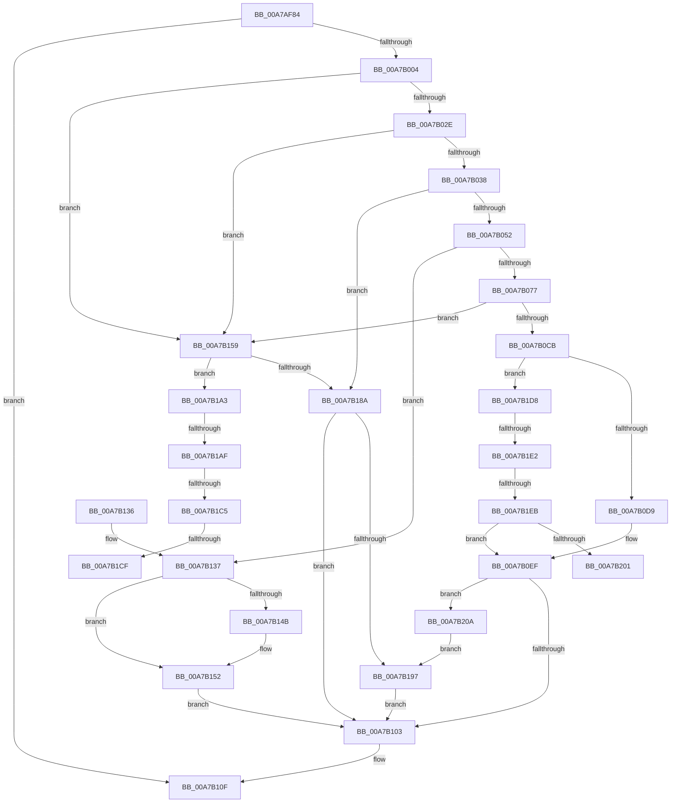

# ExpTranslateEfiPath

- RVA: `0x00A7AF84`–`0x00A7B20F` (길이 `651` bytes)
- VA: `0x0000000140A7AF84`
- 실행 섹션: `PAGE`
- PDB 이름 있음: `예`; PDB Function 태그: `예`
- unwind 정보 RVA: `0x000B659C`
- 디코드: `176`개 명령, `651/651` bytes 표시
- 미해석 바이트: `0` (있으면 어셈블리에 `.byte`로 보존)

> 이 문서는 커널 이미지의 기계어와 PDB 기호를 분석해 생성했습니다. 4번과 5번은 함수 원형과 자료형을 바이너리 사용 방식에서 추정한 C 해석이며 원본 소스 복구 결과는 아닙니다.

## 1. Dependencies

- 직접 호출 지점: **18**; 고유 호출 대상: **12**
- 직접 호출자로 확인된 함수: **1**
- RIP 상대 이미지 참조: **2**

### Outgoing calls
- `0x00A7AFF7` → [ExpParseEfiPath](ExpParseEfiPath_function_00A7B218.md) (function, `0x00A7B218`)
- `0x00A7B00A` → [RtlInitUnicodeString](../../text/42/RtlInitUnicodeString_function_0042A780.md) (function, `0x0042A780`)
- `0x00A7B043` → [RtlStringFromGUIDEx](../91/RtlStringFromGUIDEx_function_00915450.md) (function, `0x00915450`)
- `0x00A7B066` → [ExAllocatePool2](../../poolcode/B8/ExAllocatePool2_function_00B820F0.md) (function, `0x00B820F0`)
- `0x00A7B087` → [wcscpy_s](../../text/50/wcscpy_s_function_005064B0.md) (function, `0x005064B0`)
- `0x00A7B09B` → [wcsncat_s](../../text/50/wcsncat_s_function_00506540.md) (function, `0x00506540`)
- `0x00A7B0A6` → [ExFreePoolWithTag](../../poolcode/B8/ExFreePoolWithTag_function_00B82870.md) (function, `0x00B82870`)
- `0x00A7B0B2` → [ExpTranslateSymbolicLink](ExpTranslateSymbolicLink_function_00A7B38C.md) (function, `0x00A7B38C`)
- `0x00A7B0BE` → [ExFreePoolWithTag](../../poolcode/B8/ExFreePoolWithTag_function_00B82870.md) (function, `0x00B82870`)
- `0x00A7B0E8` → [ExpCreateOutputNT](ExpCreateOutputNT_function_00A7B53C.md) (function, `0x00A7B53C`)
- `0x00A7B0F5` → [ExFreePoolWithTag](../../poolcode/B8/ExFreePoolWithTag_function_00B82870.md) (function, `0x00B82870`)
- `0x00A7B108` → [ExFreePoolWithTag](../../poolcode/B8/ExFreePoolWithTag_function_00B82870.md) (function, `0x00B82870`)
- `0x00A7B116` → [_security_check_cookie](../../text/6A/_security_check_cookie_function_006AC640.md) (function, `0x006AC640`)
- `0x00A7B13D` → [ExFreePoolWithTag](../../poolcode/B8/ExFreePoolWithTag_function_00B82870.md) (function, `0x00B82870`)
- `0x00A7B14D` → [ExFreePoolWithTag](../../poolcode/B8/ExFreePoolWithTag_function_00B82870.md) (function, `0x00B82870`)
- `0x00A7B17F` → [ExpFindDiskSignature](ExpFindDiskSignature_function_00A7B608.md) (function, `0x00A7B608`)
- `0x00A7B199` → [ExFreePoolWithTag](../../poolcode/B8/ExFreePoolWithTag_function_00B82870.md) (function, `0x00B82870`)
- `0x00A7B1F2` → [ExpGetDriveGeometry](../AC/ExpGetDriveGeometry_function_00ACA760.md) (function, `0x00ACA760`)

### Direct callers
- [sub_00B37C9A](../B3/Unknown_function_00B37C9A.md) at `0x00B37CD8`

### Static image references
- `0x00A7AFA0` → RVA `0x00E0A740` (`.data`; read)
- `0x00A7B07A` → RVA `0x00AFC9B0` (` ?? ::NNGAKEGL::`string'`; read)

## 2. Other-region calls and transfers

- 다른 실행 섹션으로 향하는 call: **12**
  - `0x00A7B00A` → [RtlInitUnicodeString](../../text/42/RtlInitUnicodeString_function_0042A780.md) (`PAGE` → `.text`)
  - `0x00A7B066` → [ExAllocatePool2](../../poolcode/B8/ExAllocatePool2_function_00B820F0.md) (`PAGE` → `POOLCODE`)
  - `0x00A7B087` → [wcscpy_s](../../text/50/wcscpy_s_function_005064B0.md) (`PAGE` → `.text`)
  - `0x00A7B09B` → [wcsncat_s](../../text/50/wcsncat_s_function_00506540.md) (`PAGE` → `.text`)
  - `0x00A7B0A6` → [ExFreePoolWithTag](../../poolcode/B8/ExFreePoolWithTag_function_00B82870.md) (`PAGE` → `POOLCODE`)
  - `0x00A7B0BE` → [ExFreePoolWithTag](../../poolcode/B8/ExFreePoolWithTag_function_00B82870.md) (`PAGE` → `POOLCODE`)
  - `0x00A7B0F5` → [ExFreePoolWithTag](../../poolcode/B8/ExFreePoolWithTag_function_00B82870.md) (`PAGE` → `POOLCODE`)
  - `0x00A7B108` → [ExFreePoolWithTag](../../poolcode/B8/ExFreePoolWithTag_function_00B82870.md) (`PAGE` → `POOLCODE`)
  - `0x00A7B116` → [_security_check_cookie](../../text/6A/_security_check_cookie_function_006AC640.md) (`PAGE` → `.text`)
  - `0x00A7B13D` → [ExFreePoolWithTag](../../poolcode/B8/ExFreePoolWithTag_function_00B82870.md) (`PAGE` → `POOLCODE`)
  - `0x00A7B14D` → [ExFreePoolWithTag](../../poolcode/B8/ExFreePoolWithTag_function_00B82870.md) (`PAGE` → `POOLCODE`)
  - `0x00A7B199` → [ExFreePoolWithTag](../../poolcode/B8/ExFreePoolWithTag_function_00B82870.md) (`PAGE` → `POOLCODE`)
- call이 아닌 외부 분기/꼬리 이동: **7**
  - `0x00A7B1A9` → [sub_00B42460 + 0x124](../B4/Unknown_function_00B42460.md) (`tail-transfer`)
  - `0x00A7B1BF` → [sub_00B42460](../B4/Unknown_function_00B42460.md) (`tail-transfer`)
  - `0x00A7B1C9` → [sub_00B42460](../B4/Unknown_function_00B42460.md) (`tail-transfer`)
  - `0x00A7B1D3` → [sub_00B42460 + 0x42](../B4/Unknown_function_00B42460.md) (`tail-transfer`)
  - `0x00A7B1DC` → [sub_00B42460 + 0x10A](../B4/Unknown_function_00B42460.md) (`tail-transfer`)
  - `0x00A7B1E5` → [sub_00B42460 + 0xB3](../B4/Unknown_function_00B42460.md) (`tail-transfer`)
  - `0x00A7B205` → [sub_00B42460 + 0xB3](../B4/Unknown_function_00B42460.md) (`tail-transfer`)

## 3. Assembly (complete function range)

```asm
00A7AF84  48 89 5C 24 10                  mov qword ptr [rsp + 0x10], rbx
00A7AF89  55                              push rbp
00A7AF8A  56                              push rsi
00A7AF8B  57                              push rdi
00A7AF8C  41 54                           push r12
00A7AF8E  41 55                           push r13
00A7AF90  41 56                           push r14
00A7AF92  41 57                           push r15
00A7AF94  48 8D 6C 24 D9                  lea rbp, [rsp - 0x27]
00A7AF99  48 81 EC C0 00 00 00            sub rsp, 0xc0
00A7AFA0  48 8B 05 99 F7 38 00            mov rax, qword ptr [rip + 0x38f799]
00A7AFA7  48 33 C4                        xor rax, rsp
00A7AFAA  48 89 45 1F                     mov qword ptr [rbp + 0x1f], rax
00A7AFAE  33 F6                           xor esi, esi
00A7AFB0  4C 89 4D D7                     mov qword ptr [rbp - 0x29], r9
00A7AFB4  0F 57 C0                        xorps xmm0, xmm0
00A7AFB7  4C 89 45 DF                     mov qword ptr [rbp - 0x21], r8
00A7AFBB  44 8B E2                        mov r12d, edx
00A7AFBE  48 89 75 B7                     mov qword ptr [rbp - 0x49], rsi
00A7AFC2  0F 57 C9                        xorps xmm1, xmm1
00A7AFC5  48 89 75 AF                     mov qword ptr [rbp - 0x51], rsi
00A7AFC9  33 C0                           xor eax, eax
00A7AFCB  40 88 75 A7                     mov byte ptr [rbp - 0x59], sil
00A7AFCF  4C 8D 4D A7                     lea r9, [rbp - 0x59]
00A7AFD3  48 89 75 CF                     mov qword ptr [rbp - 0x31], rsi
00A7AFD7  4C 8D 45 AF                     lea r8, [rbp - 0x51]
00A7AFDB  48 89 75 C7                     mov qword ptr [rbp - 0x39], rsi
00A7AFDF  48 8D 55 B7                     lea rdx, [rbp - 0x49]
00A7AFE3  48 89 45 17                     mov qword ptr [rbp + 0x17], rax
00A7AFE7  48 83 C1 0C                     add rcx, 0xc
00A7AFEB  0F 11 45 E7                     movups xmmword ptr [rbp - 0x19], xmm0
00A7AFEF  0F 11 4D F7                     movups xmmword ptr [rbp - 9], xmm1
00A7AFF3  0F 11 45 07                     movups xmmword ptr [rbp + 7], xmm0
00A7AFF7  E8 1C 02 00 00                  call 0x140a7b218
00A7AFFC  85 C0                           test eax, eax
00A7AFFE  0F 88 0B 01 00 00               js 0x140a7b10f
00A7B004  33 D2                           xor edx, edx
00A7B006  48 8D 4D F7                     lea rcx, [rbp - 9]
00A7B00A  E8 71 F7 9A FF                  call 0x14042a780
00A7B00F  48 8B 7D B7                     mov rdi, qword ptr [rbp - 0x49]
00A7B013  44 8D 76 01                     lea r14d, [rsi + 1]
00A7B017  44 8B FE                        mov r15d, esi
00A7B01A  89 75 BF                        mov dword ptr [rbp - 0x41], esi
00A7B01D  44 8A EE                        mov r13b, sil
00A7B020  40 88 75 A8                     mov byte ptr [rbp - 0x58], sil
00A7B024  44 38 75 A7                     cmp byte ptr [rbp - 0x59], r14b
00A7B028  0F 85 2B 01 00 00               jne 0x140a7b159
00A7B02E  41 83 FC 02                     cmp r12d, 2
00A7B032  0F 84 21 01 00 00               je 0x140a7b159
00A7B038  48 8D 4F 18                     lea rcx, [rdi + 0x18]
00A7B03C  45 8A C6                        mov r8b, r14b
00A7B03F  48 8D 55 E7                     lea rdx, [rbp - 0x19]
00A7B043  E8 08 A4 E9 FF                  call 0x140915450
00A7B048  8B D8                           mov ebx, eax
00A7B04A  85 C0                           test eax, eax
00A7B04C  0F 88 38 01 00 00               js 0x140a7b18a
00A7B052  0F B7 45 E7                     movzx eax, word ptr [rbp - 0x19]
00A7B056  8D 4E 40                        lea ecx, [rsi + 0x40]
00A7B059  83 C0 16                        add eax, 0x16
00A7B05C  41 B8 45 6E 76 72               mov r8d, 0x72766e45
00A7B062  8B D0                           mov edx, eax
00A7B064  8B D8                           mov ebx, eax
00A7B066  E8 85 70 10 00                  call 0x140b820f0
00A7B06B  48 8B F0                        mov rsi, rax
00A7B06E  48 85 C0                        test rax, rax
00A7B071  0F 84 C0 00 00 00               je 0x140a7b137
00A7B077  48 D1 EB                        shr rbx, 1
00A7B07A  4C 8D 05 2F 19 08 00            lea r8, [rip + 0x8192f]
00A7B081  48 8B D3                        mov rdx, rbx
00A7B084  48 8B C8                        mov rcx, rax
00A7B087  E8 24 B4 A8 FF                  call 0x1405064b0
00A7B08C  44 0F B7 4D E7                  movzx r9d, word ptr [rbp - 0x19]
00A7B091  48 8B D3                        mov rdx, rbx
00A7B094  4C 8B 45 EF                     mov r8, qword ptr [rbp - 0x11]
00A7B098  48 8B CE                        mov rcx, rsi
00A7B09B  E8 A0 B4 A8 FF                  call 0x140506540
00A7B0A0  48 8B 4D EF                     mov rcx, qword ptr [rbp - 0x11]
00A7B0A4  33 D2                           xor edx, edx
00A7B0A6  E8 C5 77 10 00                  call 0x140b82870
00A7B0AB  48 8D 55 F7                     lea rdx, [rbp - 9]
00A7B0AF  48 8B CE                        mov rcx, rsi
00A7B0B2  E8 D5 02 00 00                  call 0x140a7b38c
00A7B0B7  33 D2                           xor edx, edx
00A7B0B9  48 8B CE                        mov rcx, rsi
00A7B0BC  8B D8                           mov ebx, eax
00A7B0BE  E8 AD 77 10 00                  call 0x140b82870
00A7B0C3  85 DB                           test ebx, ebx
00A7B0C5  0F 88 8E 00 00 00               js 0x140a7b159
00A7B0CB  48 8B 75 AF                     mov rsi, qword ptr [rbp - 0x51]
00A7B0CF  41 83 FC 03                     cmp r12d, 3
00A7B0D3  0F 85 FF 00 00 00               jne 0x140a7b1d8
00A7B0D9  48 8B 55 D7                     mov rdx, qword ptr [rbp - 0x29]
00A7B0DD  4C 8D 45 F7                     lea r8, [rbp - 9]
00A7B0E1  48 8B 4D DF                     mov rcx, qword ptr [rbp - 0x21]
00A7B0E5  4C 8B CE                        mov r9, rsi
00A7B0E8  E8 4F 04 00 00                  call 0x140a7b53c
00A7B0ED  8B D8                           mov ebx, eax
00A7B0EF  48 8B 4D FF                     mov rcx, qword ptr [rbp - 1]
00A7B0F3  33 D2                           xor edx, edx
00A7B0F5  E8 76 77 10 00                  call 0x140b82870
00A7B0FA  48 85 F6                        test rsi, rsi
00A7B0FD  0F 85 07 01 00 00               jne 0x140a7b20a
00A7B103  33 D2                           xor edx, edx
00A7B105  48 8B CF                        mov rcx, rdi
00A7B108  E8 63 77 10 00                  call 0x140b82870
00A7B10D  8B C3                           mov eax, ebx
00A7B10F  48 8B 4D 1F                     mov rcx, qword ptr [rbp + 0x1f]
00A7B113  48 33 CC                        xor rcx, rsp
00A7B116  E8 25 15 C3 FF                  call 0x1406ac640
00A7B11B  48 8B 9C 24 08 01 00 00         mov rbx, qword ptr [rsp + 0x108]
00A7B123  48 81 C4 C0 00 00 00            add rsp, 0xc0
00A7B12A  41 5F                           pop r15
00A7B12C  41 5E                           pop r14
00A7B12E  41 5D                           pop r13
00A7B130  41 5C                           pop r12
00A7B132  5F                              pop rdi
00A7B133  5E                              pop rsi
00A7B134  5D                              pop rbp
00A7B135  C3                              ret
00A7B136  CC                              int3
00A7B137  48 8B 4D EF                     mov rcx, qword ptr [rbp - 0x11]
00A7B13B  33 D2                           xor edx, edx
00A7B13D  E8 2E 77 10 00                  call 0x140b82870
00A7B142  48 8B 4D AF                     mov rcx, qword ptr [rbp - 0x51]
00A7B146  48 85 C9                        test rcx, rcx
00A7B149  74 07                           je 0x140a7b152
00A7B14B  33 D2                           xor edx, edx
00A7B14D  E8 1E 77 10 00                  call 0x140b82870
00A7B152  BB 9A 00 00 C0                  mov ebx, 0xc000009a
00A7B157  EB AA                           jmp 0x140a7b103
00A7B159  8B 47 04                        mov eax, dword ptr [rdi + 4]
00A7B15C  48 8D 4F 18                     lea rcx, [rdi + 0x18]
00A7B160  89 45 B7                        mov dword ptr [rbp - 0x49], eax
00A7B163  4C 8D 4D CF                     lea r9, [rbp - 0x31]
00A7B167  8A 45 A7                        mov al, byte ptr [rbp - 0x59]
00A7B16A  4C 8D 45 BF                     lea r8, [rbp - 0x41]
00A7B16E  88 44 24 28                     mov byte ptr [rsp + 0x28], al
00A7B172  48 8D 55 B7                     lea rdx, [rbp - 0x49]
00A7B176  48 8D 45 C7                     lea rax, [rbp - 0x39]
00A7B17A  48 89 44 24 20                  mov qword ptr [rsp + 0x20], rax
00A7B17F  E8 84 04 00 00                  call 0x140a7b608
00A7B184  8B D8                           mov ebx, eax
00A7B186  85 C0                           test eax, eax
00A7B188  79 19                           jns 0x140a7b1a3
00A7B18A  48 8B 4D AF                     mov rcx, qword ptr [rbp - 0x51]
00A7B18E  48 85 C9                        test rcx, rcx
00A7B191  0F 84 6C FF FF FF               je 0x140a7b103
00A7B197  33 D2                           xor edx, edx
00A7B199  E8 D2 76 10 00                  call 0x140b82870
00A7B19E  E9 60 FF FF FF                  jmp 0x140a7b103
00A7B1A3  8B 75 B7                        mov esi, dword ptr [rbp - 0x49]
00A7B1A6  39 77 04                        cmp dword ptr [rdi + 4], esi
00A7B1A9  0F 85 D5 73 0C 00               jne 0x140b42584
00A7B1AF  4C 8B 6D CF                     mov r13, qword ptr [rbp - 0x31]
00A7B1B3  44 8B 7D BF                     mov r15d, dword ptr [rbp - 0x41]
00A7B1B7  48 8B 5D C7                     mov rbx, qword ptr [rbp - 0x39]
00A7B1BB  4C 39 6F 08                     cmp qword ptr [rdi + 8], r13
00A7B1BF  0F 85 9B 72 0C 00               jne 0x140b42460
00A7B1C5  48 39 5F 10                     cmp qword ptr [rdi + 0x10], rbx
00A7B1C9  0F 85 91 72 0C 00               jne 0x140b42460
00A7B1CF  44 8A 6D A8                     mov r13b, byte ptr [rbp - 0x58]
00A7B1D3  E9 CA 72 0C 00                  jmp 0x140b424a2
00A7B1D8  41 83 FC 02                     cmp r12d, 2
00A7B1DC  0F 85 88 73 0C 00               jne 0x140b4256a
00A7B1E2  45 3A EE                        cmp r13b, r14b
00A7B1E5  0F 85 28 73 0C 00               jne 0x140b42513
00A7B1EB  48 8D 55 07                     lea rdx, [rbp + 7]
00A7B1EF  41 8B CF                        mov ecx, r15d
00A7B1F2  E8 69 F5 04 00                  call 0x140aca760
00A7B1F7  8B D8                           mov ebx, eax
00A7B1F9  85 C0                           test eax, eax
00A7B1FB  0F 88 EE FE FF FF               js 0x140a7b0ef
00A7B201  44 8B 75 1B                     mov r14d, dword ptr [rbp + 0x1b]
00A7B205  E9 09 73 0C 00                  jmp 0x140b42513
00A7B20A  48 8B CE                        mov rcx, rsi
00A7B20D  EB 88                           jmp 0x140a7b197
```

## 4. C-style interpretation (structured pseudocode)

```c
__int64 __fastcall ExpTranslateEfiPath(__int64 a1, int a2, __int64 a3, __int64 a4)
{
    __int64 result;
    __int64 v_rbx;
    __int64 v_rsi;
    __int64 v_rsp;
    unsigned __int64 v_stack_m40;
    unsigned int v_stack_m44;
    unsigned __int64 v_stack_m48;
    unsigned __int64 v_stack_m58;
    unsigned __int64 v_stack_m5F;
    unsigned __int64 v_stack_m60;
    unsigned __int64 v_stack_m68;
    unsigned __int64 v_stack_m70;
    unsigned __int64 v_stack_m78;
    unsigned __int64 v_stack_m80;
    unsigned __int64 v_stack_m88;
    unsigned __int64 v_stack_m90;
    unsigned __int64 v_stack_m98;
    unsigned int v_stack_mA0;
    unsigned __int64 v_stack_mA8;
    unsigned __int64 v_stack_mB0;
    unsigned __int8 v_stack_mB7;
    unsigned __int8 v_stack_mB8;
    unsigned __int64 v_stack_p10;
    unsigned __int64 v_stack_p20;
    unsigned __int8 v_stack_p28;

    v_stack_p10 = v_rbx;
    v_rsp = (v_rsp) - (192);
    result = (*(unsigned __int64 *)(v_rip + 3733401)) ^ (v_rsp);
    v_stack_m40 = result;
    v_rsi = 0;
    v_stack_m88 = a4;
    v_stack_m80 = a3;
    v_stack_mA8 = 0;
    v_stack_mB0 = 0;
    result = 0;
    v_stack_mB8 = 0;
    v_stack_m90 = 0;
    v_stack_m98 = 0;
    v_stack_m48 = 0;
    a1 = (a1) + (12);
    v_stack_m78 = v_xmm0;
    v_stack_m68 = v_xmm1;
    v_stack_m58 = v_xmm0;
    result = ExpParseEfiPath(a1, v_stack_mA8, v_stack_mB0, v_stack_mB8);
    if (sign_flag) goto loc_00A7B10F;
    a2 = 0;
    result = RtlInitUnicodeString(v_stack_m68, a2, v_stack_mB0, v_stack_mB8);
    v_stack_mA0 = 0;
    v_stack_mB7 = 0;
    if (v_stack_mB8 != ((unsigned __int8)(v_rsi + 1))) goto loc_00A7B159;
    if (((unsigned int)((unsigned int)(a2))) == 2) goto loc_00A7B159;
    result = RtlStringFromGUIDEx(v_stack_mA8 + 24, v_stack_m78, (unsigned __int8)(v_rsi + 1), v_stack_mB8);
    if (sign_flag) goto loc_00A7B18A;
    result = (unsigned int)((v_stack_m78) + (22));
    result = ExAllocatePool2(v_rsi + 64, (unsigned int)((unsigned int)(result)), (unsigned int)(0x72766E45ULL), v_stack_mB8);
    if (result == 0) goto loc_00A7B137;
    v_rbx = ((unsigned int)((unsigned int)(result))) >> (1);
    result = wcscpy_s(result, v_rbx, v_rip + 530735, v_stack_mB8);
    result = wcsncat_s(result, v_rbx, v_stack_m70, v_stack_m78);
    a2 = 0;
    result = ExFreePoolWithTag(v_stack_m70, a2, v_stack_m70, v_stack_m78);
    result = ExpTranslateSymbolicLink(result, v_stack_m68, v_stack_m70, v_stack_m78);
    a2 = 0;
    result = ExFreePoolWithTag(result, a2, v_stack_m70, v_stack_m78);
    if (sign_flag) goto loc_00A7B159;
    if (((unsigned int)((unsigned int)(a2))) != 3) goto loc_00A7B1D8;
    result = ExpCreateOutputNT(v_stack_m80, v_stack_m88, v_stack_m68, v_stack_mB0);
loc_00A7B0EF:
    a2 = 0;
    result = ExFreePoolWithTag(v_stack_m60, a2, v_stack_m68, v_stack_mB0);
    if (v_stack_mB0 != 0) goto loc_00A7B20A;
loc_00A7B103:
    a2 = 0;
    result = ExFreePoolWithTag(v_stack_mA8, a2, v_stack_m68, v_stack_mB0);
loc_00A7B10F:
    a1 = (v_stack_m40) ^ (v_rsp);
    result = _security_check_cookie(a1, a2, v_stack_m68, v_stack_mB0);
    v_rsp = (v_rsp) + (192);
    return result;
loc_00A7B137:
    a2 = 0;
    result = ExFreePoolWithTag(v_stack_m70, a2, v_stack_m68, v_stack_mB0);
    if (v_stack_mB0 != 0) {
        a2 = 0;
        result = ExFreePoolWithTag(v_stack_mB0, a2, v_stack_m68, v_stack_mB0);
    }
    goto loc_00A7B103;
loc_00A7B159:
    v_stack_mA8 = (unsigned int)((unsigned int)(*(unsigned int *)(v_stack_mA8 + 4)));
    v_stack_p28 = (unsigned __int8)(v_stack_mB8);
    v_stack_p20 = v_stack_m98;
    result = ExpFindDiskSignature(v_stack_mA8 + 24, v_stack_mA8, v_stack_mA0, v_stack_m90);
    if (!sign_flag) goto loc_00A7B1A3;
loc_00A7B18A:
    if (v_stack_mB0 == 0) goto loc_00A7B103;
loc_00A7B197:
    a2 = 0;
    result = ExFreePoolWithTag(v_stack_mB0, a2, v_stack_mA0, v_stack_m90);
    goto loc_00A7B103;
loc_00A7B1A3:
loc_00A7B1D8:
    result = ExpGetDriveGeometry((unsigned int)((unsigned int)((unsigned int)(v_stack_mA0))), v_stack_m58, v_stack_mA0, v_stack_m90);
    if (sign_flag) goto loc_00A7B0EF;
loc_00A7B20A:
    goto loc_00A7B197;
}
```

## 5. (Beta) C Style

```c
int64_t ExpTranslateEfiPath(int64_t Arg1, int32_t Arg2, int64_t Arg3, int64_t Arg4)
{
    int64_t result;
    int64_t local_rbx;
    int64_t local_rsi;
    int64_t local_rsp;
    uint64_t v_stack_m40;
    uint32_t v_stack_m44;
    uint64_t v_stack_m48;
    uint64_t v_stack_m58;
    uint64_t v_stack_m5F;
    uint64_t v_stack_m60;
    uint64_t v_stack_m68;
    uint64_t v_stack_m70;
    uint64_t v_stack_m78;
    uint64_t v_stack_m80;
    uint64_t v_stack_m88;
    uint64_t v_stack_m90;
    uint64_t v_stack_m98;
    uint32_t v_stack_mA0;
    uint64_t v_stack_mA8;
    uint64_t v_stack_mB0;
    uint8_t v_stack_mB7;
    uint8_t v_stack_mB8;
    uint64_t v_stack_p10;
    uint64_t v_stack_p20;
    uint8_t v_stack_p28;

    v_stack_p10 = local_rbx;
    local_rsp = (local_rsp) - (192);
    result = (*(uint64_t *)(v_rip + 0x38F799)) ^ (local_rsp);
    v_stack_m40 = result;
    local_rsi = 0;
    v_stack_m88 = Arg4;
    v_stack_m80 = Arg3;
    v_stack_mA8 = 0;
    v_stack_mB0 = 0;
    result = 0;
    v_stack_mB8 = 0;
    v_stack_m90 = 0;
    v_stack_m98 = 0;
    v_stack_m48 = 0;
    Arg1 = (Arg1) + (12);
    v_stack_m78 = v_xmm0;
    v_stack_m68 = v_xmm1;
    v_stack_m58 = v_xmm0;
    result = ExpParseEfiPath(Arg1, v_stack_mA8, v_stack_mB0, v_stack_mB8);
    if (sign_flag) goto loc_00A7B10F;
    Arg2 = 0;
    result = RtlInitUnicodeString(v_stack_m68, Arg2, v_stack_mB0, v_stack_mB8);
    v_stack_mA0 = 0;
    v_stack_mB7 = 0;
    if (v_stack_mB8 != ((uint8_t)(local_rsi + 1))) goto loc_00A7B159;
    if (((uint32_t)((uint32_t)(Arg2))) == 2) goto loc_00A7B159;
    result = RtlStringFromGUIDEx(v_stack_mA8 + 24, v_stack_m78, (uint8_t)(local_rsi + 1), v_stack_mB8);
    if (sign_flag) goto loc_00A7B18A;
    result = (uint32_t)((v_stack_m78) + (22));
    result = ExAllocatePool2(local_rsi + 64, (uint32_t)((uint32_t)(result)), (uint32_t)(0x72766E45ULL), v_stack_mB8);
    if (result == 0) goto loc_00A7B137;
    local_rbx = ((uint32_t)((uint32_t)(result))) >> (1);
    result = wcscpy_s(result, local_rbx, v_rip + 530735, v_stack_mB8);
    result = wcsncat_s(result, local_rbx, v_stack_m70, v_stack_m78);
    Arg2 = 0;
    result = ExFreePoolWithTag(v_stack_m70, Arg2, v_stack_m70, v_stack_m78);
    result = ExpTranslateSymbolicLink(result, v_stack_m68, v_stack_m70, v_stack_m78);
    Arg2 = 0;
    result = ExFreePoolWithTag(result, Arg2, v_stack_m70, v_stack_m78);
    if (sign_flag) goto loc_00A7B159;
    if (((uint32_t)((uint32_t)(Arg2))) != 3) goto loc_00A7B1D8;
    result = ExpCreateOutputNT(v_stack_m80, v_stack_m88, v_stack_m68, v_stack_mB0);
loc_00A7B0EF:
    Arg2 = 0;
    result = ExFreePoolWithTag(v_stack_m60, Arg2, v_stack_m68, v_stack_mB0);
    if (v_stack_mB0 != 0) goto loc_00A7B20A;
loc_00A7B103:
    Arg2 = 0;
    result = ExFreePoolWithTag(v_stack_mA8, Arg2, v_stack_m68, v_stack_mB0);
loc_00A7B10F:
    Arg1 = (v_stack_m40) ^ (local_rsp);
    result = _security_check_cookie(Arg1, Arg2, v_stack_m68, v_stack_mB0);
    local_rsp = (local_rsp) + (192);
    return result;
loc_00A7B137:
    Arg2 = 0;
    result = ExFreePoolWithTag(v_stack_m70, Arg2, v_stack_m68, v_stack_mB0);
    if (v_stack_mB0 != 0) {
        Arg2 = 0;
        result = ExFreePoolWithTag(v_stack_mB0, Arg2, v_stack_m68, v_stack_mB0);
    }
    goto loc_00A7B103;
loc_00A7B159:
    v_stack_mA8 = (uint32_t)((uint32_t)(*(uint32_t *)(v_stack_mA8 + 0x4)));
    v_stack_p28 = (uint8_t)(v_stack_mB8);
    v_stack_p20 = v_stack_m98;
    result = ExpFindDiskSignature(v_stack_mA8 + 24, v_stack_mA8, v_stack_mA0, v_stack_m90);
    if (!sign_flag) goto loc_00A7B1A3;
loc_00A7B18A:
    if (v_stack_mB0 == 0) goto loc_00A7B103;
loc_00A7B197:
    Arg2 = 0;
    result = ExFreePoolWithTag(v_stack_mB0, Arg2, v_stack_mA0, v_stack_m90);
    goto loc_00A7B103;
loc_00A7B1A3:
loc_00A7B1D8:
    result = ExpGetDriveGeometry((uint32_t)((uint32_t)((uint32_t)(v_stack_mA0))), v_stack_m58, v_stack_mA0, v_stack_m90);
    if (sign_flag) goto loc_00A7B0EF;
loc_00A7B20A:
    goto loc_00A7B197;
}
```

## 6. Execution-region graph

[열기: 2D/3D 그래프와 함수 탐색 컨트롤 패널](../../../control-panel.html?section=page&rva=0x00A7AF84&view=graph)

- 2D 그래프는 위에서 아래로 흐르고, 3D 그래프는 빈 공간을 드래그해 회전합니다. Shift+드래그는 이동, 휠은 확대·축소, 함수 노드 선택은 대상 보고서 이동입니다.

### Static fallback


