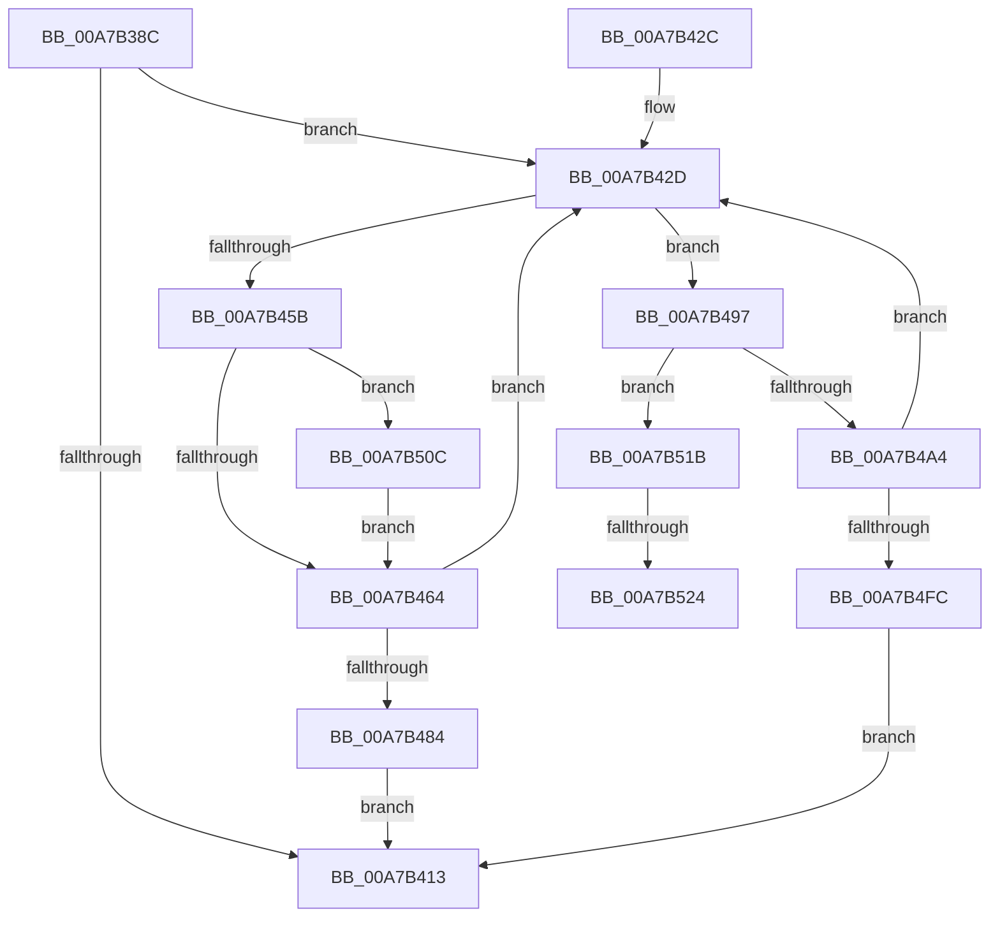

# ExpTranslateSymbolicLink

- RVA: `0x00A7B38C`–`0x00A7B534` (길이 `424` bytes)
- VA: `0x0000000140A7B38C`
- 실행 섹션: `PAGE`
- PDB 이름 있음: `예`; PDB Function 태그: `예`
- unwind 정보 RVA: `0x000B6600`
- 디코드: `114`개 명령, `424/424` bytes 표시
- 미해석 바이트: `0` (있으면 어셈블리에 `.byte`로 보존)

> 이 문서는 커널 이미지의 기계어와 PDB 기호를 분석해 생성했습니다. 4번과 5번은 함수 원형과 자료형을 바이너리 사용 방식에서 추정한 C 해석이며 원본 소스 복구 결과는 아닙니다.

## 1. Dependencies

- 직접 호출 지점: **10**; 고유 호출 대상: **6**
- 직접 호출자로 확인된 함수: **6**
- RIP 상대 이미지 참조: **0**

### Outgoing calls
- `0x00A7B3D7` → [RtlInitUnicodeString](../../text/42/RtlInitUnicodeString_function_0042A780.md) (function, `0x0042A780`)
- `0x00A7B40A` → [ZwOpenSymbolicLinkObject](../../text/6A/ZwOpenSymbolicLinkObject_function_006AF7F0.md) (function, `0x006AF7F0`)
- `0x00A7B44D` → [ZwQuerySymbolicLinkObject](../../text/6A/ZwQuerySymbolicLinkObject_function_006AFE50.md) (function, `0x006AFE50`)
- `0x00A7B477` → [ExAllocatePool2](../../poolcode/B8/ExAllocatePool2_function_00B820F0.md) (function, `0x00B820F0`)
- `0x00A7B488` → [ZwClose](../../text/6A/ZwClose_function_006AD2B0.md) (function, `0x006AD2B0`)
- `0x00A7B49B` → [ZwClose](../../text/6A/ZwClose_function_006AD2B0.md) (function, `0x006AD2B0`)
- `0x00A7B4BB` → [RtlInitUnicodeString](../../text/42/RtlInitUnicodeString_function_0042A780.md) (function, `0x0042A780`)
- `0x00A7B4EF` → [ZwOpenSymbolicLinkObject](../../text/6A/ZwOpenSymbolicLinkObject_function_006AF7F0.md) (function, `0x006AF7F0`)
- `0x00A7B511` → [ExFreePoolWithTag](../../poolcode/B8/ExFreePoolWithTag_function_00B82870.md) (function, `0x00B82870`)
- `0x00A7B529` → [ExFreePoolWithTag](../../poolcode/B8/ExFreePoolWithTag_function_00B82870.md) (function, `0x00B82870`)

### Direct callers
- [ExpConvertArcName](../7C/ExpConvertArcName_function_007CAF04.md) at `0x007CAFA1`
- [ExpConvertSignatureName](../7C/ExpConvertSignatureName_function_007CB0C8.md) at `0x007CB282`
- [ExpFindArcName](../7C/ExpFindArcName_function_007CB5CC.md) at `0x007CB7E2`
- [ExpTranslateNtPath](../7C/ExpTranslateNtPath_function_007CCEF4.md) at `0x007CCFAE`
- [ExpTranslateEfiPath](ExpTranslateEfiPath_function_00A7AF84.md) at `0x00A7B0B2`
- [sub_00B42460](../B4/Unknown_function_00B42460.md) at `0x00B424E3`

### Static image references
- 디코드된 RIP-relative 메모리 참조가 없습니다.

## 2. Other-region calls and transfers

- 다른 실행 섹션으로 향하는 call: **10**
  - `0x00A7B3D7` → [RtlInitUnicodeString](../../text/42/RtlInitUnicodeString_function_0042A780.md) (`PAGE` → `.text`)
  - `0x00A7B40A` → [ZwOpenSymbolicLinkObject](../../text/6A/ZwOpenSymbolicLinkObject_function_006AF7F0.md) (`PAGE` → `.text`)
  - `0x00A7B44D` → [ZwQuerySymbolicLinkObject](../../text/6A/ZwQuerySymbolicLinkObject_function_006AFE50.md) (`PAGE` → `.text`)
  - `0x00A7B477` → [ExAllocatePool2](../../poolcode/B8/ExAllocatePool2_function_00B820F0.md) (`PAGE` → `POOLCODE`)
  - `0x00A7B488` → [ZwClose](../../text/6A/ZwClose_function_006AD2B0.md) (`PAGE` → `.text`)
  - `0x00A7B49B` → [ZwClose](../../text/6A/ZwClose_function_006AD2B0.md) (`PAGE` → `.text`)
  - `0x00A7B4BB` → [RtlInitUnicodeString](../../text/42/RtlInitUnicodeString_function_0042A780.md) (`PAGE` → `.text`)
  - `0x00A7B4EF` → [ZwOpenSymbolicLinkObject](../../text/6A/ZwOpenSymbolicLinkObject_function_006AF7F0.md) (`PAGE` → `.text`)
  - `0x00A7B511` → [ExFreePoolWithTag](../../poolcode/B8/ExFreePoolWithTag_function_00B82870.md) (`PAGE` → `POOLCODE`)
  - `0x00A7B529` → [ExFreePoolWithTag](../../poolcode/B8/ExFreePoolWithTag_function_00B82870.md) (`PAGE` → `POOLCODE`)
- call이 아닌 외부 분기/꼬리 이동: **2**
  - `0x00A7B51E` → [sub_00B4268E](../B4/Unknown_function_00B4268E.md) (`tail-transfer`)
  - `0x00A7B52F` → [sub_00B4268E](../B4/Unknown_function_00B4268E.md) (`tail-transfer`)

## 3. Assembly (complete function range)

```asm
00A7B38C  48 89 5C 24 08                  mov qword ptr [rsp + 8], rbx
00A7B391  48 89 74 24 10                  mov qword ptr [rsp + 0x10], rsi
00A7B396  55                              push rbp
00A7B397  57                              push rdi
00A7B398  41 54                           push r12
00A7B39A  41 56                           push r14
00A7B39C  41 57                           push r15
00A7B39E  48 8B EC                        mov rbp, rsp
00A7B3A1  48 83 EC 70                     sub rsp, 0x70
00A7B3A5  45 33 FF                        xor r15d, r15d
00A7B3A8  4C 8B F2                        mov r14, rdx
00A7B3AB  0F 57 C0                        xorps xmm0, xmm0
00A7B3AE  44 89 7D B4                     mov dword ptr [rbp - 0x4c], r15d
00A7B3B2  48 8B D1                        mov rdx, rcx
00A7B3B5  44 89 7D 40                     mov dword ptr [rbp + 0x40], r15d
00A7B3B9  48 8D 4D C0                     lea rcx, [rbp - 0x40]
00A7B3BD  44 89 7D D4                     mov dword ptr [rbp - 0x2c], r15d
00A7B3C1  45 8D 67 02                     lea r12d, [r15 + 2]
00A7B3C5  44 89 7D EC                     mov dword ptr [rbp - 0x14], r15d
00A7B3C9  41 8B F4                        mov esi, r12d
00A7B3CC  4C 89 7D 48                     mov qword ptr [rbp + 0x48], r15
00A7B3D0  0F 11 45 C0                     movups xmmword ptr [rbp - 0x40], xmm0
00A7B3D4  41 8B DF                        mov ebx, r15d
00A7B3D7  E8 A4 F3 9A FF                  call 0x14042a780
00A7B3DC  48 8D 45 C0                     lea rax, [rbp - 0x40]
00A7B3E0  C7 45 D0 30 00 00 00            mov dword ptr [rbp - 0x30], 0x30
00A7B3E7  0F 57 C0                        xorps xmm0, xmm0
00A7B3EA  48 89 45 E0                     mov qword ptr [rbp - 0x20], rax
00A7B3EE  4C 8D 45 D0                     lea r8, [rbp - 0x30]
00A7B3F2  4C 89 7D D8                     mov qword ptr [rbp - 0x28], r15
00A7B3F6  41 8D 57 01                     lea edx, [r15 + 1]
00A7B3FA  C7 45 E8 40 02 00 00            mov dword ptr [rbp - 0x18], 0x240
00A7B401  48 8D 4D 48                     lea rcx, [rbp + 0x48]
00A7B405  F3 0F 7F 45 F0                  movdqu xmmword ptr [rbp - 0x10], xmm0
00A7B40A  E8 E1 43 C3 FF                  call 0x1406af7f0
00A7B40F  85 C0                           test eax, eax
00A7B411  79 1A                           jns 0x140a7b42d
00A7B413  4C 8D 5C 24 70                  lea r11, [rsp + 0x70]
00A7B418  49 8B 5B 30                     mov rbx, qword ptr [r11 + 0x30]
00A7B41C  49 8B 73 38                     mov rsi, qword ptr [r11 + 0x38]
00A7B420  49 8B E3                        mov rsp, r11
00A7B423  41 5F                           pop r15
00A7B425  41 5E                           pop r14
00A7B427  41 5C                           pop r12
00A7B429  5F                              pop rdi
00A7B42A  5D                              pop rbp
00A7B42B  C3                              ret
00A7B42C  CC                              int3
00A7B42D  48 8B 4D 48                     mov rcx, qword ptr [rbp + 0x48]
00A7B431  4C 8D 45 40                     lea r8, [rbp + 0x40]
00A7B435  0F B7 C6                        movzx eax, si
00A7B438  66 44 89 7D B0                  mov word ptr [rbp - 0x50], r15w
00A7B43D  66 41 2B C4                     sub ax, r12w
00A7B441  48 89 5D B8                     mov qword ptr [rbp - 0x48], rbx
00A7B445  48 8D 55 B0                     lea rdx, [rbp - 0x50]
00A7B449  66 89 45 B2                     mov word ptr [rbp - 0x4e], ax
00A7B44D  E8 FE 49 C3 FF                  call 0x1406afe50
00A7B452  8B F8                           mov edi, eax
00A7B454  3D 23 00 00 C0                  cmp eax, 0xc0000023
00A7B459  75 3C                           jne 0x140a7b497
00A7B45B  48 85 DB                        test rbx, rbx
00A7B45E  0F 85 A8 00 00 00               jne 0x140a7b50c
00A7B464  8B 75 40                        mov esi, dword ptr [rbp + 0x40]
00A7B467  B9 40 00 00 00                  mov ecx, 0x40
00A7B46C  41 03 F4                        add esi, r12d
00A7B46F  41 B8 45 6E 76 72               mov r8d, 0x72766e45
00A7B475  8B D6                           mov edx, esi
00A7B477  E8 74 6C 10 00                  call 0x140b820f0
00A7B47C  48 8B D8                        mov rbx, rax
00A7B47F  48 85 C0                        test rax, rax
00A7B482  75 A9                           jne 0x140a7b42d
00A7B484  48 8B 4D 48                     mov rcx, qword ptr [rbp + 0x48]
00A7B488  E8 23 1E C3 FF                  call 0x1406ad2b0
00A7B48D  B8 9A 00 00 C0                  mov eax, 0xc000009a
00A7B492  E9 7C FF FF FF                  jmp 0x140a7b413
00A7B497  48 8B 4D 48                     mov rcx, qword ptr [rbp + 0x48]
00A7B49B  E8 10 1E C3 FF                  call 0x1406ad2b0
00A7B4A0  85 FF                           test edi, edi
00A7B4A2  78 77                           js 0x140a7b51b
00A7B4A4  0F B7 45 B0                     movzx eax, word ptr [rbp - 0x50]
00A7B4A8  48 8D 4D C0                     lea rcx, [rbp - 0x40]
00A7B4AC  48 D1 E8                        shr rax, 1
00A7B4AF  48 8B D3                        mov rdx, rbx
00A7B4B2  66 44 89 3C 43                  mov word ptr [rbx + rax*2], r15w
00A7B4B7  66 89 75 B2                     mov word ptr [rbp - 0x4e], si
00A7B4BB  E8 C0 F2 9A FF                  call 0x14042a780
00A7B4C0  48 8D 45 C0                     lea rax, [rbp - 0x40]
00A7B4C4  C7 45 D0 30 00 00 00            mov dword ptr [rbp - 0x30], 0x30
00A7B4CB  0F 57 C0                        xorps xmm0, xmm0
00A7B4CE  48 89 45 E0                     mov qword ptr [rbp - 0x20], rax
00A7B4D2  4C 8D 45 D0                     lea r8, [rbp - 0x30]
00A7B4D6  4C 89 7D D8                     mov qword ptr [rbp - 0x28], r15
00A7B4DA  BA 01 00 00 00                  mov edx, 1
00A7B4DF  C7 45 E8 40 02 00 00            mov dword ptr [rbp - 0x18], 0x240
00A7B4E6  48 8D 4D 48                     lea rcx, [rbp + 0x48]
00A7B4EA  F3 0F 7F 45 F0                  movdqu xmmword ptr [rbp - 0x10], xmm0
00A7B4EF  E8 FC 42 C3 FF                  call 0x1406af7f0
00A7B4F4  85 C0                           test eax, eax
00A7B4F6  0F 89 31 FF FF FF               jns 0x140a7b42d
00A7B4FC  0F 10 45 B0                     movups xmm0, xmmword ptr [rbp - 0x50]
00A7B500  33 C0                           xor eax, eax
00A7B502  F3 41 0F 7F 06                  movdqu xmmword ptr [r14], xmm0
00A7B507  E9 07 FF FF FF                  jmp 0x140a7b413
00A7B50C  33 D2                           xor edx, edx
00A7B50E  48 8B CB                        mov rcx, rbx
00A7B511  E8 5A 73 10 00                  call 0x140b82870
00A7B516  E9 49 FF FF FF                  jmp 0x140a7b464
00A7B51B  48 85 DB                        test rbx, rbx
00A7B51E  0F 84 6A 71 0C 00               je 0x140b4268e
00A7B524  33 D2                           xor edx, edx
00A7B526  48 8B CB                        mov rcx, rbx
00A7B529  E8 42 73 10 00                  call 0x140b82870
00A7B52E  90                              nop
00A7B52F  E9 5A 71 0C 00                  jmp 0x140b4268e
```

## 4. C-style interpretation (structured pseudocode)

```c
__int64 __fastcall ExpTranslateSymbolicLink(__int64 a1, __int64 a2)
{
    __int64 result;
    __int64 v_r15;
    __int64 v_rsi;
    __int64 v_rsp;
    unsigned __int64 v_stack_m28;
    unsigned __int64 v_stack_m38;
    unsigned int v_stack_m3C;
    unsigned int v_stack_m40;
    unsigned __int64 v_stack_m48;
    unsigned __int64 v_stack_m50;
    unsigned int v_stack_m54;
    unsigned int v_stack_m58;
    unsigned __int64 v_stack_m68;
    unsigned __int64 v_stack_m70;
    unsigned int v_stack_m74;
    unsigned __int16 v_stack_m76;
    unsigned __int16 v_stack_m78;
    unsigned __int64 v_stack_p10;
    unsigned int v_stack_p18;
    unsigned __int64 v_stack_p20;
    unsigned __int64 v_stack_p8;

    v_stack_p8 = v_rbx;
    v_stack_p10 = v_rsi;
    v_rsp = (v_rsp) - (112);
    v_r15 = 0;
    v_stack_m74 = 0;
    v_stack_p18 = 0;
    v_stack_m54 = 0;
    v_stack_m3C = 0;
    v_stack_p20 = 0;
    v_stack_m68 = v_xmm0;
    result = RtlInitUnicodeString(v_stack_m68, a1, a3, a4);
    v_stack_m58 = 48;
    v_stack_m48 = v_stack_m68;
    v_stack_m50 = 0;
    v_stack_m40 = 576;
    v_stack_m38 = v_xmm0;
    result = ZwOpenSymbolicLinkObject(v_stack_p20, v_r15 + 1, v_stack_m58, a4);
    if (!sign_flag) goto loc_00A7B42D;
loc_00A7B413:
    return result;
loc_00A7B42D:
    v_stack_m78 = 0;
    result = (unsigned __int16)(((unsigned __int16)(*(unsigned __int64 *)(v_stack_m28 + 56))) - ((unsigned __int16)(v_r15 + 2)));
    v_stack_m70 = *(unsigned __int64 *)(v_stack_m28 + 48);
    v_stack_m76 = (unsigned __int16)(result);
    result = ZwQuerySymbolicLinkObject(v_stack_p20, v_stack_m78, v_stack_p18, a4);
    if (((unsigned int)(result)) != 0xC0000023ULL) goto loc_00A7B497;
    if (*(unsigned __int64 *)(v_stack_m28 + 48) != 0) goto loc_00A7B50C;
loc_00A7B464:
    v_rsi = (unsigned int)(((unsigned int)(v_stack_p18)) + ((unsigned int)(v_r15 + 2)));
    result = ExAllocatePool2(64, (unsigned int)((unsigned int)(v_rsi)), (unsigned int)(0x72766E45ULL), a4);
    if (result != 0) goto loc_00A7B42D;
    result = ZwClose(v_stack_p20, (unsigned int)((unsigned int)(v_rsi)), (unsigned int)(0x72766E45ULL), a4);
    goto loc_00A7B413;
loc_00A7B497:
    result = ZwClose(v_stack_p20, (unsigned int)((unsigned int)(v_rsi)), (unsigned int)(0x72766E45ULL), a4);
    if (sign_flag) goto loc_00A7B51B;
    result = (v_stack_m78) >> (1);
    *(unsigned __int16 *)(result + result * 2) = 0;
    v_stack_m76 = (unsigned __int16)(v_rsi);
    result = RtlInitUnicodeString(v_stack_m68, result, (unsigned int)(0x72766E45ULL), a4);
    v_stack_m58 = 48;
    v_stack_m48 = v_stack_m68;
    v_stack_m50 = 0;
    v_stack_m40 = 576;
    v_stack_m38 = v_xmm0;
    result = ZwOpenSymbolicLinkObject(v_stack_p20, 1, v_stack_m58, a4);
    if (!sign_flag) goto loc_00A7B42D;
    result = 0;
    *(unsigned __int64 *)(a2) = v_xmm0;
    goto loc_00A7B413;
loc_00A7B50C:
    a2 = 0;
    result = ExFreePoolWithTag(0, a2, v_stack_m58, a4);
    goto loc_00A7B464;
loc_00A7B51B:
    a2 = 0;
    result = ExFreePoolWithTag(result, a2, v_stack_m58, a4);
}
```

## 5. (Beta) C Style

```c
int64_t ExpTranslateSymbolicLink(int64_t Arg1, void *Arg2)
{
    uint8_t *arg2 = (uint8_t *)Arg2;

    int64_t result;
    int64_t local_r15;
    int64_t local_rsi;
    int64_t local_rsp;
    uint64_t v_stack_m28;
    uint64_t v_stack_m38;
    uint32_t v_stack_m3C;
    uint32_t v_stack_m40;
    uint64_t v_stack_m48;
    uint64_t v_stack_m50;
    uint32_t v_stack_m54;
    uint32_t v_stack_m58;
    uint64_t v_stack_m68;
    uint64_t v_stack_m70;
    uint32_t v_stack_m74;
    uint16_t v_stack_m76;
    uint16_t v_stack_m78;
    uint64_t v_stack_p10;
    uint32_t v_stack_p18;
    uint64_t v_stack_p20;
    uint64_t v_stack_p8;

    v_stack_p8 = local_rbx;
    v_stack_p10 = local_rsi;
    local_rsp = (local_rsp) - (112);
    local_r15 = 0;
    v_stack_m74 = 0;
    v_stack_p18 = 0;
    v_stack_m54 = 0;
    v_stack_m3C = 0;
    v_stack_p20 = 0;
    v_stack_m68 = v_xmm0;
    result = RtlInitUnicodeString(v_stack_m68, Arg1, a3, a4);
    v_stack_m58 = 48;
    v_stack_m48 = v_stack_m68;
    v_stack_m50 = 0;
    v_stack_m40 = 576;
    v_stack_m38 = v_xmm0;
    result = ZwOpenSymbolicLinkObject(v_stack_p20, local_r15 + 1, v_stack_m58, a4);
    if (!sign_flag) goto loc_00A7B42D;
loc_00A7B413:
    return result;
loc_00A7B42D:
    v_stack_m78 = 0;
    result = (uint16_t)(((uint16_t)(*(uint64_t *)(v_stack_m28 + 0x38))) - ((uint16_t)(local_r15 + 2)));
    v_stack_m70 = *(uint64_t *)(v_stack_m28 + 0x30);
    v_stack_m76 = (uint16_t)(result);
    result = ZwQuerySymbolicLinkObject(v_stack_p20, v_stack_m78, v_stack_p18, a4);
    if (((uint32_t)(result)) != 0xC0000023ULL) goto loc_00A7B497;
    if (*(uint64_t *)(v_stack_m28 + 0x30) != 0) goto loc_00A7B50C;
loc_00A7B464:
    local_rsi = (uint32_t)(((uint32_t)(v_stack_p18)) + ((uint32_t)(local_r15 + 2)));
    result = ExAllocatePool2(64, (uint32_t)((uint32_t)(local_rsi)), (uint32_t)(0x72766E45ULL), a4);
    if (result != 0) goto loc_00A7B42D;
    result = ZwClose(v_stack_p20, (uint32_t)((uint32_t)(local_rsi)), (uint32_t)(0x72766E45ULL), a4);
    goto loc_00A7B413;
loc_00A7B497:
    result = ZwClose(v_stack_p20, (uint32_t)((uint32_t)(local_rsi)), (uint32_t)(0x72766E45ULL), a4);
    if (sign_flag) goto loc_00A7B51B;
    result = (v_stack_m78) >> (1);
    *(uint16_t *)(result + result * 2) = 0;
    v_stack_m76 = (uint16_t)(local_rsi);
    result = RtlInitUnicodeString(v_stack_m68, result, (uint32_t)(0x72766E45ULL), a4);
    v_stack_m58 = 48;
    v_stack_m48 = v_stack_m68;
    v_stack_m50 = 0;
    v_stack_m40 = 576;
    v_stack_m38 = v_xmm0;
    result = ZwOpenSymbolicLinkObject(v_stack_p20, 1, v_stack_m58, a4);
    if (!sign_flag) goto loc_00A7B42D;
    result = 0;
    *(uint64_t *)(arg2) = v_xmm0;
    goto loc_00A7B413;
loc_00A7B50C:
    Arg2 = 0;
    result = ExFreePoolWithTag(0, Arg2, v_stack_m58, a4);
    goto loc_00A7B464;
loc_00A7B51B:
    Arg2 = 0;
    result = ExFreePoolWithTag(result, Arg2, v_stack_m58, a4);
}
```

### 관측된 메모리 오프셋

구조체 형식이 확인되지 않은 접근은 인자 기준의 오프셋으로만 기록했습니다.

| 기준 인자 | 오프셋 표현 | 폭 (bit) | 접근 |
|---|---:|---:|---|
| `Arg2` | `+ 0x0` | `128` | `W` |

## 6. Execution-region graph

[열기: 2D/3D 그래프와 함수 탐색 컨트롤 패널](../../../control-panel.html?section=page&rva=0x00A7B38C&view=graph)

- 2D 그래프는 위에서 아래로 흐르고, 3D 그래프는 빈 공간을 드래그해 회전합니다. Shift+드래그는 이동, 휠은 확대·축소, 함수 노드 선택은 대상 보고서 이동입니다.

### Static fallback


