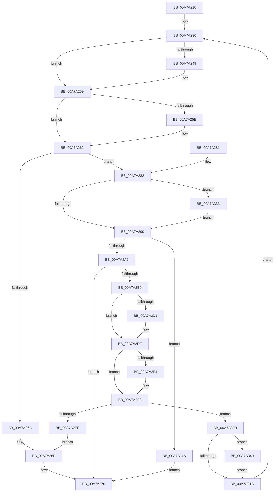

# ExpWnfAcquirePermanentDataStoreHandle

- RVA: `0x00A7A210`–`0x00A7A354` (길이 `324` bytes)
- VA: `0x0000000140A7A210`
- 실행 섹션: `PAGE`
- PDB 이름 있음: `예`; PDB Function 태그: `아니요`
- unwind 정보 RVA: `0x000B6324`
- 디코드: `96`개 명령, `324/324` bytes 표시
- 미해석 바이트: `0` (있으면 어셈블리에 `.byte`로 보존)

> 이 문서는 커널 이미지의 기계어와 PDB 기호를 분석해 생성했습니다. 4번과 5번은 함수 원형과 자료형을 바이너리 사용 방식에서 추정한 C 해석이며 원본 소스 복구 결과는 아닙니다.

## 1. Dependencies

- 직접 호출 지점: **10**; 고유 호출 대상: **8**
- 직접 호출자로 확인된 함수: **3**
- RIP 상대 이미지 참조: **0**

### Outgoing calls
- `0x00A7A238` → [KeAbPreAcquire](../../text/21/KeAbPreAcquire_function_00210230.md) (function, `0x00210230`)
- `0x00A7A254` → [ExfAcquirePushLockSharedEx](../../text/21/ExfAcquirePushLockSharedEx_function_0021044C.md) (function, `0x0021044C`)
- `0x00A7A293` → [KeAbPostRelease](../../text/2E/KeAbPostRelease_function_002E1600.md) (function, `0x002E1600`)
- `0x00A7A2B0` → [ExpWnfGetPermanentPerUserDataStoreHandle](ExpWnfGetPermanentPerUserDataStoreHandle_function_00A7A35C.md) (function, `0x00A7A35C`)
- `0x00A7A2C1` → [KeAbPreAcquire](../../text/21/KeAbPreAcquire_function_00210230.md) (function, `0x00210230`)
- `0x00A7A2DA` → [ExfAcquirePushLockExclusiveEx](../../text/20/ExfAcquirePushLockExclusiveEx_function_0020FC90.md) (function, `0x0020FC90`)
- `0x00A7A31F` → [KeAbPostRelease](../../text/2E/KeAbPostRelease_function_002E1600.md) (function, `0x002E1600`)
- `0x00A7A329` → [ZwClose](../../text/6A/ZwClose_function_006AD2B0.md) (function, `0x006AD2B0`)
- `0x00A7A336` → [ExfReleasePushLockShared](../../text/26/ExfReleasePushLockShared_function_00263440.md) (function, `0x00263440`)
- `0x00A7A343` → [ExfTryToWakePushLock](../../text/26/ExfTryToWakePushLock_function_00265DD0.md) (function, `0x00265DD0`)

### Direct callers
- [ExpWnfDeletePermanentStateData](../7D/ExpWnfDeletePermanentStateData_function_007D6254.md) at `0x007D62F4`
- [ExpWnfPopulateStateData](../8B/ExpWnfPopulateStateData_function_008BF354.md) at `0x008BF43B`
- [ExpWnfWriteStateData](../90/ExpWnfWriteStateData_function_0090B7B0.md) at `0x0090BA07`

### Static image references
- 디코드된 RIP-relative 메모리 참조가 없습니다.

## 2. Other-region calls and transfers

- 다른 실행 섹션으로 향하는 call: **9**
  - `0x00A7A238` → [KeAbPreAcquire](../../text/21/KeAbPreAcquire_function_00210230.md) (`PAGE` → `.text`)
  - `0x00A7A254` → [ExfAcquirePushLockSharedEx](../../text/21/ExfAcquirePushLockSharedEx_function_0021044C.md) (`PAGE` → `.text`)
  - `0x00A7A293` → [KeAbPostRelease](../../text/2E/KeAbPostRelease_function_002E1600.md) (`PAGE` → `.text`)
  - `0x00A7A2C1` → [KeAbPreAcquire](../../text/21/KeAbPreAcquire_function_00210230.md) (`PAGE` → `.text`)
  - `0x00A7A2DA` → [ExfAcquirePushLockExclusiveEx](../../text/20/ExfAcquirePushLockExclusiveEx_function_0020FC90.md) (`PAGE` → `.text`)
  - `0x00A7A31F` → [KeAbPostRelease](../../text/2E/KeAbPostRelease_function_002E1600.md) (`PAGE` → `.text`)
  - `0x00A7A329` → [ZwClose](../../text/6A/ZwClose_function_006AD2B0.md) (`PAGE` → `.text`)
  - `0x00A7A336` → [ExfReleasePushLockShared](../../text/26/ExfReleasePushLockShared_function_00263440.md) (`PAGE` → `.text`)
  - `0x00A7A343` → [ExfTryToWakePushLock](../../text/26/ExfTryToWakePushLock_function_00265DD0.md) (`PAGE` → `.text`)
- 별도 외부 분기/꼬리 이동을 확인하지 못했습니다.

## 3. Assembly (complete function range)

```asm
00A7A210  48 89 5C 24 10                  mov qword ptr [rsp + 0x10], rbx
00A7A215  55                              push rbp
00A7A216  56                              push rsi
00A7A217  57                              push rdi
00A7A218  41 56                           push r14
00A7A21A  41 57                           push r15
00A7A21C  48 83 EC 20                     sub rsp, 0x20
00A7A220  33 ED                           xor ebp, ebp
00A7A222  48 8D 59 08                     lea rbx, [rcx + 8]
00A7A226  4C 8B F2                        mov r14, rdx
00A7A229  48 8B F9                        mov rdi, rcx
00A7A22C  44 8D 7D 11                     lea r15d, [rbp + 0x11]
00A7A230  45 33 C0                        xor r8d, r8d
00A7A233  33 D2                           xor edx, edx
00A7A235  48 8B CB                        mov rcx, rbx
00A7A238  E8 F3 5F 79 FF                  call 0x140210230
00A7A23D  48 8B F0                        mov rsi, rax
00A7A240  33 C0                           xor eax, eax
00A7A242  F0 4C 0F B1 3B                  lock cmpxchg qword ptr [rbx], r15
00A7A247  74 10                           je 0x140a7a259
00A7A249  4C 8B CB                        mov r9, rbx
00A7A24C  4C 8B C6                        mov r8, rsi
00A7A24F  33 D2                           xor edx, edx
00A7A251  48 8B CB                        mov rcx, rbx
00A7A254  E8 F3 61 79 FF                  call 0x14021044c
00A7A259  48 85 F6                        test rsi, rsi
00A7A25C  74 04                           je 0x140a7a262
00A7A25E  C6 46 0A 01                     mov byte ptr [rsi + 0xa], 1
00A7A262  48 8B 47 10                     mov rax, qword ptr [rdi + 0x10]
00A7A266  48 85 C0                        test rax, rax
00A7A269  74 17                           je 0x140a7a282
00A7A26B  49 89 06                        mov qword ptr [r14], rax
00A7A26E  33 C0                           xor eax, eax
00A7A270  48 8B 5C 24 58                  mov rbx, qword ptr [rsp + 0x58]
00A7A275  48 83 C4 20                     add rsp, 0x20
00A7A279  41 5F                           pop r15
00A7A27B  41 5E                           pop r14
00A7A27D  5F                              pop rdi
00A7A27E  5E                              pop rsi
00A7A27F  5D                              pop rbp
00A7A280  C3                              ret
00A7A281  CC                              int3
00A7A282  49 8B C7                        mov rax, r15
00A7A285  F0 48 0F B1 2B                  lock cmpxchg qword ptr [rbx], rbp
00A7A28A  0F 85 A3 00 00 00               jne 0x140a7a333
00A7A290  48 8B CB                        mov rcx, rbx
00A7A293  E8 68 73 86 FF                  call 0x1402e1600
00A7A298  83 7F 28 02                     cmp dword ptr [rdi + 0x28], 2
00A7A29C  0F 85 A8 00 00 00               jne 0x140a7a34a
00A7A2A2  48 8D 4F 30                     lea rcx, [rdi + 0x30]
00A7A2A6  48 89 6C 24 50                  mov qword ptr [rsp + 0x50], rbp
00A7A2AB  48 8D 54 24 50                  lea rdx, [rsp + 0x50]
00A7A2B0  E8 A7 00 00 00                  call 0x140a7a35c
00A7A2B5  85 C0                           test eax, eax
00A7A2B7  78 B7                           js 0x140a7a270
00A7A2B9  45 33 C0                        xor r8d, r8d
00A7A2BC  33 D2                           xor edx, edx
00A7A2BE  48 8B CB                        mov rcx, rbx
00A7A2C1  E8 6A 5F 79 FF                  call 0x140210230
00A7A2C6  F0 48 0F BA 2B 00               lock bts qword ptr [rbx], 0
00A7A2CC  48 8B F0                        mov rsi, rax
00A7A2CF  73 0E                           jae 0x140a7a2df
00A7A2D1  4C 8B C3                        mov r8, rbx
00A7A2D4  48 8B D0                        mov rdx, rax
00A7A2D7  48 8B CB                        mov rcx, rbx
00A7A2DA  E8 B1 59 79 FF                  call 0x14020fc90
00A7A2DF  48 85 F6                        test rsi, rsi
00A7A2E2  74 04                           je 0x140a7a2e8
00A7A2E4  C6 46 0A 01                     mov byte ptr [rsi + 0xa], 1
00A7A2E8  48 39 6F 10                     cmp qword ptr [rdi + 0x10], rbp
00A7A2EC  75 1F                           jne 0x140a7a30d
00A7A2EE  48 8B 4C 24 50                  mov rcx, qword ptr [rsp + 0x50]
00A7A2F3  B8 01 00 00 00                  mov eax, 1
00A7A2F8  48 89 4F 10                     mov qword ptr [rdi + 0x10], rcx
00A7A2FC  F0 4C 0F B1 3B                  lock cmpxchg qword ptr [rbx], r15
00A7A301  48 8B 4F 10                     mov rcx, qword ptr [rdi + 0x10]
00A7A305  49 89 0E                        mov qword ptr [r14], rcx
00A7A308  E9 61 FF FF FF                  jmp 0x140a7a26e
00A7A30D  48 83 C8 FF                     or rax, 0xffffffffffffffff
00A7A311  F0 48 0F C1 03                  lock xadd qword ptr [rbx], rax
00A7A316  24 06                           and al, 6
00A7A318  3C 02                           cmp al, 2
00A7A31A  74 24                           je 0x140a7a340
00A7A31C  48 8B CB                        mov rcx, rbx
00A7A31F  E8 DC 72 86 FF                  call 0x1402e1600
00A7A324  48 8B 4C 24 50                  mov rcx, qword ptr [rsp + 0x50]
00A7A329  E8 82 2F C3 FF                  call 0x1406ad2b0
00A7A32E  E9 FD FE FF FF                  jmp 0x140a7a230
00A7A333  48 8B CB                        mov rcx, rbx
00A7A336  E8 05 91 7E FF                  call 0x140263440
00A7A33B  E9 50 FF FF FF                  jmp 0x140a7a290
00A7A340  48 8B CB                        mov rcx, rbx
00A7A343  E8 88 BA 7E FF                  call 0x140265dd0
00A7A348  EB D2                           jmp 0x140a7a31c
00A7A34A  B8 34 00 00 C0                  mov eax, 0xc0000034
00A7A34F  E9 1C FF FF FF                  jmp 0x140a7a270
```

## 4. C-style interpretation (structured pseudocode)

```c
__int64 __fastcall ExpWnfAcquirePermanentDataStoreHandle(__int64 a1, __int64 a2, int a3)
{
    __int64 result;
    __int64 v_rbp;
    __int64 v_rsp;
    unsigned __int64 v_stack_p10;
    unsigned __int64 v_stack_p50;

    v_stack_p10 = v_rbx;
    v_rsp = (v_rsp) - (32);
    v_rbp = 0;
loc_00A7A230:
    a3 = 0;
    a2 = 0;
    result = KeAbPreAcquire(a1 + 8, a2, a3, a4);
    result = 0;
    if (!(condition_is_equal)) {
        a4 = a1 + 8;
        a3 = 0;
        a2 = 0;
        a1 = a1 + 8;
        result = ExfAcquirePushLockSharedEx(a1, a2, a3, a4);
    }
    if (result != 0) {
        *(unsigned __int8 *)(result + 10) = 1;
    }
    if (*(unsigned __int64 *)(a1 + 16) == 0) goto loc_00A7A282;
    *(unsigned __int64 *)(a2) = *(unsigned __int64 *)(a1 + 16);
loc_00A7A26E:
    result = 0;
loc_00A7A270:
    v_rsp = (v_rsp) + (32);
    return result;
loc_00A7A282:
    if (condition_is_not_equal) goto loc_00A7A333;
loc_00A7A290:
    result = KeAbPostRelease(v_stack_p10, a2, a3, a4);
    if ((*(unsigned int *)(a1 + 40)) != 2) goto loc_00A7A34A;
    v_stack_p50 = 0;
    result = ExpWnfGetPermanentPerUserDataStoreHandle(a1 + 48, v_stack_p50, a3, a4);
    if (sign_flag) goto loc_00A7A270;
    a3 = 0;
    a2 = 0;
    result = KeAbPreAcquire(v_stack_p10, a2, a3, a4);
    if (!(condition_is_above_or_equal)) {
        a3 = v_stack_p10;
        a2 = result;
        a1 = v_stack_p10;
        result = ExfAcquirePushLockExclusiveEx(a1, a2, a3, a4);
    }
    if (result != 0) {
        *(unsigned __int8 *)(result + 10) = 1;
    }
    if ((*(unsigned __int64 *)(a1 + 16)) != 0) goto loc_00A7A30D;
    *(unsigned __int64 *)(a1 + 16) = v_stack_p50;
    *(unsigned __int64 *)(a2) = *(unsigned __int64 *)(a1 + 16);
    goto loc_00A7A26E;
loc_00A7A30D:
    result = (1) | (-1);
    result = (unsigned __int8)((result) & (6));
    if (((unsigned __int8)(result)) == 2) goto loc_00A7A340;
loc_00A7A31C:
    result = KeAbPostRelease(v_stack_p10, a2, a3, a4);
    result = ZwClose(v_stack_p50, a2, a3, a4);
    goto loc_00A7A230;
loc_00A7A333:
    result = ExfReleasePushLockShared(v_stack_p10, a2, a3, a4);
    goto loc_00A7A290;
loc_00A7A340:
    result = ExfTryToWakePushLock(v_stack_p10, a2, a3, a4);
    goto loc_00A7A31C;
loc_00A7A34A:
    goto loc_00A7A270;
}
```

## 5. (Beta) C Style

```c
int64_t ExpWnfAcquirePermanentDataStoreHandle(void *Arg1, void *Arg2, int32_t Arg3)
{
    uint8_t *arg1 = (uint8_t *)Arg1;
    uint8_t *arg2 = (uint8_t *)Arg2;

    int64_t result;
    int64_t local_rbp;
    int64_t local_rsp;
    uint64_t v_stack_p10;
    uint64_t v_stack_p50;

    v_stack_p10 = local_rbx;
    local_rsp = (local_rsp) - (32);
    local_rbp = 0;
loc_00A7A230:
    Arg3 = 0;
    Arg2 = 0;
    result = KeAbPreAcquire(Arg1 + 8, Arg2, Arg3, a4);
    result = 0;
    if (!(condition_is_equal)) {
        a4 = Arg1 + 8;
        Arg3 = 0;
        Arg2 = 0;
        Arg1 = Arg1 + 8;
        result = ExfAcquirePushLockSharedEx(Arg1, Arg2, Arg3, a4);
    }
    if (result != 0) {
        *(uint8_t *)(result + 0xA) = 1;
    }
    if (*(uint64_t *)(arg1 + 0x10) == 0) goto loc_00A7A282;
    *(uint64_t *)(arg2) = *(uint64_t *)(arg1 + 0x10);
loc_00A7A26E:
    result = 0;
loc_00A7A270:
    local_rsp = (local_rsp) + (32);
    return result;
loc_00A7A282:
    if (condition_is_not_equal) goto loc_00A7A333;
loc_00A7A290:
    result = KeAbPostRelease(v_stack_p10, Arg2, Arg3, a4);
    if ((*(uint32_t *)(arg1 + 0x28)) != 2) goto loc_00A7A34A;
    v_stack_p50 = 0;
    result = ExpWnfGetPermanentPerUserDataStoreHandle(Arg1 + 48, v_stack_p50, Arg3, a4);
    if (sign_flag) goto loc_00A7A270;
    Arg3 = 0;
    Arg2 = 0;
    result = KeAbPreAcquire(v_stack_p10, Arg2, Arg3, a4);
    if (!(condition_is_above_or_equal)) {
        Arg3 = v_stack_p10;
        Arg2 = result;
        Arg1 = v_stack_p10;
        result = ExfAcquirePushLockExclusiveEx(Arg1, Arg2, Arg3, a4);
    }
    if (result != 0) {
        *(uint8_t *)(result + 0xA) = 1;
    }
    if ((*(uint64_t *)(arg1 + 0x10)) != 0) goto loc_00A7A30D;
    *(uint64_t *)(arg1 + 0x10) = v_stack_p50;
    *(uint64_t *)(arg2) = *(uint64_t *)(arg1 + 0x10);
    goto loc_00A7A26E;
loc_00A7A30D:
    result = (1) | (-1);
    result = (uint8_t)((result) & (6));
    if (((uint8_t)(result)) == 2) goto loc_00A7A340;
loc_00A7A31C:
    result = KeAbPostRelease(v_stack_p10, Arg2, Arg3, a4);
    result = ZwClose(v_stack_p50, Arg2, Arg3, a4);
    goto loc_00A7A230;
loc_00A7A333:
    result = ExfReleasePushLockShared(v_stack_p10, Arg2, Arg3, a4);
    goto loc_00A7A290;
loc_00A7A340:
    result = ExfTryToWakePushLock(v_stack_p10, Arg2, Arg3, a4);
    goto loc_00A7A31C;
loc_00A7A34A:
    goto loc_00A7A270;
}
```

### 관측된 메모리 오프셋

구조체 형식이 확인되지 않은 접근은 인자 기준의 오프셋으로만 기록했습니다.

| 기준 인자 | 오프셋 표현 | 폭 (bit) | 접근 |
|---|---:|---:|---|
| `Arg1` | `+ 0x0` | `64` | `R` |
| `Arg1` | `+ 0x0` | `64` | `R/W` |
| `Arg1` | `+ 0x8` | `64` | `R` |
| `Arg1` | `+ 0x10` | `64` | `R` |
| `Arg1` | `+ 0x10` | `64` | `W` |
| `Arg1` | `+ 0x28` | `32` | `R` |
| `Arg1` | `+ 0x30` | `64` | `R` |
| `Arg2` | `+ 0x0` | `64` | `W` |

## 6. Execution-region graph

[열기: 2D/3D 그래프와 함수 탐색 컨트롤 패널](../../../control-panel.html?section=page&rva=0x00A7A210&view=graph)

- 2D 그래프는 위에서 아래로 흐르고, 3D 그래프는 빈 공간을 드래그해 회전합니다. Shift+드래그는 이동, 휠은 확대·축소, 함수 노드 선택은 대상 보고서 이동입니다.

### Static fallback


