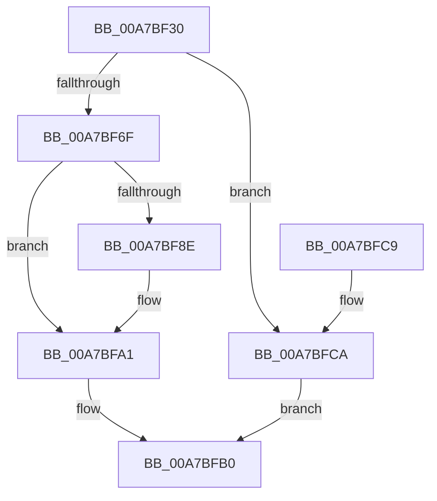

# ExpWnfAllocateScopeInstance

- RVA: `0x00A7BF30`–`0x00A7BFD1` (길이 `161` bytes)
- VA: `0x0000000140A7BF30`
- 실행 섹션: `PAGE`
- PDB 이름 있음: `예`; PDB Function 태그: `아니요`
- unwind 정보 RVA: `0x00075210`
- 디코드: `47`개 명령, `161/161` bytes 표시
- 미해석 바이트: `0` (있으면 어셈블리에 `.byte`로 보존)

> 이 문서는 커널 이미지의 기계어와 PDB 기호를 분석해 생성했습니다. 4번과 5번은 함수 원형과 자료형을 바이너리 사용 방식에서 추정한 C 해석이며 원본 소스 복구 결과는 아닙니다.

## 1. Dependencies

- 직접 호출 지점: **3**; 고유 호출 대상: **3**
- 직접 호출자로 확인된 함수: **1**
- RIP 상대 이미지 참조: **0**

### Outgoing calls
- `0x00A7BF62` → [ExAllocatePool2](../../poolcode/B8/ExAllocatePool2_function_00B820F0.md) (function, `0x00B820F0`)
- `0x00A7BF78` → [memset](../../text/6C/memset_function_006C6C40.md) (function, `0x006C6C40`)
- `0x00A7BF9C` → [memcpy](../../text/6C/memcpy_function_006C6840.md) (function, `0x006C6840`)

### Direct callers
- [sub_0090B43E](../90/Unknown_function_0090B43E.md) at `0x0090B529`

### Static image references
- 디코드된 RIP-relative 메모리 참조가 없습니다.

## 2. Other-region calls and transfers

- 다른 실행 섹션으로 향하는 call: **3**
  - `0x00A7BF62` → [ExAllocatePool2](../../poolcode/B8/ExAllocatePool2_function_00B820F0.md) (`PAGE` → `POOLCODE`)
  - `0x00A7BF78` → [memset](../../text/6C/memset_function_006C6C40.md) (`PAGE` → `.text`)
  - `0x00A7BF9C` → [memcpy](../../text/6C/memcpy_function_006C6840.md) (`PAGE` → `.text`)
- 별도 외부 분기/꼬리 이동을 확인하지 못했습니다.

## 3. Assembly (complete function range)

```asm
00A7BF30  48 89 5C 24 08                  mov qword ptr [rsp + 8], rbx
00A7BF35  48 89 6C 24 10                  mov qword ptr [rsp + 0x10], rbp
00A7BF3A  48 89 74 24 18                  mov qword ptr [rsp + 0x18], rsi
00A7BF3F  57                              push rdi
00A7BF40  41 56                           push r14
00A7BF42  41 57                           push r15
00A7BF44  48 83 EC 20                     sub rsp, 0x20
00A7BF48  41 8B F9                        mov edi, r9d
00A7BF4B  49 8B E8                        mov rbp, r8
00A7BF4E  44 8B F2                        mov r14d, edx
00A7BF51  48 8B F1                        mov rsi, rcx
00A7BF54  B9 00 01 00 00                  mov ecx, 0x100
00A7BF59  41 B8 57 6E 66 20               mov r8d, 0x20666e57
00A7BF5F  8D 57 50                        lea edx, [rdi + 0x50]
00A7BF62  E8 89 61 10 00                  call 0x140b820f0
00A7BF67  48 8B D8                        mov rbx, rax
00A7BF6A  48 85 C0                        test rax, rax
00A7BF6D  74 5B                           je 0x140a7bfca
00A7BF6F  33 D2                           xor edx, edx
00A7BF71  48 8B C8                        mov rcx, rax
00A7BF74  44 8D 42 50                     lea r8d, [rdx + 0x50]
00A7BF78  E8 C3 AC C4 FF                  call 0x1406c6c40
00A7BF7D  C7 03 02 09 50 00               mov dword ptr [rbx], 0x500902
00A7BF83  44 89 73 10                     mov dword ptr [rbx + 0x10], r14d
00A7BF87  89 7B 14                        mov dword ptr [rbx + 0x14], edi
00A7BF8A  85 FF                           test edi, edi
00A7BF8C  74 13                           je 0x140a7bfa1
00A7BF8E  48 8D 4B 50                     lea rcx, [rbx + 0x50]
00A7BF92  44 8B C7                        mov r8d, edi
00A7BF95  48 8B D5                        mov rdx, rbp
00A7BF98  48 89 4B 18                     mov qword ptr [rbx + 0x18], rcx
00A7BF9C  E8 9F A8 C4 FF                  call 0x1406c6840
00A7BFA1  48 83 63 30 00                  and qword ptr [rbx + 0x30], 0
00A7BFA6  48 83 63 38 00                  and qword ptr [rbx + 0x38], 0
00A7BFAB  33 C0                           xor eax, eax
00A7BFAD  48 89 1E                        mov qword ptr [rsi], rbx
00A7BFB0  48 8B 5C 24 40                  mov rbx, qword ptr [rsp + 0x40]
00A7BFB5  48 8B 6C 24 48                  mov rbp, qword ptr [rsp + 0x48]
00A7BFBA  48 8B 74 24 50                  mov rsi, qword ptr [rsp + 0x50]
00A7BFBF  48 83 C4 20                     add rsp, 0x20
00A7BFC3  41 5F                           pop r15
00A7BFC5  41 5E                           pop r14
00A7BFC7  5F                              pop rdi
00A7BFC8  C3                              ret
00A7BFC9  CC                              int3
00A7BFCA  B8 9A 00 00 C0                  mov eax, 0xc000009a
00A7BFCF  EB DF                           jmp 0x140a7bfb0
```

## 4. C-style interpretation (structured pseudocode)

```c
__int64 __fastcall ExpWnfAllocateScopeInstance(__int64 a1, int a2, __int64 a3, int a4)
{
    __int64 result;
    __int64 v_rsp;
    unsigned __int64 v_stack_p10;
    unsigned __int64 v_stack_p18;
    unsigned __int64 v_stack_p8;

    v_stack_p8 = v_rbx;
    v_stack_p10 = v_rbp;
    v_stack_p18 = v_rsi;
    v_rsp = (v_rsp) - (32);
    result = ExAllocatePool2(256, (unsigned int)(a4) + 80, (unsigned int)(0x20666E57ULL), a4);
    if (result == 0) goto loc_00A7BFCA;
    a2 = 0;
    result = memset(result, a2, a2 + 80, a4);
    *(unsigned int *)(result) = 0x500902ULL;
    *(unsigned int *)(result + 16) = (unsigned int)((unsigned int)(a2));
    *(unsigned int *)(result + 20) = (unsigned int)((unsigned int)(a4));
    if ((unsigned int)((unsigned int)(a4)) != 0) {
        a1 = result + 80;
        a3 = (unsigned int)((unsigned int)(a4));
        a2 = a3;
        *(unsigned __int64 *)(result + 24) = a1;
        result = memcpy(a1, a2, a3, a4);
    }
    result = 0;
    *(unsigned __int64 *)(a1) = 0;
loc_00A7BFB0:
    v_rsp = (v_rsp) + (32);
    return result;
loc_00A7BFCA:
    goto loc_00A7BFB0;
}
```

## 5. (Beta) C Style

```c
int64_t ExpWnfAllocateScopeInstance(void *Arg1, int32_t Arg2, int64_t Arg3, void *Arg4)
{
    uint8_t *arg1 = (uint8_t *)Arg1;
    uint8_t *arg4 = (uint8_t *)Arg4;

    int64_t result;
    int64_t local_rsp;
    uint64_t v_stack_p10;
    uint64_t v_stack_p18;
    uint64_t v_stack_p8;

    v_stack_p8 = local_rbx;
    v_stack_p10 = local_rbp;
    v_stack_p18 = local_rsi;
    local_rsp = (local_rsp) - (32);
    result = ExAllocatePool2(256, (uint32_t)(Arg4) + 80, (uint32_t)(0x20666E57ULL), Arg4);
    if (result == 0) goto loc_00A7BFCA;
    Arg2 = 0;
    result = memset(result, Arg2, Arg2 + 80, Arg4);
    *(uint32_t *)(result) = 0x500902ULL;
    *(uint32_t *)(result + 0x10) = (uint32_t)((uint32_t)(Arg2));
    *(uint32_t *)(result + 0x14) = (uint32_t)((uint32_t)(Arg4));
    if ((uint32_t)((uint32_t)(Arg4)) != 0) {
        Arg1 = result + 80;
        Arg3 = (uint32_t)((uint32_t)(Arg4));
        Arg2 = Arg3;
        *(void **)(result + 0x18) = Arg1;
        result = memcpy(Arg1, Arg2, Arg3, Arg4);
    }
    result = 0;
    *(uint64_t *)(arg1) = 0;
loc_00A7BFB0:
    local_rsp = (local_rsp) + (32);
    return result;
loc_00A7BFCA:
    goto loc_00A7BFB0;
}
```

### 관측된 메모리 오프셋

구조체 형식이 확인되지 않은 접근은 인자 기준의 오프셋으로만 기록했습니다.

| 기준 인자 | 오프셋 표현 | 폭 (bit) | 접근 |
|---|---:|---:|---|
| `Arg1` | `+ 0x0` | `64` | `W` |
| `Arg4` | `+ 0x50` | `32` | `R` |

## 6. Execution-region graph

[열기: 2D/3D 그래프와 함수 탐색 컨트롤 패널](../../../control-panel.html?section=page&rva=0x00A7BF30&view=graph)

- 2D 그래프는 위에서 아래로 흐르고, 3D 그래프는 빈 공간을 드래그해 회전합니다. Shift+드래그는 이동, 휠은 확대·축소, 함수 노드 선택은 대상 보고서 이동입니다.

### Static fallback


