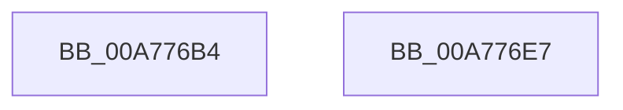

# ExpWnfDeleteNameInstanceCallback

- RVA: `0x00A776B4`–`0x00A776E8` (길이 `52` bytes)
- VA: `0x0000000140A776B4`
- 실행 섹션: `PAGE`
- PDB 이름 있음: `예`; PDB Function 태그: `아니요`
- unwind 정보 RVA: `0x0005CAAC`
- 디코드: `16`개 명령, `52/52` bytes 표시
- 미해석 바이트: `0` (있으면 어셈블리에 `.byte`로 보존)

> 이 문서는 커널 이미지의 기계어와 PDB 기호를 분석해 생성했습니다. 4번과 5번은 함수 원형과 자료형을 바이너리 사용 방식에서 추정한 C 해석이며 원본 소스 복구 결과는 아닙니다.

## 1. Dependencies

- 직접 호출 지점: **2**; 고유 호출 대상: **2**
- 직접 호출자로 확인된 함수: **1**
- RIP 상대 이미지 참조: **0**

### Outgoing calls
- `0x00A776C9` → [ExAcquireRundownProtection](../../text/21/ExAcquireRundownProtection_function_00216620.md) (function, `0x00216620`)
- `0x00A776D7` → [ExpWnfDeleteNameInstance](../90/ExpWnfDeleteNameInstance_function_009088C8.md) (function, `0x009088C8`)

### Direct callers
- [ExpWnfFreeScopeInstance](ExpWnfFreeScopeInstance_function_00A77614.md) at `0x00A77652`

### Static image references
- 디코드된 RIP-relative 메모리 참조가 없습니다.

## 2. Other-region calls and transfers

- 다른 실행 섹션으로 향하는 call: **1**
  - `0x00A776C9` → [ExAcquireRundownProtection](../../text/21/ExAcquireRundownProtection_function_00216620.md) (`PAGE` → `.text`)
- 별도 외부 분기/꼬리 이동을 확인하지 못했습니다.

## 3. Assembly (complete function range)

```asm
00A776B4  48 89 5C 24 08                  mov qword ptr [rsp + 8], rbx
00A776B9  57                              push rdi
00A776BA  48 83 EC 20                     sub rsp, 0x20
00A776BE  48 8D 59 F0                     lea rbx, [rcx - 0x10]
00A776C2  48 8B FA                        mov rdi, rdx
00A776C5  48 8D 4B 08                     lea rcx, [rbx + 8]
00A776C9  E8 52 EF 79 FF                  call 0x140216620
00A776CE  45 33 C0                        xor r8d, r8d
00A776D1  48 8B D3                        mov rdx, rbx
00A776D4  48 8B CF                        mov rcx, rdi
00A776D7  E8 EC 11 E9 FF                  call 0x1409088c8
00A776DC  48 8B 5C 24 30                  mov rbx, qword ptr [rsp + 0x30]
00A776E1  48 83 C4 20                     add rsp, 0x20
00A776E5  5F                              pop rdi
00A776E6  C3                              ret
00A776E7  CC                              int3
```

## 4. C-style interpretation (structured pseudocode)

```c
__int64 __fastcall ExpWnfDeleteNameInstanceCallback(__int64 a1, __int64 a2, int a3)
{
    __int64 result;
    __int64 v_rsp;
    unsigned __int64 v_stack_p8;

    v_stack_p8 = v_rbx;
    v_rsp = (v_rsp) - (32);
    result = ExAcquireRundownProtection(a1 - 16 + 8, a2, a3, a4);
    a3 = 0;
    result = ExpWnfDeleteNameInstance(a2, a1 - 16, a3, a4);
    v_rsp = (v_rsp) + (32);
    return result;
}
```

## 5. (Beta) C Style

```c
int64_t ExpWnfDeleteNameInstanceCallback(void *Arg1, int64_t Arg2, int32_t Arg3)
{
    uint8_t *arg1 = (uint8_t *)Arg1;

    int64_t result;
    int64_t local_rsp;
    uint64_t v_stack_p8;

    v_stack_p8 = local_rbx;
    local_rsp = (local_rsp) - (32);
    result = ExAcquireRundownProtection(Arg1 - 16 + 8, Arg2, Arg3, a4);
    Arg3 = 0;
    result = ExpWnfDeleteNameInstance(Arg2, Arg1 - 16, Arg3, a4);
    local_rsp = (local_rsp) + (32);
    return result;
}
```

### 관측된 메모리 오프셋

구조체 형식이 확인되지 않은 접근은 인자 기준의 오프셋으로만 기록했습니다.

| 기준 인자 | 오프셋 표현 | 폭 (bit) | 접근 |
|---|---:|---:|---|
| `Arg1` | `- 0x10` | `64` | `R` |
| `Arg1` | `+ 0x8` | `64` | `R` |

## 6. Execution-region graph

[열기: 2D/3D 그래프와 함수 탐색 컨트롤 패널](../../../control-panel.html?section=page&rva=0x00A776B4&view=graph)

- 2D 그래프는 위에서 아래로 흐르고, 3D 그래프는 빈 공간을 드래그해 회전합니다. Shift+드래그는 이동, 휠은 확대·축소, 함수 노드 선택은 대상 보고서 이동입니다.

### Static fallback


