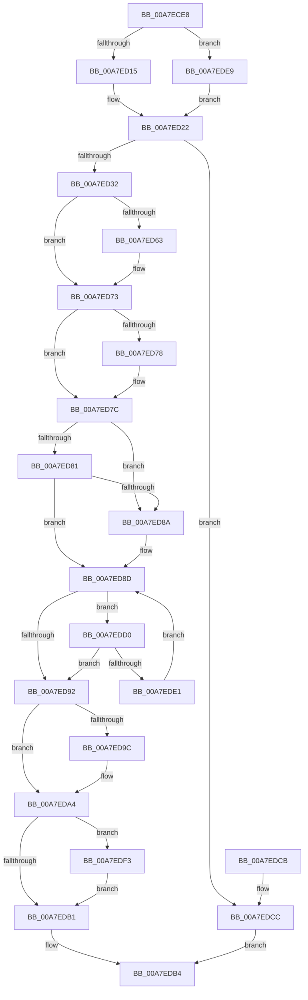

# ExpWnfEnumerateScopeInstances

- RVA: `0x00A7ECE8`–`0x00A7EDFE` (길이 `278` bytes)
- VA: `0x0000000140A7ECE8`
- 실행 섹션: `PAGE`
- PDB 이름 있음: `예`; PDB Function 태그: `아니요`
- unwind 정보 RVA: `0x000B6D30`
- 디코드: `86`개 명령, `278/278` bytes 표시
- 미해석 바이트: `0` (있으면 어셈블리에 `.byte`로 보존)

> 이 문서는 커널 이미지의 기계어와 PDB 기호를 분석해 생성했습니다. 4번과 5번은 함수 원형과 자료형을 바이너리 사용 방식에서 추정한 C 해석이며 원본 소스 복구 결과는 아닙니다.

## 1. Dependencies

- 직접 호출 지점: **9**; 고유 호출 대상: **9**
- 직접 호출자로 확인된 함수: **1**
- RIP 상대 이미지 참조: **0**

### Outgoing calls
- `0x00A7ED15` → [HalAdjustResourceList](../../text/48/HalAdjustResourceList_function_0048FDC0.md) (function, `0x0048FDC0`)
- `0x00A7ED1D` → [PsGetServerSiloGlobals](../../text/22/PsGetServerSiloGlobals_function_002250A0.md) (function, `0x002250A0`)
- `0x00A7ED4E` → [KeAbPreAcquire](../../text/21/KeAbPreAcquire_function_00210230.md) (function, `0x00210230`)
- `0x00A7ED6E` → [ExfAcquirePushLockSharedEx](../../text/21/ExfAcquirePushLockSharedEx_function_0021044C.md) (function, `0x0021044C`)
- `0x00A7ED9F` → [ExfReleasePushLockShared](../../text/26/ExfReleasePushLockShared_function_00263440.md) (function, `0x00263440`)
- `0x00A7EDA7` → [KeAbPostRelease](../../text/2E/KeAbPostRelease_function_002E1600.md) (function, `0x002E1600`)
- `0x00A7EDD8` → [ExAcquireRundownProtection](../../text/21/ExAcquireRundownProtection_function_00216620.md) (function, `0x00216620`)
- `0x00A7EDE9` → [PsGetCurrentServerSiloGlobals](../../text/2F/PsGetCurrentServerSiloGlobals_function_002FE1F0.md) (function, `0x002FE1F0`)
- `0x00A7EDF7` → [ExReleaseRundownProtection](../../text/34/ExReleaseRundownProtection_function_00349E80.md) (function, `0x00349E80`)

### Direct callers
- [NtDeleteWnfStateName](../90/NtDeleteWnfStateName_function_00908E60.md) at `0x0090923A`
- [NtDeleteWnfStateName](../90/NtDeleteWnfStateName_function_00908E60.md) at `0x00909265`

### Static image references
- 디코드된 RIP-relative 메모리 참조가 없습니다.

## 2. Other-region calls and transfers

- 다른 실행 섹션으로 향하는 call: **9**
  - `0x00A7ED15` → [HalAdjustResourceList](../../text/48/HalAdjustResourceList_function_0048FDC0.md) (`PAGE` → `.text`)
  - `0x00A7ED1D` → [PsGetServerSiloGlobals](../../text/22/PsGetServerSiloGlobals_function_002250A0.md) (`PAGE` → `.text`)
  - `0x00A7ED4E` → [KeAbPreAcquire](../../text/21/KeAbPreAcquire_function_00210230.md) (`PAGE` → `.text`)
  - `0x00A7ED6E` → [ExfAcquirePushLockSharedEx](../../text/21/ExfAcquirePushLockSharedEx_function_0021044C.md) (`PAGE` → `.text`)
  - `0x00A7ED9F` → [ExfReleasePushLockShared](../../text/26/ExfReleasePushLockShared_function_00263440.md) (`PAGE` → `.text`)
  - `0x00A7EDA7` → [KeAbPostRelease](../../text/2E/KeAbPostRelease_function_002E1600.md) (`PAGE` → `.text`)
  - `0x00A7EDD8` → [ExAcquireRundownProtection](../../text/21/ExAcquireRundownProtection_function_00216620.md) (`PAGE` → `.text`)
  - `0x00A7EDE9` → [PsGetCurrentServerSiloGlobals](../../text/2F/PsGetCurrentServerSiloGlobals_function_002FE1F0.md) (`PAGE` → `.text`)
  - `0x00A7EDF7` → [ExReleaseRundownProtection](../../text/34/ExReleaseRundownProtection_function_00349E80.md) (`PAGE` → `.text`)
- 별도 외부 분기/꼬리 이동을 확인하지 못했습니다.

## 3. Assembly (complete function range)

```asm
00A7ECE8  48 89 5C 24 08                  mov qword ptr [rsp + 8], rbx
00A7ECED  48 89 6C 24 10                  mov qword ptr [rsp + 0x10], rbp
00A7ECF2  56                              push rsi
00A7ECF3  57                              push rdi
00A7ECF4  41 54                           push r12
00A7ECF6  41 56                           push r14
00A7ECF8  41 57                           push r15
00A7ECFA  48 83 EC 20                     sub rsp, 0x20
00A7ECFE  45 33 FF                        xor r15d, r15d
00A7ED01  8B D9                           mov ebx, ecx
00A7ED03  48 8B F2                        mov rsi, rdx
00A7ED06  41 8B EF                        mov ebp, r15d
00A7ED09  8D 43 FC                        lea eax, [rbx - 4]
00A7ED0C  83 F8 01                        cmp eax, 1
00A7ED0F  0F 87 D4 00 00 00               ja 0x140a7ede9
00A7ED15  E8 A6 10 A1 FF                  call 0x14048fdc0
00A7ED1A  48 8B C8                        mov rcx, rax
00A7ED1D  E8 7E 63 7A FF                  call 0x1402250a0
00A7ED22  48 8B 90 70 03 00 00            mov rdx, qword ptr [rax + 0x370]
00A7ED29  48 85 D2                        test rdx, rdx
00A7ED2C  0F 84 9A 00 00 00               je 0x140a7edcc
00A7ED32  48 8D 0C 5B                     lea rcx, [rbx + rbx*2]
00A7ED36  45 33 C0                        xor r8d, r8d
00A7ED39  4C 8D 71 05                     lea r14, [rcx + 5]
00A7ED3D  48 8D 49 04                     lea rcx, [rcx + 4]
00A7ED41  48 8D 3C CA                     lea rdi, [rdx + rcx*8]
00A7ED45  4E 8D 34 F2                     lea r14, [rdx + r14*8]
00A7ED49  48 8B CF                        mov rcx, rdi
00A7ED4C  33 D2                           xor edx, edx
00A7ED4E  E8 DD 14 79 FF                  call 0x140210230
00A7ED53  48 8B D8                        mov rbx, rax
00A7ED56  33 C0                           xor eax, eax
00A7ED58  44 8D 60 11                     lea r12d, [rax + 0x11]
00A7ED5C  F0 4C 0F B1 27                  lock cmpxchg qword ptr [rdi], r12
00A7ED61  74 10                           je 0x140a7ed73
00A7ED63  4C 8B CF                        mov r9, rdi
00A7ED66  4C 8B C3                        mov r8, rbx
00A7ED69  33 D2                           xor edx, edx
00A7ED6B  48 8B CF                        mov rcx, rdi
00A7ED6E  E8 D9 16 79 FF                  call 0x14021044c
00A7ED73  48 85 DB                        test rbx, rbx
00A7ED76  74 04                           je 0x140a7ed7c
00A7ED78  C6 43 0A 01                     mov byte ptr [rbx + 0xa], 1
00A7ED7C  48 85 F6                        test rsi, rsi
00A7ED7F  74 09                           je 0x140a7ed8a
00A7ED81  48 8B 5E 20                     mov rbx, qword ptr [rsi + 0x20]
00A7ED85  48 85 DB                        test rbx, rbx
00A7ED88  75 03                           jne 0x140a7ed8d
00A7ED8A  49 8B 1E                        mov rbx, qword ptr [r14]
00A7ED8D  49 3B DE                        cmp rbx, r14
00A7ED90  75 3E                           jne 0x140a7edd0
00A7ED92  49 8B C4                        mov rax, r12
00A7ED95  F0 4C 0F B1 3F                  lock cmpxchg qword ptr [rdi], r15
00A7ED9A  74 08                           je 0x140a7eda4
00A7ED9C  48 8B CF                        mov rcx, rdi
00A7ED9F  E8 9C 46 7E FF                  call 0x140263440
00A7EDA4  48 8B CF                        mov rcx, rdi
00A7EDA7  E8 54 28 86 FF                  call 0x1402e1600
00A7EDAC  48 85 F6                        test rsi, rsi
00A7EDAF  75 42                           jne 0x140a7edf3
00A7EDB1  48 8B C5                        mov rax, rbp
00A7EDB4  48 8B 5C 24 50                  mov rbx, qword ptr [rsp + 0x50]
00A7EDB9  48 8B 6C 24 58                  mov rbp, qword ptr [rsp + 0x58]
00A7EDBE  48 83 C4 20                     add rsp, 0x20
00A7EDC2  41 5F                           pop r15
00A7EDC4  41 5E                           pop r14
00A7EDC6  41 5C                           pop r12
00A7EDC8  5F                              pop rdi
00A7EDC9  5E                              pop rsi
00A7EDCA  C3                              ret
00A7EDCB  CC                              int3
00A7EDCC  33 C0                           xor eax, eax
00A7EDCE  EB E4                           jmp 0x140a7edb4
00A7EDD0  48 8D 6B E0                     lea rbp, [rbx - 0x20]
00A7EDD4  48 8D 4D 08                     lea rcx, [rbp + 8]
00A7EDD8  E8 43 78 79 FF                  call 0x140216620
00A7EDDD  84 C0                           test al, al
00A7EDDF  75 B1                           jne 0x140a7ed92
00A7EDE1  48 8B 1B                        mov rbx, qword ptr [rbx]
00A7EDE4  49 8B EF                        mov rbp, r15
00A7EDE7  EB A4                           jmp 0x140a7ed8d
00A7EDE9  E8 02 F4 87 FF                  call 0x1402fe1f0
00A7EDEE  E9 2F FF FF FF                  jmp 0x140a7ed22
00A7EDF3  48 8D 4E 08                     lea rcx, [rsi + 8]
00A7EDF7  E8 84 B0 8C FF                  call 0x140349e80
00A7EDFC  EB B3                           jmp 0x140a7edb1
```

## 4. C-style interpretation (structured pseudocode)

```c
__int64 __fastcall ExpWnfEnumerateScopeInstances(int a1, __int64 a2, int a3)
{
    __int64 result;
    __int64 v_r15;
    __int64 v_rbx;
    __int64 v_rsp;
    unsigned __int64 v_stack_p10;
    unsigned __int64 v_stack_p8;

    v_stack_p8 = v_rbx;
    v_stack_p10 = v_rbp;
    v_rsp = (v_rsp) - (32);
    v_r15 = 0;
    if (((unsigned int)((unsigned int)(a1) - 4)) > 1) goto loc_00A7EDE9;
    result = HalAdjustResourceList(a1, a2, a3, a4);
    result = PsGetServerSiloGlobals(result, a2, a3, a4);
loc_00A7ED22:
    if (*(unsigned __int64 *)(result + 880) == 0) goto loc_00A7EDCC;
    a3 = 0;
    a2 = 0;
    result = KeAbPreAcquire(*(unsigned __int64 *)(result + 880) + (unsigned int)(a1) + (unsigned int)(a1) * 2 + 4 * 8, a2, a3, a4);
    result = 0;
    if (!(condition_is_equal)) {
        a4 = *(unsigned __int64 *)(result + 880) + (unsigned int)(a1) + (unsigned int)(a1) * 2 + 4 * 8;
        a3 = 0;
        a2 = 0;
        a1 = *(unsigned __int64 *)(result + 880) + (unsigned int)(a1) + (unsigned int)(a1) * 2 + 4 * 8;
        result = ExfAcquirePushLockSharedEx(a1, a2, a3, a4);
    }
    if (result != 0) {
        *(unsigned __int8 *)(result + 10) = 1;
    }
    if (0 == 0) goto loc_00A7ED8A;
    v_rbx = *(unsigned __int64 *)(a2 + 32);
    if (*(unsigned __int64 *)(a2 + 32) == 0) {
        v_rbx = *(unsigned __int64 *)(*(unsigned __int64 *)(result + 880) + (unsigned int)(a1) + (unsigned int)(a1) * 2 + 5 * 8);
    }
    if (v_rbx != (*(unsigned __int64 *)(result + 880) + (unsigned int)(a1) + (unsigned int)(a1) * 2 + 5 * 8)) goto loc_00A7EDD0;
loc_00A7ED92:
    result = result + 17;
    if (v_rbx != (*(unsigned __int64 *)(result + 880) + (unsigned int)(a1) + (unsigned int)(a1) * 2 + 5 * 8)) {
        a1 = *(unsigned __int64 *)(result + 880) + (unsigned int)(a1) + (unsigned int)(a1) * 2 + 4 * 8;
        result = ExfReleasePushLockShared(a1, a2, a3, a4);
    }
    result = KeAbPostRelease(*(unsigned __int64 *)(result + 880) + (unsigned int)(a1) + (unsigned int)(a1) * 2 + 4 * 8, a2, a3, a4);
    if (0 != 0) goto loc_00A7EDF3;
loc_00A7EDB1:
loc_00A7EDB4:
    v_rsp = (v_rsp) + (32);
    return 0;
loc_00A7EDCC:
    result = 0;
    goto loc_00A7EDB4;
loc_00A7EDD0:
    result = ExAcquireRundownProtection(v_stack_p8 - 32 + 8, a2, a3, a4);
    if ((unsigned __int8)(result) != 0) goto loc_00A7ED92;
    goto loc_00A7ED8D;
loc_00A7EDE9:
    result = PsGetCurrentServerSiloGlobals(v_stack_p8 - 32 + 8, a2, a3, a4);
    goto loc_00A7ED22;
loc_00A7EDF3:
    result = ExReleaseRundownProtection(a2 + 8, a2, a3, a4);
    goto loc_00A7EDB1;
}
```

## 5. (Beta) C Style

```c
int64_t ExpWnfEnumerateScopeInstances(void *Arg1, int64_t Arg2, int32_t Arg3)
{
    uint8_t *arg1 = (uint8_t *)Arg1;

    int64_t result;
    int64_t local_r15;
    int64_t local_rbx;
    int64_t local_rsp;
    uint64_t v_stack_p10;
    uint64_t v_stack_p8;

    v_stack_p8 = local_rbx;
    v_stack_p10 = local_rbp;
    local_rsp = (local_rsp) - (32);
    local_r15 = 0;
    if (((uint32_t)((uint32_t)(Arg1) - 4)) > 1) goto loc_00A7EDE9;
    result = HalAdjustResourceList(Arg1, Arg2, Arg3, a4);
    result = PsGetServerSiloGlobals(result, Arg2, Arg3, a4);
loc_00A7ED22:
    if (*(uint64_t *)(result + 0x370) == 0) goto loc_00A7EDCC;
    Arg3 = 0;
    Arg2 = 0;
    result = KeAbPreAcquire(*(uint64_t *)(result + 0x370) + (uint32_t)(Arg1) + (uint32_t)(Arg1) * 2 + 4 * 8, Arg2, Arg3, a4);
    result = 0;
    if (!(condition_is_equal)) {
        a4 = *(uint64_t *)(result + 0x370) + (uint32_t)(Arg1) + (uint32_t)(Arg1) * 2 + 4 * 8;
        Arg3 = 0;
        Arg2 = 0;
        Arg1 = *(uint64_t *)(result + 0x370) + (uint32_t)(Arg1) + (uint32_t)(Arg1) * 2 + 4 * 8;
        result = ExfAcquirePushLockSharedEx(Arg1, Arg2, Arg3, a4);
    }
    if (result != 0) {
        *(uint8_t *)(result + 0xA) = 1;
    }
    if (0 == 0) goto loc_00A7ED8A;
    local_rbx = *(uint64_t *)(Arg2 + 0x20);
    if (*(uint64_t *)(Arg2 + 0x20) == 0) {
        local_rbx = *(uint64_t *)(*(uint64_t *)(result + 0x370) + (uint32_t)(arg1) + (uint32_t)(arg1) * 2 + 0x5 * 8);
    }
    if (local_rbx != (*(uint64_t *)(result + 0x370) + (uint32_t)(Arg1) + (uint32_t)(Arg1) * 2 + 5 * 8)) goto loc_00A7EDD0;
loc_00A7ED92:
    result = result + 17;
    if (local_rbx != (*(uint64_t *)(result + 0x370) + (uint32_t)(Arg1) + (uint32_t)(Arg1) * 2 + 5 * 8)) {
        Arg1 = *(uint64_t *)(result + 0x370) + (uint32_t)(Arg1) + (uint32_t)(Arg1) * 2 + 4 * 8;
        result = ExfReleasePushLockShared(Arg1, Arg2, Arg3, a4);
    }
    result = KeAbPostRelease(*(uint64_t *)(result + 0x370) + (uint32_t)(Arg1) + (uint32_t)(Arg1) * 2 + 4 * 8, Arg2, Arg3, a4);
    if (0 != 0) goto loc_00A7EDF3;
loc_00A7EDB1:
loc_00A7EDB4:
    local_rsp = (local_rsp) + (32);
    return 0;
loc_00A7EDCC:
    result = 0;
    goto loc_00A7EDB4;
loc_00A7EDD0:
    result = ExAcquireRundownProtection(v_stack_p8 - 32 + 8, Arg2, Arg3, a4);
    if ((uint8_t)(result) != 0) goto loc_00A7ED92;
    goto loc_00A7ED8D;
loc_00A7EDE9:
    result = PsGetCurrentServerSiloGlobals(v_stack_p8 - 32 + 8, Arg2, Arg3, a4);
    goto loc_00A7ED22;
loc_00A7EDF3:
    result = ExReleaseRundownProtection(Arg2 + 8, Arg2, Arg3, a4);
    goto loc_00A7EDB1;
}
```

### 관측된 메모리 오프셋

구조체 형식이 확인되지 않은 접근은 인자 기준의 오프셋으로만 기록했습니다.

| 기준 인자 | 오프셋 표현 | 폭 (bit) | 접근 |
|---|---:|---:|---|
| `Arg1` | `- 0x4` | `32` | `R` |
| `Arg1` | `+ 0x0 + rbx*2` | `64` | `R` |
| `Arg1` | `+ 0x4` | `64` | `R` |
| `Arg1` | `+ 0x5` | `64` | `R` |

## 6. Execution-region graph

[열기: 2D/3D 그래프와 함수 탐색 컨트롤 패널](../../../control-panel.html?section=page&rva=0x00A7ECE8&view=graph)

- 2D 그래프는 위에서 아래로 흐르고, 3D 그래프는 빈 공간을 드래그해 회전합니다. Shift+드래그는 이동, 휠은 확대·축소, 함수 노드 선택은 대상 보고서 이동입니다.

### Static fallback


