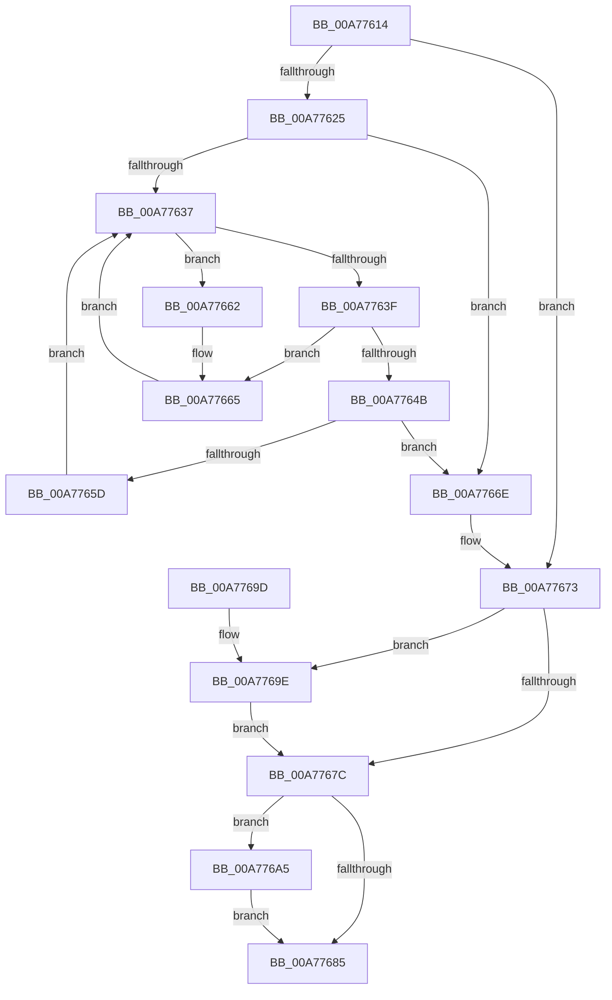

# ExpWnfFreeScopeInstance

- RVA: `0x00A77614`–`0x00A776AC` (길이 `152` bytes)
- VA: `0x0000000140A77614`
- 실행 섹션: `PAGE`
- PDB 이름 있음: `예`; PDB Function 태그: `아니요`
- unwind 정보 RVA: `0x0008A6D8`
- 디코드: `48`개 명령, `152/152` bytes 표시
- 미해석 바이트: `0` (있으면 어셈블리에 `.byte`로 보존)

> 이 문서는 커널 이미지의 기계어와 PDB 기호를 분석해 생성했습니다. 4번과 5번은 함수 원형과 자료형을 바이너리 사용 방식에서 추정한 C 해석이며 원본 소스 복구 결과는 아닙니다.

## 1. Dependencies

- 직접 호출 지점: **5**; 고유 호출 대상: **4**
- 직접 호출자로 확인된 함수: **3**
- RIP 상대 이미지 참조: **0**

### Outgoing calls
- `0x00A77629` → [ExWaitForRundownProtectionRelease](../../text/2A/ExWaitForRundownProtectionRelease_function_002A4CB0.md) (function, `0x002A4CB0`)
- `0x00A77652` → [ExpWnfDeleteNameInstanceCallback](ExpWnfDeleteNameInstanceCallback_function_00A776B4.md) (function, `0x00A776B4`)
- `0x00A7768D` → [ExFreePoolWithTag](../../poolcode/B8/ExFreePoolWithTag_function_00B82870.md) (function, `0x00B82870`)
- `0x00A7769E` → [ExpWnfDestroyPermanentDataStore](../7D/ExpWnfDestroyPermanentDataStore_function_007D6484.md) (function, `0x007D6484`)
- `0x00A776A5` → [ExpWnfDestroyPermanentDataStore](../7D/ExpWnfDestroyPermanentDataStore_function_007D6484.md) (function, `0x007D6484`)

### Direct callers
- [ExpWnfDeleteScopeInstances](../7D/ExpWnfDeleteScopeInstances_function_007D63A0.md) at `0x007D6418`
- [ExpWnfDeleteScopeById](../90/ExpWnfDeleteScopeById_function_00908168.md) at `0x00908259`
- [sub_00B21254](../B2/Unknown_function_00B21254.md) at `0x00B21262`

### Static image references
- 디코드된 RIP-relative 메모리 참조가 없습니다.

## 2. Other-region calls and transfers

- 다른 실행 섹션으로 향하는 call: **2**
  - `0x00A77629` → [ExWaitForRundownProtectionRelease](../../text/2A/ExWaitForRundownProtectionRelease_function_002A4CB0.md) (`PAGE` → `.text`)
  - `0x00A7768D` → [ExFreePoolWithTag](../../poolcode/B8/ExFreePoolWithTag_function_00B82870.md) (`PAGE` → `POOLCODE`)
- 별도 외부 분기/꼬리 이동을 확인하지 못했습니다.

## 3. Assembly (complete function range)

```asm
00A77614  48 89 5C 24 08                  mov qword ptr [rsp + 8], rbx
00A77619  57                              push rdi
00A7761A  48 83 EC 20                     sub rsp, 0x20
00A7761E  48 8B D9                        mov rbx, rcx
00A77621  84 D2                           test dl, dl
00A77623  74 4E                           je 0x140a77673
00A77625  48 83 C1 08                     add rcx, 8
00A77629  E8 82 D6 82 FF                  call 0x1402a4cb0
00A7762E  48 8B 4B 38                     mov rcx, qword ptr [rbx + 0x38]
00A77632  48 85 C9                        test rcx, rcx
00A77635  74 37                           je 0x140a7766e
00A77637  48 8B 11                        mov rdx, qword ptr [rcx]
00A7763A  48 85 D2                        test rdx, rdx
00A7763D  75 23                           jne 0x140a77662
00A7763F  48 8D 41 08                     lea rax, [rcx + 8]
00A77643  48 8B 10                        mov rdx, qword ptr [rax]
00A77646  48 85 D2                        test rdx, rdx
00A77649  75 1A                           jne 0x140a77665
00A7764B  48 8B 79 10                     mov rdi, qword ptr [rcx + 0x10]
00A7764F  48 8B D3                        mov rdx, rbx
00A77652  E8 5D 00 00 00                  call 0x140a776b4
00A77657  48 83 E7 FC                     and rdi, 0xfffffffffffffffc
00A7765B  74 11                           je 0x140a7766e
00A7765D  48 8B CF                        mov rcx, rdi
00A77660  EB D5                           jmp 0x140a77637
00A77662  48 8B C1                        mov rax, rcx
00A77665  48 83 20 00                     and qword ptr [rax], 0
00A77669  48 8B CA                        mov rcx, rdx
00A7766C  EB C9                           jmp 0x140a77637
00A7766E  48 83 63 38 00                  and qword ptr [rbx + 0x38], 0
00A77673  48 8B 4B 40                     mov rcx, qword ptr [rbx + 0x40]
00A77677  48 85 C9                        test rcx, rcx
00A7767A  75 22                           jne 0x140a7769e
00A7767C  48 8B 4B 48                     mov rcx, qword ptr [rbx + 0x48]
00A77680  48 85 C9                        test rcx, rcx
00A77683  75 20                           jne 0x140a776a5
00A77685  BA 57 6E 66 20                  mov edx, 0x20666e57
00A7768A  48 8B CB                        mov rcx, rbx
00A7768D  E8 DE B1 10 00                  call 0x140b82870
00A77692  48 8B 5C 24 30                  mov rbx, qword ptr [rsp + 0x30]
00A77697  48 83 C4 20                     add rsp, 0x20
00A7769B  5F                              pop rdi
00A7769C  C3                              ret
00A7769D  CC                              int3
00A7769E  E8 E1 ED D5 FF                  call 0x1407d6484
00A776A3  EB D7                           jmp 0x140a7767c
00A776A5  E8 DA ED D5 FF                  call 0x1407d6484
00A776AA  EB D9                           jmp 0x140a77685
```

## 4. C-style interpretation (structured pseudocode)

```c
__int64 __fastcall ExpWnfFreeScopeInstance(__int64 a1, unsigned __int8 a2)
{
    __int64 result;
    __int64 v_rdi;
    __int64 v_rsp;
    unsigned __int64 v_stack_p8;

    v_stack_p8 = v_rbx;
    v_rsp = (v_rsp) - (32);
    if (a2 == 0) goto loc_00A77673;
    a1 = (a1) + (8);
    result = ExWaitForRundownProtectionRelease(a1, a2, a3, a4);
    if (*(unsigned __int64 *)(a1 + 56) == 0) goto loc_00A7766E;
loc_00A77637:
    if (*(unsigned __int64 *)(*(unsigned __int64 *)(a1 + 56)) != 0) goto loc_00A77662;
    if (*(unsigned __int64 *)(*(unsigned __int64 *)(a1 + 56) + 8) != 0) goto loc_00A77665;
    result = ExpWnfDeleteNameInstanceCallback(*(unsigned __int64 *)(a1 + 56), a1, a3, a4);
    v_rdi = (*(unsigned __int64 *)(*(unsigned __int64 *)(a1 + 56) + 16)) & (-4);
    if (condition_is_equal) goto loc_00A7766E;
    goto loc_00A77637;
loc_00A77662:
loc_00A77665:
    goto loc_00A77637;
loc_00A7766E:
loc_00A77673:
    if (*(unsigned __int64 *)(a1 + 64) != 0) goto loc_00A7769E;
loc_00A7767C:
    if (*(unsigned __int64 *)(a1 + 72) != 0) goto loc_00A776A5;
loc_00A77685:
    result = ExFreePoolWithTag(a1, (unsigned int)(0x20666E57ULL), a3, a4);
    v_rsp = (v_rsp) + (32);
    return result;
loc_00A7769E:
    result = ExpWnfDestroyPermanentDataStore(a1, (unsigned int)(0x20666E57ULL), a3, a4);
    goto loc_00A7767C;
loc_00A776A5:
    result = ExpWnfDestroyPermanentDataStore(a1, (unsigned int)(0x20666E57ULL), a3, a4);
    goto loc_00A77685;
}
```

## 5. (Beta) C Style

```c
int64_t ExpWnfFreeScopeInstance(void *Arg1, uint8_t Arg2)
{
    uint8_t *arg1 = (uint8_t *)Arg1;

    int64_t result;
    int64_t local_rdi;
    int64_t local_rsp;
    uint64_t v_stack_p8;

    v_stack_p8 = local_rbx;
    local_rsp = (local_rsp) - (32);
    if (Arg2 == 0) goto loc_00A77673;
    Arg1 = (Arg1) + (8);
    result = ExWaitForRundownProtectionRelease(Arg1, Arg2, a3, a4);
    if (*(uint64_t *)(arg1 + 0x38) == 0) goto loc_00A7766E;
loc_00A77637:
    if (*(uint64_t *)(*(uint64_t *)(arg1 + 0x38)) != 0) goto loc_00A77662;
    if (*(uint64_t *)(*(uint64_t *)(arg1 + 0x38) + 0x8) != 0) goto loc_00A77665;
    result = ExpWnfDeleteNameInstanceCallback(*(uint64_t *)(arg1 + 0x38), Arg1, a3, a4);
    local_rdi = (*(uint64_t *)(*(uint64_t *)(arg1 + 0x38) + 0x10)) & (-4);
    if (condition_is_equal) goto loc_00A7766E;
    goto loc_00A77637;
loc_00A77662:
loc_00A77665:
    goto loc_00A77637;
loc_00A7766E:
loc_00A77673:
    if (*(uint64_t *)(arg1 + 0x40) != 0) goto loc_00A7769E;
loc_00A7767C:
    if (*(uint64_t *)(arg1 + 0x48) != 0) goto loc_00A776A5;
loc_00A77685:
    result = ExFreePoolWithTag(Arg1, (uint32_t)(0x20666E57ULL), a3, a4);
    local_rsp = (local_rsp) + (32);
    return result;
loc_00A7769E:
    result = ExpWnfDestroyPermanentDataStore(Arg1, (uint32_t)(0x20666E57ULL), a3, a4);
    goto loc_00A7767C;
loc_00A776A5:
    result = ExpWnfDestroyPermanentDataStore(Arg1, (uint32_t)(0x20666E57ULL), a3, a4);
    goto loc_00A77685;
}
```

### 관측된 메모리 오프셋

구조체 형식이 확인되지 않은 접근은 인자 기준의 오프셋으로만 기록했습니다.

| 기준 인자 | 오프셋 표현 | 폭 (bit) | 접근 |
|---|---:|---:|---|
| `Arg1` | `+ 0x38` | `64` | `R` |
| `Arg1` | `+ 0x38` | `64` | `R/W` |
| `Arg1` | `+ 0x40` | `64` | `R` |
| `Arg1` | `+ 0x48` | `64` | `R` |

## 6. Execution-region graph

[열기: 2D/3D 그래프와 함수 탐색 컨트롤 패널](../../../control-panel.html?section=page&rva=0x00A77614&view=graph)

- 2D 그래프는 위에서 아래로 흐르고, 3D 그래프는 빈 공간을 드래그해 회전합니다. Shift+드래그는 이동, 휠은 확대·축소, 함수 노드 선택은 대상 보고서 이동입니다.

### Static fallback


