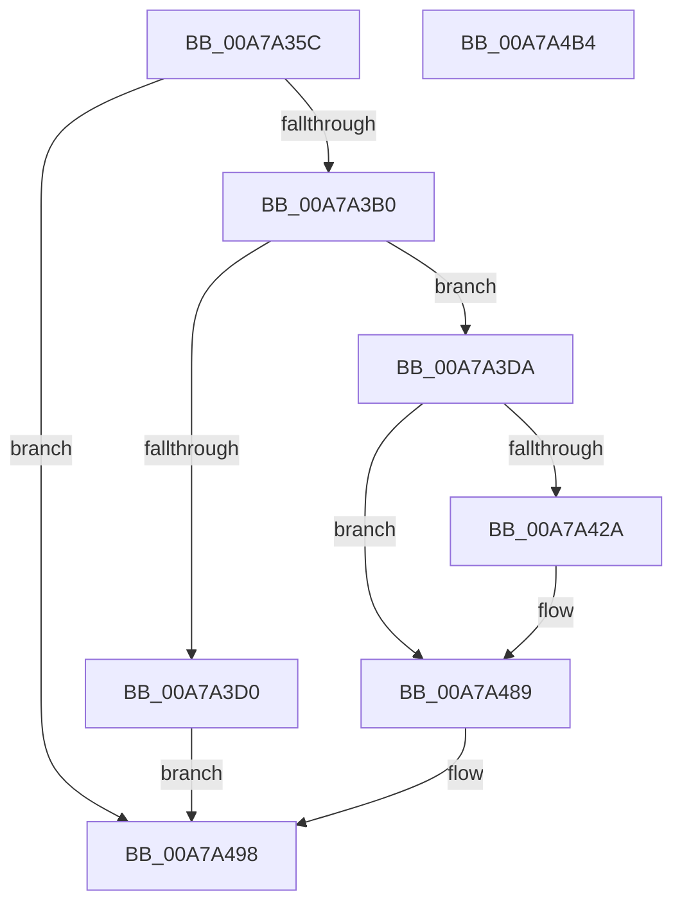

# ExpWnfGetPermanentPerUserDataStoreHandle

- RVA: `0x00A7A35C`–`0x00A7A4B5` (길이 `345` bytes)
- VA: `0x0000000140A7A35C`
- 실행 섹션: `PAGE`
- PDB 이름 있음: `예`; PDB Function 태그: `아니요`
- unwind 정보 RVA: `0x000B633C`
- 디코드: `92`개 명령, `345/345` bytes 표시
- 미해석 바이트: `0` (있으면 어셈블리에 `.byte`로 보존)

> 이 문서는 커널 이미지의 기계어와 PDB 기호를 분석해 생성했습니다. 4번과 5번은 함수 원형과 자료형을 바이너리 사용 방식에서 추정한 C 해석이며 원본 소스 복구 결과는 아닙니다.

## 1. Dependencies

- 직접 호출 지점: **7**; 고유 호출 대상: **6**
- 직접 호출자로 확인된 함수: **2**
- RIP 상대 이미지 참조: **2**

### Outgoing calls
- `0x00A7A3A3` → [RtlLengthSidAsUnicodeString](../92/RtlLengthSidAsUnicodeString_function_00927970.md) (function, `0x00927970`)
- `0x00A7A3C3` → [ExAllocatePool2](../../poolcode/B8/ExAllocatePool2_function_00B820F0.md) (function, `0x00B820F0`)
- `0x00A7A3F4` → [RtlAppendUnicodeToString](../../text/40/RtlAppendUnicodeToString_function_0040F990.md) (function, `0x0040F990`)
- `0x00A7A41F` → [RtlConvertSidToUnicodeString](../92/RtlConvertSidToUnicodeString_function_00927B30.md) (function, `0x00927B30`)
- `0x00A7A43D` → [RtlAppendUnicodeToString](../../text/40/RtlAppendUnicodeToString_function_0040F990.md) (function, `0x0040F990`)
- `0x00A7A482` → [ZwCreateKey](../../text/6A/ZwCreateKey_function_006AD470.md) (function, `0x006AD470`)
- `0x00A7A491` → [ExFreePoolWithTag](../../poolcode/B8/ExFreePoolWithTag_function_00B82870.md) (function, `0x00B82870`)

### Direct callers
- [ExpWnfGetPermanentDataStoreHandleByScopeId](../7D/ExpWnfGetPermanentDataStoreHandleByScopeId_function_007D65F8.md) at `0x007D6646`
- [ExpWnfAcquirePermanentDataStoreHandle](ExpWnfAcquirePermanentDataStoreHandle_function_00A7A210.md) at `0x00A7A2B0`

### Static image references
- `0x00A7A3DD` → RVA `0x00B08E90` (` ?? ::NNGAKEGL::`string'`; read)
- `0x00A7A42E` → RVA `0x00B08E40` (` ?? ::NNGAKEGL::`string'`; read)

## 2. Other-region calls and transfers

- 다른 실행 섹션으로 향하는 call: **5**
  - `0x00A7A3C3` → [ExAllocatePool2](../../poolcode/B8/ExAllocatePool2_function_00B820F0.md) (`PAGE` → `POOLCODE`)
  - `0x00A7A3F4` → [RtlAppendUnicodeToString](../../text/40/RtlAppendUnicodeToString_function_0040F990.md) (`PAGE` → `.text`)
  - `0x00A7A43D` → [RtlAppendUnicodeToString](../../text/40/RtlAppendUnicodeToString_function_0040F990.md) (`PAGE` → `.text`)
  - `0x00A7A482` → [ZwCreateKey](../../text/6A/ZwCreateKey_function_006AD470.md) (`PAGE` → `.text`)
  - `0x00A7A491` → [ExFreePoolWithTag](../../poolcode/B8/ExFreePoolWithTag_function_00B82870.md) (`PAGE` → `POOLCODE`)
- 별도 외부 분기/꼬리 이동을 확인하지 못했습니다.

## 3. Assembly (complete function range)

```asm
00A7A35C  48 89 5C 24 08                  mov qword ptr [rsp + 8], rbx
00A7A361  48 89 74 24 10                  mov qword ptr [rsp + 0x10], rsi
00A7A366  55                              push rbp
00A7A367  57                              push rdi
00A7A368  41 54                           push r12
00A7A36A  41 56                           push r14
00A7A36C  41 57                           push r15
00A7A36E  48 8D 6C 24 C9                  lea rbp, [rsp - 0x37]
00A7A373  48 81 EC 90 00 00 00            sub rsp, 0x90
00A7A37A  33 C0                           xor eax, eax
00A7A37C  0F 57 C0                        xorps xmm0, xmm0
00A7A37F  4C 8B FA                        mov r15, rdx
00A7A382  48 89 45 27                     mov qword ptr [rbp + 0x27], rax
00A7A386  45 33 E4                        xor r12d, r12d
00A7A389  89 45 2F                        mov dword ptr [rbp + 0x2f], eax
00A7A38C  48 8D 55 77                     lea rdx, [rbp + 0x77]
00A7A390  44 89 65 FB                     mov dword ptr [rbp - 5], r12d
00A7A394  0F 11 45 07                     movups xmmword ptr [rbp + 7], xmm0
00A7A398  44 89 65 77                     mov dword ptr [rbp + 0x77], r12d
00A7A39C  4C 8B F1                        mov r14, rcx
00A7A39F  0F 11 45 17                     movups xmmword ptr [rbp + 0x17], xmm0
00A7A3A3  E8 C8 D5 EA FF                  call 0x140927970
00A7A3A8  85 C0                           test eax, eax
00A7A3AA  0F 88 E8 00 00 00               js 0x140a7a498
00A7A3B0  8B 7D 77                        mov edi, dword ptr [rbp + 0x77]
00A7A3B3  B9 00 01 00 00                  mov ecx, 0x100
00A7A3B8  41 B8 57 6E 66 20               mov r8d, 0x20666e57
00A7A3BE  8D 77 64                        lea esi, [rdi + 0x64]
00A7A3C1  8B D6                           mov edx, esi
00A7A3C3  E8 28 7D 10 00                  call 0x140b820f0
00A7A3C8  48 8B D8                        mov rbx, rax
00A7A3CB  48 85 C0                        test rax, rax
00A7A3CE  75 0A                           jne 0x140a7a3da
00A7A3D0  B8 9A 00 00 C0                  mov eax, 0xc000009a
00A7A3D5  E9 BE 00 00 00                  jmp 0x140a7a498
00A7A3DA  0F 57 C0                        xorps xmm0, xmm0
00A7A3DD  48 8D 15 AC EA 08 00            lea rdx, [rip + 0x8eaac]
00A7A3E4  0F 11 45 E7                     movups xmmword ptr [rbp - 0x19], xmm0
00A7A3E8  48 8D 4D E7                     lea rcx, [rbp - 0x19]
00A7A3EC  66 89 75 E9                     mov word ptr [rbp - 0x17], si
00A7A3F0  48 89 5D EF                     mov qword ptr [rbp - 0x11], rbx
00A7A3F4  E8 97 55 99 FF                  call 0x14040f990
00A7A3F9  0F B7 4D E7                     movzx ecx, word ptr [rbp - 0x19]
00A7A3FD  45 33 C0                        xor r8d, r8d
00A7A400  48 8B 45 EF                     mov rax, qword ptr [rbp - 0x11]
00A7A404  49 8B D6                        mov rdx, r14
00A7A407  48 D1 E9                        shr rcx, 1
00A7A40A  66 44 89 65 F7                  mov word ptr [rbp - 9], r12w
00A7A40F  66 89 7D F9                     mov word ptr [rbp - 7], di
00A7A413  48 8D 0C 48                     lea rcx, [rax + rcx*2]
00A7A417  48 89 4D FF                     mov qword ptr [rbp - 1], rcx
00A7A41B  48 8D 4D F7                     lea rcx, [rbp - 9]
00A7A41F  E8 0C D7 EA FF                  call 0x140927b30
00A7A424  8B F8                           mov edi, eax
00A7A426  85 C0                           test eax, eax
00A7A428  78 5F                           js 0x140a7a489
00A7A42A  0F B7 45 F7                     movzx eax, word ptr [rbp - 9]
00A7A42E  48 8D 15 0B EA 08 00            lea rdx, [rip + 0x8ea0b]
00A7A435  66 01 45 E7                     add word ptr [rbp - 0x19], ax
00A7A439  48 8D 4D E7                     lea rcx, [rbp - 0x19]
00A7A43D  E8 4E 55 99 FF                  call 0x14040f990
00A7A442  48 8D 45 E7                     lea rax, [rbp - 0x19]
00A7A446  4C 89 64 24 30                  mov qword ptr [rsp + 0x30], r12
00A7A44B  0F 57 C0                        xorps xmm0, xmm0
00A7A44E  44 89 64 24 28                  mov dword ptr [rsp + 0x28], r12d
00A7A453  45 33 C9                        xor r9d, r9d
00A7A456  48 89 45 17                     mov qword ptr [rbp + 0x17], rax
00A7A45A  4C 8D 45 07                     lea r8, [rbp + 7]
00A7A45E  C7 45 07 30 00 00 00            mov dword ptr [rbp + 7], 0x30
00A7A465  BA 3F 00 0F 00                  mov edx, 0xf003f
00A7A46A  4C 89 65 0F                     mov qword ptr [rbp + 0xf], r12
00A7A46E  49 8B CF                        mov rcx, r15
00A7A471  C7 45 1F 40 02 00 00            mov dword ptr [rbp + 0x1f], 0x240
00A7A478  F3 0F 7F 45 27                  movdqu xmmword ptr [rbp + 0x27], xmm0
00A7A47D  4C 89 64 24 20                  mov qword ptr [rsp + 0x20], r12
00A7A482  E8 E9 2F C3 FF                  call 0x1406ad470
00A7A487  8B F8                           mov edi, eax
00A7A489  BA 57 6E 66 20                  mov edx, 0x20666e57
00A7A48E  48 8B CB                        mov rcx, rbx
00A7A491  E8 DA 83 10 00                  call 0x140b82870
00A7A496  8B C7                           mov eax, edi
00A7A498  4C 8D 9C 24 90 00 00 00         lea r11, [rsp + 0x90]
00A7A4A0  49 8B 5B 30                     mov rbx, qword ptr [r11 + 0x30]
00A7A4A4  49 8B 73 38                     mov rsi, qword ptr [r11 + 0x38]
00A7A4A8  49 8B E3                        mov rsp, r11
00A7A4AB  41 5F                           pop r15
00A7A4AD  41 5E                           pop r14
00A7A4AF  41 5C                           pop r12
00A7A4B1  5F                              pop rdi
00A7A4B2  5D                              pop rbp
00A7A4B3  C3                              ret
00A7A4B4  CC                              int3
```

## 4. C-style interpretation (structured pseudocode)

```c
__int64 __fastcall ExpWnfGetPermanentPerUserDataStoreHandle(__int64 a1, __int64 a2, __int64 a3, int a4)
{
    __int64 result;
    __int64 v_r12;
    __int64 v_rdi;
    __int64 v_rsp;
    unsigned __int64 v_stack_m28;
    unsigned int v_stack_m30;
    unsigned __int64 v_stack_m38;
    unsigned int v_stack_m40;
    unsigned __int64 v_stack_m48;
    unsigned __int64 v_stack_m50;
    unsigned __int64 v_stack_m58;
    unsigned __int64 v_stack_m5F;
    unsigned __int64 v_stack_m60;
    unsigned int v_stack_m64;
    unsigned __int16 v_stack_m66;
    unsigned __int16 v_stack_m68;
    unsigned __int64 v_stack_m70;
    unsigned __int16 v_stack_m76;
    unsigned __int64 v_stack_m78;
    unsigned __int64 v_stack_m88;
    unsigned int v_stack_m90;
    unsigned __int64 v_stack_m98;
    unsigned __int64 v_stack_p10;
    unsigned __int64 v_stack_p18;
    unsigned __int64 v_stack_p8;

    v_stack_p8 = v_rbx;
    v_stack_p10 = v_rsi;
    v_rsp = (v_rsp) - (144);
    result = 0;
    v_stack_m38 = 0;
    v_r12 = 0;
    v_stack_m30 = 0;
    v_stack_m64 = 0;
    v_stack_m58 = v_xmm0;
    v_stack_p18 = 0;
    v_stack_m48 = v_xmm0;
    result = RtlLengthSidAsUnicodeString(a1, v_stack_p18, a3, a4);
    if (sign_flag) goto loc_00A7A498;
    result = ExAllocatePool2(256, (unsigned int)((unsigned int)((unsigned int)(v_stack_p18) + 100)), (unsigned int)(0x20666E57ULL), a4);
    if (result != 0) goto loc_00A7A3DA;
    goto loc_00A7A498;
loc_00A7A3DA:
    v_stack_m78 = v_xmm0;
    v_stack_m76 = (unsigned __int16)((unsigned int)(v_stack_p18) + 100);
    v_stack_m70 = result;
    result = RtlAppendUnicodeToString(v_stack_m78, v_rip + 584364, (unsigned int)(0x20666E57ULL), a4);
    a3 = 0;
    a1 = (v_stack_m78) >> (1);
    v_stack_m68 = 0;
    v_stack_m66 = (unsigned __int16)((unsigned int)(v_stack_p18));
    v_stack_m60 = v_stack_m70 + a1 * 2;
    result = RtlConvertSidToUnicodeString(v_stack_m68, a1, a3, a4);
    v_rdi = (unsigned int)((unsigned int)(result));
    if (!(sign_flag)) {
        result = v_stack_m68;
        a2 = v_rip + 584203;
        a1 = v_stack_m78;
        result = RtlAppendUnicodeToString(a1, a2, a3, a4);
        result = v_stack_m78;
        v_stack_m88 = 0;
        v_stack_m90 = 0;
        a4 = 0;
        v_stack_m48 = result;
        a3 = v_stack_m58;
        v_stack_m58 = 48;
        a2 = 0xF003FULL;
        v_stack_m50 = 0;
        a1 = a2;
        v_stack_m40 = 576;
        v_stack_m38 = v_xmm0;
        v_stack_m98 = 0;
        result = ZwCreateKey(a1, a2, a3, a4);
        v_rdi = (unsigned int)(result);
    }
    result = ExFreePoolWithTag(result, (unsigned int)(0x20666E57ULL), a3, a4);
loc_00A7A498:
    return (unsigned int)((unsigned int)(v_rdi));
}
```

## 5. (Beta) C Style

```c
int64_t ExpWnfGetPermanentPerUserDataStoreHandle(int64_t Arg1, int64_t Arg2, int64_t Arg3, int32_t Arg4)
{
    int64_t result;
    int64_t local_r12;
    int64_t local_rdi;
    int64_t local_rsp;
    uint64_t v_stack_m28;
    uint32_t v_stack_m30;
    uint64_t v_stack_m38;
    uint32_t v_stack_m40;
    uint64_t v_stack_m48;
    uint64_t v_stack_m50;
    uint64_t v_stack_m58;
    uint64_t v_stack_m5F;
    uint64_t v_stack_m60;
    uint32_t v_stack_m64;
    uint16_t v_stack_m66;
    uint16_t v_stack_m68;
    uint64_t v_stack_m70;
    uint16_t v_stack_m76;
    uint64_t v_stack_m78;
    uint64_t v_stack_m88;
    uint32_t v_stack_m90;
    uint64_t v_stack_m98;
    uint64_t v_stack_p10;
    uint64_t v_stack_p18;
    uint64_t v_stack_p8;

    v_stack_p8 = local_rbx;
    v_stack_p10 = local_rsi;
    local_rsp = (local_rsp) - (144);
    result = 0;
    v_stack_m38 = 0;
    local_r12 = 0;
    v_stack_m30 = 0;
    v_stack_m64 = 0;
    v_stack_m58 = v_xmm0;
    v_stack_p18 = 0;
    v_stack_m48 = v_xmm0;
    result = RtlLengthSidAsUnicodeString(Arg1, v_stack_p18, Arg3, Arg4);
    if (sign_flag) goto loc_00A7A498;
    result = ExAllocatePool2(256, (uint32_t)((uint32_t)((uint32_t)(v_stack_p18) + 100)), (uint32_t)(0x20666E57ULL), Arg4);
    if (result != 0) goto loc_00A7A3DA;
    goto loc_00A7A498;
loc_00A7A3DA:
    v_stack_m78 = v_xmm0;
    v_stack_m76 = (uint16_t)((uint32_t)(v_stack_p18) + 100);
    v_stack_m70 = result;
    result = RtlAppendUnicodeToString(v_stack_m78, v_rip + 584364, (uint32_t)(0x20666E57ULL), Arg4);
    Arg3 = 0;
    Arg1 = (v_stack_m78) >> (1);
    v_stack_m68 = 0;
    v_stack_m66 = (uint16_t)((uint32_t)(v_stack_p18));
    v_stack_m60 = v_stack_m70 + Arg1 * 2;
    result = RtlConvertSidToUnicodeString(v_stack_m68, Arg1, Arg3, Arg4);
    local_rdi = (uint32_t)((uint32_t)(result));
    if (!(sign_flag)) {
        result = v_stack_m68;
        Arg2 = v_rip + 584203;
        Arg1 = v_stack_m78;
        result = RtlAppendUnicodeToString(Arg1, Arg2, Arg3, Arg4);
        result = v_stack_m78;
        v_stack_m88 = 0;
        v_stack_m90 = 0;
        Arg4 = 0;
        v_stack_m48 = result;
        Arg3 = v_stack_m58;
        v_stack_m58 = 48;
        Arg2 = 0xF003FULL;
        v_stack_m50 = 0;
        Arg1 = Arg2;
        v_stack_m40 = 576;
        v_stack_m38 = v_xmm0;
        v_stack_m98 = 0;
        result = ZwCreateKey(Arg1, Arg2, Arg3, Arg4);
        local_rdi = (uint32_t)(result);
    }
    result = ExFreePoolWithTag(result, (uint32_t)(0x20666E57ULL), Arg3, Arg4);
loc_00A7A498:
    return (uint32_t)((uint32_t)(local_rdi));
}
```

## 6. Execution-region graph

[열기: 2D/3D 그래프와 함수 탐색 컨트롤 패널](../../../control-panel.html?section=page&rva=0x00A7A35C&view=graph)

- 2D 그래프는 위에서 아래로 흐르고, 3D 그래프는 빈 공간을 드래그해 회전합니다. Shift+드래그는 이동, 휠은 확대·축소, 함수 노드 선택은 대상 보고서 이동입니다.

### Static fallback


