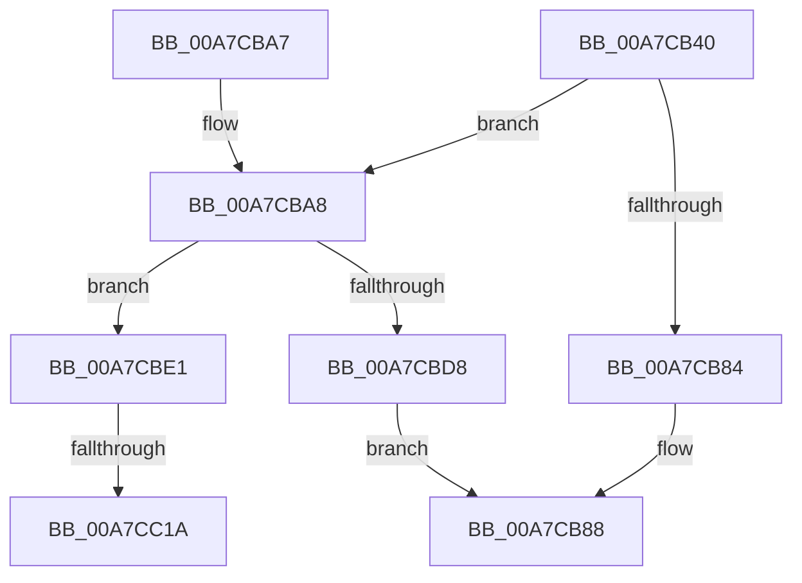

# FsRtlMdlReadEx

- RVA: `0x00A7CB40`–`0x00A7CC2B` (길이 `235` bytes)
- VA: `0x0000000140A7CB40`
- 실행 섹션: `PAGE`
- PDB 이름 있음: `예`; PDB Function 태그: `예`
- unwind 정보 RVA: `0x00093FA4`
- 디코드: `67`개 명령, `235/235` bytes 표시
- 미해석 바이트: `0` (있으면 어셈블리에 `.byte`로 보존)

> 이 문서는 커널 이미지의 기계어와 PDB 기호를 분석해 생성했습니다. 4번과 5번은 함수 원형과 자료형을 바이너리 사용 방식에서 추정한 C 해석이며 원본 소스 복구 결과는 아닙니다.

## 1. Dependencies

- 직접 호출 지점: **4**; 고유 호출 대상: **4**
- 직접 호출자로 확인된 함수: **0**
- RIP 상대 이미지 참조: **0**

### Outgoing calls
- `0x00A7CB7B` → [FsRtlMdlRead](FsRtlMdlRead_function_00A7CC40.md) (function, `0x00A7CC40`)
- `0x00A7CBAB` → [IoGetRelatedDeviceObject](../../text/29/IoGetRelatedDeviceObject_function_0029B120.md) (function, `0x0029B120`)
- `0x00A7CBCB` → [IoBuildAsynchronousFsdRequest](../../text/29/IoBuildAsynchronousFsdRequest_function_0029DD00.md) (function, `0x0029DD00`)
- `0x00A7CBFE` → [IoSynchronousCallDriver](../../text/48/IoSynchronousCallDriver_function_00484050.md) (function, `0x00484050`)

### Direct callers
- 이 함수 시작 RVA로 연결되는 직접 call은 확인되지 않았습니다. 간접 호출은 완전히 역산할 수 없습니다.

### Static image references
- 디코드된 RIP-relative 메모리 참조가 없습니다.

## 2. Other-region calls and transfers

- 다른 실행 섹션으로 향하는 call: **3**
  - `0x00A7CBAB` → [IoGetRelatedDeviceObject](../../text/29/IoGetRelatedDeviceObject_function_0029B120.md) (`PAGE` → `.text`)
  - `0x00A7CBCB` → [IoBuildAsynchronousFsdRequest](../../text/29/IoBuildAsynchronousFsdRequest_function_0029DD00.md) (`PAGE` → `.text`)
  - `0x00A7CBFE` → [IoSynchronousCallDriver](../../text/48/IoSynchronousCallDriver_function_00484050.md) (`PAGE` → `.text`)
- call이 아닌 외부 분기/꼬리 이동: **2**
  - `0x00A7CC14` → [sub_00B42864](../B4/Unknown_function_00B42864.md) (`tail-transfer`)
  - `0x00A7CC26` → [sub_00B42864](../B4/Unknown_function_00B42864.md) (`tail-transfer`)

## 3. Assembly (complete function range)

```asm
00A7CB40  48 8B C4                        mov rax, rsp
00A7CB43  48 89 58 08                     mov qword ptr [rax + 8], rbx
00A7CB47  48 89 68 10                     mov qword ptr [rax + 0x10], rbp
00A7CB4B  48 89 70 18                     mov qword ptr [rax + 0x18], rsi
00A7CB4F  48 89 78 20                     mov qword ptr [rax + 0x20], rdi
00A7CB53  41 54                           push r12
00A7CB55  41 56                           push r14
00A7CB57  41 57                           push r15
00A7CB59  48 83 EC 30                     sub rsp, 0x30
00A7CB5D  48 8B 74 24 78                  mov rsi, qword ptr [rsp + 0x78]
00A7CB62  45 8B E1                        mov r12d, r9d
00A7CB65  4C 8B 74 24 70                  mov r14, qword ptr [rsp + 0x70]
00A7CB6A  41 8B D8                        mov ebx, r8d
00A7CB6D  48 89 70 E0                     mov qword ptr [rax - 0x20], rsi
00A7CB71  4C 8B FA                        mov r15, rdx
00A7CB74  4C 89 70 D8                     mov qword ptr [rax - 0x28], r14
00A7CB78  48 8B F9                        mov rdi, rcx
00A7CB7B  E8 C0 00 00 00                  call 0x140a7cc40
00A7CB80  84 C0                           test al, al
00A7CB82  74 24                           je 0x140a7cba8
00A7CB84  33 FF                           xor edi, edi
00A7CB86  8B C7                           mov eax, edi
00A7CB88  48 8B 5C 24 50                  mov rbx, qword ptr [rsp + 0x50]
00A7CB8D  48 8B 6C 24 58                  mov rbp, qword ptr [rsp + 0x58]
00A7CB92  48 8B 74 24 60                  mov rsi, qword ptr [rsp + 0x60]
00A7CB97  48 8B 7C 24 68                  mov rdi, qword ptr [rsp + 0x68]
00A7CB9C  48 83 C4 30                     add rsp, 0x30
00A7CBA0  41 5F                           pop r15
00A7CBA2  41 5E                           pop r14
00A7CBA4  41 5C                           pop r12
00A7CBA6  C3                              ret
00A7CBA7  CC                              int3
00A7CBA8  48 8B CF                        mov rcx, rdi
00A7CBAB  E8 70 E5 81 FF                  call 0x14029b120
00A7CBB0  48 83 64 24 28 00               and qword ptr [rsp + 0x28], 0
00A7CBB6  45 33 C0                        xor r8d, r8d
00A7CBB9  44 8B CB                        mov r9d, ebx
00A7CBBC  4C 89 7C 24 20                  mov qword ptr [rsp + 0x20], r15
00A7CBC1  48 8B D0                        mov rdx, rax
00A7CBC4  48 8B E8                        mov rbp, rax
00A7CBC7  41 8D 48 03                     lea ecx, [r8 + 3]
00A7CBCB  E8 30 11 82 FF                  call 0x14029dd00
00A7CBD0  48 8B D8                        mov rbx, rax
00A7CBD3  48 85 C0                        test rax, rax
00A7CBD6  75 09                           jne 0x140a7cbe1
00A7CBD8  B8 9A 00 00 C0                  mov eax, 0xc000009a
00A7CBDD  89 06                           mov dword ptr [rsi], eax
00A7CBDF  EB A7                           jmp 0x140a7cb88
00A7CBE1  48 8B 80 B8 00 00 00            mov rax, qword ptr [rax + 0xb8]
00A7CBE8  48 8B D3                        mov rdx, rbx
00A7CBEB  48 8B CD                        mov rcx, rbp
00A7CBEE  48 89 78 E8                     mov qword ptr [rax - 0x18], rdi
00A7CBF2  C6 40 B9 02                     mov byte ptr [rax - 0x47], 2
00A7CBF6  44 89 60 C8                     mov dword ptr [rax - 0x38], r12d
00A7CBFA  83 4B 10 04                     or dword ptr [rbx + 0x10], 4
00A7CBFE  E8 4D 74 A0 FF                  call 0x140484050
00A7CC03  8B 4B 30                        mov ecx, dword ptr [rbx + 0x30]
00A7CC06  8B F8                           mov edi, eax
00A7CC08  89 0E                           mov dword ptr [rsi], ecx
00A7CC0A  48 8B 4B 38                     mov rcx, qword ptr [rbx + 0x38]
00A7CC0E  48 89 4E 08                     mov qword ptr [rsi + 8], rcx
00A7CC12  85 C0                           test eax, eax
00A7CC14  0F 88 4A 5C 0C 00               js 0x140b42864
00A7CC1A  48 8B 4B 08                     mov rcx, qword ptr [rbx + 8]
00A7CC1E  49 89 0E                        mov qword ptr [r14], rcx
00A7CC21  48 83 63 08 00                  and qword ptr [rbx + 8], 0
00A7CC26  E9 39 5C 0C 00                  jmp 0x140b42864
```

## 4. C-style interpretation (structured pseudocode)

```c
__int64 __fastcall FsRtlMdlReadEx(__int64 a1, __int64 a2, int a3, int a4, __int64 a5, __int64 a6)
{
    __int64 result;
    __int64 v_rdi;
    __int64 v_rsp;
    unsigned __int64 v_stack_p10;
    unsigned __int64 v_stack_p18;
    unsigned __int64 v_stack_p20;
    unsigned __int64 v_stack_p28;
    unsigned __int64 v_stack_p8;

    *(unsigned __int64 *)(v_rsp + 8) = v_rbx;
    *(unsigned __int64 *)(v_rsp + 16) = v_rbp;
    *(unsigned __int64 *)(v_rsp + 24) = v_rsi;
    *(unsigned __int64 *)(v_rsp + 32) = v_rdi;
    v_rsp = (v_rsp) - (48);
    *(unsigned __int64 *)(v_rsp - 32) = a6;
    *(unsigned __int64 *)(v_rsp - 40) = a5;
    result = FsRtlMdlRead(a1, a2, a3, a4);
    if ((unsigned __int8)(result) == 0) goto loc_00A7CBA8;
    v_rdi = 0;
loc_00A7CB88:
    v_rsp = (v_rsp) + (48);
    return 0;
loc_00A7CBA8:
    result = IoGetRelatedDeviceObject(v_stack_p20, a2, a3, a4);
    a3 = 0;
    v_stack_p20 = a2;
    result = IoBuildAsynchronousFsdRequest(a3 + 3, result, a3, (unsigned int)((unsigned int)(v_stack_p8)));
    if (result != 0) goto loc_00A7CBE1;
    *(unsigned int *)(v_stack_p18) = (unsigned int)((unsigned int)(0xC000009AULL));
    goto loc_00A7CB88;
loc_00A7CBE1:
    *(unsigned __int64 *)(*(unsigned __int64 *)((unsigned int)(0xC000009AULL) + 184) - 24) = v_stack_p20;
    *(unsigned __int8 *)(*(unsigned __int64 *)((unsigned int)(0xC000009AULL) + 184) - 71) = 2;
    *(unsigned int *)(*(unsigned __int64 *)((unsigned int)(0xC000009AULL) + 184) - 56) = (unsigned int)((unsigned int)(a4));
    result = IoSynchronousCallDriver(result, result, a3, (unsigned int)((unsigned int)(v_stack_p8)));
    *(unsigned int *)(v_stack_p18) = (unsigned int)((unsigned int)(*(unsigned int *)(result + 48)));
    *(unsigned __int64 *)(v_stack_p18 + 8) = *(unsigned __int64 *)(result + 56);
    *(unsigned __int64 *)(a5) = *(unsigned __int64 *)(result + 8);
}
```

## 5. (Beta) C Style

```c
int64_t FsRtlMdlReadEx(int64_t Arg1, int64_t Arg2, int32_t Arg3, int32_t Arg4, void *Arg5, void *Arg6)
{
    uint8_t *arg5 = (uint8_t *)Arg5;
    uint8_t *arg6 = (uint8_t *)Arg6;

    int64_t result;
    int64_t local_rdi;
    int64_t local_rsp;
    uint64_t v_stack_p10;
    uint64_t v_stack_p18;
    uint64_t v_stack_p20;
    uint64_t v_stack_p28;
    uint64_t v_stack_p8;

    *(uint64_t *)(local_rsp + 0x8) = local_rbx;
    *(uint64_t *)(local_rsp + 0x10) = local_rbp;
    *(uint64_t *)(local_rsp + 0x18) = local_rsi;
    *(uint64_t *)(local_rsp + 0x20) = local_rdi;
    local_rsp = (local_rsp) - (48);
    *(void **)(local_rsp - 0x20) = Arg6;
    *(void **)(local_rsp - 0x28) = Arg5;
    result = FsRtlMdlRead(Arg1, Arg2, Arg3, Arg4);
    if ((uint8_t)(result) == 0) goto loc_00A7CBA8;
    local_rdi = 0;
loc_00A7CB88:
    local_rsp = (local_rsp) + (48);
    return 0;
loc_00A7CBA8:
    result = IoGetRelatedDeviceObject(v_stack_p20, Arg2, Arg3, Arg4);
    Arg3 = 0;
    v_stack_p20 = Arg2;
    result = IoBuildAsynchronousFsdRequest(Arg3 + 3, result, Arg3, (uint32_t)((uint32_t)(v_stack_p8)));
    if (result != 0) goto loc_00A7CBE1;
    *(uint32_t *)(v_stack_p18) = (uint32_t)((uint32_t)(0xC000009AULL));
    goto loc_00A7CB88;
loc_00A7CBE1:
    *(uint64_t *)(*(uint64_t *)((uint32_t)(0xC000009AULL) + 0xB8) - 0x18) = v_stack_p20;
    *(uint8_t *)(*(uint64_t *)((uint32_t)(0xC000009AULL) + 0xB8) - 0x47) = 2;
    *(uint32_t *)(*(uint64_t *)((uint32_t)(0xC000009AULL) + 0xB8) - 0x38) = (uint32_t)((uint32_t)(Arg4));
    result = IoSynchronousCallDriver(result, result, Arg3, (uint32_t)((uint32_t)(v_stack_p8)));
    *(uint32_t *)(v_stack_p18) = (uint32_t)((uint32_t)(*(uint32_t *)(result + 0x30)));
    *(uint64_t *)(v_stack_p18 + 0x8) = *(uint64_t *)(result + 0x38);
    *(uint64_t *)(arg5) = *(uint64_t *)(result + 0x8);
}
```

### 관측된 메모리 오프셋

구조체 형식이 확인되지 않은 접근은 인자 기준의 오프셋으로만 기록했습니다.

| 기준 인자 | 오프셋 표현 | 폭 (bit) | 접근 |
|---|---:|---:|---|
| `Arg5` | `+ 0x0` | `64` | `W` |
| `Arg6` | `+ 0x0` | `32` | `W` |
| `Arg6` | `+ 0x8` | `64` | `W` |

## 6. Execution-region graph

[열기: 2D/3D 그래프와 함수 탐색 컨트롤 패널](../../../control-panel.html?section=page&rva=0x00A7CB40&view=graph)

- 2D 그래프는 위에서 아래로 흐르고, 3D 그래프는 빈 공간을 드래그해 회전합니다. Shift+드래그는 이동, 휠은 확대·축소, 함수 노드 선택은 대상 보고서 이동입니다.

### Static fallback


