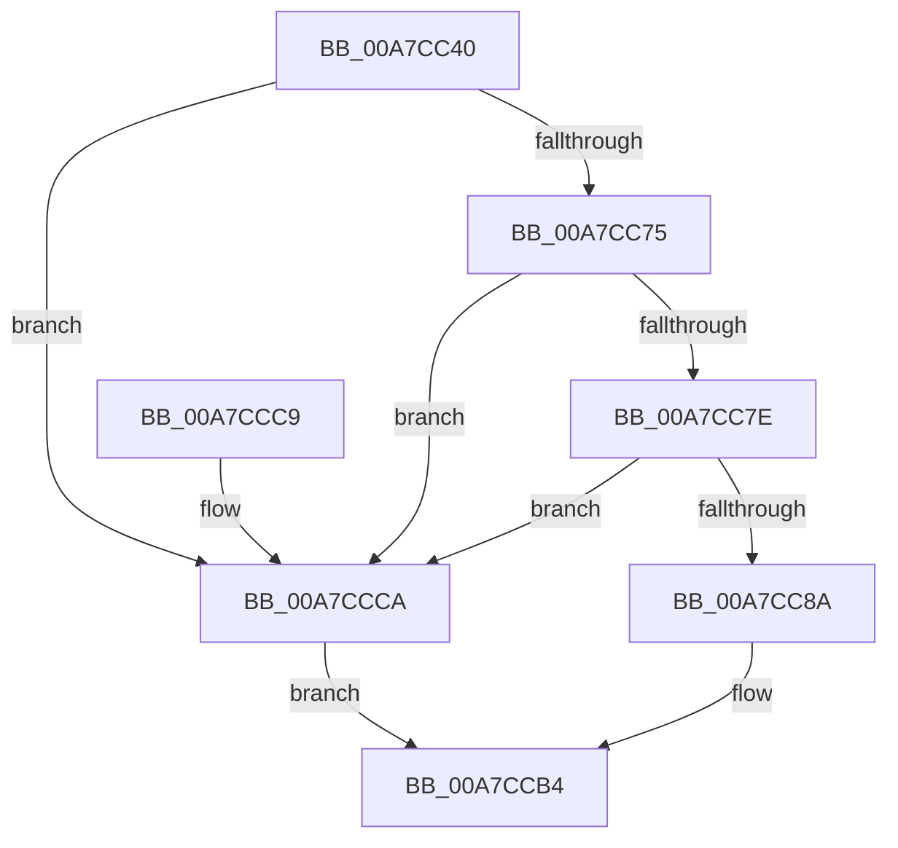

# FsRtlMdlRead

- RVA: `0x00A7CC40`–`0x00A7CCCE` (길이 `142` bytes)
- VA: `0x0000000140A7CC40`
- 실행 섹션: `PAGE`
- PDB 이름 있음: `예`; PDB Function 태그: `아니요`
- unwind 정보 RVA: `0x000B68F4`
- 디코드: `39`개 명령, `142/142` bytes 표시
- 미해석 바이트: `0` (있으면 어셈블리에 `.byte`로 보존)

> 이 문서는 커널 이미지의 기계어와 PDB 기호를 분석해 생성했습니다. 4번과 5번은 함수 원형과 자료형을 바이너리 사용 방식에서 추정한 C 해석이며 원본 소스 복구 결과는 아닙니다.

## 1. Dependencies

- 직접 호출 지점: **2**; 고유 호출 대상: **2**
- 직접 호출자로 확인된 함수: **1**
- RIP 상대 이미지 참조: **0**

### Outgoing calls
- `0x00A7CC60` → [IoGetRelatedDeviceObject](../../text/29/IoGetRelatedDeviceObject_function_0029B120.md) (function, `0x0029B120`)
- `0x00A7CCAF` → [guard_dispatch_icall](../../text/6B/guard_dispatch_icall_function_006BAAD0.md) (function, `0x006BAAD0`)

### Direct callers
- [FsRtlMdlReadEx](FsRtlMdlReadEx_function_00A7CB40.md) at `0x00A7CB7B`

### Static image references
- 디코드된 RIP-relative 메모리 참조가 없습니다.

## 2. Other-region calls and transfers

- 다른 실행 섹션으로 향하는 call: **2**
  - `0x00A7CC60` → [IoGetRelatedDeviceObject](../../text/29/IoGetRelatedDeviceObject_function_0029B120.md) (`PAGE` → `.text`)
  - `0x00A7CCAF` → [guard_dispatch_icall](../../text/6B/guard_dispatch_icall_function_006BAAD0.md) (`PAGE` → `.text`)
- 별도 외부 분기/꼬리 이동을 확인하지 못했습니다.

## 3. Assembly (complete function range)

```asm
00A7CC40  48 89 5C 24 08                  mov qword ptr [rsp + 8], rbx
00A7CC45  48 89 6C 24 10                  mov qword ptr [rsp + 0x10], rbp
00A7CC4A  48 89 74 24 18                  mov qword ptr [rsp + 0x18], rsi
00A7CC4F  57                              push rdi
00A7CC50  48 83 EC 40                     sub rsp, 0x40
00A7CC54  41 8B F9                        mov edi, r9d
00A7CC57  41 8B F0                        mov esi, r8d
00A7CC5A  48 8B EA                        mov rbp, rdx
00A7CC5D  48 8B D9                        mov rbx, rcx
00A7CC60  E8 BB E4 81 FF                  call 0x14029b120
00A7CC65  48 8B C8                        mov rcx, rax
00A7CC68  4C 8B 50 08                     mov r10, qword ptr [rax + 8]
00A7CC6C  4D 8B 5A 50                     mov r11, qword ptr [r10 + 0x50]
00A7CC70  4D 85 DB                        test r11, r11
00A7CC73  74 55                           je 0x140a7ccca
00A7CC75  41 81 3B 80 00 00 00            cmp dword ptr [r11], 0x80
00A7CC7C  76 4C                           jbe 0x140a7ccca
00A7CC7E  49 8B 83 80 00 00 00            mov rax, qword ptr [r11 + 0x80]
00A7CC85  48 85 C0                        test rax, rax
00A7CC88  74 40                           je 0x140a7ccca
00A7CC8A  48 89 4C 24 30                  mov qword ptr [rsp + 0x30], rcx
00A7CC8F  44 8B CF                        mov r9d, edi
00A7CC92  48 8B 4C 24 78                  mov rcx, qword ptr [rsp + 0x78]
00A7CC97  44 8B C6                        mov r8d, esi
00A7CC9A  48 89 4C 24 28                  mov qword ptr [rsp + 0x28], rcx
00A7CC9F  48 8B D5                        mov rdx, rbp
00A7CCA2  48 8B 4C 24 70                  mov rcx, qword ptr [rsp + 0x70]
00A7CCA7  48 89 4C 24 20                  mov qword ptr [rsp + 0x20], rcx
00A7CCAC  48 8B CB                        mov rcx, rbx
00A7CCAF  E8 1C DE C3 FF                  call 0x1406baad0
00A7CCB4  48 8B 5C 24 50                  mov rbx, qword ptr [rsp + 0x50]
00A7CCB9  48 8B 6C 24 58                  mov rbp, qword ptr [rsp + 0x58]
00A7CCBE  48 8B 74 24 60                  mov rsi, qword ptr [rsp + 0x60]
00A7CCC3  48 83 C4 40                     add rsp, 0x40
00A7CCC7  5F                              pop rdi
00A7CCC8  C3                              ret
00A7CCC9  CC                              int3
00A7CCCA  32 C0                           xor al, al
00A7CCCC  EB E6                           jmp 0x140a7ccb4
```

## 4. C-style interpretation (structured pseudocode)

```c
__int64 __fastcall FsRtlMdlRead(__int64 a1, __int64 a2, int a3, int a4, __int64 a5, __int64 a6)
{
    __int64 result;
    __int64 v_rsp;
    unsigned __int64 v_stack_m18;
    unsigned __int64 v_stack_m20;
    unsigned __int64 v_stack_m28;
    unsigned __int64 v_stack_p10;
    unsigned __int64 v_stack_p18;
    unsigned __int64 v_stack_p8;

    v_stack_p8 = v_rbx;
    v_stack_p10 = v_rbp;
    v_stack_p18 = v_rsi;
    v_rsp = (v_rsp) - (64);
    result = IoGetRelatedDeviceObject(a1, a2, a3, a4);
    if (*(unsigned __int64 *)(*(unsigned __int64 *)(result + 8) + 80) == 0) goto loc_00A7CCCA;
    if ((*(unsigned int *)(*(unsigned __int64 *)(*(unsigned __int64 *)(result + 8) + 80))) <= 128) goto loc_00A7CCCA;
    if (*(unsigned __int64 *)(*(unsigned __int64 *)(*(unsigned __int64 *)(result + 8) + 80) + 128) == 0) goto loc_00A7CCCA;
    v_stack_m18 = result;
    v_stack_m20 = a6;
    v_stack_m28 = a5;
    result = guard_dispatch_icall(a1, a2, (unsigned int)((unsigned int)((unsigned int)(a3))), (unsigned int)((unsigned int)((unsigned int)(a4))));
loc_00A7CCB4:
    v_rsp = (v_rsp) + (64);
    return result;
loc_00A7CCCA:
    result = 0;
    goto loc_00A7CCB4;
}
```

## 5. (Beta) C Style

```c
int64_t FsRtlMdlRead(int64_t Arg1, int64_t Arg2, int32_t Arg3, int32_t Arg4, int64_t Arg5, int64_t Arg6)
{
    int64_t result;
    int64_t local_rsp;
    uint64_t v_stack_m18;
    uint64_t v_stack_m20;
    uint64_t v_stack_m28;
    uint64_t v_stack_p10;
    uint64_t v_stack_p18;
    uint64_t v_stack_p8;

    v_stack_p8 = local_rbx;
    v_stack_p10 = local_rbp;
    v_stack_p18 = local_rsi;
    local_rsp = (local_rsp) - (64);
    result = IoGetRelatedDeviceObject(Arg1, Arg2, Arg3, Arg4);
    if (*(uint64_t *)(*(uint64_t *)(result + 0x8) + 0x50) == 0) goto loc_00A7CCCA;
    if ((*(uint32_t *)(*(uint64_t *)(*(uint64_t *)(result + 0x8) + 0x50))) <= 128) goto loc_00A7CCCA;
    if (*(uint64_t *)(*(uint64_t *)(*(uint64_t *)(result + 0x8) + 0x50) + 0x80) == 0) goto loc_00A7CCCA;
    v_stack_m18 = result;
    v_stack_m20 = Arg6;
    v_stack_m28 = Arg5;
    result = guard_dispatch_icall(Arg1, Arg2, (uint32_t)((uint32_t)((uint32_t)(Arg3))), (uint32_t)((uint32_t)((uint32_t)(Arg4))));
loc_00A7CCB4:
    local_rsp = (local_rsp) + (64);
    return result;
loc_00A7CCCA:
    result = 0;
    goto loc_00A7CCB4;
}
```

## 6. Execution-region graph

[열기: 2D/3D 그래프와 함수 탐색 컨트롤 패널](../../../control-panel.html?section=page&rva=0x00A7CC40&view=graph)

- 2D 그래프는 위에서 아래로 흐르고, 3D 그래프는 빈 공간을 드래그해 회전합니다. Shift+드래그는 이동, 휠은 확대·축소, 함수 노드 선택은 대상 보고서 이동입니다.

### Static fallback


