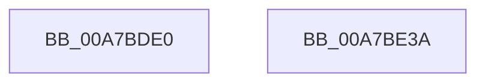

# FsRtlNotifyInitializeSync

- RVA: `0x00A7BDE0`–`0x00A7BE3B` (길이 `91` bytes)
- VA: `0x0000000140A7BDE0`
- 실행 섹션: `PAGE`
- PDB 이름 있음: `예`; PDB Function 태그: `아니요`
- unwind 정보 RVA: `0x0005CAAC`
- 디코드: `25`개 명령, `91/91` bytes 표시
- 미해석 바이트: `0` (있으면 어셈블리에 `.byte`로 보존)

> 이 문서는 커널 이미지의 기계어와 PDB 기호를 분석해 생성했습니다. 4번과 5번은 함수 원형과 자료형을 바이너리 사용 방식에서 추정한 C 해석이며 원본 소스 복구 결과는 아닙니다.

## 1. Dependencies

- 직접 호출 지점: **2**; 고유 호출 대상: **2**
- 직접 호출자로 확인된 함수: **2**
- RIP 상대 이미지 참조: **0**

### Outgoing calls
- `0x00A7BDFF` → [ExAllocatePool2](../../poolcode/B8/ExAllocatePool2_function_00B820F0.md) (function, `0x00B820F0`)
- `0x00A7BE1E` → [KeInitializeEvent](../../text/40/KeInitializeEvent_function_0040DD10.md) (function, `0x0040DD10`)

### Direct callers
- [FsRtlNotifyFilterReportChangeLiteEx](../A1/FsRtlNotifyFilterReportChangeLiteEx_function_00A1F2B0.md) at `0x00A1F95C`
- [FsRtlNotifyFilterChangeDirectoryLite](../AD/FsRtlNotifyFilterChangeDirectoryLite_function_00ADC950.md) at `0x00ADC99C`

### Static image references
- 디코드된 RIP-relative 메모리 참조가 없습니다.

## 2. Other-region calls and transfers

- 다른 실행 섹션으로 향하는 call: **2**
  - `0x00A7BDFF` → [ExAllocatePool2](../../poolcode/B8/ExAllocatePool2_function_00B820F0.md) (`PAGE` → `POOLCODE`)
  - `0x00A7BE1E` → [KeInitializeEvent](../../text/40/KeInitializeEvent_function_0040DD10.md) (`PAGE` → `.text`)
- 별도 외부 분기/꼬리 이동을 확인하지 못했습니다.

## 3. Assembly (complete function range)

```asm
00A7BDE0  48 89 5C 24 08                  mov qword ptr [rsp + 8], rbx
00A7BDE5  57                              push rdi
00A7BDE6  48 83 EC 20                     sub rsp, 0x20
00A7BDEA  48 83 21 00                     and qword ptr [rcx], 0
00A7BDEE  BA 48 00 00 00                  mov edx, 0x48
00A7BDF3  48 8B F9                        mov rdi, rcx
00A7BDF6  41 B8 46 53 72 4E               mov r8d, 0x4e725346
00A7BDFC  8D 4A 1A                        lea ecx, [rdx + 0x1a]
00A7BDFF  E8 EC 62 10 00                  call 0x140b820f0
00A7BE04  BA 01 00 00 00                  mov edx, 1
00A7BE09  45 33 C0                        xor r8d, r8d
00A7BE0C  48 8B D8                        mov rbx, rax
00A7BE0F  48 83 60 08 00                  and qword ptr [rax + 8], 0
00A7BE14  48 8D 48 18                     lea rcx, [rax + 0x18]
00A7BE18  83 60 10 00                     and dword ptr [rax + 0x10], 0
00A7BE1C  89 10                           mov dword ptr [rax], edx
00A7BE1E  E8 ED 1E 99 FF                  call 0x14040dd10
00A7BE23  48 83 63 38 00                  and qword ptr [rbx + 0x38], 0
00A7BE28  83 63 40 00                     and dword ptr [rbx + 0x40], 0
00A7BE2C  48 89 1F                        mov qword ptr [rdi], rbx
00A7BE2F  48 8B 5C 24 30                  mov rbx, qword ptr [rsp + 0x30]
00A7BE34  48 83 C4 20                     add rsp, 0x20
00A7BE38  5F                              pop rdi
00A7BE39  C3                              ret
00A7BE3A  CC                              int3
```

## 4. C-style interpretation (structured pseudocode)

```c
__int64 __fastcall FsRtlNotifyInitializeSync(__int64 a1)
{
    __int64 result;
    __int64 v_rsp;
    unsigned __int64 v_stack_p8;

    v_stack_p8 = v_rbx;
    v_rsp = (v_rsp) - (32);
    result = ExAllocatePool2(72 + 26, 72, (unsigned int)(0x4E725346ULL), a4);
    a3 = 0;
    *(unsigned int *)(result) = 1;
    result = KeInitializeEvent(result + 24, 1, a3, a4);
    *(unsigned __int64 *)(a1) = result;
    v_rsp = (v_rsp) + (32);
    return result;
}
```

## 5. (Beta) C Style

```c
int64_t FsRtlNotifyInitializeSync(void *Arg1)
{
    uint8_t *arg1 = (uint8_t *)Arg1;

    int64_t result;
    int64_t local_rsp;
    uint64_t v_stack_p8;

    v_stack_p8 = local_rbx;
    local_rsp = (local_rsp) - (32);
    result = ExAllocatePool2(72 + 26, 72, (uint32_t)(0x4E725346ULL), a4);
    a3 = 0;
    *(uint32_t *)(result) = 1;
    result = KeInitializeEvent(result + 24, 1, a3, a4);
    *(uint64_t *)(arg1) = result;
    local_rsp = (local_rsp) + (32);
    return result;
}
```

### 관측된 메모리 오프셋

구조체 형식이 확인되지 않은 접근은 인자 기준의 오프셋으로만 기록했습니다.

| 기준 인자 | 오프셋 표현 | 폭 (bit) | 접근 |
|---|---:|---:|---|
| `Arg1` | `+ 0x0` | `64` | `R/W` |
| `Arg1` | `+ 0x0` | `64` | `W` |

## 6. Execution-region graph

[열기: 2D/3D 그래프와 함수 탐색 컨트롤 패널](../../../control-panel.html?section=page&rva=0x00A7BDE0&view=graph)

- 2D 그래프는 위에서 아래로 흐르고, 3D 그래프는 빈 공간을 드래그해 회전합니다. Shift+드래그는 이동, 휠은 확대·축소, 함수 노드 선택은 대상 보고서 이동입니다.

### Static fallback


