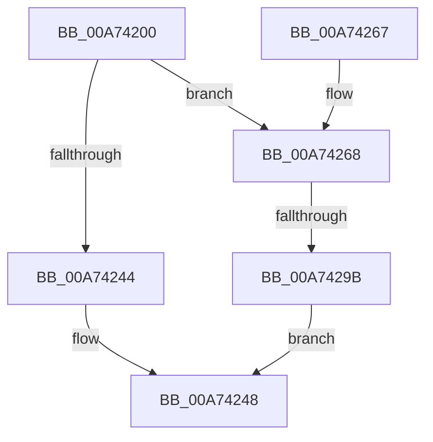

# FsRtlPrepareMdlWriteEx

- RVA: `0x00A74200`–`0x00A742A4` (길이 `164` bytes)
- VA: `0x0000000140A74200`
- 실행 섹션: `PAGE`
- PDB 이름 있음: `예`; PDB Function 태그: `예`
- unwind 정보 RVA: `0x000B5724`
- 디코드: `48`개 명령, `164/164` bytes 표시
- 미해석 바이트: `0` (있으면 어셈블리에 `.byte`로 보존)

> 이 문서는 커널 이미지의 기계어와 PDB 기호를 분석해 생성했습니다. 4번과 5번은 함수 원형과 자료형을 바이너리 사용 방식에서 추정한 C 해석이며 원본 소스 복구 결과는 아닙니다.

## 1. Dependencies

- 직접 호출 지점: **3**; 고유 호출 대상: **3**
- 직접 호출자로 확인된 함수: **0**
- RIP 상대 이미지 참조: **0**

### Outgoing calls
- `0x00A7423B` → [FsRtlPrepareMdlWrite](FsRtlPrepareMdlWrite_function_00A742B0.md) (function, `0x00A742B0`)
- `0x00A7426B` → [IoGetRelatedDeviceObject](../../text/29/IoGetRelatedDeviceObject_function_0029B120.md) (function, `0x0029B120`)
- `0x00A7428A` → [IoBuildAsynchronousFsdRequest](../../text/29/IoBuildAsynchronousFsdRequest_function_0029DD00.md) (function, `0x0029DD00`)

### Direct callers
- 이 함수 시작 RVA로 연결되는 직접 call은 확인되지 않았습니다. 간접 호출은 완전히 역산할 수 없습니다.

### Static image references
- 디코드된 RIP-relative 메모리 참조가 없습니다.

## 2. Other-region calls and transfers

- 다른 실행 섹션으로 향하는 call: **2**
  - `0x00A7426B` → [IoGetRelatedDeviceObject](../../text/29/IoGetRelatedDeviceObject_function_0029B120.md) (`PAGE` → `.text`)
  - `0x00A7428A` → [IoBuildAsynchronousFsdRequest](../../text/29/IoBuildAsynchronousFsdRequest_function_0029DD00.md) (`PAGE` → `.text`)
- call이 아닌 외부 분기/꼬리 이동: **1**
  - `0x00A74295` → [sub_00B406D6](../B4/Unknown_function_00B406D6.md) (`tail-transfer`)

## 3. Assembly (complete function range)

```asm
00A74200  48 8B C4                        mov rax, rsp
00A74203  48 89 58 08                     mov qword ptr [rax + 8], rbx
00A74207  48 89 68 10                     mov qword ptr [rax + 0x10], rbp
00A7420B  48 89 70 18                     mov qword ptr [rax + 0x18], rsi
00A7420F  48 89 78 20                     mov qword ptr [rax + 0x20], rdi
00A74213  41 54                           push r12
00A74215  41 56                           push r14
00A74217  41 57                           push r15
00A74219  48 83 EC 30                     sub rsp, 0x30
00A7421D  48 8B 7C 24 78                  mov rdi, qword ptr [rsp + 0x78]
00A74222  45 8B E1                        mov r12d, r9d
00A74225  4C 8B 74 24 70                  mov r14, qword ptr [rsp + 0x70]
00A7422A  41 8B D8                        mov ebx, r8d
00A7422D  48 89 78 E0                     mov qword ptr [rax - 0x20], rdi
00A74231  4C 8B FA                        mov r15, rdx
00A74234  4C 89 70 D8                     mov qword ptr [rax - 0x28], r14
00A74238  48 8B F1                        mov rsi, rcx
00A7423B  E8 70 00 00 00                  call 0x140a742b0
00A74240  84 C0                           test al, al
00A74242  74 24                           je 0x140a74268
00A74244  33 F6                           xor esi, esi
00A74246  8B C6                           mov eax, esi
00A74248  48 8B 5C 24 50                  mov rbx, qword ptr [rsp + 0x50]
00A7424D  48 8B 6C 24 58                  mov rbp, qword ptr [rsp + 0x58]
00A74252  48 8B 74 24 60                  mov rsi, qword ptr [rsp + 0x60]
00A74257  48 8B 7C 24 68                  mov rdi, qword ptr [rsp + 0x68]
00A7425C  48 83 C4 30                     add rsp, 0x30
00A74260  41 5F                           pop r15
00A74262  41 5E                           pop r14
00A74264  41 5C                           pop r12
00A74266  C3                              ret
00A74267  CC                              int3
00A74268  48 8B CE                        mov rcx, rsi
00A7426B  E8 B0 6E 82 FF                  call 0x14029b120
00A74270  45 33 C0                        xor r8d, r8d
00A74273  48 89 7C 24 28                  mov qword ptr [rsp + 0x28], rdi
00A74278  44 8B CB                        mov r9d, ebx
00A7427B  4C 89 7C 24 20                  mov qword ptr [rsp + 0x20], r15
00A74280  48 8B D0                        mov rdx, rax
00A74283  48 8B E8                        mov rbp, rax
00A74286  41 8D 48 04                     lea ecx, [r8 + 4]
00A7428A  E8 71 9A 82 FF                  call 0x14029dd00
00A7428F  48 8B D8                        mov rbx, rax
00A74292  48 85 C0                        test rax, rax
00A74295  0F 85 3B C4 0C 00               jne 0x140b406d6
00A7429B  B8 9A 00 00 C0                  mov eax, 0xc000009a
00A742A0  89 07                           mov dword ptr [rdi], eax
00A742A2  EB A4                           jmp 0x140a74248
```

## 4. C-style interpretation (structured pseudocode)

```c
__int64 __fastcall FsRtlPrepareMdlWriteEx(__int64 a1, __int64 a2, int a3, int a4, __int64 a5, __int64 a6)
{
    __int64 result;
    __int64 v_rsi;
    __int64 v_rsp;
    unsigned __int64 v_stack_p10;
    unsigned __int64 v_stack_p18;
    unsigned __int64 v_stack_p20;
    unsigned __int64 v_stack_p28;
    unsigned __int64 v_stack_p8;

    *(unsigned __int64 *)(v_rsp + 8) = v_rbx;
    *(unsigned __int64 *)(v_rsp + 16) = v_rbp;
    *(unsigned __int64 *)(v_rsp + 24) = v_rsi;
    *(unsigned __int64 *)(v_rsp + 32) = v_rdi;
    v_rsp = (v_rsp) - (48);
    *(unsigned __int64 *)(v_rsp - 32) = a6;
    *(unsigned __int64 *)(v_rsp - 40) = a5;
    result = FsRtlPrepareMdlWrite(a1, a2, a3, a4);
    if ((unsigned __int8)(result) == 0) goto loc_00A74268;
    v_rsi = 0;
loc_00A74248:
    v_rsp = (v_rsp) + (48);
    return 0;
loc_00A74268:
    result = IoGetRelatedDeviceObject(v_stack_p18, a2, a3, a4);
    a3 = 0;
    v_stack_p28 = v_stack_p20;
    v_stack_p20 = a2;
    result = IoBuildAsynchronousFsdRequest(a3 + 4, result, a3, (unsigned int)((unsigned int)(v_stack_p8)));
    *(unsigned int *)(v_stack_p20) = (unsigned int)((unsigned int)(0xC000009AULL));
    goto loc_00A74248;
}
```

## 5. (Beta) C Style

```c
int64_t FsRtlPrepareMdlWriteEx(int64_t Arg1, int64_t Arg2, int32_t Arg3, int32_t Arg4, int64_t Arg5, void *Arg6)
{
    uint8_t *arg6 = (uint8_t *)Arg6;

    int64_t result;
    int64_t local_rsi;
    int64_t local_rsp;
    uint64_t v_stack_p10;
    uint64_t v_stack_p18;
    uint64_t v_stack_p20;
    uint64_t v_stack_p28;
    uint64_t v_stack_p8;

    *(uint64_t *)(local_rsp + 0x8) = local_rbx;
    *(uint64_t *)(local_rsp + 0x10) = local_rbp;
    *(uint64_t *)(local_rsp + 0x18) = local_rsi;
    *(uint64_t *)(local_rsp + 0x20) = local_rdi;
    local_rsp = (local_rsp) - (48);
    *(void **)(local_rsp - 0x20) = Arg6;
    *(uint64_t *)(local_rsp - 0x28) = Arg5;
    result = FsRtlPrepareMdlWrite(Arg1, Arg2, Arg3, Arg4);
    if ((uint8_t)(result) == 0) goto loc_00A74268;
    local_rsi = 0;
loc_00A74248:
    local_rsp = (local_rsp) + (48);
    return 0;
loc_00A74268:
    result = IoGetRelatedDeviceObject(v_stack_p18, Arg2, Arg3, Arg4);
    Arg3 = 0;
    v_stack_p28 = v_stack_p20;
    v_stack_p20 = Arg2;
    result = IoBuildAsynchronousFsdRequest(Arg3 + 4, result, Arg3, (uint32_t)((uint32_t)(v_stack_p8)));
    *(uint32_t *)(v_stack_p20) = (uint32_t)((uint32_t)(0xC000009AULL));
    goto loc_00A74248;
}
```

### 관측된 메모리 오프셋

구조체 형식이 확인되지 않은 접근은 인자 기준의 오프셋으로만 기록했습니다.

| 기준 인자 | 오프셋 표현 | 폭 (bit) | 접근 |
|---|---:|---:|---|
| `Arg6` | `+ 0x0` | `32` | `W` |

## 6. Execution-region graph

[열기: 2D/3D 그래프와 함수 탐색 컨트롤 패널](../../../control-panel.html?section=page&rva=0x00A74200&view=graph)

- 2D 그래프는 위에서 아래로 흐르고, 3D 그래프는 빈 공간을 드래그해 회전합니다. Shift+드래그는 이동, 휠은 확대·축소, 함수 노드 선택은 대상 보고서 이동입니다.

### Static fallback


