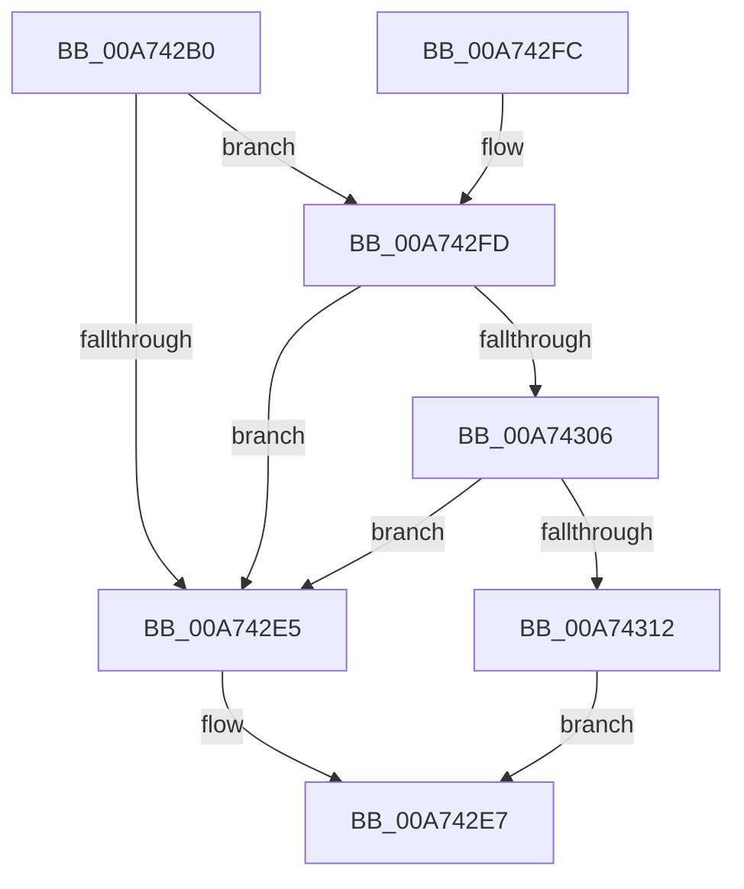

# FsRtlPrepareMdlWrite

- RVA: `0x00A742B0`–`0x00A7433E` (길이 `142` bytes)
- VA: `0x0000000140A742B0`
- 실행 섹션: `PAGE`
- PDB 이름 있음: `예`; PDB Function 태그: `아니요`
- unwind 정보 RVA: `0x000A9B80`
- 디코드: `39`개 명령, `142/142` bytes 표시
- 미해석 바이트: `0` (있으면 어셈블리에 `.byte`로 보존)

> 이 문서는 커널 이미지의 기계어와 PDB 기호를 분석해 생성했습니다. 4번과 5번은 함수 원형과 자료형을 바이너리 사용 방식에서 추정한 C 해석이며 원본 소스 복구 결과는 아닙니다.

## 1. Dependencies

- 직접 호출 지점: **2**; 고유 호출 대상: **2**
- 직접 호출자로 확인된 함수: **1**
- RIP 상대 이미지 참조: **0**

### Outgoing calls
- `0x00A742D0` → [IoGetRelatedDeviceObject](../../text/29/IoGetRelatedDeviceObject_function_0029B120.md) (function, `0x0029B120`)
- `0x00A74337` → [guard_dispatch_icall](../../text/6B/guard_dispatch_icall_function_006BAAD0.md) (function, `0x006BAAD0`)

### Direct callers
- [FsRtlPrepareMdlWriteEx](FsRtlPrepareMdlWriteEx_function_00A74200.md) at `0x00A7423B`

### Static image references
- 디코드된 RIP-relative 메모리 참조가 없습니다.

## 2. Other-region calls and transfers

- 다른 실행 섹션으로 향하는 call: **2**
  - `0x00A742D0` → [IoGetRelatedDeviceObject](../../text/29/IoGetRelatedDeviceObject_function_0029B120.md) (`PAGE` → `.text`)
  - `0x00A74337` → [guard_dispatch_icall](../../text/6B/guard_dispatch_icall_function_006BAAD0.md) (`PAGE` → `.text`)
- 별도 외부 분기/꼬리 이동을 확인하지 못했습니다.

## 3. Assembly (complete function range)

```asm
00A742B0  48 89 5C 24 08                  mov qword ptr [rsp + 8], rbx
00A742B5  48 89 6C 24 10                  mov qword ptr [rsp + 0x10], rbp
00A742BA  48 89 74 24 18                  mov qword ptr [rsp + 0x18], rsi
00A742BF  57                              push rdi
00A742C0  48 83 EC 40                     sub rsp, 0x40
00A742C4  41 8B F9                        mov edi, r9d
00A742C7  41 8B F0                        mov esi, r8d
00A742CA  48 8B EA                        mov rbp, rdx
00A742CD  48 8B D9                        mov rbx, rcx
00A742D0  E8 4B 6E 82 FF                  call 0x14029b120
00A742D5  48 8B C8                        mov rcx, rax
00A742D8  4C 8B 50 08                     mov r10, qword ptr [rax + 8]
00A742DC  4D 8B 5A 50                     mov r11, qword ptr [r10 + 0x50]
00A742E0  4D 85 DB                        test r11, r11
00A742E3  75 18                           jne 0x140a742fd
00A742E5  32 C0                           xor al, al
00A742E7  48 8B 5C 24 50                  mov rbx, qword ptr [rsp + 0x50]
00A742EC  48 8B 6C 24 58                  mov rbp, qword ptr [rsp + 0x58]
00A742F1  48 8B 74 24 60                  mov rsi, qword ptr [rsp + 0x60]
00A742F6  48 83 C4 40                     add rsp, 0x40
00A742FA  5F                              pop rdi
00A742FB  C3                              ret
00A742FC  CC                              int3
00A742FD  41 81 3B 90 00 00 00            cmp dword ptr [r11], 0x90
00A74304  76 DF                           jbe 0x140a742e5
00A74306  49 8B 83 90 00 00 00            mov rax, qword ptr [r11 + 0x90]
00A7430D  48 85 C0                        test rax, rax
00A74310  74 D3                           je 0x140a742e5
00A74312  48 89 4C 24 30                  mov qword ptr [rsp + 0x30], rcx
00A74317  44 8B CF                        mov r9d, edi
00A7431A  48 8B 4C 24 78                  mov rcx, qword ptr [rsp + 0x78]
00A7431F  44 8B C6                        mov r8d, esi
00A74322  48 89 4C 24 28                  mov qword ptr [rsp + 0x28], rcx
00A74327  48 8B D5                        mov rdx, rbp
00A7432A  48 8B 4C 24 70                  mov rcx, qword ptr [rsp + 0x70]
00A7432F  48 89 4C 24 20                  mov qword ptr [rsp + 0x20], rcx
00A74334  48 8B CB                        mov rcx, rbx
00A74337  E8 94 67 C4 FF                  call 0x1406baad0
00A7433C  EB A9                           jmp 0x140a742e7
```

## 4. C-style interpretation (structured pseudocode)

```c
__int64 __fastcall FsRtlPrepareMdlWrite(__int64 a1, __int64 a2, int a3, int a4, __int64 a5, __int64 a6)
{
    __int64 result;
    __int64 v_rsp;
    unsigned __int64 v_stack_p10;
    unsigned __int64 v_stack_p18;
    unsigned __int64 v_stack_p20;
    unsigned __int64 v_stack_p28;
    unsigned __int64 v_stack_p30;
    unsigned __int64 v_stack_p8;

    v_stack_p8 = v_rbx;
    v_stack_p10 = v_rbp;
    v_stack_p18 = v_rsi;
    v_rsp = (v_rsp) - (64);
    result = IoGetRelatedDeviceObject(a1, a2, a3, a4);
    if (*(unsigned __int64 *)(*(unsigned __int64 *)(result + 8) + 80) != 0) goto loc_00A742FD;
loc_00A742E5:
    result = 0;
loc_00A742E7:
    v_rsp = (v_rsp) + (64);
    return result;
loc_00A742FD:
    if ((*(unsigned int *)(*(unsigned __int64 *)(*(unsigned __int64 *)(result + 8) + 80))) <= 144) goto loc_00A742E5;
    if (*(unsigned __int64 *)(*(unsigned __int64 *)(*(unsigned __int64 *)(result + 8) + 80) + 144) == 0) goto loc_00A742E5;
    v_stack_p30 = 0;
    v_stack_p28 = a6;
    v_stack_p20 = a5;
    result = guard_dispatch_icall(v_stack_p8, v_stack_p10, (unsigned int)((unsigned int)(v_stack_p18)), (unsigned int)((unsigned int)((unsigned int)(a4))));
    goto loc_00A742E7;
}
```

## 5. (Beta) C Style

```c
int64_t FsRtlPrepareMdlWrite(int64_t Arg1, int64_t Arg2, int32_t Arg3, int32_t Arg4, int64_t Arg5, int64_t Arg6)
{
    int64_t result;
    int64_t local_rsp;
    uint64_t v_stack_p10;
    uint64_t v_stack_p18;
    uint64_t v_stack_p20;
    uint64_t v_stack_p28;
    uint64_t v_stack_p30;
    uint64_t v_stack_p8;

    v_stack_p8 = local_rbx;
    v_stack_p10 = local_rbp;
    v_stack_p18 = local_rsi;
    local_rsp = (local_rsp) - (64);
    result = IoGetRelatedDeviceObject(Arg1, Arg2, Arg3, Arg4);
    if (*(uint64_t *)(*(uint64_t *)(result + 0x8) + 0x50) != 0) goto loc_00A742FD;
loc_00A742E5:
    result = 0;
loc_00A742E7:
    local_rsp = (local_rsp) + (64);
    return result;
loc_00A742FD:
    if ((*(uint32_t *)(*(uint64_t *)(*(uint64_t *)(result + 0x8) + 0x50))) <= 144) goto loc_00A742E5;
    if (*(uint64_t *)(*(uint64_t *)(*(uint64_t *)(result + 0x8) + 0x50) + 0x90) == 0) goto loc_00A742E5;
    v_stack_p30 = 0;
    v_stack_p28 = Arg6;
    v_stack_p20 = Arg5;
    result = guard_dispatch_icall(v_stack_p8, v_stack_p10, (uint32_t)((uint32_t)(v_stack_p18)), (uint32_t)((uint32_t)((uint32_t)(Arg4))));
    goto loc_00A742E7;
}
```

## 6. Execution-region graph

[열기: 2D/3D 그래프와 함수 탐색 컨트롤 패널](../../../control-panel.html?section=page&rva=0x00A742B0&view=graph)

- 2D 그래프는 위에서 아래로 흐르고, 3D 그래프는 빈 공간을 드래그해 회전합니다. Shift+드래그는 이동, 휠은 확대·축소, 함수 노드 선택은 대상 보고서 이동입니다.

### Static fallback


