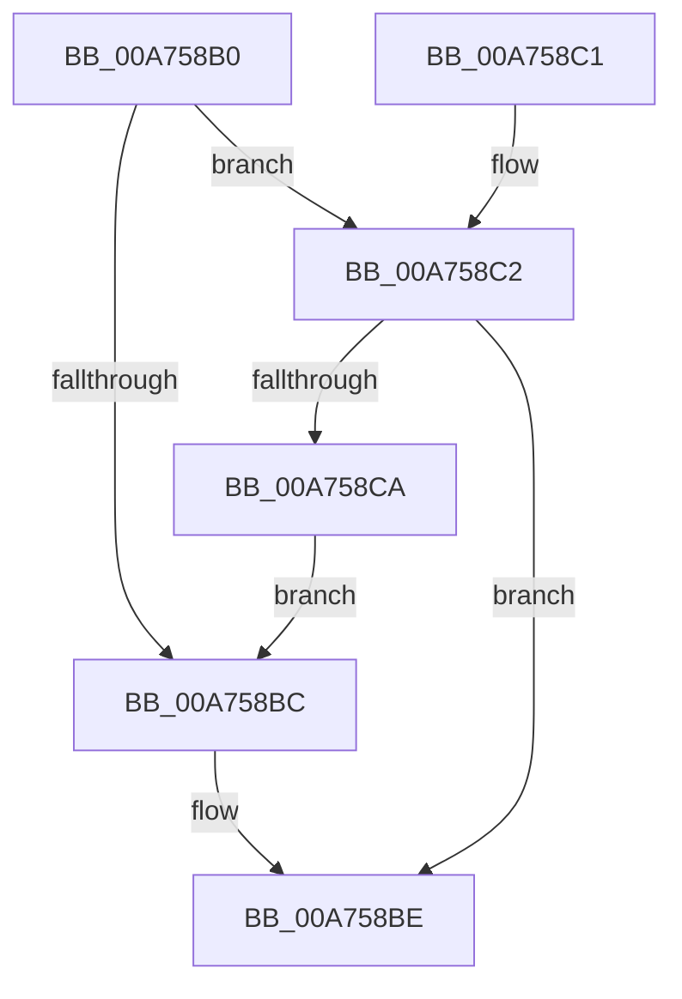

# IoIsFileObjectIgnoringSharing

- RVA: `0x00A758B0`–`0x00A758CC` (길이 `28` bytes)
- VA: `0x0000000140A758B0`
- 실행 섹션: `PAGE`
- PDB 이름 있음: `예`; PDB Function 태그: `아니요`
- unwind 정보 RVA: `0x000DB714`
- 디코드: `12`개 명령, `28/28` bytes 표시
- 미해석 바이트: `0` (있으면 어셈블리에 `.byte`로 보존)

> 이 문서는 커널 이미지의 기계어와 PDB 기호를 분석해 생성했습니다. 4번과 5번은 함수 원형과 자료형을 바이너리 사용 방식에서 추정한 C 해석이며 원본 소스 복구 결과는 아닙니다.

## 1. Dependencies

- 직접 호출 지점: **0**; 고유 호출 대상: **0**
- 직접 호출자로 확인된 함수: **0**
- RIP 상대 이미지 참조: **0**

### Outgoing calls
- 직접 디코드된 call 명령이 없습니다.

### Direct callers
- 이 함수 시작 RVA로 연결되는 직접 call은 확인되지 않았습니다. 간접 호출은 완전히 역산할 수 없습니다.

### Static image references
- 디코드된 RIP-relative 메모리 참조가 없습니다.

## 2. Other-region calls and transfers

- 다른 실행 섹션으로 향하는 call: **0**
- 별도 외부 분기/꼬리 이동을 확인하지 못했습니다.

## 3. Assembly (complete function range)

```asm
00A758B0  48 8B 81 D0 00 00 00            mov rax, qword ptr [rcx + 0xd0]
00A758B7  48 85 C0                        test rax, rax
00A758BA  75 06                           jne 0x140a758c2
00A758BC  32 C9                           xor cl, cl
00A758BE  8A C1                           mov al, cl
00A758C0  C3                              ret
00A758C1  CC                              int3
00A758C2  8B 00                           mov eax, dword ptr [rax]
00A758C4  B1 01                           mov cl, 1
00A758C6  84 C1                           test cl, al
00A758C8  75 F4                           jne 0x140a758be
00A758CA  EB F0                           jmp 0x140a758bc
```

## 4. C-style interpretation (structured pseudocode)

```c
__int64 __fastcall IoIsFileObjectIgnoringSharing(__int64 a1)
{
    if (*(unsigned __int64 *)(a1 + 208) != 0) goto loc_00A758C2;
loc_00A758BC:
    a1 = 0;
loc_00A758BE:
    return 0;
loc_00A758C2:
    if (((1) & ((unsigned __int8)((unsigned int)(*(unsigned int *)(0))))) != 0) goto loc_00A758BE;
    goto loc_00A758BC;
}
```

## 5. (Beta) C Style

```c
int64_t IoIsFileObjectIgnoringSharing(void *Arg1)
{
    uint8_t *arg1 = (uint8_t *)Arg1;

    if (*(uint64_t *)(arg1 + 0xD0) != 0) goto loc_00A758C2;
loc_00A758BC:
    Arg1 = 0;
loc_00A758BE:
    return 0;
loc_00A758C2:
    if (((1) & ((uint8_t)((uint32_t)(*(uint32_t *)(0))))) != 0) goto loc_00A758BE;
    goto loc_00A758BC;
}
```

### 관측된 메모리 오프셋

구조체 형식이 확인되지 않은 접근은 인자 기준의 오프셋으로만 기록했습니다.

| 기준 인자 | 오프셋 표현 | 폭 (bit) | 접근 |
|---|---:|---:|---|
| `Arg1` | `+ 0xD0` | `64` | `R` |

## 6. Execution-region graph

[열기: 2D/3D 그래프와 함수 탐색 컨트롤 패널](../../../control-panel.html?section=page&rva=0x00A758B0&view=graph)

- 2D 그래프는 위에서 아래로 흐르고, 3D 그래프는 빈 공간을 드래그해 회전합니다. Shift+드래그는 이동, 휠은 확대·축소, 함수 노드 선택은 대상 보고서 이동입니다.

### Static fallback


