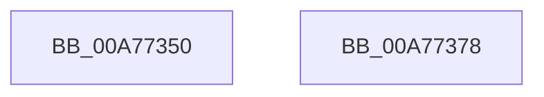

# IopGetEnvironmentVariableHal

- RVA: `0x00A77350`–`0x00A77379` (길이 `41` bytes)
- VA: `0x0000000140A77350`
- 실행 섹션: `PAGE`
- PDB 이름 있음: `예`; PDB Function 태그: `아니요`
- unwind 정보 RVA: `0x0005D2F4`
- 디코드: `11`개 명령, `41/41` bytes 표시
- 미해석 바이트: `0` (있으면 어셈블리에 `.byte`로 보존)

> 이 문서는 커널 이미지의 기계어와 PDB 기호를 분석해 생성했습니다. 4번과 5번은 함수 원형과 자료형을 바이너리 사용 방식에서 추정한 C 해석이며 원본 소스 복구 결과는 아닙니다.

## 1. Dependencies

- 직접 호출 지점: **1**; 고유 호출 대상: **1**
- 직접 호출자로 확인된 함수: **0**
- RIP 상대 이미지 참조: **0**

### Outgoing calls
- `0x00A7736E` → [HalGetEnvironmentVariableEx](../../text/44/HalGetEnvironmentVariableEx_function_00449100.md) (function, `0x00449100`)

### Direct callers
- 이 함수 시작 RVA로 연결되는 직접 call은 확인되지 않았습니다. 간접 호출은 완전히 역산할 수 없습니다.

### Static image references
- 디코드된 RIP-relative 메모리 참조가 없습니다.

## 2. Other-region calls and transfers

- 다른 실행 섹션으로 향하는 call: **1**
  - `0x00A7736E` → [HalGetEnvironmentVariableEx](../../text/44/HalGetEnvironmentVariableEx_function_00449100.md) (`PAGE` → `.text`)
- 별도 외부 분기/꼬리 이동을 확인하지 못했습니다.

## 3. Assembly (complete function range)

```asm
00A77350  48 83 EC 38                     sub rsp, 0x38
00A77354  48 8B 44 24 70                  mov rax, qword ptr [rsp + 0x70]
00A77359  49 8B D1                        mov rdx, r9
00A7735C  4C 8B 4C 24 68                  mov r9, qword ptr [rsp + 0x68]
00A77361  49 8B C8                        mov rcx, r8
00A77364  4C 8B 44 24 60                  mov r8, qword ptr [rsp + 0x60]
00A77369  48 89 44 24 20                  mov qword ptr [rsp + 0x20], rax
00A7736E  E8 8D 1D 9D FF                  call 0x140449100
00A77373  48 83 C4 38                     add rsp, 0x38
00A77377  C3                              ret
00A77378  CC                              int3
```

## 4. C-style interpretation (structured pseudocode)

```c
__int64 __fastcall IopGetEnvironmentVariableHal(__int64 a1, __int64 a2, __int64 a3, __int64 a4, __int64 a5, __int64 a6, __int64 a7)
{
    __int64 result;
    __int64 v_rsp;
    unsigned __int64 v_stack_m18;

    v_rsp = (v_rsp) - (56);
    v_stack_m18 = a7;
    result = HalGetEnvironmentVariableEx(a3, a4, a5, a6);
    v_rsp = (v_rsp) + (56);
    return result;
}
```

## 5. (Beta) C Style

```c
int64_t IopGetEnvironmentVariableHal(int64_t Arg1, int64_t Arg2, int64_t Arg3, int64_t Arg4, int64_t Arg5, int64_t Arg6, int64_t Arg7)
{
    int64_t result;
    int64_t local_rsp;
    uint64_t v_stack_m18;

    local_rsp = (local_rsp) - (56);
    v_stack_m18 = Arg7;
    result = HalGetEnvironmentVariableEx(Arg3, Arg4, Arg5, Arg6);
    local_rsp = (local_rsp) + (56);
    return result;
}
```

## 6. Execution-region graph

[열기: 2D/3D 그래프와 함수 탐색 컨트롤 패널](../../../control-panel.html?section=page&rva=0x00A77350&view=graph)

- 2D 그래프는 위에서 아래로 흐르고, 3D 그래프는 빈 공간을 드래그해 회전합니다. Shift+드래그는 이동, 휠은 확대·축소, 함수 노드 선택은 대상 보고서 이동입니다.

### Static fallback


