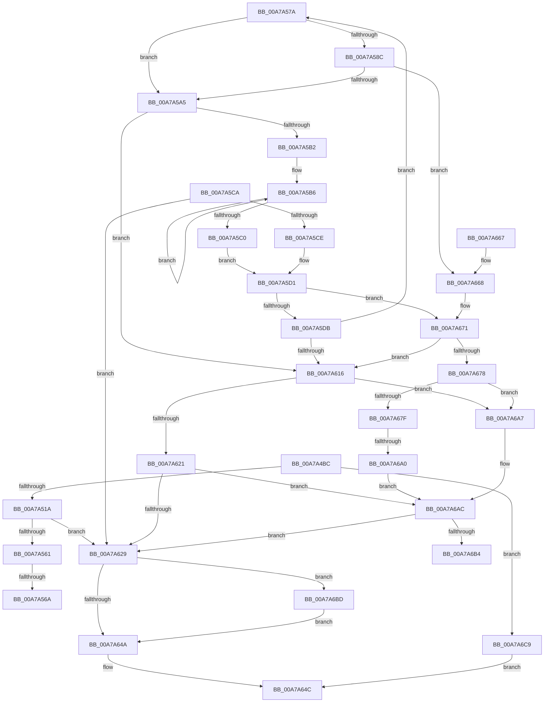

# IopGetRootDevices

- RVA: `0x00A7A4BC`–`0x00A7A6D3` (길이 `535` bytes)
- VA: `0x0000000140A7A4BC`
- 실행 섹션: `PAGE`
- PDB 이름 있음: `예`; PDB Function 태그: `예`
- unwind 정보 RVA: `0x000B635C`
- 디코드: `142`개 명령, `535/535` bytes 표시
- 미해석 바이트: `0` (있으면 어셈블리에 `.byte`로 보존)

> 이 문서는 커널 이미지의 기계어와 PDB 기호를 분석해 생성했습니다. 4번과 5번은 함수 원형과 자료형을 바이너리 사용 방식에서 추정한 C 해석이며 원본 소스 복구 결과는 아닙니다.

## 1. Dependencies

- 직접 호출 지점: **13**; 고유 호출 대상: **9**
- 직접 호출자로 확인된 함수: **1**
- RIP 상대 이미지 참조: **2**

### Outgoing calls
- `0x00A7A508` → [ExAllocatePool2](../../poolcode/B8/ExAllocatePool2_function_00B820F0.md) (function, `0x00B820F0`)
- `0x00A7A540` → [ExAcquireResourceExclusiveLite](../../text/21/ExAcquireResourceExclusiveLite_function_00214E20.md) (function, `0x00214E20`)
- `0x00A7A56F` → [ExFreePoolWithTag](../../poolcode/B8/ExFreePoolWithTag_function_00B82870.md) (function, `0x00B82870`)
- `0x00A7A581` → [RtlInitUnicodeStringEx](../../text/46/RtlInitUnicodeStringEx_function_00463960.md) (function, `0x00463960`)
- `0x00A7A598` → [IopInitializeDeviceInstanceKey](IopInitializeDeviceInstanceKey_function_00A7A6DC.md) (function, `0x00A7A6DC`)
- `0x00A7A5A9` → [ZwClose](../../text/6A/ZwClose_function_006AD2B0.md) (function, `0x006AD2B0`)
- `0x00A7A607` → [_CmOpenDeviceRegKey](../8E/_CmOpenDeviceRegKey_function_008EE540.md) (function, `0x008EE540`)
- `0x00A7A630` → [ExReleaseResourceLite](../../text/25/ExReleaseResourceLite_function_0025FA10.md) (function, `0x0025FA10`)
- `0x00A7A635` → [KeLeaveCriticalRegion](../../text/25/KeLeaveCriticalRegion_function_0025D8B0.md) (function, `0x0025D8B0`)
- `0x00A7A640` → [ExFreePoolWithTag](../../poolcode/B8/ExFreePoolWithTag_function_00B82870.md) (function, `0x00B82870`)
- `0x00A7A66C` → [ZwClose](../../text/6A/ZwClose_function_006AD2B0.md) (function, `0x006AD2B0`)
- `0x00A7A68F` → [ExAllocatePool2](../../poolcode/B8/ExAllocatePool2_function_00B820F0.md) (function, `0x00B820F0`)
- `0x00A7A6C2` → [ExFreePoolWithTag](../../poolcode/B8/ExFreePoolWithTag_function_00B82870.md) (function, `0x00B82870`)

### Direct callers
- [IopPnPDispatch](IopPnPDispatch_function_00A74B90.md) at `0x00A74DDF`

### Static image references
- `0x00A7A538` → RVA `0x00F8C600` (`.data`; read)
- `0x00A7A5DB` → RVA `0x00E66398` (`.data`; read)

## 2. Other-region calls and transfers

- 다른 실행 섹션으로 향하는 call: **11**
  - `0x00A7A508` → [ExAllocatePool2](../../poolcode/B8/ExAllocatePool2_function_00B820F0.md) (`PAGE` → `POOLCODE`)
  - `0x00A7A540` → [ExAcquireResourceExclusiveLite](../../text/21/ExAcquireResourceExclusiveLite_function_00214E20.md) (`PAGE` → `.text`)
  - `0x00A7A56F` → [ExFreePoolWithTag](../../poolcode/B8/ExFreePoolWithTag_function_00B82870.md) (`PAGE` → `POOLCODE`)
  - `0x00A7A581` → [RtlInitUnicodeStringEx](../../text/46/RtlInitUnicodeStringEx_function_00463960.md) (`PAGE` → `.text`)
  - `0x00A7A5A9` → [ZwClose](../../text/6A/ZwClose_function_006AD2B0.md) (`PAGE` → `.text`)
  - `0x00A7A630` → [ExReleaseResourceLite](../../text/25/ExReleaseResourceLite_function_0025FA10.md) (`PAGE` → `.text`)
  - `0x00A7A635` → [KeLeaveCriticalRegion](../../text/25/KeLeaveCriticalRegion_function_0025D8B0.md) (`PAGE` → `.text`)
  - `0x00A7A640` → [ExFreePoolWithTag](../../poolcode/B8/ExFreePoolWithTag_function_00B82870.md) (`PAGE` → `POOLCODE`)
  - `0x00A7A66C` → [ZwClose](../../text/6A/ZwClose_function_006AD2B0.md) (`PAGE` → `.text`)
  - `0x00A7A68F` → [ExAllocatePool2](../../poolcode/B8/ExAllocatePool2_function_00B820F0.md) (`PAGE` → `POOLCODE`)
  - `0x00A7A6C2` → [ExFreePoolWithTag](../../poolcode/B8/ExFreePoolWithTag_function_00B82870.md) (`PAGE` → `POOLCODE`)
- call이 아닌 외부 분기/꼬리 이동: **4**
  - `0x00A7A564` → [sub_00B4200E](../B4/Unknown_function_00B4200E.md) (`tail-transfer`)
  - `0x00A7A575` → [sub_00B4200E](../B4/Unknown_function_00B4200E.md) (`tail-transfer`)
  - `0x00A7A69A` → [sub_00B4200E + 0x61](../B4/Unknown_function_00B4200E.md) (`tail-transfer`)
  - `0x00A7A6B8` → [sub_00B4200E + 0x81](../B4/Unknown_function_00B4200E.md) (`tail-transfer`)

## 3. Assembly (complete function range)

```asm
00A7A4BC  48 89 5C 24 18                  mov qword ptr [rsp + 0x18], rbx
00A7A4C1  55                              push rbp
00A7A4C2  56                              push rsi
00A7A4C3  57                              push rdi
00A7A4C4  41 54                           push r12
00A7A4C6  41 55                           push r13
00A7A4C8  41 56                           push r14
00A7A4CA  41 57                           push r15
00A7A4CC  48 8B EC                        mov rbp, rsp
00A7A4CF  48 81 EC 80 00 00 00            sub rsp, 0x80
00A7A4D6  45 33 ED                        xor r13d, r13d
00A7A4D9  4C 8B E1                        mov r12, rcx
00A7A4DC  4C 89 29                        mov qword ptr [rcx], r13
00A7A4DF  0F 57 C0                        xorps xmm0, xmm0
00A7A4E2  41 BF 50 70 64 64               mov r15d, 0x64647050
00A7A4E8  44 89 6D E0                     mov dword ptr [rbp - 0x20], r13d
00A7A4EC  B9 00 01 00 00                  mov ecx, 0x100
00A7A4F1  44 89 6D EC                     mov dword ptr [rbp - 0x14], r13d
00A7A4F5  45 8B C7                        mov r8d, r15d
00A7A4F8  4C 89 6D 48                     mov qword ptr [rbp + 0x48], r13
00A7A4FC  BA 00 04 00 00                  mov edx, 0x400
00A7A501  41 8B F5                        mov esi, r13d
00A7A504  0F 11 45 D0                     movups xmmword ptr [rbp - 0x30], xmm0
00A7A508  E8 E3 7B 10 00                  call 0x140b820f0
00A7A50D  48 89 45 F0                     mov qword ptr [rbp - 0x10], rax
00A7A511  48 85 C0                        test rax, rax
00A7A514  0F 84 AF 01 00 00               je 0x140a7a6c9
00A7A51A  65 48 8B 04 25 88 01 00 00      mov rax, qword ptr gs:[0x188]
00A7A523  48 83 C9 FF                     or rcx, 0xffffffffffffffff
00A7A527  B2 01                           mov dl, 1
00A7A529  48 C7 45 E4 80 00 00 00         mov qword ptr [rbp - 0x1c], 0x80
00A7A531  66 01 88 E4 01 00 00            add word ptr [rax + 0x1e4], cx
00A7A538  48 8D 0D C1 20 51 00            lea rcx, [rip + 0x5120c1]
00A7A53F  90                              nop
00A7A540  E8 DB A8 79 FF                  call 0x140214e20
00A7A545  41 BE 23 00 00 C0               mov r14d, 0xc0000023
00A7A54B  C7 45 40 00 08 00 00            mov dword ptr [rbp + 0x40], 0x800
00A7A552  41 8B DE                        mov ebx, r14d
00A7A555  41 8B FD                        mov edi, r13d
00A7A558  83 FF 05                        cmp edi, 5
00A7A55B  0F 83 C8 00 00 00               jae 0x140a7a629
00A7A561  48 85 F6                        test rsi, rsi
00A7A564  0F 84 A4 7A 0C 00               je 0x140b4200e
00A7A56A  33 D2                           xor edx, edx
00A7A56C  48 8B CE                        mov rcx, rsi
00A7A56F  E8 FC 82 10 00                  call 0x140b82870
00A7A574  90                              nop
00A7A575  E9 94 7A 0C 00                  jmp 0x140b4200e
00A7A57A  48 8B D7                        mov rdx, rdi
00A7A57D  48 8D 4D D0                     lea rcx, [rbp - 0x30]
00A7A581  E8 DA 93 9E FF                  call 0x140463960
00A7A586  8B D8                           mov ebx, eax
00A7A588  85 C0                           test eax, eax
00A7A58A  78 19                           js 0x140a7a5a5
00A7A58C  48 8B 4D 48                     mov rcx, qword ptr [rbp + 0x48]
00A7A590  4C 8D 45 E0                     lea r8, [rbp - 0x20]
00A7A594  48 8D 55 D0                     lea rdx, [rbp - 0x30]
00A7A598  E8 3F 01 00 00                  call 0x140a7a6dc
00A7A59D  85 C0                           test eax, eax
00A7A59F  0F 84 C3 00 00 00               je 0x140a7a668
00A7A5A5  48 8B 4D 48                     mov rcx, qword ptr [rbp + 0x48]
00A7A5A9  E8 02 2D C3 FF                  call 0x1406ad2b0
00A7A5AE  85 DB                           test ebx, ebx
00A7A5B0  78 64                           js 0x140a7a616
00A7A5B2  48 83 C8 FF                     or rax, 0xffffffffffffffff
00A7A5B6  48 FF C0                        inc rax
00A7A5B9  66 44 39 2C 47                  cmp word ptr [rdi + rax*2], r13w
00A7A5BE  75 F6                           jne 0x140a7a5b6
00A7A5C0  48 8D 3C 47                     lea rdi, [rdi + rax*2]
00A7A5C4  48 83 C7 02                     add rdi, 2
00A7A5C8  EB 07                           jmp 0x140a7a5d1
00A7A5CA  85 C0                           test eax, eax
00A7A5CC  78 5B                           js 0x140a7a629
00A7A5CE  48 8B FE                        mov rdi, rsi
00A7A5D1  66 44 39 2F                     cmp word ptr [rdi], r13w
00A7A5D5  0F 84 96 00 00 00               je 0x140a7a671
00A7A5DB  48 8B 0D B6 BD 3E 00            mov rcx, qword ptr [rip + 0x3ebdb6]
00A7A5E2  48 8D 45 48                     lea rax, [rbp + 0x48]
00A7A5E6  4C 89 6C 24 38                  mov qword ptr [rsp + 0x38], r13
00A7A5EB  45 33 C9                        xor r9d, r9d
00A7A5EE  48 89 44 24 30                  mov qword ptr [rsp + 0x30], rax
00A7A5F3  48 8B D7                        mov rdx, rdi
00A7A5F6  44 88 6C 24 28                  mov byte ptr [rsp + 0x28], r13b
00A7A5FB  C7 44 24 20 3F 00 0F 00         mov dword ptr [rsp + 0x20], 0xf003f
00A7A603  45 8D 41 10                     lea r8d, [r9 + 0x10]
00A7A607  E8 34 3F E7 FF                  call 0x1408ee540
00A7A60C  8B D8                           mov ebx, eax
00A7A60E  85 C0                           test eax, eax
00A7A610  0F 89 64 FF FF FF               jns 0x140a7a57a
00A7A616  8B 7D E8                        mov edi, dword ptr [rbp - 0x18]
00A7A619  85 FF                           test edi, edi
00A7A61B  0F 84 86 00 00 00               je 0x140a7a6a7
00A7A621  85 DB                           test ebx, ebx
00A7A623  0F 88 83 00 00 00               js 0x140a7a6ac
00A7A629  48 8D 0D D0 1F 51 00            lea rcx, [rip + 0x511fd0]
00A7A630  E8 DB 53 7E FF                  call 0x14025fa10
00A7A635  E8 76 32 7E FF                  call 0x14025d8b0
00A7A63A  48 8B 4D F0                     mov rcx, qword ptr [rbp - 0x10]
00A7A63E  33 D2                           xor edx, edx
00A7A640  E8 2B 82 10 00                  call 0x140b82870
00A7A645  48 85 F6                        test rsi, rsi
00A7A648  75 73                           jne 0x140a7a6bd
00A7A64A  8B C3                           mov eax, ebx
00A7A64C  48 8B 9C 24 D0 00 00 00         mov rbx, qword ptr [rsp + 0xd0]
00A7A654  48 81 C4 80 00 00 00            add rsp, 0x80
00A7A65B  41 5F                           pop r15
00A7A65D  41 5E                           pop r14
00A7A65F  41 5D                           pop r13
00A7A661  41 5C                           pop r12
00A7A663  5F                              pop rdi
00A7A664  5E                              pop rsi
00A7A665  5D                              pop rbp
00A7A666  C3                              ret
00A7A667  CC                              int3
00A7A668  48 8B 4D 48                     mov rcx, qword ptr [rbp + 0x48]
00A7A66C  E8 3F 2C C3 FF                  call 0x1406ad2b0
00A7A671  8B 5D E0                        mov ebx, dword ptr [rbp - 0x20]
00A7A674  85 DB                           test ebx, ebx
00A7A676  78 9E                           js 0x140a7a616
00A7A678  8B 7D E8                        mov edi, dword ptr [rbp - 0x18]
00A7A67B  85 FF                           test edi, edi
00A7A67D  74 28                           je 0x140a7a6a7
00A7A67F  48 8D 14 FD 10 00 00 00         lea rdx, [rdi*8 + 0x10]
00A7A687  B9 00 01 00 00                  mov ecx, 0x100
00A7A68C  45 8B C7                        mov r8d, r15d
00A7A68F  E8 5C 7A 10 00                  call 0x140b820f0
00A7A694  4C 8B F0                        mov r14, rax
00A7A697  48 85 C0                        test rax, rax
00A7A69A  0F 85 CF 79 0C 00               jne 0x140b4206f
00A7A6A0  BB 9A 00 00 C0                  mov ebx, 0xc000009a
00A7A6A5  EB 05                           jmp 0x140a7a6ac
00A7A6A7  BB 01 00 00 C0                  mov ebx, 0xc0000001
00A7A6AC  85 FF                           test edi, edi
00A7A6AE  0F 84 75 FF FF FF               je 0x140a7a629
00A7A6B4  4C 8B 75 F0                     mov r14, qword ptr [rbp - 0x10]
00A7A6B8  E9 D2 79 0C 00                  jmp 0x140b4208f
00A7A6BD  33 D2                           xor edx, edx
00A7A6BF  48 8B CE                        mov rcx, rsi
00A7A6C2  E8 A9 81 10 00                  call 0x140b82870
00A7A6C7  EB 81                           jmp 0x140a7a64a
00A7A6C9  B8 9A 00 00 C0                  mov eax, 0xc000009a
00A7A6CE  E9 79 FF FF FF                  jmp 0x140a7a64c
```

## 4. C-style interpretation (structured pseudocode)

```c
__int64 __fastcall IopGetRootDevices(__int64 a1, __int64 a2, __int64 a3, int a4)
{
    __int64 result;
    __int64 v_r13;
    __int64 v_rsp;
    unsigned __int64 v_stack_m48;
    unsigned int v_stack_m4C;
    unsigned int v_stack_m50;
    unsigned __int64 v_stack_m54;
    unsigned int v_stack_m58;
    unsigned __int64 v_stack_m68;
    unsigned __int64 v_stack_m80;
    unsigned __int64 v_stack_m88;
    unsigned __int8 v_stack_m90;
    unsigned int v_stack_m98;
    unsigned __int64 v_stack_p10;
    unsigned __int64 v_stack_p18;
    unsigned int v_stack_p8;

    v_stack_p18 = v_rbx;
    v_rsp = (v_rsp) - (128);
    v_r13 = 0;
    *(unsigned __int64 *)(a1) = 0;
    v_stack_m58 = 0;
    v_stack_m4C = 0;
    v_stack_p10 = 0;
    v_stack_m68 = v_xmm0;
    result = ExAllocatePool2(256, (unsigned int)(0x400ULL), (unsigned int)((unsigned int)((unsigned int)(0x64647050ULL))), a4);
    v_stack_m48 = result;
    if (result == 0) goto loc_00A7A6C9;
    a1 = (256) | (-1);
    v_stack_m54 = 128;
    result = ExAcquireResourceExclusiveLite(v_rip + 5316801, 1, (unsigned int)((unsigned int)((unsigned int)(0x64647050ULL))), a4);
    v_stack_p8 = 0x800ULL;
    if (0 >= 5) goto loc_00A7A629;
    a2 = 0;
    result = ExFreePoolWithTag(0, a2, (unsigned int)((unsigned int)((unsigned int)(0x64647050ULL))), a4);
loc_00A7A629:
    result = ExReleaseResourceLite(v_rip + 5316560, a2, (unsigned int)((unsigned int)((unsigned int)(0x64647050ULL))), a4);
    result = KeLeaveCriticalRegion(v_rip + 5316560, a2, (unsigned int)((unsigned int)((unsigned int)(0x64647050ULL))), a4);
    a2 = 0;
    result = ExFreePoolWithTag(v_stack_m48, a2, (unsigned int)((unsigned int)((unsigned int)(0x64647050ULL))), a4);
    if (0 != 0) goto loc_00A7A6BD;
loc_00A7A64A:
loc_00A7A64C:
    v_rsp = (v_rsp) + (128);
    return (unsigned int)((unsigned int)((unsigned int)((unsigned int)((unsigned int)(0xC0000023ULL)))));
loc_00A7A6BD:
    a2 = 0;
    result = ExFreePoolWithTag(0, a2, (unsigned int)((unsigned int)((unsigned int)(0x64647050ULL))), a4);
    goto loc_00A7A64A;
loc_00A7A6C9:
    goto loc_00A7A64C;
}
```

## 5. (Beta) C Style

```c
int64_t IopGetRootDevices(void *Arg1, int64_t Arg2, int64_t Arg3, int32_t Arg4)
{
    uint8_t *arg1 = (uint8_t *)Arg1;

    int64_t result;
    int64_t local_r13;
    int64_t local_rsp;
    uint64_t v_stack_m48;
    uint32_t v_stack_m4C;
    uint32_t v_stack_m50;
    uint64_t v_stack_m54;
    uint32_t v_stack_m58;
    uint64_t v_stack_m68;
    uint64_t v_stack_m80;
    uint64_t v_stack_m88;
    uint8_t v_stack_m90;
    uint32_t v_stack_m98;
    uint64_t v_stack_p10;
    uint64_t v_stack_p18;
    uint32_t v_stack_p8;

    v_stack_p18 = local_rbx;
    local_rsp = (local_rsp) - (128);
    local_r13 = 0;
    *(uint64_t *)(arg1) = 0;
    v_stack_m58 = 0;
    v_stack_m4C = 0;
    v_stack_p10 = 0;
    v_stack_m68 = v_xmm0;
    result = ExAllocatePool2(256, (uint32_t)(0x400ULL), (uint32_t)((uint32_t)((uint32_t)(0x64647050ULL))), Arg4);
    v_stack_m48 = result;
    if (result == 0) goto loc_00A7A6C9;
    Arg1 = (256) | (-1);
    v_stack_m54 = 128;
    result = ExAcquireResourceExclusiveLite(v_rip + 5316801, 1, (uint32_t)((uint32_t)((uint32_t)(0x64647050ULL))), Arg4);
    v_stack_p8 = 0x800ULL;
    if (0 >= 5) goto loc_00A7A629;
    Arg2 = 0;
    result = ExFreePoolWithTag(0, Arg2, (uint32_t)((uint32_t)((uint32_t)(0x64647050ULL))), Arg4);
loc_00A7A629:
    result = ExReleaseResourceLite(v_rip + 5316560, Arg2, (uint32_t)((uint32_t)((uint32_t)(0x64647050ULL))), Arg4);
    result = KeLeaveCriticalRegion(v_rip + 5316560, Arg2, (uint32_t)((uint32_t)((uint32_t)(0x64647050ULL))), Arg4);
    Arg2 = 0;
    result = ExFreePoolWithTag(v_stack_m48, Arg2, (uint32_t)((uint32_t)((uint32_t)(0x64647050ULL))), Arg4);
    if (0 != 0) goto loc_00A7A6BD;
loc_00A7A64A:
loc_00A7A64C:
    local_rsp = (local_rsp) + (128);
    return (uint32_t)((uint32_t)((uint32_t)((uint32_t)((uint32_t)(0xC0000023ULL)))));
loc_00A7A6BD:
    Arg2 = 0;
    result = ExFreePoolWithTag(0, Arg2, (uint32_t)((uint32_t)((uint32_t)(0x64647050ULL))), Arg4);
    goto loc_00A7A64A;
loc_00A7A6C9:
    goto loc_00A7A64C;
}
```

### 관측된 메모리 오프셋

구조체 형식이 확인되지 않은 접근은 인자 기준의 오프셋으로만 기록했습니다.

| 기준 인자 | 오프셋 표현 | 폭 (bit) | 접근 |
|---|---:|---:|---|
| `Arg1` | `+ 0x0` | `64` | `W` |

## 6. Execution-region graph

[열기: 2D/3D 그래프와 함수 탐색 컨트롤 패널](../../../control-panel.html?section=page&rva=0x00A7A4BC&view=graph)

- 2D 그래프는 위에서 아래로 흐르고, 3D 그래프는 빈 공간을 드래그해 회전합니다. Shift+드래그는 이동, 휠은 확대·축소, 함수 노드 선택은 대상 보고서 이동입니다.

### Static fallback


