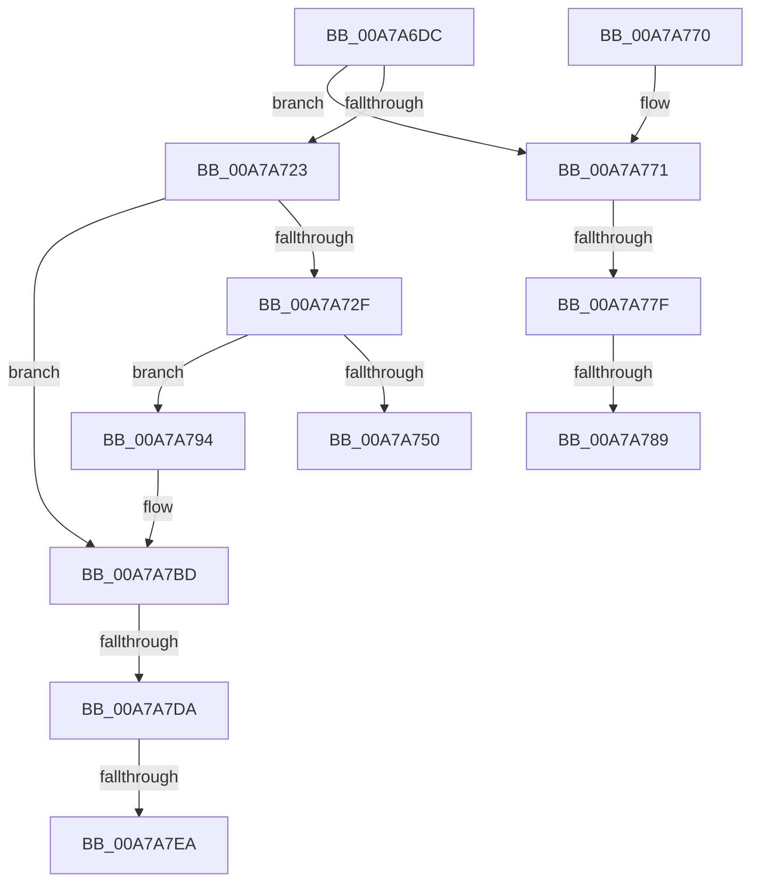

# IopInitializeDeviceInstanceKey

- RVA: `0x00A7A6DC`–`0x00A7A800` (길이 `292` bytes)
- VA: `0x0000000140A7A6DC`
- 실행 섹션: `PAGE`
- PDB 이름 있음: `예`; PDB Function 태그: `예`
- unwind 정보 RVA: `0x000B6388`
- 디코드: `83`개 명령, `292/292` bytes 표시
- 미해석 바이트: `0` (있으면 어셈블리에 `.byte`로 보존)

> 이 문서는 커널 이미지의 기계어와 PDB 기호를 분석해 생성했습니다. 4번과 5번은 함수 원형과 자료형을 바이너리 사용 방식에서 추정한 C 해석이며 원본 소스 복구 결과는 아닙니다.

## 1. Dependencies

- 직접 호출 지점: **6**; 고유 호출 대상: **6**
- 직접 호출자로 확인된 함수: **1**
- RIP 상대 이미지 참조: **1**

### Outgoing calls
- `0x00A7A71A` → [IopGetRegistryValue](../99/IopGetRegistryValue_function_009990EC.md) (function, `0x009990EC`)
- `0x00A7A743` → [ExAllocatePool2](../../poolcode/B8/ExAllocatePool2_function_00B820F0.md) (function, `0x00B820F0`)
- `0x00A7A7A3` → [memcpy](../../text/6C/memcpy_function_006C6840.md) (function, `0x006C6840`)
- `0x00A7A7AE` → [ExFreePoolWithTag](../../poolcode/B8/ExFreePoolWithTag_function_00B82870.md) (function, `0x00B82870`)
- `0x00A7A7C5` → [PnpDeviceObjectFromDeviceInstanceWithTag](../8E/PnpDeviceObjectFromDeviceInstanceWithTag_function_008E7490.md) (function, `0x008E7490`)
- `0x00A7A7DD` → [IopIsRootEnumeratedDeviceObjectActive](../AB/IopIsRootEnumeratedDeviceObjectActive_function_00AB1CB4.md) (function, `0x00AB1CB4`)

### Direct callers
- [IopGetRootDevices](IopGetRootDevices_function_00A7A4BC.md) at `0x00A7A598`

### Static image references
- `0x00A7A70C` → RVA `0x00AFF700` (` ?? ::NNGAKEGL::`string'`; read)

## 2. Other-region calls and transfers

- 다른 실행 섹션으로 향하는 call: **3**
  - `0x00A7A743` → [ExAllocatePool2](../../poolcode/B8/ExAllocatePool2_function_00B820F0.md) (`PAGE` → `POOLCODE`)
  - `0x00A7A7A3` → [memcpy](../../text/6C/memcpy_function_006C6840.md) (`PAGE` → `.text`)
  - `0x00A7A7AE` → [ExFreePoolWithTag](../../poolcode/B8/ExFreePoolWithTag_function_00B82870.md) (`PAGE` → `POOLCODE`)
- call이 아닌 외부 분기/꼬리 이동: **6**
  - `0x00A7A779` → [sub_00B420B0](../B4/Unknown_function_00B420B0.md) (`tail-transfer`)
  - `0x00A7A783` → [sub_00B420B0](../B4/Unknown_function_00B420B0.md) (`tail-transfer`)
  - `0x00A7A78F` → [sub_00B420B0 + 0x2](../B4/Unknown_function_00B420B0.md) (`tail-transfer`)
  - `0x00A7A7D4` → [sub_00B420B0 + 0x58](../B4/Unknown_function_00B420B0.md) (`tail-transfer`)
  - `0x00A7A7E4` → [sub_00B420B0 + 0x13](../B4/Unknown_function_00B420B0.md) (`tail-transfer`)
  - `0x00A7A7FB` → [sub_00B420B0 + 0x4C](../B4/Unknown_function_00B420B0.md) (`tail-transfer`)

## 3. Assembly (complete function range)

```asm
00A7A6DC  48 89 5C 24 08                  mov qword ptr [rsp + 8], rbx
00A7A6E1  55                              push rbp
00A7A6E2  56                              push rsi
00A7A6E3  57                              push rdi
00A7A6E4  41 54                           push r12
00A7A6E6  41 55                           push r13
00A7A6E8  41 56                           push r14
00A7A6EA  41 57                           push r15
00A7A6EC  48 8B EC                        mov rbp, rsp
00A7A6EF  48 83 EC 60                     sub rsp, 0x60
00A7A6F3  33 FF                           xor edi, edi
00A7A6F5  4C 8D 4D E8                     lea r9, [rbp - 0x18]
00A7A6F9  49 8B F0                        mov rsi, r8
00A7A6FC  48 89 7D E8                     mov qword ptr [rbp - 0x18], rdi
00A7A700  4C 8B E2                        mov r12, rdx
00A7A703  89 7D 58                        mov dword ptr [rbp + 0x58], edi
00A7A706  45 33 C0                        xor r8d, r8d
00A7A709  89 7D E4                        mov dword ptr [rbp - 0x1c], edi
00A7A70C  48 8D 15 ED 4F 08 00            lea rdx, [rip + 0x84fed]
00A7A713  48 89 7D F8                     mov qword ptr [rbp - 8], rdi
00A7A717  4C 8B E9                        mov r13, rcx
00A7A71A  E8 CD E9 F1 FF                  call 0x1409990ec
00A7A71F  85 C0                           test eax, eax
00A7A721  79 4E                           jns 0x140a7a771
00A7A723  8B 5E 04                        mov ebx, dword ptr [rsi + 4]
00A7A726  39 5E 08                        cmp dword ptr [rsi + 8], ebx
00A7A729  0F 85 8E 00 00 00               jne 0x140a7a7bd
00A7A72F  8D 1C DD 00 04 00 00            lea ebx, [rbx*8 + 0x400]
00A7A736  B9 00 01 00 00                  mov ecx, 0x100
00A7A73B  8B D3                           mov edx, ebx
00A7A73D  41 B8 50 70 64 64               mov r8d, 0x64647050
00A7A743  E8 A8 79 10 00                  call 0x140b820f0
00A7A748  4C 8B F0                        mov r14, rax
00A7A74B  48 85 C0                        test rax, rax
00A7A74E  75 44                           jne 0x140a7a794
00A7A750  C7 06 9A 00 00 C0               mov dword ptr [rsi], 0xc000009a
00A7A756  33 C0                           xor eax, eax
00A7A758  48 8B 9C 24 A0 00 00 00         mov rbx, qword ptr [rsp + 0xa0]
00A7A760  48 83 C4 60                     add rsp, 0x60
00A7A764  41 5F                           pop r15
00A7A766  41 5E                           pop r14
00A7A768  41 5D                           pop r13
00A7A76A  41 5C                           pop r12
00A7A76C  5F                              pop rdi
00A7A76D  5E                              pop rsi
00A7A76E  5D                              pop rbp
00A7A76F  C3                              ret
00A7A770  CC                              int3
00A7A771  48 8B 4D E8                     mov rcx, qword ptr [rbp - 0x18]
00A7A775  83 79 04 04                     cmp dword ptr [rcx + 4], 4
00A7A779  0F 85 31 79 0C 00               jne 0x140b420b0
00A7A77F  83 79 0C 04                     cmp dword ptr [rcx + 0xc], 4
00A7A783  0F 82 27 79 0C 00               jb 0x140b420b0
00A7A789  8B 41 08                        mov eax, dword ptr [rcx + 8]
00A7A78C  8B 1C 08                        mov ebx, dword ptr [rax + rcx]
00A7A78F  E9 1E 79 0C 00                  jmp 0x140b420b2
00A7A794  44 8B 46 08                     mov r8d, dword ptr [rsi + 8]
00A7A798  49 8B CE                        mov rcx, r14
00A7A79B  48 8B 56 10                     mov rdx, qword ptr [rsi + 0x10]
00A7A79F  49 C1 E0 03                     shl r8, 3
00A7A7A3  E8 98 C0 C4 FF                  call 0x1406c6840
00A7A7A8  48 8B 4E 10                     mov rcx, qword ptr [rsi + 0x10]
00A7A7AC  33 D2                           xor edx, edx
00A7A7AE  E8 BD 80 10 00                  call 0x140b82870
00A7A7B3  C1 EB 03                        shr ebx, 3
00A7A7B6  89 5E 04                        mov dword ptr [rsi + 4], ebx
00A7A7B9  4C 89 76 10                     mov qword ptr [rsi + 0x10], r14
00A7A7BD  BA 44 66 6C 74                  mov edx, 0x746c6644
00A7A7C2  49 8B CC                        mov rcx, r12
00A7A7C5  E8 C6 CC E6 FF                  call 0x1408e7490
00A7A7CA  48 89 45 F0                     mov qword ptr [rbp - 0x10], rax
00A7A7CE  48 8B D0                        mov rdx, rax
00A7A7D1  48 85 C0                        test rax, rax
00A7A7D4  0F 84 2E 79 0C 00               je 0x140b42108
00A7A7DA  48 8B C8                        mov rcx, rax
00A7A7DD  E8 D2 74 03 00                  call 0x140ab1cb4
00A7A7E2  84 C0                           test al, al
00A7A7E4  0F 84 D9 78 0C 00               je 0x140b420c3
00A7A7EA  8B 4E 08                        mov ecx, dword ptr [rsi + 8]
00A7A7ED  41 BE 01 00 00 00               mov r14d, 1
00A7A7F3  48 8B 46 10                     mov rax, qword ptr [rsi + 0x10]
00A7A7F7  48 89 14 C8                     mov qword ptr [rax + rcx*8], rdx
00A7A7FB  E9 FC 78 0C 00                  jmp 0x140b420fc
```

## 4. C-style interpretation (structured pseudocode)

```c
__int64 __fastcall IopInitializeDeviceInstanceKey(__int64 a1, __int64 a2, __int64 a3)
{
    __int64 result;
    __int64 v_rbx;
    __int64 v_rdi;
    __int64 v_rsp;
    unsigned __int64 v_stack_m40;
    unsigned __int64 v_stack_m48;
    unsigned __int64 v_stack_m50;
    unsigned int v_stack_m54;
    unsigned int v_stack_p20;
    unsigned __int64 v_stack_p8;

    v_stack_p8 = v_rbx;
    v_rsp = (v_rsp) - (96);
    v_rdi = 0;
    v_stack_m50 = 0;
    v_stack_p20 = 0;
    a3 = 0;
    v_stack_m54 = 0;
    v_stack_m40 = 0;
    result = IopGetRegistryValue(a1, v_rip + 544749, a3, v_stack_m50);
    if (!sign_flag) goto loc_00A7A771;
    if ((*(unsigned int *)(a3 + 8)) != ((unsigned int)((unsigned int)(*(unsigned int *)(a3 + 4))))) goto loc_00A7A7BD;
    result = ExAllocatePool2(256, (unsigned int)((unsigned int)((unsigned int)(*(unsigned int *)(a3 + 4)) * 8 + 1024)), (unsigned int)(0x64647050ULL), v_stack_m50);
    if (result != 0) goto loc_00A7A794;
    *(unsigned int *)(a3) = 0xC000009AULL;
    result = 0;
    v_rsp = (v_rsp) + (96);
    return result;
loc_00A7A771:
loc_00A7A794:
    a3 = ((unsigned int)(*(unsigned int *)(a3 + 8))) << (3);
    result = memcpy(0, *(unsigned __int64 *)(a3 + 16), a3, v_stack_m50);
    a2 = 0;
    result = ExFreePoolWithTag(*(unsigned __int64 *)(a3 + 16), a2, a3, v_stack_m50);
    v_rbx = (unsigned int)(((unsigned int)(*(unsigned int *)((unsigned int)(*(unsigned int *)(v_stack_m50 + 8)) + v_stack_m50 * 1))) >> (3));
    *(unsigned int *)(a3 + 4) = (unsigned int)(v_rbx);
    *(unsigned __int64 *)(a3 + 16) = result;
loc_00A7A7BD:
    result = PnpDeviceObjectFromDeviceInstanceWithTag(0, (unsigned int)(0x746C6644ULL), a3, v_stack_m50);
    v_stack_m48 = result;
    result = IopIsRootEnumeratedDeviceObjectActive(result, result, a3, v_stack_m50);
    *(unsigned __int64 *)(*(unsigned __int64 *)(a3 + 16) + (unsigned int)(*(unsigned int *)(a3 + 8)) * 8) = result;
}
```

## 5. (Beta) C Style

```c
int64_t IopInitializeDeviceInstanceKey(int64_t Arg1, int64_t Arg2, void *Arg3)
{
    uint8_t *arg3 = (uint8_t *)Arg3;

    int64_t result;
    int64_t local_rbx;
    int64_t local_rdi;
    int64_t local_rsp;
    uint64_t v_stack_m40;
    uint64_t v_stack_m48;
    uint64_t v_stack_m50;
    uint32_t v_stack_m54;
    uint32_t v_stack_p20;
    uint64_t v_stack_p8;

    v_stack_p8 = local_rbx;
    local_rsp = (local_rsp) - (96);
    local_rdi = 0;
    v_stack_m50 = 0;
    v_stack_p20 = 0;
    Arg3 = 0;
    v_stack_m54 = 0;
    v_stack_m40 = 0;
    result = IopGetRegistryValue(Arg1, v_rip + 544749, Arg3, v_stack_m50);
    if (!sign_flag) goto loc_00A7A771;
    if ((*(uint32_t *)(arg3 + 0x8)) != ((uint32_t)((uint32_t)(*(uint32_t *)(arg3 + 0x4))))) goto loc_00A7A7BD;
    result = ExAllocatePool2(256, (uint32_t)((uint32_t)((uint32_t)(*(uint32_t *)(arg3 + 0x4)) * 8 + 1024)), (uint32_t)(0x64647050ULL), v_stack_m50);
    if (result != 0) goto loc_00A7A794;
    *(uint32_t *)(arg3) = 0xC000009AULL;
    result = 0;
    local_rsp = (local_rsp) + (96);
    return result;
loc_00A7A771:
loc_00A7A794:
    Arg3 = ((uint32_t)(*(uint32_t *)(arg3 + 0x8))) << (3);
    result = memcpy(0, *(uint64_t *)(arg3 + 0x10), Arg3, v_stack_m50);
    Arg2 = 0;
    result = ExFreePoolWithTag(*(uint64_t *)(arg3 + 0x10), Arg2, Arg3, v_stack_m50);
    local_rbx = (uint32_t)(((uint32_t)(*(uint32_t *)((uint32_t)(*(uint32_t *)(v_stack_m50 + 0x8)) + v_stack_m50 * 1))) >> (3));
    *(uint32_t *)(arg3 + 0x4) = (uint32_t)(local_rbx);
    *(uint64_t *)(arg3 + 0x10) = result;
loc_00A7A7BD:
    result = PnpDeviceObjectFromDeviceInstanceWithTag(0, (uint32_t)(0x746C6644ULL), Arg3, v_stack_m50);
    v_stack_m48 = result;
    result = IopIsRootEnumeratedDeviceObjectActive(result, result, Arg3, v_stack_m50);
    *(uint64_t *)(*(uint64_t *)(arg3 + 0x10) + (uint32_t)(*(uint32_t *)(arg3 + 0x8)) * 8) = result;
}
```

### 관측된 메모리 오프셋

구조체 형식이 확인되지 않은 접근은 인자 기준의 오프셋으로만 기록했습니다.

| 기준 인자 | 오프셋 표현 | 폭 (bit) | 접근 |
|---|---:|---:|---|
| `Arg3` | `+ 0x0` | `32` | `W` |
| `Arg3` | `+ 0x4` | `32` | `R` |
| `Arg3` | `+ 0x4` | `32` | `W` |
| `Arg3` | `+ 0x8` | `32` | `R` |
| `Arg3` | `+ 0x10` | `64` | `R` |
| `Arg3` | `+ 0x10` | `64` | `W` |

## 6. Execution-region graph

[열기: 2D/3D 그래프와 함수 탐색 컨트롤 패널](../../../control-panel.html?section=page&rva=0x00A7A6DC&view=graph)

- 2D 그래프는 위에서 아래로 흐르고, 3D 그래프는 빈 공간을 드래그해 회전합니다. Shift+드래그는 이동, 휠은 확대·축소, 함수 노드 선택은 대상 보고서 이동입니다.

### Static fallback


