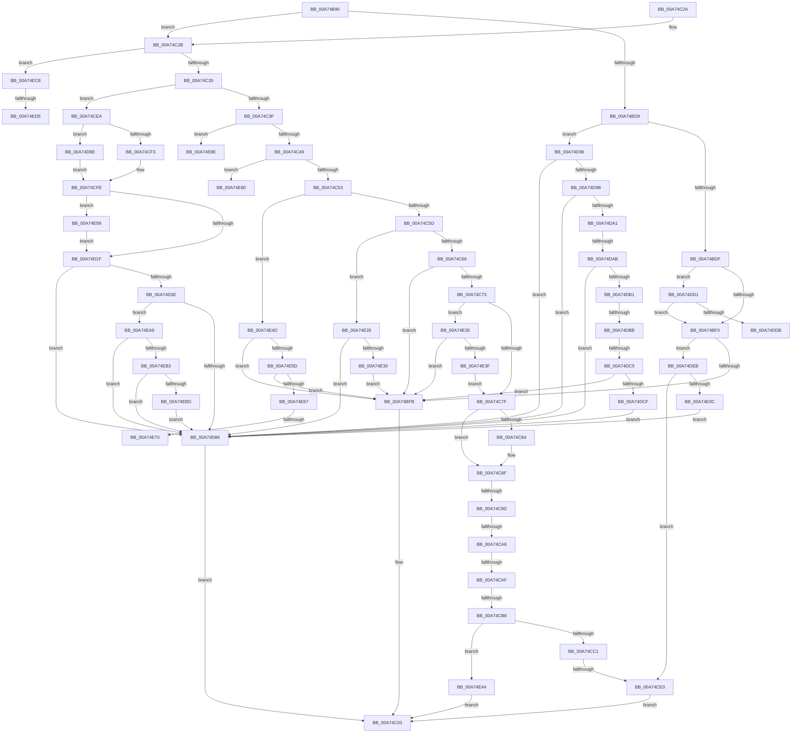

# IopPnPDispatch

- RVA: `0x00A74B90`–`0x00A74EE5` (길이 `853` bytes)
- VA: `0x0000000140A74B90`
- 실행 섹션: `PAGE`
- PDB 이름 있음: `예`; PDB Function 태그: `예`
- unwind 정보 RVA: `0x000B5908`
- 디코드: `200`개 명령, `853/853` bytes 표시
- 미해석 바이트: `0` (있으면 어셈블리에 `.byte`로 보존)

> 이 문서는 커널 이미지의 기계어와 PDB 기호를 분석해 생성했습니다. 4번과 5번은 함수 원형과 자료형을 바이너리 사용 방식에서 추정한 C 해석이며 원본 소스 복구 결과는 아닙니다.

## 1. Dependencies

- 직접 호출 지점: **6**; 고유 호출 대상: **5**
- 직접 호출자로 확인된 함수: **0**
- RIP 상대 이미지 참조: **3**

### Outgoing calls
- `0x00A74C0B` → [IopPnPCompleteRequest](../../text/4B/IopPnPCompleteRequest_function_004BD6C4.md) (function, `0x004BD6C4`)
- `0x00A74CCF` → [ExAllocatePool2](../../poolcode/B8/ExAllocatePool2_function_00B820F0.md) (function, `0x00B820F0`)
- `0x00A74D79` → [CmGetDeviceRegProp](../8E/CmGetDeviceRegProp_function_008ED870.md) (function, `0x008ED870`)
- `0x00A74DDF` → [IopGetRootDevices](IopGetRootDevices_function_00A7A4BC.md) (function, `0x00A7A4BC`)
- `0x00A74DFB` → [ExAllocatePool2](../../poolcode/B8/ExAllocatePool2_function_00B820F0.md) (function, `0x00B820F0`)
- `0x00A74E19` → [ObfReferenceObject](../../text/20/ObfReferenceObject_function_0020FA20.md) (function, `0x0020FA20`)

### Direct callers
- 이 함수 시작 RVA로 연결되는 직접 call은 확인되지 않았습니다. 간접 호출은 완전히 역산할 수 없습니다.

### Static image references
- `0x00A74BDF` → RVA `0x00F8C438` (`.data`; read)
- `0x00A74D1F` → RVA `0x0001A390` (`.rdata`; read)
- `0x00A74D3E` → RVA `0x00E66398` (`.data`; read)

## 2. Other-region calls and transfers

- 다른 실행 섹션으로 향하는 call: **4**
  - `0x00A74C0B` → [IopPnPCompleteRequest](../../text/4B/IopPnPCompleteRequest_function_004BD6C4.md) (`PAGE` → `.text`)
  - `0x00A74CCF` → [ExAllocatePool2](../../poolcode/B8/ExAllocatePool2_function_00B820F0.md) (`PAGE` → `POOLCODE`)
  - `0x00A74DFB` → [ExAllocatePool2](../../poolcode/B8/ExAllocatePool2_function_00B820F0.md) (`PAGE` → `POOLCODE`)
  - `0x00A74E19` → [ObfReferenceObject](../../text/20/ObfReferenceObject_function_0020FA20.md) (`PAGE` → `.text`)
- call이 아닌 외부 분기/꼬리 이동: **15**
  - `0x00A74C97` → [sub_00B40828 + 0x1C1](../B4/Unknown_function_00B40828.md) (`tail-transfer`)
  - `0x00A74CA0` → [sub_00B40828 + 0xAA](../B4/Unknown_function_00B40828.md) (`tail-transfer`)
  - `0x00A74CA9` → [sub_00B40828 + 0xAA](../B4/Unknown_function_00B40828.md) (`tail-transfer`)
  - `0x00A74CB2` → [sub_00B40828 + 0x1C1](../B4/Unknown_function_00B40828.md) (`tail-transfer`)
  - `0x00A74CDA` → [sub_00B40828 + 0x54](../B4/Unknown_function_00B40828.md) (`tail-transfer`)
  - `0x00A74DA5` → [sub_00B40828 + 0xA](../B4/Unknown_function_00B40828.md) (`tail-transfer`)
  - `0x00A74DB5` → [sub_00B40828](../B4/Unknown_function_00B40828.md) (`tail-transfer`)
  - `0x00A74DBF` → [sub_00B40828](../B4/Unknown_function_00B40828.md) (`tail-transfer`)
  - `0x00A74DE6` → [sub_00B40828 + 0x4B](../B4/Unknown_function_00B40828.md) (`tail-transfer`)
  - `0x00A74E6A` → [sub_00B40828 + 0x27F](../B4/Unknown_function_00B40828.md) (`tail-transfer`)
  - `0x00A74E7B` → [sub_00B40828 + 0x282](../B4/Unknown_function_00B40828.md) (`tail-transfer`)
  - `0x00A74E89` → [sub_00B40828 + 0x314](../B4/Unknown_function_00B40828.md) (`tail-transfer`)
  - `0x00A74E94` → [sub_00B40828 + 0x314](../B4/Unknown_function_00B40828.md) (`tail-transfer`)
  - `0x00A74ECF` → [sub_00B40828 + 0x33A](../B4/Unknown_function_00B40828.md) (`tail-transfer`)
  - `0x00A74EE0` → [sub_00B40828 + 0x33D](../B4/Unknown_function_00B40828.md) (`tail-transfer`)

## 3. Assembly (complete function range)

```asm
00A74B90  48 89 5C 24 08                  mov qword ptr [rsp + 8], rbx
00A74B95  55                              push rbp
00A74B96  56                              push rsi
00A74B97  57                              push rdi
00A74B98  41 54                           push r12
00A74B9A  41 55                           push r13
00A74B9C  41 56                           push r14
00A74B9E  41 57                           push r15
00A74BA0  48 8B EC                        mov rbp, rsp
00A74BA3  48 83 EC 50                     sub rsp, 0x50
00A74BA7  4C 8B AA B8 00 00 00            mov r13, qword ptr [rdx + 0xb8]
00A74BAE  45 33 E4                        xor r12d, r12d
00A74BB1  4C 8B FA                        mov r15, rdx
00A74BB4  44 89 65 48                     mov dword ptr [rbp + 0x48], r12d
00A74BB8  44 89 65 50                     mov dword ptr [rbp + 0x50], r12d
00A74BBC  48 8B F9                        mov rdi, rcx
00A74BBF  44 89 65 58                     mov dword ptr [rbp + 0x58], r12d
00A74BC3  41 8B F4                        mov esi, r12d
00A74BC6  45 0F B6 45 01                  movzx r8d, byte ptr [r13 + 1]
00A74BCB  41 8D 54 24 07                  lea edx, [r12 + 7]
00A74BD0  4C 89 65 F0                     mov qword ptr [rbp - 0x10], r12
00A74BD4  44 3B C2                        cmp r8d, edx
00A74BD7  77 52                           ja 0x140a74c2b
00A74BD9  0F 85 B7 01 00 00               jne 0x140a74d96
00A74BDF  48 8B 05 52 78 51 00            mov rax, qword ptr [rip + 0x517852]
00A74BE6  48 3B 48 20                     cmp rcx, qword ptr [rax + 0x20]
00A74BEA  0F 84 E1 01 00 00               je 0x140a74dd1
00A74BF0  41 83 7D 08 04                  cmp dword ptr [r13 + 8], 4
00A74BF5  0F 84 F0 01 00 00               je 0x140a74deb
00A74BFB  49 8B 77 38                     mov rsi, qword ptr [r15 + 0x38]
00A74BFF  41 8B 5F 30                     mov ebx, dword ptr [r15 + 0x30]
00A74C03  4C 8B C6                        mov r8, rsi
00A74C06  8B D3                           mov edx, ebx
00A74C08  49 8B CF                        mov rcx, r15
00A74C0B  E8 B4 8A A4 FF                  call 0x1404bd6c4
00A74C10  8B C3                           mov eax, ebx
00A74C12  48 8B 9C 24 90 00 00 00         mov rbx, qword ptr [rsp + 0x90]
00A74C1A  48 83 C4 50                     add rsp, 0x50
00A74C1E  41 5F                           pop r15
00A74C20  41 5E                           pop r14
00A74C22  41 5D                           pop r13
00A74C24  41 5C                           pop r12
00A74C26  5F                              pop rdi
00A74C27  5E                              pop rsi
00A74C28  5D                              pop rbp
00A74C29  C3                              ret
00A74C2A  CC                              int3
00A74C2B  41 83 E8 08                     sub r8d, 8
00A74C2F  0F 84 93 02 00 00               je 0x140a74ec8
00A74C35  41 83 E8 01                     sub r8d, 1
00A74C39  0F 84 AB 00 00 00               je 0x140a74cea
00A74C3F  41 83 E8 01                     sub r8d, 1
00A74C43  0F 84 45 02 00 00               je 0x140a74e8e
00A74C49  41 83 E8 01                     sub r8d, 1
00A74C4D  0F 84 2D 02 00 00               je 0x140a74e80
00A74C53  41 83 E8 01                     sub r8d, 1
00A74C57  0F 84 F0 01 00 00               je 0x140a74e4d
00A74C5D  44 2B C2                        sub r8d, edx
00A74C60  0F 85 C0 01 00 00               jne 0x140a74e26
00A74C66  48 8B 05 CB 77 51 00            mov rax, qword ptr [rip + 0x5177cb]
00A74C6D  48 3B 78 20                     cmp rdi, qword ptr [rax + 0x20]
00A74C71  74 88                           je 0x140a74bfb
00A74C73  41 8B 5F 30                     mov ebx, dword ptr [r15 + 0x30]
00A74C77  85 DB                           test ebx, ebx
00A74C79  0F 89 B6 01 00 00               jns 0x140a74e35
00A74C7F  48 85 FF                        test rdi, rdi
00A74C82  74 0B                           je 0x140a74c8f
00A74C84  48 8B 81 38 01 00 00            mov rax, qword ptr [rcx + 0x138]
00A74C8B  4C 8B 60 28                     mov r12, qword ptr [rax + 0x28]
00A74C8F  41 8B 4D 08                     mov ecx, dword ptr [r13 + 8]
00A74C93  33 FF                           xor edi, edi
00A74C95  85 C9                           test ecx, ecx
00A74C97  0F 84 4C BD 0C 00               je 0x140b409e9
00A74C9D  83 E9 01                        sub ecx, 1
00A74CA0  0F 84 2C BC 0C 00               je 0x140b408d2
00A74CA6  83 E9 01                        sub ecx, 1
00A74CA9  0F 84 23 BC 0C 00               je 0x140b408d2
00A74CAF  83 E9 01                        sub ecx, 1
00A74CB2  0F 84 31 BD 0C 00               je 0x140b409e9
00A74CB8  83 F9 02                        cmp ecx, 2
00A74CBB  0F 85 83 01 00 00               jne 0x140a74e44
00A74CC1  8D 57 4E                        lea edx, [rdi + 0x4e]
00A74CC4  B9 00 01 00 00                  mov ecx, 0x100
00A74CC9  41 B8 50 70 64 64               mov r8d, 0x64647050
00A74CCF  E8 1C D4 10 00                  call 0x140b820f0
00A74CD4  48 8B C8                        mov rcx, rax
00A74CD7  48 85 C0                        test rax, rax
00A74CDA  0F 85 9C BB 0C 00               jne 0x140b4087c
00A74CE0  BB 9A 00 00 C0                  mov ebx, 0xc000009a
00A74CE5  E9 19 FF FF FF                  jmp 0x140a74c03
00A74CEA  48 85 FF                        test rdi, rdi
00A74CED  0F 84 9B 00 00 00               je 0x140a74d8e
00A74CF3  48 8B 81 38 01 00 00            mov rax, qword ptr [rcx + 0x138]
00A74CFA  48 8B 50 28                     mov rdx, qword ptr [rax + 0x28]
00A74CFE  49 8B 5D 08                     mov rbx, qword ptr [r13 + 8]
00A74D02  41 BE 01 00 00 00               mov r14d, 1
00A74D08  C7 03 40 00 01 00               mov dword ptr [rbx], 0x10040
00A74D0E  48 8B 05 23 77 51 00            mov rax, qword ptr [rip + 0x517723]
00A74D15  48 3B 78 20                     cmp rdi, qword ptr [rax + 0x20]
00A74D19  0F 84 7A 01 00 00               je 0x140a74e99
00A74D1F  66 0F 6F 05 69 56 5A FF         movdqa xmm0, xmmword ptr [rip - 0xa5a997]
00A74D27  44 89 63 10                     mov dword ptr [rbx + 0x10], r12d
00A74D2B  44 89 73 14                     mov dword ptr [rbx + 0x14], r14d
00A74D2F  0F 11 43 18                     movups xmmword ptr [rbx + 0x18], xmm0
00A74D33  66 0F 7E 43 28                  movd dword ptr [rbx + 0x28], xmm0
00A74D38  83 7B 0C FF                     cmp dword ptr [rbx + 0xc], -1
00A74D3C  75 48                           jne 0x140a74d86
00A74D3E  48 8B 0D 53 16 3F 00            mov rcx, qword ptr [rip + 0x3f1653]
00A74D45  48 8D 45 48                     lea rax, [rbp + 0x48]
00A74D49  44 89 64 24 38                  mov dword ptr [rsp + 0x38], r12d
00A74D4E  41 B9 11 00 00 00               mov r9d, 0x11
00A74D54  48 89 44 24 30                  mov qword ptr [rsp + 0x30], rax
00A74D59  45 33 C0                        xor r8d, r8d
00A74D5C  48 8D 45 58                     lea rax, [rbp + 0x58]
00A74D60  C7 45 48 04 00 00 00            mov dword ptr [rbp + 0x48], 4
00A74D67  48 8B 52 30                     mov rdx, qword ptr [rdx + 0x30]
00A74D6B  48 89 44 24 28                  mov qword ptr [rsp + 0x28], rax
00A74D70  48 8D 45 50                     lea rax, [rbp + 0x50]
00A74D74  48 89 44 24 20                  mov qword ptr [rsp + 0x20], rax
00A74D79  E8 F2 8A E7 FF                  call 0x1408ed870
00A74D7E  85 C0                           test eax, eax
00A74D80  0F 89 23 01 00 00               jns 0x140a74ea9
00A74D86  41 8B DC                        mov ebx, r12d
00A74D89  E9 75 FE FF FF                  jmp 0x140a74c03
00A74D8E  49 8B D4                        mov rdx, r12
00A74D91  E9 68 FF FF FF                  jmp 0x140a74cfe
00A74D96  45 85 C0                        test r8d, r8d
00A74D99  74 EB                           je 0x140a74d86
00A74D9B  41 83 E8 01                     sub r8d, 1
00A74D9F  74 E5                           je 0x140a74d86
00A74DA1  41 83 E8 01                     sub r8d, 1
00A74DA5  0F 84 87 BA 0C 00               je 0x140b40832
00A74DAB  41 83 E8 01                     sub r8d, 1
00A74DAF  74 D5                           je 0x140a74d86
00A74DB1  41 83 E8 01                     sub r8d, 1
00A74DB5  0F 84 6D BA 0C 00               je 0x140b40828
00A74DBB  41 83 E8 01                     sub r8d, 1
00A74DBF  0F 84 63 BA 0C 00               je 0x140b40828
00A74DC5  41 83 F8 01                     cmp r8d, 1
00A74DC9  0F 85 2C FE FF FF               jne 0x140a74bfb
00A74DCF  EB B5                           jmp 0x140a74d86
00A74DD1  45 39 65 08                     cmp dword ptr [r13 + 8], r12d
00A74DD5  0F 85 15 FE FF FF               jne 0x140a74bf0
00A74DDB  48 8D 4D F0                     lea rcx, [rbp - 0x10]
00A74DDF  E8 D8 56 00 00                  call 0x140a7a4bc
00A74DE4  8B D8                           mov ebx, eax
00A74DE6  E9 88 BA 0C 00                  jmp 0x140b40873
00A74DEB  BA 10 00 00 00                  mov edx, 0x10
00A74DF0  B9 00 01 00 00                  mov ecx, 0x100
00A74DF5  41 B8 50 70 64 64               mov r8d, 0x64647050
00A74DFB  E8 F0 D2 10 00                  call 0x140b820f0
00A74E00  48 8B D8                        mov rbx, rax
00A74E03  48 85 C0                        test rax, rax
00A74E06  0F 84 D4 FE FF FF               je 0x140a74ce0
00A74E0C  48 8B CF                        mov rcx, rdi
00A74E0F  C7 00 01 00 00 00               mov dword ptr [rax], 1
00A74E15  48 89 78 08                     mov qword ptr [rax + 8], rdi
00A74E19  E8 02 AC 79 FF                  call 0x14020fa20
00A74E1E  48 8B F3                        mov rsi, rbx
00A74E21  E9 60 FF FF FF                  jmp 0x140a74d86
00A74E26  41 83 F8 03                     cmp r8d, 3
00A74E2A  0F 84 56 FF FF FF               je 0x140a74d86
00A74E30  E9 C6 FD FF FF                  jmp 0x140a74bfb
00A74E35  4D 39 67 38                     cmp qword ptr [r15 + 0x38], r12
00A74E39  0F 85 BC FD FF FF               jne 0x140a74bfb
00A74E3F  E9 3B FE FF FF                  jmp 0x140a74c7f
00A74E44  49 8B 77 38                     mov rsi, qword ptr [r15 + 0x38]
00A74E48  E9 B6 FD FF FF                  jmp 0x140a74c03
00A74E4D  41 BE 01 00 00 00               mov r14d, 1
00A74E53  45 39 75 08                     cmp dword ptr [r13 + 8], r14d
00A74E57  0F 85 9E FD FF FF               jne 0x140a74bfb
00A74E5D  4D 39 67 38                     cmp qword ptr [r15 + 0x38], r12
00A74E61  0F 85 94 FD FF FF               jne 0x140a74bfb
00A74E67  48 85 FF                        test rdi, rdi
00A74E6A  0F 84 37 BC 0C 00               je 0x140b40aa7
00A74E70  48 8B 81 38 01 00 00            mov rax, qword ptr [rcx + 0x138]
00A74E77  48 8B 58 28                     mov rbx, qword ptr [rax + 0x28]
00A74E7B  E9 2A BC 0C 00                  jmp 0x140b40aaa
00A74E80  BA 01 00 00 00                  mov edx, 1
00A74E85  44 8D 42 01                     lea r8d, [rdx + 1]
00A74E89  E9 AE BC 0C 00                  jmp 0x140b40b3c
00A74E8E  33 D2                           xor edx, edx
00A74E90  44 8D 42 04                     lea r8d, [rdx + 4]
00A74E94  E9 A3 BC 0C 00                  jmp 0x140b40b3c
00A74E99  81 4B 04 C0 01 00 00            or dword ptr [rbx + 4], 0x1c0
00A74EA0  44 89 63 0C                     mov dword ptr [rbx + 0xc], r12d
00A74EA4  E9 76 FE FF FF                  jmp 0x140a74d1f
00A74EA9  83 7D 50 04                     cmp dword ptr [rbp + 0x50], 4
00A74EAD  0F 85 D3 FE FF FF               jne 0x140a74d86
00A74EB3  83 7D 48 04                     cmp dword ptr [rbp + 0x48], 4
00A74EB7  0F 85 C9 FE FF FF               jne 0x140a74d86
00A74EBD  8B 45 58                        mov eax, dword ptr [rbp + 0x58]
00A74EC0  89 43 0C                        mov dword ptr [rbx + 0xc], eax
00A74EC3  E9 BE FE FF FF                  jmp 0x140a74d86
00A74EC8  41 8B 5F 30                     mov ebx, dword ptr [r15 + 0x30]
00A74ECC  48 85 FF                        test rdi, rdi
00A74ECF  0F 84 8D BC 0C 00               je 0x140b40b62
00A74ED5  48 8B 81 38 01 00 00            mov rax, qword ptr [rcx + 0x138]
00A74EDC  48 8B 48 28                     mov rcx, qword ptr [rax + 0x28]
00A74EE0  E9 80 BC 0C 00                  jmp 0x140b40b65
```

## 4. C-style interpretation (structured pseudocode)

```c
__int64 __fastcall IopPnPDispatch(__int64 a1, __int64 a2)
{
    __int64 result;
    __int64 v_r12;
    __int64 v_rdi;
    __int64 v_rsp;
    unsigned __int64 v_stack_m48;
    unsigned int v_stack_p10;
    unsigned int v_stack_p18;
    unsigned int v_stack_p20;
    unsigned __int64 v_stack_p28;
    unsigned __int64 v_stack_p30;
    unsigned int v_stack_p38;
    unsigned __int64 v_stack_p8;

    v_stack_p8 = v_rbx;
    v_rsp = (v_rsp) - (80);
    v_r12 = 0;
    v_stack_p10 = 0;
    v_stack_p18 = 0;
    v_stack_p20 = 0;
    v_stack_m48 = 0;
    if (((unsigned int)(*(unsigned __int8 *)(*(unsigned __int64 *)(a2 + 184) + 1))) > ((unsigned int)(v_r12 + 7))) goto loc_00A74C2B;
    if (((unsigned int)(*(unsigned __int8 *)(*(unsigned __int64 *)(a2 + 184) + 1))) != ((unsigned int)(v_r12 + 7))) goto loc_00A74D96;
    if (a1 == (*(unsigned __int64 *)(*(unsigned __int64 *)(v_rip + 5339218) + 32))) goto loc_00A74DD1;
loc_00A74BF0:
    if ((*(unsigned int *)(*(unsigned __int64 *)(a2 + 184) + 8)) == 4) goto loc_00A74DEB;
loc_00A74BFB:
loc_00A74C03:
    result = IopPnPCompleteRequest(a2, (unsigned int)((unsigned int)((unsigned int)(*(unsigned int *)(a2 + 48)))), *(unsigned __int64 *)(a2 + 56), a4);
    v_rsp = (v_rsp) + (80);
    return (unsigned int)((unsigned int)((unsigned int)(*(unsigned int *)(a2 + 48))));
loc_00A74C2B:
    a3 = (unsigned int)((*(unsigned __int64 *)(a2 + 56)) - (8));
    if (condition_is_equal) goto loc_00A74EC8;
    a3 = (unsigned int)((a3) - (1));
    if (condition_is_equal) goto loc_00A74CEA;
    a3 = (unsigned int)((a3) - (1));
    if (condition_is_equal) goto loc_00A74E8E;
    a3 = (unsigned int)((a3) - (1));
    if (condition_is_equal) goto loc_00A74E80;
    a3 = (unsigned int)((a3) - (1));
    if (condition_is_equal) goto loc_00A74E4D;
    a3 = (unsigned int)((a3) - ((unsigned int)((unsigned int)((unsigned int)((unsigned int)(*(unsigned int *)(a2 + 48)))))));
    if (condition_is_not_equal) goto loc_00A74E26;
    if (a1 == (*(unsigned __int64 *)(*(unsigned __int64 *)(v_rip + 5339083) + 32))) goto loc_00A74BFB;
    if (!sign_flag) goto loc_00A74E35;
loc_00A74C7F:
    result = *(unsigned __int64 *)(v_rip + 5339083);
    if (a1 != 0) {
        result = *(unsigned __int64 *)(a2 + 312);
        v_r12 = *(unsigned __int64 *)(result + 40);
    }
    v_rdi = 0;
    a1 = (unsigned int)(((unsigned int)(*(unsigned int *)(*(unsigned __int64 *)(a2 + 184) + 8))) - (1));
    a1 = (unsigned int)((a1) - (1));
    a1 = (unsigned int)((a1) - (1));
    if (((unsigned int)(a1)) != 2) goto loc_00A74E44;
    result = ExAllocatePool2(256, v_rdi + 78, (unsigned int)(0x64647050ULL), a4);
loc_00A74CE0:
    goto loc_00A74C03;
loc_00A74CEA:
    if (0 == 0) goto loc_00A74D8E;
loc_00A74CFE:
    *(unsigned int *)(*(unsigned __int64 *)(*(unsigned __int64 *)(a2 + 184) + 8)) = 0x10040ULL;
    if (0 == (*(unsigned __int64 *)(*(unsigned __int64 *)(v_rip + 5338915) + 32))) goto loc_00A74E99;
loc_00A74D1F:
    *(unsigned int *)(*(unsigned __int64 *)(*(unsigned __int64 *)(a2 + 184) + 8) + 16) = (unsigned int)(v_r12);
    *(unsigned int *)(*(unsigned __int64 *)(*(unsigned __int64 *)(a2 + 184) + 8) + 20) = 1;
    *(unsigned __int64 *)(*(unsigned __int64 *)(*(unsigned __int64 *)(a2 + 184) + 8) + 24) = v_xmm0;
    *(unsigned int *)(*(unsigned __int64 *)(*(unsigned __int64 *)(a2 + 184) + 8) + 40) = v_xmm0;
    if ((*(unsigned int *)(*(unsigned __int64 *)(*(unsigned __int64 *)(a2 + 184) + 8) + 12)) != -1) goto loc_00A74D86;
    v_stack_p38 = (unsigned int)(v_r12);
    v_stack_p30 = v_stack_p10;
    a3 = 0;
    v_stack_p10 = 4;
    v_stack_p28 = v_stack_p20;
    v_stack_p20 = v_stack_p18;
    result = CmGetDeviceRegProp(*(unsigned __int64 *)(v_rip + 4134483), *(unsigned __int64 *)(*(unsigned __int64 *)(*(unsigned __int64 *)(result + 312) + 40) + 48), a3, 17);
    if (!sign_flag) goto loc_00A74EA9;
loc_00A74D86:
    goto loc_00A74C03;
loc_00A74D8E:
    goto loc_00A74CFE;
loc_00A74D96:
    if (0 == 0) goto loc_00A74D86;
    a3 = (unsigned int)((a3) - (1));
    if (condition_is_equal) goto loc_00A74D86;
    a3 = (unsigned int)((a3) - (1));
    a3 = (unsigned int)((a3) - (1));
    if (condition_is_equal) goto loc_00A74D86;
    a3 = (unsigned int)((a3) - (1));
    a3 = (unsigned int)((a3) - (1));
    if (((unsigned int)(a3)) != 1) goto loc_00A74BFB;
    goto loc_00A74D86;
loc_00A74DD1:
    if ((*(unsigned int *)(*(unsigned __int64 *)(a2 + 184) + 8)) != ((unsigned int)(v_r12))) goto loc_00A74BF0;
    result = IopGetRootDevices(v_stack_m48, v_r12, a3, 17);
loc_00A74DEB:
    result = ExAllocatePool2(256, 16, (unsigned int)(0x64647050ULL), 17);
    if (result == 0) goto loc_00A74CE0;
    *(unsigned int *)(result) = 1;
    *(unsigned __int64 *)(result + 8) = 0;
    result = ObfReferenceObject(0, 16, (unsigned int)(0x64647050ULL), 17);
    goto loc_00A74D86;
loc_00A74E26:
    if (((unsigned int)((unsigned int)(0x64647050ULL))) == 3) goto loc_00A74D86;
    goto loc_00A74BFB;
loc_00A74E35:
    if ((*(unsigned __int64 *)(a2 + 56)) != v_r12) goto loc_00A74BFB;
    goto loc_00A74C7F;
loc_00A74E44:
    goto loc_00A74C03;
loc_00A74E4D:
    if ((*(unsigned int *)(*(unsigned __int64 *)(a2 + 184) + 8)) != 1) goto loc_00A74BFB;
    if ((*(unsigned __int64 *)(a2 + 56)) != v_r12) goto loc_00A74BFB;
loc_00A74E80:
loc_00A74E8E:
    a2 = 0;
loc_00A74E99:
    *(unsigned int *)(*(unsigned __int64 *)(*(unsigned __int64 *)(0 + 312) + 40) + 12) = (unsigned int)(v_r12);
    goto loc_00A74D1F;
loc_00A74EA9:
    if (v_stack_p18 != 4) goto loc_00A74D86;
    if (v_stack_p10 != 4) goto loc_00A74D86;
    *(unsigned int *)(*(unsigned __int64 *)(*(unsigned __int64 *)(0 + 312) + 40) + 12) = (unsigned int)((unsigned int)(v_stack_p20));
    goto loc_00A74D86;
loc_00A74EC8:
}
```

## 5. (Beta) C Style

```c
int64_t IopPnPDispatch(void *Arg1, void *Arg2)
{
    uint8_t *arg1 = (uint8_t *)Arg1;
    uint8_t *arg2 = (uint8_t *)Arg2;

    int64_t result;
    int64_t local_r12;
    int64_t local_rdi;
    int64_t local_rsp;
    uint64_t v_stack_m48;
    uint32_t v_stack_p10;
    uint32_t v_stack_p18;
    uint32_t v_stack_p20;
    uint64_t v_stack_p28;
    uint64_t v_stack_p30;
    uint32_t v_stack_p38;
    uint64_t v_stack_p8;

    v_stack_p8 = local_rbx;
    local_rsp = (local_rsp) - (80);
    local_r12 = 0;
    v_stack_p10 = 0;
    v_stack_p18 = 0;
    v_stack_p20 = 0;
    v_stack_m48 = 0;
    if (((uint32_t)(*(uint8_t *)(*(uint64_t *)(arg2 + 0xB8) + 0x1))) > ((uint32_t)(local_r12 + 7))) goto loc_00A74C2B;
    if (((uint32_t)(*(uint8_t *)(*(uint64_t *)(arg2 + 0xB8) + 0x1))) != ((uint32_t)(local_r12 + 7))) goto loc_00A74D96;
    if (Arg1 == (*(uint64_t *)(*(uint64_t *)(v_rip + 0x517852) + 0x20))) goto loc_00A74DD1;
loc_00A74BF0:
    if ((*(uint32_t *)(*(uint64_t *)(arg2 + 0xB8) + 0x8)) == 4) goto loc_00A74DEB;
loc_00A74BFB:
loc_00A74C03:
    result = IopPnPCompleteRequest(Arg2, (uint32_t)((uint32_t)((uint32_t)(*(uint32_t *)(arg2 + 0x30)))), *(uint64_t *)(arg2 + 0x38), a4);
    local_rsp = (local_rsp) + (80);
    return (uint32_t)((uint32_t)((uint32_t)(*(uint32_t *)(arg2 + 0x30))));
loc_00A74C2B:
    a3 = (uint32_t)((*(uint64_t *)(arg2 + 0x38)) - (8));
    if (condition_is_equal) goto loc_00A74EC8;
    a3 = (uint32_t)((a3) - (1));
    if (condition_is_equal) goto loc_00A74CEA;
    a3 = (uint32_t)((a3) - (1));
    if (condition_is_equal) goto loc_00A74E8E;
    a3 = (uint32_t)((a3) - (1));
    if (condition_is_equal) goto loc_00A74E80;
    a3 = (uint32_t)((a3) - (1));
    if (condition_is_equal) goto loc_00A74E4D;
    a3 = (uint32_t)((a3) - ((uint32_t)((uint32_t)((uint32_t)((uint32_t)(*(uint32_t *)(arg2 + 0x30)))))));
    if (condition_is_not_equal) goto loc_00A74E26;
    if (Arg1 == (*(uint64_t *)(*(uint64_t *)(v_rip + 0x5177CB) + 0x20))) goto loc_00A74BFB;
    if (!sign_flag) goto loc_00A74E35;
loc_00A74C7F:
    result = *(uint64_t *)(v_rip + 0x5177CB);
    if (Arg1 != NULL) {
        result = *(uint64_t *)(arg2 + 0x138);
        local_r12 = *(uint64_t *)(result + 0x28);
    }
    local_rdi = 0;
    Arg1 = (uint32_t)(((uint32_t)(*(uint32_t *)(*(uint64_t *)(arg2 + 0xB8) + 0x8))) - (1));
    Arg1 = (uint32_t)((Arg1) - (1));
    Arg1 = (uint32_t)((Arg1) - (1));
    if (((uint32_t)(Arg1)) != 2) goto loc_00A74E44;
    result = ExAllocatePool2(256, local_rdi + 78, (uint32_t)(0x64647050ULL), a4);
loc_00A74CE0:
    goto loc_00A74C03;
loc_00A74CEA:
    if (0 == 0) goto loc_00A74D8E;
loc_00A74CFE:
    *(uint32_t *)(*(uint64_t *)(*(uint64_t *)(arg2 + 0xB8) + 0x8)) = 0x10040ULL;
    if (0 == (*(uint64_t *)(*(uint64_t *)(v_rip + 0x517723) + 0x20))) goto loc_00A74E99;
loc_00A74D1F:
    *(uint32_t *)(*(uint64_t *)(*(uint64_t *)(arg2 + 0xB8) + 0x8) + 0x10) = (uint32_t)(local_r12);
    *(uint32_t *)(*(uint64_t *)(*(uint64_t *)(arg2 + 0xB8) + 0x8) + 0x14) = 1;
    *(uint64_t *)(*(uint64_t *)(*(uint64_t *)(arg2 + 0xB8) + 0x8) + 0x18) = v_xmm0;
    *(uint32_t *)(*(uint64_t *)(*(uint64_t *)(arg2 + 0xB8) + 0x8) + 0x28) = v_xmm0;
    if ((*(uint32_t *)(*(uint64_t *)(*(uint64_t *)(arg2 + 0xB8) + 0x8) + 0xC)) != -1) goto loc_00A74D86;
    v_stack_p38 = (uint32_t)(local_r12);
    v_stack_p30 = v_stack_p10;
    a3 = 0;
    v_stack_p10 = 4;
    v_stack_p28 = v_stack_p20;
    v_stack_p20 = v_stack_p18;
    result = CmGetDeviceRegProp(*(uint64_t *)(v_rip + 0x3F1653), *(uint64_t *)(*(uint64_t *)(*(uint64_t *)(result + 0x138) + 0x28) + 0x30), a3, 17);
    if (!sign_flag) goto loc_00A74EA9;
loc_00A74D86:
    goto loc_00A74C03;
loc_00A74D8E:
    goto loc_00A74CFE;
loc_00A74D96:
    if (0 == 0) goto loc_00A74D86;
    a3 = (uint32_t)((a3) - (1));
    if (condition_is_equal) goto loc_00A74D86;
    a3 = (uint32_t)((a3) - (1));
    a3 = (uint32_t)((a3) - (1));
    if (condition_is_equal) goto loc_00A74D86;
    a3 = (uint32_t)((a3) - (1));
    a3 = (uint32_t)((a3) - (1));
    if (((uint32_t)(a3)) != 1) goto loc_00A74BFB;
    goto loc_00A74D86;
loc_00A74DD1:
    if ((*(uint32_t *)(*(uint64_t *)(arg2 + 0xB8) + 0x8)) != ((uint32_t)(local_r12))) goto loc_00A74BF0;
    result = IopGetRootDevices(v_stack_m48, local_r12, a3, 17);
loc_00A74DEB:
    result = ExAllocatePool2(256, 16, (uint32_t)(0x64647050ULL), 17);
    if (result == 0) goto loc_00A74CE0;
    *(uint32_t *)(result) = 1;
    *(uint64_t *)(result + 0x8) = 0;
    result = ObfReferenceObject(0, 16, (uint32_t)(0x64647050ULL), 17);
    goto loc_00A74D86;
loc_00A74E26:
    if (((uint32_t)((uint32_t)(0x64647050ULL))) == 3) goto loc_00A74D86;
    goto loc_00A74BFB;
loc_00A74E35:
    if ((*(uint64_t *)(arg2 + 0x38)) != local_r12) goto loc_00A74BFB;
    goto loc_00A74C7F;
loc_00A74E44:
    goto loc_00A74C03;
loc_00A74E4D:
    if ((*(uint32_t *)(*(uint64_t *)(arg2 + 0xB8) + 0x8)) != 1) goto loc_00A74BFB;
    if ((*(uint64_t *)(arg2 + 0x38)) != local_r12) goto loc_00A74BFB;
loc_00A74E80:
loc_00A74E8E:
    Arg2 = 0;
loc_00A74E99:
    *(uint32_t *)(*(uint64_t *)(*(uint64_t *)(0 + 0x138) + 0x28) + 0xC) = (uint32_t)(local_r12);
    goto loc_00A74D1F;
loc_00A74EA9:
    if (v_stack_p18 != 4) goto loc_00A74D86;
    if (v_stack_p10 != 4) goto loc_00A74D86;
    *(uint32_t *)(*(uint64_t *)(*(uint64_t *)(0 + 0x138) + 0x28) + 0xC) = (uint32_t)((uint32_t)(v_stack_p20));
    goto loc_00A74D86;
loc_00A74EC8:
}
```

### 관측된 메모리 오프셋

구조체 형식이 확인되지 않은 접근은 인자 기준의 오프셋으로만 기록했습니다.

| 기준 인자 | 오프셋 표현 | 폭 (bit) | 접근 |
|---|---:|---:|---|
| `Arg1` | `+ 0x138` | `64` | `R` |
| `Arg2` | `+ 0x30` | `32` | `R` |
| `Arg2` | `+ 0x38` | `64` | `R` |
| `Arg2` | `+ 0xB8` | `64` | `R` |

## 6. Execution-region graph

[열기: 2D/3D 그래프와 함수 탐색 컨트롤 패널](../../../control-panel.html?section=page&rva=0x00A74B90&view=graph)

- 2D 그래프는 위에서 아래로 흐르고, 3D 그래프는 빈 공간을 드래그해 회전합니다. Shift+드래그는 이동, 휠은 확대·축소, 함수 노드 선택은 대상 보고서 이동입니다.

### Static fallback


