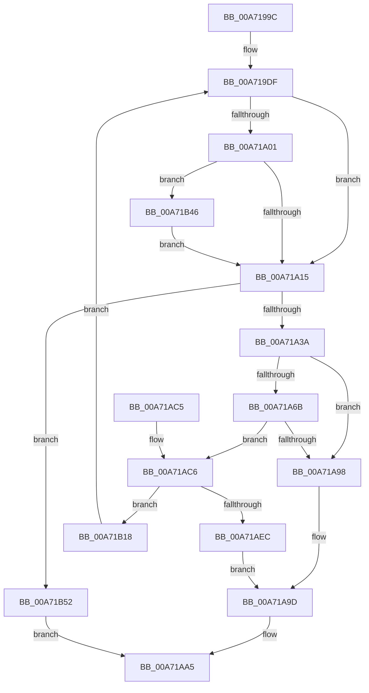

# IopSetDeviceSecurityDescriptor

- RVA: `0x00A7199C`–`0x00A71B5C` (길이 `448` bytes)
- VA: `0x0000000140A7199C`
- 실행 섹션: `PAGE`
- PDB 이름 있음: `예`; PDB Function 태그: `아니요`
- unwind 정보 RVA: `0x000B53D0`
- 디코드: `107`개 명령, `448/448` bytes 표시
- 미해석 바이트: `0` (있으면 어셈블리에 `.byte`로 보존)

> 이 문서는 커널 이미지의 기계어와 PDB 기호를 분석해 생성했습니다. 4번과 5번은 함수 원형과 자료형을 바이너리 사용 방식에서 추정한 C 해석이며 원본 소스 복구 결과는 아닙니다.

## 1. Dependencies

- 직접 호출 지점: **14**; 고유 호출 대상: **8**
- 직접 호출자로 확인된 함수: **2**
- RIP 상대 이미지 참조: **1**

### Outgoing calls
- `0x00A719F0` → [ExAcquireResourceSharedLite](../../text/21/ExAcquireResourceSharedLite_function_00211BC0.md) (function, `0x00211BC0`)
- `0x00A71A1C` → [ExReleaseResourceLite](../../text/25/ExReleaseResourceLite_function_0025FA10.md) (function, `0x0025FA10`)
- `0x00A71A24` → [KiLeaveCriticalRegionUnsafe](../../text/25/KiLeaveCriticalRegionUnsafe_function_0025F010.md) (function, `0x0025F010`)
- `0x00A71A60` → [RtlpSetSecurityObject](../8B/RtlpSetSecurityObject_function_008BB500.md) (function, `0x008BB500`)
- `0x00A71A7E` → [ObLogSecurityDescriptor](../8C/ObLogSecurityDescriptor_function_008C0020.md) (function, `0x008C0020`)
- `0x00A71A8F` → [ExFreePoolWithTag](../../poolcode/B8/ExFreePoolWithTag_function_00B82870.md) (function, `0x00B82870`)
- `0x00A71AA0` → [ObDereferenceSecurityDescriptor](../87/ObDereferenceSecurityDescriptor_function_008740A0.md) (function, `0x008740A0`)
- `0x00A71AD7` → [ExAcquireResourceExclusiveLite](../../text/21/ExAcquireResourceExclusiveLite_function_00214E20.md) (function, `0x00214E20`)
- `0x00A71B04` → [ExReleaseResourceLite](../../text/25/ExReleaseResourceLite_function_0025FA10.md) (function, `0x0025FA10`)
- `0x00A71B0C` → [KiLeaveCriticalRegionUnsafe](../../text/25/KiLeaveCriticalRegionUnsafe_function_0025F010.md) (function, `0x0025F010`)
- `0x00A71B18` → [ExReleaseResourceLite](../../text/25/ExReleaseResourceLite_function_0025FA10.md) (function, `0x0025FA10`)
- `0x00A71B20` → [KiLeaveCriticalRegionUnsafe](../../text/25/KiLeaveCriticalRegionUnsafe_function_0025F010.md) (function, `0x0025F010`)
- `0x00A71B2D` → [ObDereferenceSecurityDescriptor](../87/ObDereferenceSecurityDescriptor_function_008740A0.md) (function, `0x008740A0`)
- `0x00A71B3C` → [ObDereferenceSecurityDescriptor](../87/ObDereferenceSecurityDescriptor_function_008740A0.md) (function, `0x008740A0`)

### Direct callers
- [IopGetSetSecurityObject](../87/IopGetSetSecurityObject_function_00873A80.md) at `0x00873FD8`
- [IopSetDeviceSecurityDescriptors](IopSetDeviceSecurityDescriptors_function_00A718FC.md) at `0x00A71947`

### Static image references
- `0x00A719E6` → RVA `0x00F8D2A0` (`.data`; read)

## 2. Other-region calls and transfers

- 다른 실행 섹션으로 향하는 call: **9**
  - `0x00A719F0` → [ExAcquireResourceSharedLite](../../text/21/ExAcquireResourceSharedLite_function_00211BC0.md) (`PAGE` → `.text`)
  - `0x00A71A1C` → [ExReleaseResourceLite](../../text/25/ExReleaseResourceLite_function_0025FA10.md) (`PAGE` → `.text`)
  - `0x00A71A24` → [KiLeaveCriticalRegionUnsafe](../../text/25/KiLeaveCriticalRegionUnsafe_function_0025F010.md) (`PAGE` → `.text`)
  - `0x00A71A8F` → [ExFreePoolWithTag](../../poolcode/B8/ExFreePoolWithTag_function_00B82870.md) (`PAGE` → `POOLCODE`)
  - `0x00A71AD7` → [ExAcquireResourceExclusiveLite](../../text/21/ExAcquireResourceExclusiveLite_function_00214E20.md) (`PAGE` → `.text`)
  - `0x00A71B04` → [ExReleaseResourceLite](../../text/25/ExReleaseResourceLite_function_0025FA10.md) (`PAGE` → `.text`)
  - `0x00A71B0C` → [KiLeaveCriticalRegionUnsafe](../../text/25/KiLeaveCriticalRegionUnsafe_function_0025F010.md) (`PAGE` → `.text`)
  - `0x00A71B18` → [ExReleaseResourceLite](../../text/25/ExReleaseResourceLite_function_0025FA10.md) (`PAGE` → `.text`)
  - `0x00A71B20` → [KiLeaveCriticalRegionUnsafe](../../text/25/KiLeaveCriticalRegionUnsafe_function_0025F010.md) (`PAGE` → `.text`)
- 별도 외부 분기/꼬리 이동을 확인하지 못했습니다.

## 3. Assembly (complete function range)

```asm
00A7199C  48 8B C4                        mov rax, rsp
00A7199F  48 89 58 10                     mov qword ptr [rax + 0x10], rbx
00A719A3  48 89 68 18                     mov qword ptr [rax + 0x18], rbp
00A719A7  48 89 70 20                     mov qword ptr [rax + 0x20], rsi
00A719AB  57                              push rdi
00A719AC  41 54                           push r12
00A719AE  41 55                           push r13
00A719B0  41 56                           push r14
00A719B2  41 57                           push r15
00A719B4  48 83 EC 50                     sub rsp, 0x50
00A719B8  48 83 60 08 00                  and qword ptr [rax + 8], 0
00A719BD  45 8B F1                        mov r14d, r9d
00A719C0  48 83 60 C8 00                  and qword ptr [rax - 0x38], 0
00A719C5  4D 8B F8                        mov r15, r8
00A719C8  65 48 8B 34 25 88 01 00 00      mov rsi, qword ptr gs:[0x188]
00A719D1  4C 8B E2                        mov r12, rdx
00A719D4  4C 8B AC 24 A0 00 00 00         mov r13, qword ptr [rsp + 0xa0]
00A719DC  48 8B E9                        mov rbp, rcx
00A719DF  66 FF 8E E4 01 00 00            dec word ptr [rsi + 0x1e4]
00A719E6  48 8D 0D B3 B8 51 00            lea rcx, [rip + 0x51b8b3]
00A719ED  B2 01                           mov dl, 1
00A719EF  90                              nop
00A719F0  E8 CB 01 7A FF                  call 0x140211bc0
00A719F5  48 8B 9D 10 01 00 00            mov rbx, qword ptr [rbp + 0x110]
00A719FC  48 85 DB                        test rbx, rbx
00A719FF  74 14                           je 0x140a71a15
00A71A01  B8 01 00 00 00                  mov eax, 1
00A71A06  F0 48 0F C1 43 E8               lock xadd qword ptr [rbx - 0x18], rax
00A71A0C  48 85 C0                        test rax, rax
00A71A0F  0F 8E 31 01 00 00               jle 0x140a71b46
00A71A15  48 8D 0D 84 B8 51 00            lea rcx, [rip + 0x51b884]
00A71A1C  E8 EF DF 7E FF                  call 0x14025fa10
00A71A21  48 8B CE                        mov rcx, rsi
00A71A24  E8 E7 D5 7E FF                  call 0x14025f010
00A71A29  48 89 9C 24 80 00 00 00         mov qword ptr [rsp + 0x80], rbx
00A71A31  48 85 DB                        test rbx, rbx
00A71A34  0F 84 18 01 00 00               je 0x140a71b52
00A71A3A  48 83 64 24 38 00               and qword ptr [rsp + 0x38], 0
00A71A40  4C 8D 8C 24 80 00 00 00         lea r9, [rsp + 0x80]
00A71A48  41 8B 14 24                     mov edx, dword ptr [r12]
00A71A4C  4D 8B C7                        mov r8, r15
00A71A4F  4C 89 6C 24 30                  mov qword ptr [rsp + 0x30], r13
00A71A54  33 C9                           xor ecx, ecx
00A71A56  44 89 74 24 28                  mov dword ptr [rsp + 0x28], r14d
00A71A5B  83 64 24 20 00                  and dword ptr [rsp + 0x20], 0
00A71A60  E8 9B 9A E4 FF                  call 0x1408bb500
00A71A65  8B F8                           mov edi, eax
00A71A67  85 C0                           test eax, eax
00A71A69  78 2D                           js 0x140a71a98
00A71A6B  48 8B 8C 24 80 00 00 00         mov rcx, qword ptr [rsp + 0x80]
00A71A73  48 8D 54 24 40                  lea rdx, [rsp + 0x40]
00A71A78  41 B8 01 00 00 00               mov r8d, 1
00A71A7E  E8 9D E5 E4 FF                  call 0x1408c0020
00A71A83  48 8B 8C 24 80 00 00 00         mov rcx, qword ptr [rsp + 0x80]
00A71A8B  33 D2                           xor edx, edx
00A71A8D  8B F8                           mov edi, eax
00A71A8F  E8 DC 0D 11 00                  call 0x140b82870
00A71A94  85 FF                           test edi, edi
00A71A96  79 2E                           jns 0x140a71ac6
00A71A98  BA 01 00 00 00                  mov edx, 1
00A71A9D  48 8B CB                        mov rcx, rbx
00A71AA0  E8 FB 25 E0 FF                  call 0x1408740a0
00A71AA5  4C 8D 5C 24 50                  lea r11, [rsp + 0x50]
00A71AAA  8B C7                           mov eax, edi
00A71AAC  49 8B 5B 38                     mov rbx, qword ptr [r11 + 0x38]
00A71AB0  49 8B 6B 40                     mov rbp, qword ptr [r11 + 0x40]
00A71AB4  49 8B 73 48                     mov rsi, qword ptr [r11 + 0x48]
00A71AB8  49 8B E3                        mov rsp, r11
00A71ABB  41 5F                           pop r15
00A71ABD  41 5E                           pop r14
00A71ABF  41 5D                           pop r13
00A71AC1  41 5C                           pop r12
00A71AC3  5F                              pop rdi
00A71AC4  C3                              ret
00A71AC5  CC                              int3
00A71AC6  66 FF 8E E4 01 00 00            dec word ptr [rsi + 0x1e4]
00A71ACD  48 8D 0D CC B7 51 00            lea rcx, [rip + 0x51b7cc]
00A71AD4  B2 01                           mov dl, 1
00A71AD6  90                              nop
00A71AD7  E8 44 33 7A FF                  call 0x140214e20
00A71ADC  48 8D 0D BD B7 51 00            lea rcx, [rip + 0x51b7bd]
00A71AE3  48 39 9D 10 01 00 00            cmp qword ptr [rbp + 0x110], rbx
00A71AEA  75 2C                           jne 0x140a71b18
00A71AEC  48 8B 44 24 40                  mov rax, qword ptr [rsp + 0x40]
00A71AF1  48 89 85 10 01 00 00            mov qword ptr [rbp + 0x110], rax
00A71AF8  48 8B 85 38 01 00 00            mov rax, qword ptr [rbp + 0x138]
00A71AFF  0F BA 70 20 0B                  btr dword ptr [rax + 0x20], 0xb
00A71B04  E8 07 DF 7E FF                  call 0x14025fa10
00A71B09  48 8B CE                        mov rcx, rsi
00A71B0C  E8 FF D4 7E FF                  call 0x14025f010
00A71B11  BA 02 00 00 00                  mov edx, 2
00A71B16  EB 85                           jmp 0x140a71a9d
00A71B18  E8 F3 DE 7E FF                  call 0x14025fa10
00A71B1D  48 8B CE                        mov rcx, rsi
00A71B20  E8 EB D4 7E FF                  call 0x14025f010
00A71B25  BA 01 00 00 00                  mov edx, 1
00A71B2A  48 8B CB                        mov rcx, rbx
00A71B2D  E8 6E 25 E0 FF                  call 0x1408740a0
00A71B32  48 8B 4C 24 40                  mov rcx, qword ptr [rsp + 0x40]
00A71B37  BA 01 00 00 00                  mov edx, 1
00A71B3C  E8 5F 25 E0 FF                  call 0x1408740a0
00A71B41  E9 99 FE FF FF                  jmp 0x140a719df
00A71B46  B9 0E 00 00 00                  mov ecx, 0xe
00A71B4B  CD 29                           int 0x29
00A71B4D  E9 C3 FE FF FF                  jmp 0x140a71a15
00A71B52  BF D7 00 00 C0                  mov edi, 0xc00000d7
00A71B57  E9 49 FF FF FF                  jmp 0x140a71aa5
```

## 4. C-style interpretation (structured pseudocode)

```c
__int64 __fastcall IopSetDeviceSecurityDescriptor(__int64 a1, __int64 a2, __int64 a3, int a4, __int64 a5)
{
    __int64 result;
    __int64 v_rsp;
    unsigned __int64 v_stack_m10;
    unsigned __int64 v_stack_m28;
    unsigned __int64 v_stack_m38;
    unsigned __int64 v_stack_m40;
    unsigned __int64 v_stack_m48;
    unsigned int v_stack_m50;
    unsigned int v_stack_m58;
    unsigned __int64 v_stack_p8;

    *(unsigned __int64 *)(v_rsp + 16) = v_rbx;
    *(unsigned __int64 *)(v_rsp + 24) = v_rbp;
    *(unsigned __int64 *)(v_rsp + 32) = v_rsi;
    v_rsp = (v_rsp) - (80);
loc_00A719DF:
    result = ExAcquireResourceSharedLite(v_rip + 5355699, 1, a3, a4);
    if (*(unsigned __int64 *)(a1 + 272) == 0) goto loc_00A71A15;
    if (condition_is_less_or_equal) goto loc_00A71B46;
loc_00A71A15:
    result = ExReleaseResourceLite(v_rip + 5355652, 1, a3, a4);
    result = KiLeaveCriticalRegionUnsafe(*(unsigned __int64 *)(gs_base + (0 + 392)), 1, a3, a4);
    v_stack_p8 = *(unsigned __int64 *)(a1 + 272);
    if (*(unsigned __int64 *)(a1 + 272) == 0) goto loc_00A71B52;
    v_stack_m48 = a5;
    a1 = 0;
    v_stack_m50 = (unsigned int)((unsigned int)(a4));
    result = RtlpSetSecurityObject(a1, (unsigned int)(*(unsigned int *)(a2)), a3, v_stack_p8);
    if (sign_flag) goto loc_00A71A98;
    result = ObLogSecurityDescriptor(v_stack_p8, v_stack_m38, 1, v_stack_p8);
    a2 = 0;
    result = ExFreePoolWithTag(v_stack_p8, a2, 1, v_stack_p8);
    if (!sign_flag) goto loc_00A71AC6;
loc_00A71A98:
loc_00A71A9D:
    result = ObDereferenceSecurityDescriptor(*(unsigned __int64 *)(a1 + 272), 1, 1, v_stack_p8);
loc_00A71AA5:
    return (unsigned int)((unsigned int)((unsigned int)((unsigned int)(result))));
loc_00A71AC6:
    result = ExAcquireResourceExclusiveLite(v_rip + 5355468, 1, 1, v_stack_p8);
    if ((*(unsigned __int64 *)(*(unsigned __int64 *)(v_stack_m28 + 64) + 272)) != (*(unsigned __int64 *)(v_stack_m28 + 56))) goto loc_00A71B18;
    *(unsigned __int64 *)(*(unsigned __int64 *)(v_stack_m28 + 64) + 272) = v_stack_m10;
    result = ExReleaseResourceLite(v_rip + 5355453, 1, 1, v_stack_p8);
    result = KiLeaveCriticalRegionUnsafe(*(unsigned __int64 *)(v_stack_m28 + 72), 1, 1, v_stack_p8);
    goto loc_00A71A9D;
loc_00A71B18:
    result = ExReleaseResourceLite(*(unsigned __int64 *)(v_stack_m28 + 72), 2, 1, v_stack_p8);
    result = KiLeaveCriticalRegionUnsafe(*(unsigned __int64 *)(v_stack_m28 + 72), 2, 1, v_stack_p8);
    result = ObDereferenceSecurityDescriptor(*(unsigned __int64 *)(v_stack_m28 + 56), 1, 1, v_stack_p8);
    result = ObDereferenceSecurityDescriptor(v_stack_m10, 1, 1, v_stack_p8);
    goto loc_00A719DF;
loc_00A71B46:
    goto loc_00A71A15;
loc_00A71B52:
    goto loc_00A71AA5;
}
```

## 5. (Beta) C Style

```c
int64_t IopSetDeviceSecurityDescriptor(void *Arg1, void *Arg2, int64_t Arg3, int32_t Arg4, int64_t Arg5)
{
    uint8_t *arg1 = (uint8_t *)Arg1;
    uint8_t *arg2 = (uint8_t *)Arg2;

    int64_t result;
    int64_t local_rsp;
    uint64_t v_stack_m10;
    uint64_t v_stack_m28;
    uint64_t v_stack_m38;
    uint64_t v_stack_m40;
    uint64_t v_stack_m48;
    uint32_t v_stack_m50;
    uint32_t v_stack_m58;
    uint64_t v_stack_p8;

    *(uint64_t *)(local_rsp + 0x10) = local_rbx;
    *(uint64_t *)(local_rsp + 0x18) = local_rbp;
    *(uint64_t *)(local_rsp + 0x20) = local_rsi;
    local_rsp = (local_rsp) - (80);
loc_00A719DF:
    result = ExAcquireResourceSharedLite(v_rip + 5355699, 1, Arg3, Arg4);
    if (*(uint64_t *)(arg1 + 0x110) == 0) goto loc_00A71A15;
    if (condition_is_less_or_equal) goto loc_00A71B46;
loc_00A71A15:
    result = ExReleaseResourceLite(v_rip + 5355652, 1, Arg3, Arg4);
    result = KiLeaveCriticalRegionUnsafe(*(uint64_t *)(gs_base + (0 + 0x188)), 1, Arg3, Arg4);
    v_stack_p8 = *(uint64_t *)(arg1 + 0x110);
    if (*(uint64_t *)(arg1 + 0x110) == 0) goto loc_00A71B52;
    v_stack_m48 = Arg5;
    Arg1 = 0;
    v_stack_m50 = (uint32_t)((uint32_t)(Arg4));
    result = RtlpSetSecurityObject(Arg1, (uint32_t)(*(uint32_t *)(arg2)), Arg3, v_stack_p8);
    if (sign_flag) goto loc_00A71A98;
    result = ObLogSecurityDescriptor(v_stack_p8, v_stack_m38, 1, v_stack_p8);
    Arg2 = 0;
    result = ExFreePoolWithTag(v_stack_p8, Arg2, 1, v_stack_p8);
    if (!sign_flag) goto loc_00A71AC6;
loc_00A71A98:
loc_00A71A9D:
    result = ObDereferenceSecurityDescriptor(*(uint64_t *)(arg1 + 0x110), 1, 1, v_stack_p8);
loc_00A71AA5:
    return (uint32_t)((uint32_t)((uint32_t)((uint32_t)(result))));
loc_00A71AC6:
    result = ExAcquireResourceExclusiveLite(v_rip + 5355468, 1, 1, v_stack_p8);
    if ((*(uint64_t *)(*(uint64_t *)(v_stack_m28 + 0x40) + 0x110)) != (*(uint64_t *)(v_stack_m28 + 0x38))) goto loc_00A71B18;
    *(uint64_t *)(*(uint64_t *)(v_stack_m28 + 0x40) + 0x110) = v_stack_m10;
    result = ExReleaseResourceLite(v_rip + 5355453, 1, 1, v_stack_p8);
    result = KiLeaveCriticalRegionUnsafe(*(uint64_t *)(v_stack_m28 + 0x48), 1, 1, v_stack_p8);
    goto loc_00A71A9D;
loc_00A71B18:
    result = ExReleaseResourceLite(*(uint64_t *)(v_stack_m28 + 0x48), 2, 1, v_stack_p8);
    result = KiLeaveCriticalRegionUnsafe(*(uint64_t *)(v_stack_m28 + 0x48), 2, 1, v_stack_p8);
    result = ObDereferenceSecurityDescriptor(*(uint64_t *)(v_stack_m28 + 0x38), 1, 1, v_stack_p8);
    result = ObDereferenceSecurityDescriptor(v_stack_m10, 1, 1, v_stack_p8);
    goto loc_00A719DF;
loc_00A71B46:
    goto loc_00A71A15;
loc_00A71B52:
    goto loc_00A71AA5;
}
```

### 관측된 메모리 오프셋

구조체 형식이 확인되지 않은 접근은 인자 기준의 오프셋으로만 기록했습니다.

| 기준 인자 | 오프셋 표현 | 폭 (bit) | 접근 |
|---|---:|---:|---|
| `Arg1` | `+ 0x110` | `64` | `R` |
| `Arg1` | `+ 0x110` | `64` | `W` |
| `Arg1` | `+ 0x138` | `64` | `R` |
| `Arg2` | `+ 0x0` | `32` | `R` |

## 6. Execution-region graph

[열기: 2D/3D 그래프와 함수 탐색 컨트롤 패널](../../../control-panel.html?section=page&rva=0x00A7199C&view=graph)

- 2D 그래프는 위에서 아래로 흐르고, 3D 그래프는 빈 공간을 드래그해 회전합니다. Shift+드래그는 이동, 휠은 확대·축소, 함수 노드 선택은 대상 보고서 이동입니다.

### Static fallback


