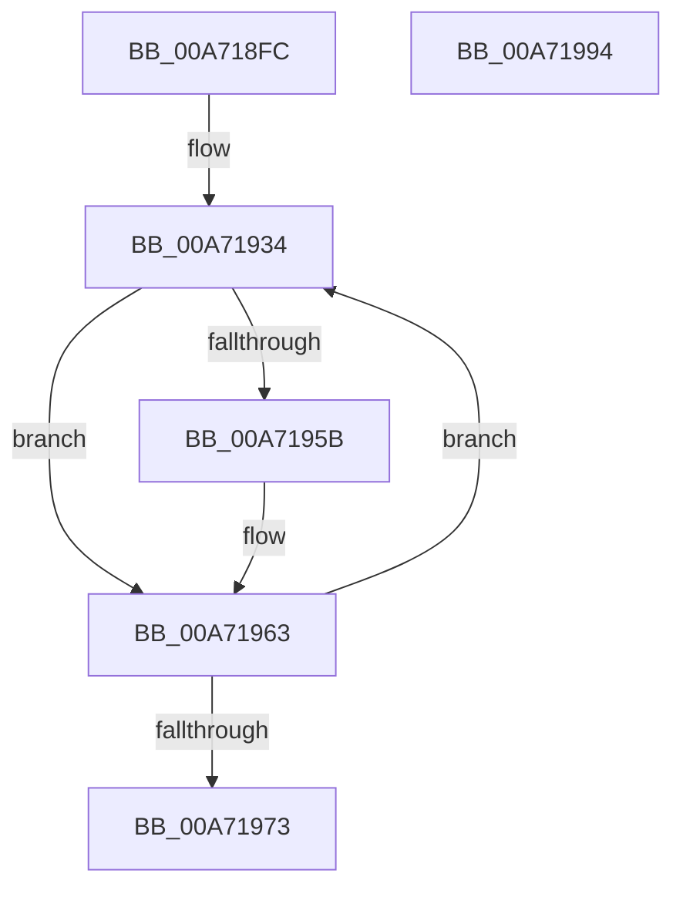

# IopSetDeviceSecurityDescriptors

- RVA: `0x00A718FC`–`0x00A71995` (길이 `153` bytes)
- VA: `0x0000000140A718FC`
- 실행 섹션: `PAGE`
- PDB 이름 있음: `예`; PDB Function 태그: `아니요`
- unwind 정보 RVA: `0x000847EC`
- 디코드: `46`개 명령, `153/153` bytes 표시
- 미해석 바이트: `0` (있으면 어셈블리에 `.byte`로 보존)

> 이 문서는 커널 이미지의 기계어와 PDB 기호를 분석해 생성했습니다. 4번과 5번은 함수 원형과 자료형을 바이너리 사용 방식에서 추정한 C 해석이며 원본 소스 복구 결과는 아닙니다.

## 1. Dependencies

- 직접 호출 지점: **4**; 고유 호출 대상: **3**
- 직접 호출자로 확인된 함수: **1**
- RIP 상대 이미지 참조: **0**

### Outgoing calls
- `0x00A7192A` → [ObfReferenceObject](../../text/20/ObfReferenceObject_function_0020FA20.md) (function, `0x0020FA20`)
- `0x00A71947` → [IopSetDeviceSecurityDescriptor](IopSetDeviceSecurityDescriptor_function_00A7199C.md) (function, `0x00A7199C`)
- `0x00A7195E` → [ObfReferenceObject](../../text/20/ObfReferenceObject_function_0020FA20.md) (function, `0x0020FA20`)
- `0x00A71966` → [ObfDereferenceObject](../../text/2F/ObfDereferenceObject_function_002F9350.md) (function, `0x002F9350`)

### Direct callers
- [IopGetSetSecurityObject](../87/IopGetSetSecurityObject_function_00873A80.md) at `0x0087401C`

### Static image references
- 디코드된 RIP-relative 메모리 참조가 없습니다.

## 2. Other-region calls and transfers

- 다른 실행 섹션으로 향하는 call: **3**
  - `0x00A7192A` → [ObfReferenceObject](../../text/20/ObfReferenceObject_function_0020FA20.md) (`PAGE` → `.text`)
  - `0x00A7195E` → [ObfReferenceObject](../../text/20/ObfReferenceObject_function_0020FA20.md) (`PAGE` → `.text`)
  - `0x00A71966` → [ObfDereferenceObject](../../text/2F/ObfDereferenceObject_function_002F9350.md) (`PAGE` → `.text`)
- 별도 외부 분기/꼬리 이동을 확인하지 못했습니다.

## 3. Assembly (complete function range)

```asm
00A718FC  48 8B C4                        mov rax, rsp
00A718FF  48 89 58 08                     mov qword ptr [rax + 8], rbx
00A71903  48 89 68 10                     mov qword ptr [rax + 0x10], rbp
00A71907  48 89 70 18                     mov qword ptr [rax + 0x18], rsi
00A7190B  48 89 78 20                     mov qword ptr [rax + 0x20], rdi
00A7190F  41 54                           push r12
00A71911  41 56                           push r14
00A71913  41 57                           push r15
00A71915  48 83 EC 30                     sub rsp, 0x30
00A71919  4C 8B F9                        mov r15, rcx
00A7191C  33 FF                           xor edi, edi
00A7191E  48 8B CA                        mov rcx, rdx
00A71921  49 8B E9                        mov rbp, r9
00A71924  4D 8B F0                        mov r14, r8
00A71927  48 8B DA                        mov rbx, rdx
00A7192A  E8 F1 E0 79 FF                  call 0x14020fa20
00A7192F  4C 8B 64 24 78                  mov r12, qword ptr [rsp + 0x78]
00A71934  44 8B 4C 24 70                  mov r9d, dword ptr [rsp + 0x70]
00A71939  4C 8B C5                        mov r8, rbp
00A7193C  49 8B D6                        mov rdx, r14
00A7193F  4C 89 64 24 20                  mov qword ptr [rsp + 0x20], r12
00A71944  48 8B CB                        mov rcx, rbx
00A71947  E8 50 00 00 00                  call 0x140a7199c
00A7194C  48 8B 73 18                     mov rsi, qword ptr [rbx + 0x18]
00A71950  49 3B DF                        cmp rbx, r15
00A71953  0F 44 F8                        cmove edi, eax
00A71956  48 85 F6                        test rsi, rsi
00A71959  74 08                           je 0x140a71963
00A7195B  48 8B CE                        mov rcx, rsi
00A7195E  E8 BD E0 79 FF                  call 0x14020fa20
00A71963  48 8B CB                        mov rcx, rbx
00A71966  E8 E5 79 88 FF                  call 0x1402f9350
00A7196B  48 8B DE                        mov rbx, rsi
00A7196E  48 85 F6                        test rsi, rsi
00A71971  75 C1                           jne 0x140a71934
00A71973  48 8B 5C 24 50                  mov rbx, qword ptr [rsp + 0x50]
00A71978  8B C7                           mov eax, edi
00A7197A  48 8B 7C 24 68                  mov rdi, qword ptr [rsp + 0x68]
00A7197F  48 8B 6C 24 58                  mov rbp, qword ptr [rsp + 0x58]
00A71984  48 8B 74 24 60                  mov rsi, qword ptr [rsp + 0x60]
00A71989  48 83 C4 30                     add rsp, 0x30
00A7198D  41 5F                           pop r15
00A7198F  41 5E                           pop r14
00A71991  41 5C                           pop r12
00A71993  C3                              ret
00A71994  CC                              int3
```

## 4. C-style interpretation (structured pseudocode)

```c
__int64 __fastcall IopSetDeviceSecurityDescriptors(__int64 a1, __int64 a2, __int64 a3, __int64 a4, unsigned int a5, __int64 a6)
{
    __int64 result;
    __int64 v_rdi;
    __int64 v_rsp;
    unsigned __int64 v_stack_m28;
    unsigned __int64 v_stack_p10;
    unsigned __int64 v_stack_p18;
    unsigned __int64 v_stack_p20;
    unsigned __int64 v_stack_p8;

    *(unsigned __int64 *)(v_rsp + 8) = v_rbx;
    *(unsigned __int64 *)(v_rsp + 16) = v_rbp;
    *(unsigned __int64 *)(v_rsp + 24) = v_rsi;
    *(unsigned __int64 *)(v_rsp + 32) = v_rdi;
    v_rsp = (v_rsp) - (48);
    v_rdi = 0;
    result = ObfReferenceObject(a2, a2, a3, a4);
loc_00A71934:
    v_stack_m28 = a6;
    result = IopSetDeviceSecurityDescriptor(a2, a3, a4, (unsigned int)(a5));
    if (a2 == a1) { v_rdi = (unsigned int)(result); }
    if (*(unsigned __int64 *)(a2 + 24) != 0) {
        a1 = *(unsigned __int64 *)(a2 + 24);
        result = ObfReferenceObject(a1, a3, a4, (unsigned int)(a5));
    }
    result = ObfDereferenceObject(a2, a3, a4, (unsigned int)(a5));
    if (*(unsigned __int64 *)(a2 + 24) != 0) goto loc_00A71934;
    v_rsp = (v_rsp) + (48);
    return (unsigned int)((unsigned int)(v_rdi));
}
```

## 5. (Beta) C Style

```c
int64_t IopSetDeviceSecurityDescriptors(int64_t Arg1, int64_t Arg2, int64_t Arg3, int64_t Arg4, uint32_t Arg5, int64_t Arg6)
{
    int64_t result;
    int64_t local_rdi;
    int64_t local_rsp;
    uint64_t v_stack_m28;
    uint64_t v_stack_p10;
    uint64_t v_stack_p18;
    uint64_t v_stack_p20;
    uint64_t v_stack_p8;

    *(uint64_t *)(local_rsp + 0x8) = local_rbx;
    *(uint64_t *)(local_rsp + 0x10) = local_rbp;
    *(uint64_t *)(local_rsp + 0x18) = local_rsi;
    *(uint64_t *)(local_rsp + 0x20) = local_rdi;
    local_rsp = (local_rsp) - (48);
    local_rdi = 0;
    result = ObfReferenceObject(Arg2, Arg2, Arg3, Arg4);
loc_00A71934:
    v_stack_m28 = Arg6;
    result = IopSetDeviceSecurityDescriptor(Arg2, Arg3, Arg4, (uint32_t)(Arg5));
    if (Arg2 == Arg1) { local_rdi = (uint32_t)(result); }
    if (*(uint64_t *)(Arg2 + 0x18) != 0) {
        Arg1 = *(uint64_t *)(Arg2 + 0x18);
        result = ObfReferenceObject(Arg1, Arg3, Arg4, (uint32_t)(Arg5));
    }
    result = ObfDereferenceObject(Arg2, Arg3, Arg4, (uint32_t)(Arg5));
    if (*(uint64_t *)(Arg2 + 0x18) != 0) goto loc_00A71934;
    local_rsp = (local_rsp) + (48);
    return (uint32_t)((uint32_t)(local_rdi));
}
```

## 6. Execution-region graph

[열기: 2D/3D 그래프와 함수 탐색 컨트롤 패널](../../../control-panel.html?section=page&rva=0x00A718FC&view=graph)

- 2D 그래프는 위에서 아래로 흐르고, 3D 그래프는 빈 공간을 드래그해 회전합니다. Shift+드래그는 이동, 휠은 확대·축소, 함수 노드 선택은 대상 보고서 이동입니다.

### Static fallback


