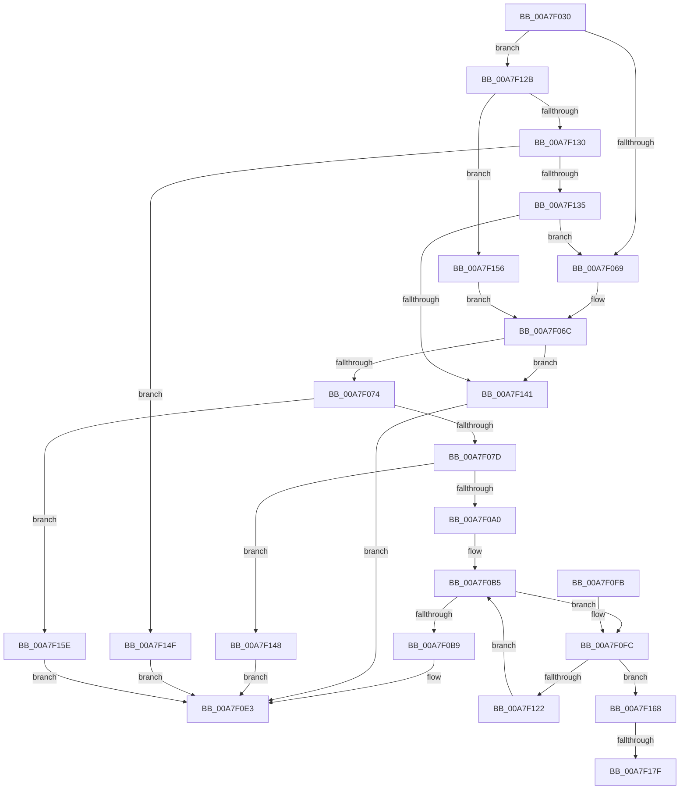

# KeAllocateCalloutStackEx

- RVA: `0x00A7F030`–`0x00A7F187` (길이 `343` bytes)
- VA: `0x0000000140A7F030`
- 실행 섹션: `PAGE`
- PDB 이름 있음: `예`; PDB Function 태그: `예`
- unwind 정보 RVA: `0x000B6D7C`
- 디코드: `99`개 명령, `343/343` bytes 표시
- 미해석 바이트: `0` (있으면 어셈블리에 `.byte`로 보존)

> 이 문서는 커널 이미지의 기계어와 PDB 기호를 분석해 생성했습니다. 4번과 5번은 함수 원형과 자료형을 바이너리 사용 방식에서 추정한 C 해석이며 원본 소스 복구 결과는 아닙니다.

## 1. Dependencies

- 직접 호출 지점: **3**; 고유 호출 대상: **3**
- 직접 호출자로 확인된 함수: **3**
- RIP 상대 이미지 참조: **0**

### Outgoing calls
- `0x00A7F08F` → [ExAllocatePool2](../../poolcode/B8/ExAllocatePool2_function_00B820F0.md) (function, `0x00B820F0`)
- `0x00A7F0D5` → [KeInitializeMutex](../../text/48/KeInitializeMutex_function_004830E0.md) (function, `0x004830E0`)
- `0x00A7F114` → [MmCreateKernelStack](../../text/33/MmCreateKernelStack_function_00337D20.md) (function, `0x00337D20`)

### Direct callers
- [EtwpStackInitializeProcessor](../../text/65/EtwpStackInitializeProcessor_function_00651DD8.md) at `0x00651E2C`
- [KeAllocateCalloutStack](../74/KeAllocateCalloutStack_function_007464C0.md) at `0x007464E0`
- [EtwpReferenceStackLookasideList](EtwpReferenceStackLookasideList_function_00A7EF68.md) at `0x00A7EFD7`

### Static image references
- 디코드된 RIP-relative 메모리 참조가 없습니다.

## 2. Other-region calls and transfers

- 다른 실행 섹션으로 향하는 call: **3**
  - `0x00A7F08F` → [ExAllocatePool2](../../poolcode/B8/ExAllocatePool2_function_00B820F0.md) (`PAGE` → `POOLCODE`)
  - `0x00A7F0D5` → [KeInitializeMutex](../../text/48/KeInitializeMutex_function_004830E0.md) (`PAGE` → `.text`)
  - `0x00A7F114` → [MmCreateKernelStack](../../text/33/MmCreateKernelStack_function_00337D20.md) (`PAGE` → `.text`)
- call이 아닌 외부 분기/꼬리 이동: **2**
  - `0x00A7F179` → [sub_00B42BA8 + 0x22](../B4/Unknown_function_00B42BA8.md) (`tail-transfer`)
  - `0x00A7F182` → [sub_00B42BA8](../B4/Unknown_function_00B42BA8.md) (`tail-transfer`)

## 3. Assembly (complete function range)

```asm
00A7F030  48 89 5C 24 10                  mov qword ptr [rsp + 0x10], rbx
00A7F035  4C 89 4C 24 20                  mov qword ptr [rsp + 0x20], r9
00A7F03A  55                              push rbp
00A7F03B  56                              push rsi
00A7F03C  57                              push rdi
00A7F03D  41 54                           push r12
00A7F03F  41 55                           push r13
00A7F041  41 56                           push r14
00A7F043  41 57                           push r15
00A7F045  48 8B EC                        mov rbp, rsp
00A7F048  48 83 EC 50                     sub rsp, 0x50
00A7F04C  0F 57 C0                        xorps xmm0, xmm0
00A7F04F  0F B6 F2                        movzx esi, dl
00A7F052  45 32 E4                        xor r12b, r12b
00A7F055  0F 11 45 D0                     movups xmmword ptr [rbp - 0x30], xmm0
00A7F059  0F 11 45 E0                     movups xmmword ptr [rbp - 0x20], xmm0
00A7F05D  0F 11 45 F0                     movups xmmword ptr [rbp - 0x10], xmm0
00A7F061  85 C9                           test ecx, ecx
00A7F063  0F 85 C2 00 00 00               jne 0x140a7f12b
00A7F069  45 32 F6                        xor r14b, r14b
00A7F06C  84 D2                           test dl, dl
00A7F06E  0F 84 CD 00 00 00               je 0x140a7f141
00A7F074  4D 85 C0                        test r8, r8
00A7F077  0F 85 E1 00 00 00               jne 0x140a7f15e
00A7F07D  41 8D 48 40                     lea ecx, [r8 + 0x40]
00A7F081  41 B8 4B 65 53 63               mov r8d, 0x6353654b
00A7F087  48 8D 14 F5 40 00 00 00         lea rdx, [rsi*8 + 0x40]
00A7F08F  E8 5C 30 10 00                  call 0x140b820f0
00A7F094  48 8B D8                        mov rbx, rax
00A7F097  48 85 C0                        test rax, rax
00A7F09A  0F 84 A8 00 00 00               je 0x140a7f148
00A7F0A0  41 8A C6                        mov al, r14b
00A7F0A3  F6 D8                           neg al
00A7F0A5  41 0F B6 C6                     movzx eax, r14b
00A7F0A9  45 1B FF                        sbb r15d, r15d
00A7F0AC  89 45 40                        mov dword ptr [rbp + 0x40], eax
00A7F0AF  41 83 E7 05                     and r15d, 5
00A7F0B3  33 FF                           xor edi, edi
00A7F0B5  3B FE                           cmp edi, esi
00A7F0B7  72 43                           jb 0x140a7f0fc
00A7F0B9  48 8D 4B 08                     lea rcx, [rbx + 8]
00A7F0BD  C7 03 53 74 61 6B               mov dword ptr [rbx], 0x6b617453
00A7F0C3  33 D2                           xor edx, edx
00A7F0C5  44 88 73 04                     mov byte ptr [rbx + 4], r14b
00A7F0C9  40 88 73 05                     mov byte ptr [rbx + 5], sil
00A7F0CD  C6 43 06 00                     mov byte ptr [rbx + 6], 0
00A7F0D1  44 88 63 07                     mov byte ptr [rbx + 7], r12b
00A7F0D5  E8 06 40 A0 FF                  call 0x1404830e0
00A7F0DA  48 8B 45 58                     mov rax, qword ptr [rbp + 0x58]
00A7F0DE  48 89 18                        mov qword ptr [rax], rbx
00A7F0E1  33 C0                           xor eax, eax
00A7F0E3  48 8B 9C 24 98 00 00 00         mov rbx, qword ptr [rsp + 0x98]
00A7F0EB  48 83 C4 50                     add rsp, 0x50
00A7F0EF  41 5F                           pop r15
00A7F0F1  41 5E                           pop r14
00A7F0F3  41 5D                           pop r13
00A7F0F5  41 5C                           pop r12
00A7F0F7  5F                              pop rdi
00A7F0F8  5E                              pop rsi
00A7F0F9  5D                              pop rbp
00A7F0FA  C3                              ret
00A7F0FB  CC                              int3
00A7F0FC  83 65 D8 00                     and dword ptr [rbp - 0x28], 0
00A7F100  48 8D 4D D0                     lea rcx, [rbp - 0x30]
00A7F104  48 83 65 E0 00                  and qword ptr [rbp - 0x20], 0
00A7F109  44 89 7D D0                     mov dword ptr [rbp - 0x30], r15d
00A7F10D  C7 45 D4 05 00 00 00            mov dword ptr [rbp - 0x2c], 5
00A7F114  E8 07 8C 8B FF                  call 0x140337d20
00A7F119  48 8B 4D E8                     mov rcx, qword ptr [rbp - 0x18]
00A7F11D  48 85 C9                        test rcx, rcx
00A7F120  74 46                           je 0x140a7f168
00A7F122  48 89 4C FB 40                  mov qword ptr [rbx + rdi*8 + 0x40], rcx
00A7F127  FF C7                           inc edi
00A7F129  EB 8A                           jmp 0x140a7f0b5
00A7F12B  83 E9 01                        sub ecx, 1
00A7F12E  74 26                           je 0x140a7f156
00A7F130  83 F9 01                        cmp ecx, 1
00A7F133  75 1A                           jne 0x140a7f14f
00A7F135  44 8A E1                        mov r12b, cl
00A7F138  40 3A F1                        cmp sil, cl
00A7F13B  0F 84 28 FF FF FF               je 0x140a7f069
00A7F141  B8 F0 00 00 C0                  mov eax, 0xc00000f0
00A7F146  EB 9B                           jmp 0x140a7f0e3
00A7F148  B8 17 00 00 C0                  mov eax, 0xc0000017
00A7F14D  EB 94                           jmp 0x140a7f0e3
00A7F14F  B8 EF 00 00 C0                  mov eax, 0xc00000ef
00A7F154  EB 8D                           jmp 0x140a7f0e3
00A7F156  41 B6 01                        mov r14b, 1
00A7F159  E9 0E FF FF FF                  jmp 0x140a7f06c
00A7F15E  B8 F1 00 00 C0                  mov eax, 0xc00000f1
00A7F163  E9 7B FF FF FF                  jmp 0x140a7f0e3
00A7F168  0F 57 C0                        xorps xmm0, xmm0
00A7F16B  0F 11 45 D0                     movups xmmword ptr [rbp - 0x30], xmm0
00A7F16F  0F 11 45 E0                     movups xmmword ptr [rbp - 0x20], xmm0
00A7F173  0F 11 45 F0                     movups xmmword ptr [rbp - 0x10], xmm0
00A7F177  85 FF                           test edi, edi
00A7F179  0F 84 4B 3A 0C 00               je 0x140b42bca
00A7F17F  8B 75 40                        mov esi, dword ptr [rbp + 0x40]
00A7F182  E9 21 3A 0C 00                  jmp 0x140b42ba8
```

## 4. C-style interpretation (structured pseudocode)

```c
__int64 __fastcall KeAllocateCalloutStackEx(int a1, unsigned __int8 a2, __int64 a3, __int64 a4)
{
    __int64 result;
    __int64 v_r12;
    __int64 v_r14;
    __int64 v_r15;
    __int64 v_rdi;
    __int64 v_rsp;
    unsigned __int64 v_stack_m48;
    unsigned __int64 v_stack_m50;
    unsigned __int64 v_stack_m58;
    unsigned int v_stack_m60;
    unsigned int v_stack_m64;
    unsigned __int64 v_stack_m68;
    unsigned __int64 v_stack_p10;
    unsigned __int64 v_stack_p20;
    unsigned int v_stack_p8;

    v_stack_p10 = v_rbx;
    v_stack_p20 = a4;
    v_rsp = (v_rsp) - (80);
    v_r12 = 0;
    v_stack_m68 = v_xmm0;
    v_stack_m58 = v_xmm0;
    v_stack_m48 = v_xmm0;
    if (a1 != 0) goto loc_00A7F12B;
loc_00A7F069:
    v_r14 = 0;
loc_00A7F06C:
    if (a2 == 0) goto loc_00A7F141;
    if (a3 != 0) goto loc_00A7F15E;
    result = ExAllocatePool2(a3 + 64, a2 * 8 + 64, (unsigned int)(0x6353654BULL), a4);
    if (result == 0) goto loc_00A7F148;
    result = (unsigned __int8)(-(0));
    v_stack_p8 = 0;
    v_r15 = (unsigned int)((v_r15) & (5));
    v_rdi = 0;
loc_00A7F0B5:
    if (0 < a2) goto loc_00A7F0FC;
    *(unsigned int *)(result) = 0x6B617453ULL;
    a2 = 0;
    *(unsigned __int8 *)(result + 4) = 0;
    *(unsigned __int8 *)(result + 5) = 0;
    *(unsigned __int8 *)(result + 6) = 0;
    *(unsigned __int8 *)(result + 7) = 0;
    result = KeInitializeMutex(result + 8, a2, (unsigned int)(0x6353654BULL), a4);
    *(unsigned __int64 *)(v_stack_p20) = result;
    result = 0;
loc_00A7F0E3:
    v_rsp = (v_rsp) + (80);
    return result;
loc_00A7F0FC:
    v_stack_m68 = (unsigned int)(v_r15);
    v_stack_m64 = 5;
    result = MmCreateKernelStack(v_stack_m68, a2, (unsigned int)(0x6353654BULL), a4);
    if (v_stack_m50 == 0) goto loc_00A7F168;
    *(unsigned __int64 *)(v_stack_p10 + v_rdi * 8 + 64) = v_stack_m50;
    v_rdi = (unsigned int)((v_rdi) + 1);
    goto loc_00A7F0B5;
loc_00A7F12B:
    a1 = (unsigned int)((v_stack_m50) - (1));
    if (condition_is_equal) goto loc_00A7F156;
    if (a1 != 1) goto loc_00A7F14F;
    if (0 == ((unsigned __int8)(a1))) goto loc_00A7F069;
loc_00A7F141:
    goto loc_00A7F0E3;
loc_00A7F148:
    goto loc_00A7F0E3;
loc_00A7F14F:
    goto loc_00A7F0E3;
loc_00A7F156:
    goto loc_00A7F06C;
loc_00A7F15E:
    goto loc_00A7F0E3;
loc_00A7F168:
    v_stack_m68 = v_xmm0;
    v_stack_m58 = v_xmm0;
    v_stack_m48 = v_xmm0;
}
```

## 5. (Beta) C Style

```c
int64_t KeAllocateCalloutStackEx(int32_t Arg1, uint8_t Arg2, int64_t Arg3, int64_t Arg4)
{
    int64_t result;
    int64_t local_r12;
    int64_t local_r14;
    int64_t local_r15;
    int64_t local_rdi;
    int64_t local_rsp;
    uint64_t v_stack_m48;
    uint64_t v_stack_m50;
    uint64_t v_stack_m58;
    uint32_t v_stack_m60;
    uint32_t v_stack_m64;
    uint64_t v_stack_m68;
    uint64_t v_stack_p10;
    uint64_t v_stack_p20;
    uint32_t v_stack_p8;

    v_stack_p10 = local_rbx;
    v_stack_p20 = Arg4;
    local_rsp = (local_rsp) - (80);
    local_r12 = 0;
    v_stack_m68 = v_xmm0;
    v_stack_m58 = v_xmm0;
    v_stack_m48 = v_xmm0;
    if (Arg1 != 0) goto loc_00A7F12B;
loc_00A7F069:
    local_r14 = 0;
loc_00A7F06C:
    if (Arg2 == 0) goto loc_00A7F141;
    if (Arg3 != 0) goto loc_00A7F15E;
    result = ExAllocatePool2(Arg3 + 64, Arg2 * 8 + 64, (uint32_t)(0x6353654BULL), Arg4);
    if (result == 0) goto loc_00A7F148;
    result = (uint8_t)(-(0));
    v_stack_p8 = 0;
    local_r15 = (uint32_t)((local_r15) & (5));
    local_rdi = 0;
loc_00A7F0B5:
    if (0 < Arg2) goto loc_00A7F0FC;
    *(uint32_t *)(result) = 0x6B617453ULL;
    Arg2 = 0;
    *(uint8_t *)(result + 0x4) = 0;
    *(uint8_t *)(result + 0x5) = 0;
    *(uint8_t *)(result + 0x6) = 0;
    *(uint8_t *)(result + 0x7) = 0;
    result = KeInitializeMutex(result + 8, Arg2, (uint32_t)(0x6353654BULL), Arg4);
    *(uint64_t *)(v_stack_p20) = result;
    result = 0;
loc_00A7F0E3:
    local_rsp = (local_rsp) + (80);
    return result;
loc_00A7F0FC:
    v_stack_m68 = (uint32_t)(local_r15);
    v_stack_m64 = 5;
    result = MmCreateKernelStack(v_stack_m68, Arg2, (uint32_t)(0x6353654BULL), Arg4);
    if (v_stack_m50 == 0) goto loc_00A7F168;
    *(uint64_t *)(v_stack_p10 + local_rdi * 8 + 0x40) = v_stack_m50;
    local_rdi = (uint32_t)((local_rdi) + 1);
    goto loc_00A7F0B5;
loc_00A7F12B:
    Arg1 = (uint32_t)((v_stack_m50) - (1));
    if (condition_is_equal) goto loc_00A7F156;
    if (Arg1 != 1) goto loc_00A7F14F;
    if (0 == ((uint8_t)(Arg1))) goto loc_00A7F069;
loc_00A7F141:
    goto loc_00A7F0E3;
loc_00A7F148:
    goto loc_00A7F0E3;
loc_00A7F14F:
    goto loc_00A7F0E3;
loc_00A7F156:
    goto loc_00A7F06C;
loc_00A7F15E:
    goto loc_00A7F0E3;
loc_00A7F168:
    v_stack_m68 = v_xmm0;
    v_stack_m58 = v_xmm0;
    v_stack_m48 = v_xmm0;
}
```

## 6. Execution-region graph

[열기: 2D/3D 그래프와 함수 탐색 컨트롤 패널](../../../control-panel.html?section=page&rva=0x00A7F030&view=graph)

- 2D 그래프는 위에서 아래로 흐르고, 3D 그래프는 빈 공간을 드래그해 회전합니다. Shift+드래그는 이동, 휠은 확대·축소, 함수 노드 선택은 대상 보고서 이동입니다.

### Static fallback


