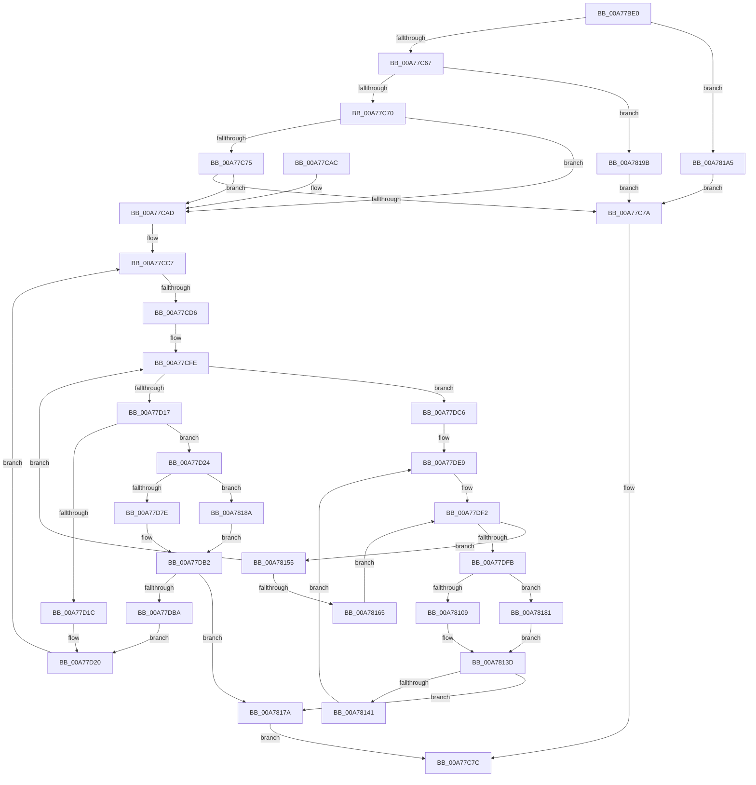

# KiSynchNumaCounterSetCallback

- RVA: `0x00A77BE0`–`0x00A781AF` (길이 `1,487` bytes)
- VA: `0x0000000140A77BE0`
- 실행 섹션: `PAGE`
- PDB 이름 있음: `예`; PDB Function 태그: `예`
- unwind 정보 RVA: `0x000B5F4C`
- 디코드: `360`개 명령, `1,487/1,487` bytes 표시
- 미해석 바이트: `0` (있으면 어셈블리에 `.byte`로 보존)

> 이 문서는 커널 이미지의 기계어와 PDB 기호를 분석해 생성했습니다. 4번과 5번은 함수 원형과 자료형을 바이너리 사용 방식에서 추정한 C 해석이며 원본 소스 복구 결과는 아닙니다.

## 1. Dependencies

- 직접 호출 지점: **21**; 고유 호출 대상: **13**
- 직접 호출자로 확인된 함수: **0**
- RIP 상대 이미지 참조: **8**

### Outgoing calls
- `0x00A77C3B` → [memset](../../text/6C/memset_function_006C6C40.md) (function, `0x006C6C40`)
- `0x00A77C4C` → [memset](../../text/6C/memset_function_006C6C40.md) (function, `0x006C6C40`)
- `0x00A77C86` → [_security_check_cookie](../../text/6A/_security_check_cookie_function_006AC640.md) (function, `0x006AC640`)
- `0x00A77CE2` → [memset](../../text/6C/memset_function_006C6C40.md) (function, `0x006C6C40`)
- `0x00A77CF9` → [KeInitializeSchedulerSubNodeEnumerationContext](../../text/41/KeInitializeSchedulerSubNodeEnumerationContext_function_0041E4B0.md) (function, `0x0041E4B0`)
- `0x00A77D0A` → [KeEnumerateNextSchedulerSubNodeInNode](../../text/25/KeEnumerateNextSchedulerSubNodeInNode_function_002566D8.md) (function, `0x002566D8`)
- `0x00A77D3A` → [RtlStringCbPrintfW](../../text/40/RtlStringCbPrintfW_function_0040FB40.md) (function, `0x0040FB40`)
- `0x00A77D4B` → [RtlInitUnicodeString](../../text/42/RtlInitUnicodeString_function_0042A780.md) (function, `0x0042A780`)
- `0x00A77D70` → [ExGetExtensionTable](../../text/42/ExGetExtensionTable_function_00428814.md) (function, `0x00428814`)
- `0x00A77D9F` → [guard_dispatch_icall](../../text/6B/guard_dispatch_icall_function_006BAAD0.md) (function, `0x006BAAD0`)
- `0x00A77DAD` → [ExReleaseExtensionTable](../../text/45/ExReleaseExtensionTable_function_00456DC0.md) (function, `0x00456DC0`)
- `0x00A77DD3` → [KiQuerySubNodeActiveAffinity](../../text/43/KiQuerySubNodeActiveAffinity_function_0043F060.md) (function, `0x0043F060`)
- `0x00A780D5` → [RtlStringCbPrintfW](../../text/40/RtlStringCbPrintfW_function_0040FB40.md) (function, `0x0040FB40`)
- `0x00A780E6` → [RtlInitUnicodeString](../../text/42/RtlInitUnicodeString_function_0042A780.md) (function, `0x0042A780`)
- `0x00A780FF` → [ExGetExtensionTable](../../text/42/ExGetExtensionTable_function_00428814.md) (function, `0x00428814`)
- `0x00A7812A` → [guard_dispatch_icall](../../text/6B/guard_dispatch_icall_function_006BAAD0.md) (function, `0x006BAAD0`)
- `0x00A78138` → [ExReleaseExtensionTable](../../text/45/ExReleaseExtensionTable_function_00456DC0.md) (function, `0x00456DC0`)
- `0x00A78181` → [ExpPcwDisabledStatus](../A6/ExpPcwDisabledStatus_function_00A611E0.md) (function, `0x00A611E0`)
- `0x00A7818A` → [ExpPcwDisabledStatus](../A6/ExpPcwDisabledStatus_function_00A611E0.md) (function, `0x00A611E0`)
- `0x00A7819B` → [EtwDereferenceSpinLockCounters](../7B/EtwDereferenceSpinLockCounters_function_007BC2E8.md) (function, `0x007BC2E8`)
- `0x00A781A5` → [EtwReferenceSpinLockCounters](../7B/EtwReferenceSpinLockCounters_function_007BC344.md) (function, `0x007BC344`)

### Direct callers
- 이 함수 시작 RVA로 연결되는 직접 call은 확인되지 않았습니다. 간접 호출은 완전히 역산할 수 없습니다.

### Static image references
- `0x00A77C06` → RVA `0x00E0A740` (`.data`; read)
- `0x00A77CB2` → RVA `0x00000000` (`image boundary/outside`; read)
- `0x00A77CC7` → RVA `0x00FC5000` (`ALMOSTRO`; read)
- `0x00A77D27` → RVA `0x00B00680` (` ?? ::NNGAKEGL::`string'`; read)
- `0x00A77D50` → RVA `0x00FC6AE8` (`ALMOSTRO`; read)
- `0x00A77D5A` → RVA `0x00FD8080` (`PAGEDATA`; read)
- `0x00A77E11` → RVA `0x00F231B8` (`.data`; read)
- `0x00A78054` → RVA `0x00B00670` (` ?? ::NNGAKEGL::`string'`; read)

## 2. Other-region calls and transfers

- 다른 실행 섹션으로 향하는 call: **17**
  - `0x00A77C3B` → [memset](../../text/6C/memset_function_006C6C40.md) (`PAGE` → `.text`)
  - `0x00A77C4C` → [memset](../../text/6C/memset_function_006C6C40.md) (`PAGE` → `.text`)
  - `0x00A77C86` → [_security_check_cookie](../../text/6A/_security_check_cookie_function_006AC640.md) (`PAGE` → `.text`)
  - `0x00A77CE2` → [memset](../../text/6C/memset_function_006C6C40.md) (`PAGE` → `.text`)
  - `0x00A77CF9` → [KeInitializeSchedulerSubNodeEnumerationContext](../../text/41/KeInitializeSchedulerSubNodeEnumerationContext_function_0041E4B0.md) (`PAGE` → `.text`)
  - `0x00A77D0A` → [KeEnumerateNextSchedulerSubNodeInNode](../../text/25/KeEnumerateNextSchedulerSubNodeInNode_function_002566D8.md) (`PAGE` → `.text`)
  - `0x00A77D3A` → [RtlStringCbPrintfW](../../text/40/RtlStringCbPrintfW_function_0040FB40.md) (`PAGE` → `.text`)
  - `0x00A77D4B` → [RtlInitUnicodeString](../../text/42/RtlInitUnicodeString_function_0042A780.md) (`PAGE` → `.text`)
  - `0x00A77D70` → [ExGetExtensionTable](../../text/42/ExGetExtensionTable_function_00428814.md) (`PAGE` → `.text`)
  - `0x00A77D9F` → [guard_dispatch_icall](../../text/6B/guard_dispatch_icall_function_006BAAD0.md) (`PAGE` → `.text`)
  - `0x00A77DAD` → [ExReleaseExtensionTable](../../text/45/ExReleaseExtensionTable_function_00456DC0.md) (`PAGE` → `.text`)
  - `0x00A77DD3` → [KiQuerySubNodeActiveAffinity](../../text/43/KiQuerySubNodeActiveAffinity_function_0043F060.md) (`PAGE` → `.text`)
  - `0x00A780D5` → [RtlStringCbPrintfW](../../text/40/RtlStringCbPrintfW_function_0040FB40.md) (`PAGE` → `.text`)
  - `0x00A780E6` → [RtlInitUnicodeString](../../text/42/RtlInitUnicodeString_function_0042A780.md) (`PAGE` → `.text`)
  - `0x00A780FF` → [ExGetExtensionTable](../../text/42/ExGetExtensionTable_function_00428814.md) (`PAGE` → `.text`)
  - `0x00A7812A` → [guard_dispatch_icall](../../text/6B/guard_dispatch_icall_function_006BAAD0.md) (`PAGE` → `.text`)
  - `0x00A78138` → [ExReleaseExtensionTable](../../text/45/ExReleaseExtensionTable_function_00456DC0.md) (`PAGE` → `.text`)
- call이 아닌 외부 분기/꼬리 이동: **1**
  - `0x00A77CD0` → [sub_00B41970](../B4/Unknown_function_00B41970.md) (`tail-transfer`)

## 3. Assembly (complete function range)

```asm
00A77BE0  48 8B C4                        mov rax, rsp
00A77BE3  48 89 58 08                     mov qword ptr [rax + 8], rbx
00A77BE7  48 89 70 18                     mov qword ptr [rax + 0x18], rsi
00A77BEB  48 89 78 20                     mov qword ptr [rax + 0x20], rdi
00A77BEF  55                              push rbp
00A77BF0  41 54                           push r12
00A77BF2  41 55                           push r13
00A77BF4  41 56                           push r14
00A77BF6  41 57                           push r15
00A77BF8  48 8D A8 88 FE FF FF            lea rbp, [rax - 0x178]
00A77BFF  48 81 EC 50 02 00 00            sub rsp, 0x250
00A77C06  48 8B 05 33 2B 39 00            mov rax, qword ptr [rip + 0x392b33]
00A77C0D  48 33 C4                        xor rax, rsp
00A77C10  48 89 85 40 01 00 00            mov qword ptr [rbp + 0x140], rax
00A77C17  48 8B FA                        mov rdi, rdx
00A77C1A  8B D9                           mov ebx, ecx
00A77C1C  0F 57 C0                        xorps xmm0, xmm0
00A77C1F  48 8D 4D 90                     lea rcx, [rbp - 0x70]
00A77C23  33 C0                           xor eax, eax
00A77C25  33 D2                           xor edx, edx
00A77C27  41 B8 B8 00 00 00               mov r8d, 0xb8
00A77C2D  48 89 85 20 01 00 00            mov qword ptr [rbp + 0x120], rax
00A77C34  0F 11 85 10 01 00 00            movups xmmword ptr [rbp + 0x110], xmm0
00A77C3B  E8 00 F0 C4 FF                  call 0x1406c6c40
00A77C40  33 D2                           xor edx, edx
00A77C42  48 8D 4D 50                     lea rcx, [rbp + 0x50]
00A77C46  41 B8 B8 00 00 00               mov r8d, 0xb8
00A77C4C  E8 EF EF C4 FF                  call 0x1406c6c40
00A77C51  48 83 64 24 48 00               and qword ptr [rsp + 0x48], 0
00A77C57  0F 57 C0                        xorps xmm0, xmm0
00A77C5A  0F 11 44 24 38                  movups xmmword ptr [rsp + 0x38], xmm0
00A77C5F  85 DB                           test ebx, ebx
00A77C61  0F 84 3E 05 00 00               je 0x140a781a5
00A77C67  83 EB 01                        sub ebx, 1
00A77C6A  0F 84 2B 05 00 00               je 0x140a7819b
00A77C70  83 EB 01                        sub ebx, 1
00A77C73  74 38                           je 0x140a77cad
00A77C75  83 FB 01                        cmp ebx, 1
00A77C78  74 33                           je 0x140a77cad
00A77C7A  33 C0                           xor eax, eax
00A77C7C  48 8B 8D 40 01 00 00            mov rcx, qword ptr [rbp + 0x140]
00A77C83  48 33 CC                        xor rcx, rsp
00A77C86  E8 B5 49 C3 FF                  call 0x1406ac640
00A77C8B  4C 8D 9C 24 50 02 00 00         lea r11, [rsp + 0x250]
00A77C93  49 8B 5B 30                     mov rbx, qword ptr [r11 + 0x30]
00A77C97  49 8B 73 40                     mov rsi, qword ptr [r11 + 0x40]
00A77C9B  49 8B 7B 48                     mov rdi, qword ptr [r11 + 0x48]
00A77C9F  49 8B E3                        mov rsp, r11
00A77CA2  41 5F                           pop r15
00A77CA4  41 5E                           pop r14
00A77CA6  41 5D                           pop r13
00A77CA8  41 5C                           pop r12
00A77CAA  5D                              pop rbp
00A77CAB  C3                              ret
00A77CAC  CC                              int3
00A77CAD  B8 18 00 00 00                  mov eax, 0x18
00A77CB2  48 8D 1D 47 83 58 FF            lea rbx, [rip - 0xa77cb9]
00A77CB9  4C 8B 24 07                     mov r12, qword ptr [rdi + rax]
00A77CBD  8D 70 E9                        lea esi, [rax - 0x17]
00A77CC0  0F 11 44 24 50                  movups xmmword ptr [rsp + 0x50], xmm0
00A77CC5  33 FF                           xor edi, edi
00A77CC7  0F B7 05 32 D3 54 00            movzx eax, word ptr [rip + 0x54d332]
00A77CCE  3B F8                           cmp edi, eax
00A77CD0  0F 83 9A 9C 0C 00               jae 0x140b41970
00A77CD6  33 D2                           xor edx, edx
00A77CD8  48 8D 4D 90                     lea rcx, [rbp - 0x70]
00A77CDC  41 B8 B8 00 00 00               mov r8d, 0xb8
00A77CE2  E8 59 EF C4 FF                  call 0x1406c6c40
00A77CE7  48 8B 94 FB C0 F6 FC 00         mov rdx, qword ptr [rbx + rdi*8 + 0xfcf6c0]
00A77CEF  48 8D 8D 10 01 00 00            lea rcx, [rbp + 0x110]
00A77CF6  45 33 FF                        xor r15d, r15d
00A77CF9  E8 B2 67 9A FF                  call 0x14041e4b0
00A77CFE  48 8D 54 24 48                  lea rdx, [rsp + 0x48]
00A77D03  48 8D 8D 10 01 00 00            lea rcx, [rbp + 0x110]
00A77D0A  E8 C9 E9 7D FF                  call 0x1402566d8
00A77D0F  85 C0                           test eax, eax
00A77D11  0F 84 AF 00 00 00               je 0x140a77dc6
00A77D17  45 85 FF                        test r15d, r15d
00A77D1A  75 08                           jne 0x140a77d24
00A77D1C  41 8D 77 01                     lea esi, [r15 + 1]
00A77D20  03 FE                           add edi, esi
00A77D22  EB A3                           jmp 0x140a77cc7
00A77D24  44 8B CF                        mov r9d, edi
00A77D27  4C 8D 05 52 89 08 00            lea r8, [rip + 0x88952]
00A77D2E  BA 16 00 00 00                  mov edx, 0x16
00A77D33  48 8D 8D 28 01 00 00            lea rcx, [rbp + 0x128]
00A77D3A  E8 01 7E 99 FF                  call 0x14040fb40
00A77D3F  48 8D 95 28 01 00 00            lea rdx, [rbp + 0x128]
00A77D46  48 8D 4C 24 38                  lea rcx, [rsp + 0x38]
00A77D4B  E8 30 2A 9B FF                  call 0x14042a780
00A77D50  8B 1D 92 ED 54 00               mov ebx, dword ptr [rip + 0x54ed92]
00A77D56  48 8D 45 90                     lea rax, [rbp - 0x70]
00A77D5A  48 8B 0D 1F 03 56 00            mov rcx, qword ptr [rip + 0x56031f]
00A77D61  03 DF                           add ebx, edi
00A77D63  48 89 44 24 70                  mov qword ptr [rsp + 0x70], rax
00A77D68  C7 44 24 78 B8 00 00 00         mov dword ptr [rsp + 0x78], 0xb8
00A77D70  E8 9F 0A 9B FF                  call 0x140428814
00A77D75  48 85 C0                        test rax, rax
00A77D78  0F 84 0C 04 00 00               je 0x140a7818a
00A77D7E  48 8B 40 20                     mov rax, qword ptr [rax + 0x20]
00A77D82  48 8D 4C 24 70                  lea rcx, [rsp + 0x70]
00A77D87  48 89 4C 24 20                  mov qword ptr [rsp + 0x20], rcx
00A77D8C  48 8D 54 24 38                  lea rdx, [rsp + 0x38]
00A77D91  BE 01 00 00 00                  mov esi, 1
00A77D96  49 8B CC                        mov rcx, r12
00A77D99  44 8B CE                        mov r9d, esi
00A77D9C  44 8B C3                        mov r8d, ebx
00A77D9F  E8 2C 2D C4 FF                  call 0x1406baad0
00A77DA4  48 8B 0D D5 02 56 00            mov rcx, qword ptr [rip + 0x5602d5]
00A77DAB  8B D8                           mov ebx, eax
00A77DAD  E8 0E F0 9D FF                  call 0x140456dc0
00A77DB2  85 DB                           test ebx, ebx
00A77DB4  0F 88 C0 03 00 00               js 0x140a7817a
00A77DBA  48 8D 1D 3F 82 58 FF            lea rbx, [rip - 0xa77dc1]
00A77DC1  E9 5A FF FF FF                  jmp 0x140a77d20
00A77DC6  48 8B 4C 24 48                  mov rcx, qword ptr [rsp + 0x48]
00A77DCB  48 8D 54 24 50                  lea rdx, [rsp + 0x50]
00A77DD0  45 33 C0                        xor r8d, r8d
00A77DD3  E8 88 72 9C FF                  call 0x14043f060
00A77DD8  0F B7 74 24 58                  movzx esi, word ptr [rsp + 0x58]
00A77DDD  41 8D 40 01                     lea eax, [r8 + 1]
00A77DE1  4C 8B 6C 24 50                  mov r13, qword ptr [rsp + 0x50]
00A77DE6  44 8B F6                        mov r14d, esi
00A77DE9  83 64 24 30 00                  and dword ptr [rsp + 0x30], 0
00A77DEE  41 8D 4E 01                     lea ecx, [r14 + 1]
00A77DF2  4D 85 ED                        test r13, r13
00A77DF5  0F 84 5A 03 00 00               je 0x140a78155
00A77DFB  49 0F BC D5                     bsf rdx, r13
00A77DFF  41 8B CE                        mov ecx, r14d
00A77E02  0F B6 C2                        movzx eax, dl
00A77E05  49 0F B3 C5                     btr r13, rax
00A77E09  C1 E1 06                        shl ecx, 6
00A77E0C  0F B6 C2                        movzx eax, dl
00A77E0F  03 C8                           add ecx, eax
00A77E11  48 8B 05 A0 B3 4A 00            mov rax, qword ptr [rip + 0x4ab3a0]
00A77E18  8B 04 88                        mov eax, dword ptr [rax + rcx*4]
00A77E1B  89 44 24 30                     mov dword ptr [rsp + 0x30], eax
00A77E1F  48 8B 9C C3 40 8C FC 00         mov rbx, qword ptr [rbx + rax*8 + 0xfc8c40]
00A77E27  48 81 C3 C0 8E 00 00            add rbx, 0x8ec0
00A77E2E  8B 03                           mov eax, dword ptr [rbx]
00A77E30  01 45 90                        add dword ptr [rbp - 0x70], eax
00A77E33  8B 43 04                        mov eax, dword ptr [rbx + 4]
00A77E36  01 45 94                        add dword ptr [rbp - 0x6c], eax
00A77E39  8B 43 08                        mov eax, dword ptr [rbx + 8]
00A77E3C  01 45 98                        add dword ptr [rbp - 0x68], eax
00A77E3F  8B 43 0C                        mov eax, dword ptr [rbx + 0xc]
00A77E42  01 45 9C                        add dword ptr [rbp - 0x64], eax
00A77E45  8B 43 10                        mov eax, dword ptr [rbx + 0x10]
00A77E48  01 45 A0                        add dword ptr [rbp - 0x60], eax
00A77E4B  8B 43 14                        mov eax, dword ptr [rbx + 0x14]
00A77E4E  01 45 A4                        add dword ptr [rbp - 0x5c], eax
00A77E51  8B 43 18                        mov eax, dword ptr [rbx + 0x18]
00A77E54  01 45 A8                        add dword ptr [rbp - 0x58], eax
00A77E57  8B 43 1C                        mov eax, dword ptr [rbx + 0x1c]
00A77E5A  01 45 AC                        add dword ptr [rbp - 0x54], eax
00A77E5D  8B 43 20                        mov eax, dword ptr [rbx + 0x20]
00A77E60  01 45 B0                        add dword ptr [rbp - 0x50], eax
00A77E63  8B 43 24                        mov eax, dword ptr [rbx + 0x24]
00A77E66  01 45 B4                        add dword ptr [rbp - 0x4c], eax
00A77E69  8B 43 28                        mov eax, dword ptr [rbx + 0x28]
00A77E6C  01 45 B8                        add dword ptr [rbp - 0x48], eax
00A77E6F  8B 43 2C                        mov eax, dword ptr [rbx + 0x2c]
00A77E72  01 45 BC                        add dword ptr [rbp - 0x44], eax
00A77E75  8B 43 30                        mov eax, dword ptr [rbx + 0x30]
00A77E78  01 45 C0                        add dword ptr [rbp - 0x40], eax
00A77E7B  8B 43 34                        mov eax, dword ptr [rbx + 0x34]
00A77E7E  01 45 C4                        add dword ptr [rbp - 0x3c], eax
00A77E81  8B 43 38                        mov eax, dword ptr [rbx + 0x38]
00A77E84  01 45 C8                        add dword ptr [rbp - 0x38], eax
00A77E87  8B 43 3C                        mov eax, dword ptr [rbx + 0x3c]
00A77E8A  01 45 CC                        add dword ptr [rbp - 0x34], eax
00A77E8D  8B 43 40                        mov eax, dword ptr [rbx + 0x40]
00A77E90  01 45 D0                        add dword ptr [rbp - 0x30], eax
00A77E93  8B 43 44                        mov eax, dword ptr [rbx + 0x44]
00A77E96  01 45 D4                        add dword ptr [rbp - 0x2c], eax
00A77E99  8B 43 48                        mov eax, dword ptr [rbx + 0x48]
00A77E9C  01 45 D8                        add dword ptr [rbp - 0x28], eax
00A77E9F  8B 43 4C                        mov eax, dword ptr [rbx + 0x4c]
00A77EA2  01 45 DC                        add dword ptr [rbp - 0x24], eax
00A77EA5  8B 43 50                        mov eax, dword ptr [rbx + 0x50]
00A77EA8  01 45 E0                        add dword ptr [rbp - 0x20], eax
00A77EAB  8B 43 54                        mov eax, dword ptr [rbx + 0x54]
00A77EAE  01 45 E4                        add dword ptr [rbp - 0x1c], eax
00A77EB1  8B 43 58                        mov eax, dword ptr [rbx + 0x58]
00A77EB4  01 45 E8                        add dword ptr [rbp - 0x18], eax
00A77EB7  8B 43 5C                        mov eax, dword ptr [rbx + 0x5c]
00A77EBA  01 45 EC                        add dword ptr [rbp - 0x14], eax
00A77EBD  8B 43 60                        mov eax, dword ptr [rbx + 0x60]
00A77EC0  01 45 F0                        add dword ptr [rbp - 0x10], eax
00A77EC3  8B 43 64                        mov eax, dword ptr [rbx + 0x64]
00A77EC6  01 45 F4                        add dword ptr [rbp - 0xc], eax
00A77EC9  8B 43 68                        mov eax, dword ptr [rbx + 0x68]
00A77ECC  01 45 F8                        add dword ptr [rbp - 8], eax
00A77ECF  8B 43 6C                        mov eax, dword ptr [rbx + 0x6c]
00A77ED2  01 45 FC                        add dword ptr [rbp - 4], eax
00A77ED5  8B 43 70                        mov eax, dword ptr [rbx + 0x70]
00A77ED8  01 45 00                        add dword ptr [rbp], eax
00A77EDB  8B 43 74                        mov eax, dword ptr [rbx + 0x74]
00A77EDE  01 45 04                        add dword ptr [rbp + 4], eax
00A77EE1  8B 43 78                        mov eax, dword ptr [rbx + 0x78]
00A77EE4  01 45 08                        add dword ptr [rbp + 8], eax
00A77EE7  8B 43 7C                        mov eax, dword ptr [rbx + 0x7c]
00A77EEA  01 45 0C                        add dword ptr [rbp + 0xc], eax
00A77EED  8B 83 80 00 00 00               mov eax, dword ptr [rbx + 0x80]
00A77EF3  01 45 10                        add dword ptr [rbp + 0x10], eax
00A77EF6  8B 83 84 00 00 00               mov eax, dword ptr [rbx + 0x84]
00A77EFC  01 45 14                        add dword ptr [rbp + 0x14], eax
00A77EFF  8B 83 88 00 00 00               mov eax, dword ptr [rbx + 0x88]
00A77F05  01 45 18                        add dword ptr [rbp + 0x18], eax
00A77F08  8B 83 8C 00 00 00               mov eax, dword ptr [rbx + 0x8c]
00A77F0E  01 45 1C                        add dword ptr [rbp + 0x1c], eax
00A77F11  8B 83 90 00 00 00               mov eax, dword ptr [rbx + 0x90]
00A77F17  01 45 20                        add dword ptr [rbp + 0x20], eax
00A77F1A  8B 83 94 00 00 00               mov eax, dword ptr [rbx + 0x94]
00A77F20  01 45 24                        add dword ptr [rbp + 0x24], eax
00A77F23  8B 83 98 00 00 00               mov eax, dword ptr [rbx + 0x98]
00A77F29  01 45 28                        add dword ptr [rbp + 0x28], eax
00A77F2C  8B 83 9C 00 00 00               mov eax, dword ptr [rbx + 0x9c]
00A77F32  01 45 2C                        add dword ptr [rbp + 0x2c], eax
00A77F35  8B 83 A8 00 00 00               mov eax, dword ptr [rbx + 0xa8]
00A77F3B  01 45 38                        add dword ptr [rbp + 0x38], eax
00A77F3E  8B 83 AC 00 00 00               mov eax, dword ptr [rbx + 0xac]
00A77F44  01 45 3C                        add dword ptr [rbp + 0x3c], eax
00A77F47  8B 03                           mov eax, dword ptr [rbx]
00A77F49  01 45 50                        add dword ptr [rbp + 0x50], eax
00A77F4C  8B 43 04                        mov eax, dword ptr [rbx + 4]
00A77F4F  01 45 54                        add dword ptr [rbp + 0x54], eax
00A77F52  8B 43 08                        mov eax, dword ptr [rbx + 8]
00A77F55  01 45 58                        add dword ptr [rbp + 0x58], eax
00A77F58  8B 43 0C                        mov eax, dword ptr [rbx + 0xc]
00A77F5B  01 45 5C                        add dword ptr [rbp + 0x5c], eax
00A77F5E  8B 43 10                        mov eax, dword ptr [rbx + 0x10]
00A77F61  01 45 60                        add dword ptr [rbp + 0x60], eax
00A77F64  8B 43 14                        mov eax, dword ptr [rbx + 0x14]
00A77F67  01 45 64                        add dword ptr [rbp + 0x64], eax
00A77F6A  8B 43 18                        mov eax, dword ptr [rbx + 0x18]
00A77F6D  01 45 68                        add dword ptr [rbp + 0x68], eax
00A77F70  8B 43 1C                        mov eax, dword ptr [rbx + 0x1c]
00A77F73  01 45 6C                        add dword ptr [rbp + 0x6c], eax
00A77F76  8B 43 20                        mov eax, dword ptr [rbx + 0x20]
00A77F79  01 45 70                        add dword ptr [rbp + 0x70], eax
00A77F7C  8B 43 24                        mov eax, dword ptr [rbx + 0x24]
00A77F7F  01 45 74                        add dword ptr [rbp + 0x74], eax
00A77F82  8B 43 28                        mov eax, dword ptr [rbx + 0x28]
00A77F85  01 45 78                        add dword ptr [rbp + 0x78], eax
00A77F88  8B 43 2C                        mov eax, dword ptr [rbx + 0x2c]
00A77F8B  01 45 7C                        add dword ptr [rbp + 0x7c], eax
00A77F8E  8B 43 30                        mov eax, dword ptr [rbx + 0x30]
00A77F91  01 85 80 00 00 00               add dword ptr [rbp + 0x80], eax
00A77F97  8B 43 34                        mov eax, dword ptr [rbx + 0x34]
00A77F9A  01 85 84 00 00 00               add dword ptr [rbp + 0x84], eax
00A77FA0  8B 43 38                        mov eax, dword ptr [rbx + 0x38]
00A77FA3  01 85 88 00 00 00               add dword ptr [rbp + 0x88], eax
00A77FA9  8B 43 3C                        mov eax, dword ptr [rbx + 0x3c]
00A77FAC  01 85 8C 00 00 00               add dword ptr [rbp + 0x8c], eax
00A77FB2  8B 43 40                        mov eax, dword ptr [rbx + 0x40]
00A77FB5  01 85 90 00 00 00               add dword ptr [rbp + 0x90], eax
00A77FBB  8B 43 44                        mov eax, dword ptr [rbx + 0x44]
00A77FBE  01 85 94 00 00 00               add dword ptr [rbp + 0x94], eax
00A77FC4  8B 43 48                        mov eax, dword ptr [rbx + 0x48]
00A77FC7  01 85 98 00 00 00               add dword ptr [rbp + 0x98], eax
00A77FCD  8B 43 4C                        mov eax, dword ptr [rbx + 0x4c]
00A77FD0  01 85 9C 00 00 00               add dword ptr [rbp + 0x9c], eax
00A77FD6  8B 43 50                        mov eax, dword ptr [rbx + 0x50]
00A77FD9  01 85 A0 00 00 00               add dword ptr [rbp + 0xa0], eax
00A77FDF  8B 43 54                        mov eax, dword ptr [rbx + 0x54]
00A77FE2  01 85 A4 00 00 00               add dword ptr [rbp + 0xa4], eax
00A77FE8  8B 43 58                        mov eax, dword ptr [rbx + 0x58]
00A77FEB  01 85 A8 00 00 00               add dword ptr [rbp + 0xa8], eax
00A77FF1  8B 43 5C                        mov eax, dword ptr [rbx + 0x5c]
00A77FF4  01 85 AC 00 00 00               add dword ptr [rbp + 0xac], eax
00A77FFA  8B 43 60                        mov eax, dword ptr [rbx + 0x60]
00A77FFD  01 85 B0 00 00 00               add dword ptr [rbp + 0xb0], eax
00A78003  8B 43 64                        mov eax, dword ptr [rbx + 0x64]
00A78006  01 85 B4 00 00 00               add dword ptr [rbp + 0xb4], eax
00A7800C  8B 43 68                        mov eax, dword ptr [rbx + 0x68]
00A7800F  01 85 B8 00 00 00               add dword ptr [rbp + 0xb8], eax
00A78015  8B 43 6C                        mov eax, dword ptr [rbx + 0x6c]
00A78018  01 85 BC 00 00 00               add dword ptr [rbp + 0xbc], eax
00A7801E  8B 43 70                        mov eax, dword ptr [rbx + 0x70]
00A78021  01 85 C0 00 00 00               add dword ptr [rbp + 0xc0], eax
00A78027  8B 43 74                        mov eax, dword ptr [rbx + 0x74]
00A7802A  01 85 C4 00 00 00               add dword ptr [rbp + 0xc4], eax
00A78030  8B 43 78                        mov eax, dword ptr [rbx + 0x78]
00A78033  01 85 C8 00 00 00               add dword ptr [rbp + 0xc8], eax
00A78039  8B 43 7C                        mov eax, dword ptr [rbx + 0x7c]
00A7803C  01 85 CC 00 00 00               add dword ptr [rbp + 0xcc], eax
00A78042  8B 83 80 00 00 00               mov eax, dword ptr [rbx + 0x80]
00A78048  01 85 D0 00 00 00               add dword ptr [rbp + 0xd0], eax
00A7804E  8B 83 84 00 00 00               mov eax, dword ptr [rbx + 0x84]
00A78054  4C 8D 05 15 86 08 00            lea r8, [rip + 0x88615]
00A7805B  01 85 D4 00 00 00               add dword ptr [rbp + 0xd4], eax
00A78061  48 8D 8D 28 01 00 00            lea rcx, [rbp + 0x128]
00A78068  8B 83 88 00 00 00               mov eax, dword ptr [rbx + 0x88]
00A7806E  44 8B CF                        mov r9d, edi
00A78071  01 85 D8 00 00 00               add dword ptr [rbp + 0xd8], eax
00A78077  BA 16 00 00 00                  mov edx, 0x16
00A7807C  8B 83 8C 00 00 00               mov eax, dword ptr [rbx + 0x8c]
00A78082  01 85 DC 00 00 00               add dword ptr [rbp + 0xdc], eax
00A78088  8B 83 90 00 00 00               mov eax, dword ptr [rbx + 0x90]
00A7808E  01 85 E0 00 00 00               add dword ptr [rbp + 0xe0], eax
00A78094  8B 83 94 00 00 00               mov eax, dword ptr [rbx + 0x94]
00A7809A  01 85 E4 00 00 00               add dword ptr [rbp + 0xe4], eax
00A780A0  8B 83 98 00 00 00               mov eax, dword ptr [rbx + 0x98]
00A780A6  01 85 E8 00 00 00               add dword ptr [rbp + 0xe8], eax
00A780AC  8B 83 9C 00 00 00               mov eax, dword ptr [rbx + 0x9c]
00A780B2  01 85 EC 00 00 00               add dword ptr [rbp + 0xec], eax
00A780B8  8B 83 A8 00 00 00               mov eax, dword ptr [rbx + 0xa8]
00A780BE  01 85 F8 00 00 00               add dword ptr [rbp + 0xf8], eax
00A780C4  8B 83 AC 00 00 00               mov eax, dword ptr [rbx + 0xac]
00A780CA  01 85 FC 00 00 00               add dword ptr [rbp + 0xfc], eax
00A780D0  44 89 7C 24 20                  mov dword ptr [rsp + 0x20], r15d
00A780D5  E8 66 7A 99 FF                  call 0x14040fb40
00A780DA  48 8D 95 28 01 00 00            lea rdx, [rbp + 0x128]
00A780E1  48 8D 4C 24 38                  lea rcx, [rsp + 0x38]
00A780E6  E8 95 26 9B FF                  call 0x14042a780
00A780EB  48 8B 0D 8E FF 55 00            mov rcx, qword ptr [rip + 0x55ff8e]
00A780F2  48 89 5C 24 60                  mov qword ptr [rsp + 0x60], rbx
00A780F7  C7 44 24 68 B8 00 00 00         mov dword ptr [rsp + 0x68], 0xb8
00A780FF  E8 10 07 9B FF                  call 0x140428814
00A78104  48 85 C0                        test rax, rax
00A78107  74 78                           je 0x140a78181
00A78109  48 8B 40 20                     mov rax, qword ptr [rax + 0x20]
00A7810D  48 8D 4C 24 60                  lea rcx, [rsp + 0x60]
00A78112  44 8B 44 24 30                  mov r8d, dword ptr [rsp + 0x30]
00A78117  48 8D 54 24 38                  lea rdx, [rsp + 0x38]
00A7811C  48 89 4C 24 20                  mov qword ptr [rsp + 0x20], rcx
00A78121  41 B9 01 00 00 00               mov r9d, 1
00A78127  49 8B CC                        mov rcx, r12
00A7812A  E8 A1 29 C4 FF                  call 0x1406baad0
00A7812F  48 8B 0D 4A FF 55 00            mov rcx, qword ptr [rip + 0x55ff4a]
00A78136  8B D8                           mov ebx, eax
00A78138  E8 83 EC 9D FF                  call 0x140456dc0
00A7813D  85 DB                           test ebx, ebx
00A7813F  78 39                           js 0x140a7817a
00A78141  B8 01 00 00 00                  mov eax, 1
00A78146  48 8D 1D B3 7E 58 FF            lea rbx, [rip - 0xa7814d]
00A7814D  44 03 F8                        add r15d, eax
00A78150  E9 94 FC FF FF                  jmp 0x140a77de9
00A78155  66 03 F0                        add si, ax
00A78158  44 0F B7 F6                     movzx r14d, si
00A7815C  44 3B F1                        cmp r14d, ecx
00A7815F  0F 83 99 FB FF FF               jae 0x140a77cfe
00A78165  0F B7 C6                        movzx eax, si
00A78168  4C 8B 2C C5 08 00 00 00         mov r13, qword ptr [rax*8 + 8]
00A78170  B8 01 00 00 00                  mov eax, 1
00A78175  E9 78 FC FF FF                  jmp 0x140a77df2
00A7817A  8B C3                           mov eax, ebx
00A7817C  E9 FB FA FF FF                  jmp 0x140a77c7c
00A78181  E8 5A 90 FE FF                  call 0x140a611e0
00A78186  8B D8                           mov ebx, eax
00A78188  EB B3                           jmp 0x140a7813d
00A7818A  E8 51 90 FE FF                  call 0x140a611e0
00A7818F  8B D8                           mov ebx, eax
00A78191  BE 01 00 00 00                  mov esi, 1
00A78196  E9 17 FC FF FF                  jmp 0x140a77db2
00A7819B  E8 48 41 D4 FF                  call 0x1407bc2e8
00A781A0  E9 D5 FA FF FF                  jmp 0x140a77c7a
00A781A5  E8 9A 41 D4 FF                  call 0x1407bc344
00A781AA  E9 CB FA FF FF                  jmp 0x140a77c7a
```

## 4. C-style interpretation (structured pseudocode)

```c
__int64 __fastcall KiSynchNumaCounterSetCallback(int a1, __int64 a2)
{
    __int64 result;
    __int64 v_r15;
    __int64 v_rbx;
    __int64 v_rdi;
    __int64 v_rsi;
    __int64 v_rsp;
    unsigned int v_stack_m1D8;
    unsigned __int64 v_stack_m1E0;
    unsigned int v_stack_m1E8;
    unsigned __int64 v_stack_m1F0;
    unsigned __int16 v_stack_m1F8;
    unsigned __int64 v_stack_m200;
    unsigned __int64 v_stack_m208;
    unsigned __int64 v_stack_m218;
    unsigned int v_stack_m220;
    unsigned __int64 v_stack_m230;
    unsigned __int64 v_stack_m240;
    unsigned __int64 v_stack_m28;

    *(unsigned __int64 *)(v_rsp + 8) = v_rbx;
    *(unsigned __int64 *)(v_rsp + 24) = v_rsi;
    *(unsigned __int64 *)(v_rsp + 32) = v_rdi;
    v_rsp = (v_rsp) - (592);
    result = (*(unsigned __int64 *)(v_rip + 3746611)) ^ (v_rsp);
    *(unsigned __int64 *)(v_rsp - 376 + 320) = result;
    result = 0;
    a2 = 0;
    *(unsigned __int64 *)(v_rsp - 376 + 288) = 0;
    *(unsigned __int64 *)(v_rsp - 376 + 272) = v_xmm0;
    result = memset(v_rsp - 376 - 112, a2, 184, a4);
    a2 = 0;
    result = memset(v_rsp - 376 + 80, a2, 184, a4);
    v_stack_m240 = v_xmm0;
    if ((unsigned int)((unsigned int)(a1)) == 0) goto loc_00A781A5;
    v_rbx = (unsigned int)(((unsigned int)(a1)) - (1));
    if (condition_is_equal) goto loc_00A7819B;
    v_rbx = (unsigned int)((v_rbx) - (1));
    if (condition_is_equal) goto loc_00A77CAD;
    if (((unsigned int)(v_rbx)) == 1) goto loc_00A77CAD;
loc_00A77C7A:
    result = 0;
loc_00A77C7C:
    a1 = (*(unsigned __int64 *)(v_rsp - 376 + 320)) ^ (v_rsp);
    result = _security_check_cookie(a1, a2, 184, a4);
    return result;
loc_00A77CAD:
    v_stack_m200 = v_xmm0;
    v_rdi = 0;
loc_00A77CC7:
    a2 = 0;
    result = memset(v_rsp - 376 - 112, a2, 184, a4);
    v_r15 = 0;
    result = KeInitializeSchedulerSubNodeEnumerationContext(v_rsp - 376 + 272, *(unsigned __int64 *)(v_rip - 10976441 + v_rdi * 8 + 16578240), 184, a4);
loc_00A77CFE:
    result = KeEnumerateNextSchedulerSubNodeInNode(v_rsp - 376 + 272, v_stack_m208, 184, a4);
    if ((unsigned int)(result) == 0) goto loc_00A77DC6;
    if (0 != 0) goto loc_00A77D24;
loc_00A77D20:
    v_rdi = (unsigned int)((v_rdi) + ((unsigned int)(v_r15 + 1)));
    goto loc_00A77CC7;
loc_00A77D24:
    result = RtlStringCbPrintfW(v_rsp - 376 + 296, 22, v_rip + 559442, (unsigned int)((unsigned int)(v_rdi)));
    result = RtlInitUnicodeString(v_stack_m218, v_rsp - 376 + 296, v_rip + 559442, (unsigned int)((unsigned int)(v_rdi)));
    v_rbx = (unsigned int)(((unsigned int)(*(unsigned int *)(v_rip + 5565842))) + ((unsigned int)(v_rdi)));
    v_stack_m1E0 = v_rsp - 376 - 112;
    v_stack_m1D8 = 184;
    result = ExGetExtensionTable(*(unsigned __int64 *)(v_rip + 5636895), v_rsp - 376 + 296, v_rip + 559442, (unsigned int)((unsigned int)(v_rdi)));
    if (result == 0) goto loc_00A7818A;
    v_stack_m230 = v_stack_m1E0;
    result = guard_dispatch_icall(*(unsigned __int64 *)(*(unsigned __int64 *)(v_stack_m28 + 72) + 24 * 1), v_stack_m218, (unsigned int)((unsigned int)(v_rbx)), 1);
    result = ExReleaseExtensionTable(*(unsigned __int64 *)(v_rip + 5636821), v_stack_m218, (unsigned int)((unsigned int)(v_rbx)), 1);
loc_00A77DB2:
    if (sign_flag) goto loc_00A7817A;
    goto loc_00A77D20;
loc_00A77DC6:
    a3 = 0;
    result = KiQuerySubNodeActiveAffinity(v_stack_m208, v_stack_m200, a3, 1);
loc_00A77DE9:
loc_00A77DF2:
    if (v_stack_m200 == 0) goto loc_00A78155;
    a1 = (unsigned int)(((unsigned int)((unsigned int)((unsigned int)((unsigned int)(v_stack_m1F8))))) << (6));
    a1 = (unsigned int)((a1) + ((unsigned int)((unsigned __int8)(v_stack_m200))));
    v_stack_m220 = (unsigned int)((unsigned int)(*(unsigned int *)(*(unsigned __int64 *)(v_rip + 4895648) + a1 * 4)));
    v_rbx = (*(unsigned __int64 *)(v_rip - 10976705 + (unsigned int)(*(unsigned int *)(*(unsigned __int64 *)(v_rip + 4895648) + a1 * 4)) * 8 + 16550976)) + (0x8EC0ULL);
    v_stack_m230 = 0;
    result = RtlStringCbPrintfW(v_rsp - 376 + 296, 22, v_rip + 558613, (unsigned int)((unsigned int)(v_rdi)));
    result = RtlInitUnicodeString(v_stack_m218, v_rsp - 376 + 296, v_rip + 558613, (unsigned int)((unsigned int)(v_rdi)));
    v_stack_m1F0 = v_rbx;
    v_stack_m1E8 = 184;
    result = ExGetExtensionTable(*(unsigned __int64 *)(v_rip + 5635982), v_rsp - 376 + 296, v_rip + 558613, (unsigned int)((unsigned int)(v_rdi)));
    if (result == 0) goto loc_00A78181;
    v_stack_m230 = v_stack_m1F0;
    result = guard_dispatch_icall(*(unsigned __int64 *)(*(unsigned __int64 *)(v_stack_m28 + 72) + 24 * 1), v_stack_m218, (unsigned int)(v_stack_m220), 1);
    result = ExReleaseExtensionTable(*(unsigned __int64 *)(v_rip + 5635914), v_stack_m218, (unsigned int)(v_stack_m220), 1);
loc_00A7813D:
    if (sign_flag) goto loc_00A7817A;
    v_r15 = (unsigned int)((v_r15) + (1));
    goto loc_00A77DE9;
loc_00A78155:
    v_rsi = (unsigned __int16)((v_stack_m1F8) + (1));
    if (((unsigned int)((unsigned __int16)(v_rsi))) >= ((unsigned int)(*(unsigned __int64 *)(v_rip + 5635914)))) goto loc_00A77CFE;
    goto loc_00A77DF2;
loc_00A7817A:
    goto loc_00A77C7C;
loc_00A78181:
    result = ExpPcwDisabledStatus(*(unsigned __int64 *)(v_rip + 5635914), v_stack_m218, (unsigned int)(v_stack_m220), 1);
    goto loc_00A7813D;
loc_00A7818A:
    result = ExpPcwDisabledStatus(*(unsigned __int64 *)(v_rip + 5635914), v_stack_m218, (unsigned int)(v_stack_m220), 1);
    goto loc_00A77DB2;
loc_00A7819B:
    result = EtwDereferenceSpinLockCounters(*(unsigned __int64 *)(v_rip + 5635914), v_stack_m218, (unsigned int)(v_stack_m220), 1);
    goto loc_00A77C7A;
loc_00A781A5:
    result = EtwReferenceSpinLockCounters(*(unsigned __int64 *)(v_rip + 5635914), v_stack_m218, (unsigned int)(v_stack_m220), 1);
    goto loc_00A77C7A;
}
```

## 5. (Beta) C Style

```c
int64_t KiSynchNumaCounterSetCallback(int32_t Arg1, void *Arg2)
{
    uint8_t *arg2 = (uint8_t *)Arg2;

    int64_t result;
    int64_t local_r15;
    int64_t local_rbx;
    int64_t local_rdi;
    int64_t local_rsi;
    int64_t local_rsp;
    uint32_t v_stack_m1D8;
    uint64_t v_stack_m1E0;
    uint32_t v_stack_m1E8;
    uint64_t v_stack_m1F0;
    uint16_t v_stack_m1F8;
    uint64_t v_stack_m200;
    uint64_t v_stack_m208;
    uint64_t v_stack_m218;
    uint32_t v_stack_m220;
    uint64_t v_stack_m230;
    uint64_t v_stack_m240;
    uint64_t v_stack_m28;

    *(uint64_t *)(local_rsp + 0x8) = local_rbx;
    *(uint64_t *)(local_rsp + 0x18) = local_rsi;
    *(uint64_t *)(local_rsp + 0x20) = local_rdi;
    local_rsp = (local_rsp) - (592);
    result = (*(uint64_t *)(v_rip + 0x392B33)) ^ (local_rsp);
    *(uint64_t *)(local_rsp - 0x178 + 0x140) = result;
    result = 0;
    Arg2 = 0;
    *(uint64_t *)(local_rsp - 0x178 + 0x120) = 0;
    *(uint64_t *)(local_rsp - 0x178 + 0x110) = v_xmm0;
    result = memset(local_rsp - 376 - 112, Arg2, 184, a4);
    Arg2 = 0;
    result = memset(local_rsp - 376 + 80, Arg2, 184, a4);
    v_stack_m240 = v_xmm0;
    if ((uint32_t)((uint32_t)(Arg1)) == 0) goto loc_00A781A5;
    local_rbx = (uint32_t)(((uint32_t)(Arg1)) - (1));
    if (condition_is_equal) goto loc_00A7819B;
    local_rbx = (uint32_t)((local_rbx) - (1));
    if (condition_is_equal) goto loc_00A77CAD;
    if (((uint32_t)(local_rbx)) == 1) goto loc_00A77CAD;
loc_00A77C7A:
    result = 0;
loc_00A77C7C:
    Arg1 = (*(uint64_t *)(local_rsp - 0x178 + 0x140)) ^ (local_rsp);
    result = _security_check_cookie(Arg1, Arg2, 184, a4);
    return result;
loc_00A77CAD:
    v_stack_m200 = v_xmm0;
    local_rdi = 0;
loc_00A77CC7:
    Arg2 = 0;
    result = memset(local_rsp - 376 - 112, Arg2, 184, a4);
    local_r15 = 0;
    result = KeInitializeSchedulerSubNodeEnumerationContext(local_rsp - 376 + 272, *(uint64_t *)(v_rip - 0xA77CB9 + local_rdi * 8 + 0xFCF6C0), 184, a4);
loc_00A77CFE:
    result = KeEnumerateNextSchedulerSubNodeInNode(local_rsp - 376 + 272, v_stack_m208, 184, a4);
    if ((uint32_t)(result) == 0) goto loc_00A77DC6;
    if (0 != 0) goto loc_00A77D24;
loc_00A77D20:
    local_rdi = (uint32_t)((local_rdi) + ((uint32_t)(local_r15 + 1)));
    goto loc_00A77CC7;
loc_00A77D24:
    result = RtlStringCbPrintfW(local_rsp - 376 + 296, 22, v_rip + 559442, (uint32_t)((uint32_t)(local_rdi)));
    result = RtlInitUnicodeString(v_stack_m218, local_rsp - 376 + 296, v_rip + 559442, (uint32_t)((uint32_t)(local_rdi)));
    local_rbx = (uint32_t)(((uint32_t)(*(uint32_t *)(v_rip + 0x54ED92))) + ((uint32_t)(local_rdi)));
    v_stack_m1E0 = local_rsp - 376 - 112;
    v_stack_m1D8 = 184;
    result = ExGetExtensionTable(*(uint64_t *)(v_rip + 0x56031F), local_rsp - 376 + 296, v_rip + 559442, (uint32_t)((uint32_t)(local_rdi)));
    if (result == 0) goto loc_00A7818A;
    v_stack_m230 = v_stack_m1E0;
    result = guard_dispatch_icall(*(uint64_t *)(*(uint64_t *)(v_stack_m28 + 0x48) + 0x18 * 1), v_stack_m218, (uint32_t)((uint32_t)(local_rbx)), 1);
    result = ExReleaseExtensionTable(*(uint64_t *)(v_rip + 0x5602D5), v_stack_m218, (uint32_t)((uint32_t)(local_rbx)), 1);
loc_00A77DB2:
    if (sign_flag) goto loc_00A7817A;
    goto loc_00A77D20;
loc_00A77DC6:
    a3 = 0;
    result = KiQuerySubNodeActiveAffinity(v_stack_m208, v_stack_m200, a3, 1);
loc_00A77DE9:
loc_00A77DF2:
    if (v_stack_m200 == 0) goto loc_00A78155;
    Arg1 = (uint32_t)(((uint32_t)((uint32_t)((uint32_t)((uint32_t)(v_stack_m1F8))))) << (6));
    Arg1 = (uint32_t)((Arg1) + ((uint32_t)((uint8_t)(v_stack_m200))));
    v_stack_m220 = (uint32_t)((uint32_t)(*(uint32_t *)(*(uint64_t *)(v_rip + 0x4AB3A0) + Arg1 * 4)));
    local_rbx = (*(uint64_t *)(v_rip - 0xA77DC1 + (uint32_t)(*(uint32_t *)(*(uint64_t *)(v_rip + 0x4AB3A0) + Arg1 * 4)) * 8 + 0xFC8C40)) + (0x8EC0ULL);
    v_stack_m230 = 0;
    result = RtlStringCbPrintfW(local_rsp - 376 + 296, 22, v_rip + 558613, (uint32_t)((uint32_t)(local_rdi)));
    result = RtlInitUnicodeString(v_stack_m218, local_rsp - 376 + 296, v_rip + 558613, (uint32_t)((uint32_t)(local_rdi)));
    v_stack_m1F0 = local_rbx;
    v_stack_m1E8 = 184;
    result = ExGetExtensionTable(*(uint64_t *)(v_rip + 0x55FF8E), local_rsp - 376 + 296, v_rip + 558613, (uint32_t)((uint32_t)(local_rdi)));
    if (result == 0) goto loc_00A78181;
    v_stack_m230 = v_stack_m1F0;
    result = guard_dispatch_icall(*(uint64_t *)(*(uint64_t *)(v_stack_m28 + 0x48) + 0x18 * 1), v_stack_m218, (uint32_t)(v_stack_m220), 1);
    result = ExReleaseExtensionTable(*(uint64_t *)(v_rip + 0x55FF4A), v_stack_m218, (uint32_t)(v_stack_m220), 1);
loc_00A7813D:
    if (sign_flag) goto loc_00A7817A;
    local_r15 = (uint32_t)((local_r15) + (1));
    goto loc_00A77DE9;
loc_00A78155:
    local_rsi = (uint16_t)((v_stack_m1F8) + (1));
    if (((uint32_t)((uint16_t)(local_rsi))) >= ((uint32_t)(*(uint64_t *)(v_rip + 0x55FF4A)))) goto loc_00A77CFE;
    goto loc_00A77DF2;
loc_00A7817A:
    goto loc_00A77C7C;
loc_00A78181:
    result = ExpPcwDisabledStatus(*(uint64_t *)(v_rip + 0x55FF4A), v_stack_m218, (uint32_t)(v_stack_m220), 1);
    goto loc_00A7813D;
loc_00A7818A:
    result = ExpPcwDisabledStatus(*(uint64_t *)(v_rip + 0x55FF4A), v_stack_m218, (uint32_t)(v_stack_m220), 1);
    goto loc_00A77DB2;
loc_00A7819B:
    result = EtwDereferenceSpinLockCounters(*(uint64_t *)(v_rip + 0x55FF4A), v_stack_m218, (uint32_t)(v_stack_m220), 1);
    goto loc_00A77C7A;
loc_00A781A5:
    result = EtwReferenceSpinLockCounters(*(uint64_t *)(v_rip + 0x55FF4A), v_stack_m218, (uint32_t)(v_stack_m220), 1);
    goto loc_00A77C7A;
}
```

### 관측된 메모리 오프셋

구조체 형식이 확인되지 않은 접근은 인자 기준의 오프셋으로만 기록했습니다.

| 기준 인자 | 오프셋 표현 | 폭 (bit) | 접근 |
|---|---:|---:|---|
| `Arg2` | `+ 0x0 + rax*1` | `64` | `R` |

## 6. Execution-region graph

[열기: 2D/3D 그래프와 함수 탐색 컨트롤 패널](../../../control-panel.html?section=page&rva=0x00A77BE0&view=graph)

- 2D 그래프는 위에서 아래로 흐르고, 3D 그래프는 빈 공간을 드래그해 회전합니다. Shift+드래그는 이동, 휠은 확대·축소, 함수 노드 선택은 대상 보고서 이동입니다.

### Static fallback


