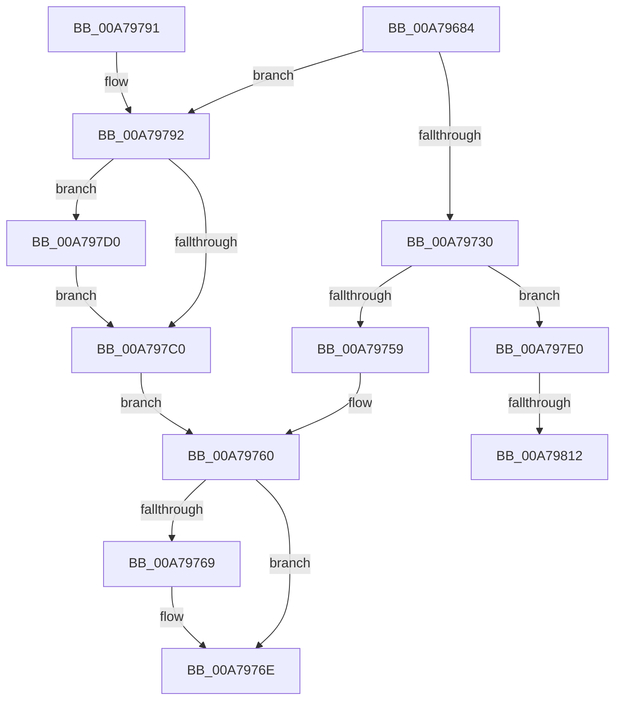

# KsepShimDatabaseTime

- RVA: `0x00A79684`–`0x00A79826` (길이 `418` bytes)
- VA: `0x0000000140A79684`
- 실행 섹션: `PAGE`
- PDB 이름 있음: `예`; PDB Function 태그: `예`
- unwind 정보 RVA: `0x000B6234`
- 디코드: `101`개 명령, `418/418` bytes 표시
- 미해석 바이트: `0` (있으면 어셈블리에 `.byte`로 보존)

> 이 문서는 커널 이미지의 기계어와 PDB 기호를 분석해 생성했습니다. 4번과 5번은 함수 원형과 자료형을 바이너리 사용 방식에서 추정한 C 해석이며 원본 소스 복구 결과는 아닙니다.

## 1. Dependencies

- 직접 호출 지점: **8**; 고유 호출 대상: **7**
- 직접 호출자로 확인된 함수: **1**
- RIP 상대 이미지 참조: **6**

### Outgoing calls
- `0x00A796DF` → [RtlInitUnicodeString](../../text/42/RtlInitUnicodeString_function_0042A780.md) (function, `0x0042A780`)
- `0x00A79725` → [ZwOpenFile](../../text/6A/ZwOpenFile_function_006AD730.md) (function, `0x006AD730`)
- `0x00A7974A` → [ZwQueryInformationFile](../../text/6A/ZwQueryInformationFile_function_006AD2F0.md) (function, `0x006AD2F0`)
- `0x00A79769` → [ZwClose](../../text/6A/ZwClose_function_006AD2B0.md) (function, `0x006AD2B0`)
- `0x00A79777` → [_security_check_cookie](../../text/6A/_security_check_cookie_function_006AC640.md) (function, `0x006AC640`)
- `0x00A797C9` → [KsepLogError](../../text/49/KsepLogError_function_00499A98.md) (function, `0x00499A98`)
- `0x00A797D9` → [KsepDebugPrint](../../text/4D/KsepDebugPrint_function_004DCFF0.md) (function, `0x004DCFF0`)
- `0x00A7981B` → [KsepDebugPrint](../../text/4D/KsepDebugPrint_function_004DCFF0.md) (function, `0x004DCFF0`)

### Direct callers
- [KsepShimDbChanged](../../text/4B/KsepShimDbChanged_function_004B014C.md) at `0x004B01BA`
- [KsepShimDbChanged](../../text/4B/KsepShimDbChanged_function_004B014C.md) at `0x004B01EB`

### Static image references
- `0x00A7969B` → RVA `0x00E0A740` (`.data`; read)
- `0x00A79797` → RVA `0x00F101C0` (`.data`; read/write)
- `0x00A797A1` → RVA `0x00F101E0` (`.data`; read)
- `0x00A797AF` → RVA `0x00E66CE8` (`.data`; read)
- `0x00A797C0` → RVA `0x00B00F40` (` ?? ::NNGAKEGL::`string'`; read)
- `0x00A79812` → RVA `0x00B00FC0` (` ?? ::NNGAKEGL::`string'`; read)

## 2. Other-region calls and transfers

- 다른 실행 섹션으로 향하는 call: **8**
  - `0x00A796DF` → [RtlInitUnicodeString](../../text/42/RtlInitUnicodeString_function_0042A780.md) (`PAGE` → `.text`)
  - `0x00A79725` → [ZwOpenFile](../../text/6A/ZwOpenFile_function_006AD730.md) (`PAGE` → `.text`)
  - `0x00A7974A` → [ZwQueryInformationFile](../../text/6A/ZwQueryInformationFile_function_006AD2F0.md) (`PAGE` → `.text`)
  - `0x00A79769` → [ZwClose](../../text/6A/ZwClose_function_006AD2B0.md) (`PAGE` → `.text`)
  - `0x00A79777` → [_security_check_cookie](../../text/6A/_security_check_cookie_function_006AC640.md) (`PAGE` → `.text`)
  - `0x00A797C9` → [KsepLogError](../../text/49/KsepLogError_function_00499A98.md) (`PAGE` → `.text`)
  - `0x00A797D9` → [KsepDebugPrint](../../text/4D/KsepDebugPrint_function_004DCFF0.md) (`PAGE` → `.text`)
  - `0x00A7981B` → [KsepDebugPrint](../../text/4D/KsepDebugPrint_function_004DCFF0.md) (`PAGE` → `.text`)
- call이 아닌 외부 분기/꼬리 이동: **2**
  - `0x00A7980C` → [sub_00B41E92](../B4/Unknown_function_00B41E92.md) (`tail-transfer`)
  - `0x00A79821` → [sub_00B41E92](../B4/Unknown_function_00B41E92.md) (`tail-transfer`)

## 3. Assembly (complete function range)

```asm
00A79684  48 89 5C 24 18                  mov qword ptr [rsp + 0x18], rbx
00A79689  48 89 7C 24 20                  mov qword ptr [rsp + 0x20], rdi
00A7968E  55                              push rbp
00A7968F  48 8D 6C 24 A9                  lea rbp, [rsp - 0x57]
00A79694  48 81 EC C0 00 00 00            sub rsp, 0xc0
00A7969B  48 8B 05 9E 10 39 00            mov rax, qword ptr [rip + 0x39109e]
00A796A2  48 33 C4                        xor rax, rsp
00A796A5  48 89 45 47                     mov qword ptr [rbp + 0x47], rax
00A796A9  33 C0                           xor eax, eax
00A796AB  0F 57 C0                        xorps xmm0, xmm0
00A796AE  48 21 02                        and qword ptr [rdx], rax
00A796B1  0F 57 C9                        xorps xmm1, xmm1
00A796B4  21 45 0B                        and dword ptr [rbp + 0xb], eax
00A796B7  48 8B FA                        mov rdi, rdx
00A796BA  48 21 45 C7                     and qword ptr [rbp - 0x39], rax
00A796BE  48 8B D1                        mov rdx, rcx
00A796C1  89 45 F3                        mov dword ptr [rbp - 0xd], eax
00A796C4  48 8D 4D CF                     lea rcx, [rbp - 0x31]
00A796C8  21 45 F3                        and dword ptr [rbp - 0xd], eax
00A796CB  0F 11 45 CF                     movups xmmword ptr [rbp - 0x31], xmm0
00A796CF  48 89 45 3F                     mov qword ptr [rbp + 0x3f], rax
00A796D3  0F 11 45 DF                     movups xmmword ptr [rbp - 0x21], xmm0
00A796D7  0F 11 4D 1F                     movups xmmword ptr [rbp + 0x1f], xmm1
00A796DB  0F 11 4D 2F                     movups xmmword ptr [rbp + 0x2f], xmm1
00A796DF  E8 9C 10 9B FF                  call 0x14042a780
00A796E4  83 64 24 28 00                  and dword ptr [rsp + 0x28], 0
00A796E9  48 8D 45 CF                     lea rax, [rbp - 0x31]
00A796ED  48 83 65 F7 00                  and qword ptr [rbp - 9], 0
00A796F2  4C 8D 4D DF                     lea r9, [rbp - 0x21]
00A796F6  0F 57 C0                        xorps xmm0, xmm0
00A796F9  48 89 45 FF                     mov qword ptr [rbp - 1], rax
00A796FD  4C 8D 45 EF                     lea r8, [rbp - 0x11]
00A79701  C7 45 EF 30 00 00 00            mov dword ptr [rbp - 0x11], 0x30
00A79708  BA 00 00 00 80                  mov edx, 0x80000000
00A7970D  C7 45 07 40 02 00 00            mov dword ptr [rbp + 7], 0x240
00A79714  48 8D 4D C7                     lea rcx, [rbp - 0x39]
00A79718  C7 44 24 20 05 00 00 00         mov dword ptr [rsp + 0x20], 5
00A79720  F3 0F 7F 45 0F                  movdqu xmmword ptr [rbp + 0xf], xmm0
00A79725  E8 06 40 C3 FF                  call 0x1406ad730
00A7972A  8B D8                           mov ebx, eax
00A7972C  85 C0                           test eax, eax
00A7972E  78 62                           js 0x140a79792
00A79730  48 8B 4D C7                     mov rcx, qword ptr [rbp - 0x39]
00A79734  4C 8D 45 1F                     lea r8, [rbp + 0x1f]
00A79738  41 B9 28 00 00 00               mov r9d, 0x28
00A7973E  C7 44 24 20 04 00 00 00         mov dword ptr [rsp + 0x20], 4
00A79746  48 8D 55 DF                     lea rdx, [rbp - 0x21]
00A7974A  E8 A1 3B C3 FF                  call 0x1406ad2f0
00A7974F  8B D8                           mov ebx, eax
00A79751  85 C0                           test eax, eax
00A79753  0F 88 87 00 00 00               js 0x140a797e0
00A79759  48 8B 45 2F                     mov rax, qword ptr [rbp + 0x2f]
00A7975D  48 89 07                        mov qword ptr [rdi], rax
00A79760  48 8B 4D C7                     mov rcx, qword ptr [rbp - 0x39]
00A79764  48 85 C9                        test rcx, rcx
00A79767  74 05                           je 0x140a7976e
00A79769  E8 42 3B C3 FF                  call 0x1406ad2b0
00A7976E  8B C3                           mov eax, ebx
00A79770  48 8B 4D 47                     mov rcx, qword ptr [rbp + 0x47]
00A79774  48 33 CC                        xor rcx, rsp
00A79777  E8 C4 2E C3 FF                  call 0x1406ac640
00A7977C  4C 8D 9C 24 C0 00 00 00         lea r11, [rsp + 0xc0]
00A79784  49 8B 5B 20                     mov rbx, qword ptr [r11 + 0x20]
00A79788  49 8B 7B 28                     mov rdi, qword ptr [r11 + 0x28]
00A7978C  49 8B E3                        mov rsp, r11
00A7978F  5D                              pop rbp
00A79790  C3                              ret
00A79791  CC                              int3
00A79792  B9 01 00 00 00                  mov ecx, 1
00A79797  F0 0F C1 0D 21 6A 49 00         lock xadd dword ptr [rip + 0x496a21], ecx
00A7979F  FF C1                           inc ecx
00A797A1  48 8D 15 38 6A 49 00            lea rdx, [rip + 0x496a38]
00A797A8  83 E1 3F                        and ecx, 0x3f
00A797AB  89 44 CA 04                     mov dword ptr [rdx + rcx*8 + 4], eax
00A797AF  8B 05 33 D5 3E 00               mov eax, dword ptr [rip + 0x3ed533]
00A797B5  C7 04 CA 84 03 09 00            mov dword ptr [rdx + rcx*8], 0x90384
00A797BC  A8 02                           test al, 2
00A797BE  75 10                           jne 0x140a797d0
00A797C0  48 8D 15 79 77 08 00            lea rdx, [rip + 0x87779]
00A797C7  33 C9                           xor ecx, ecx
00A797C9  E8 CA 02 A2 FF                  call 0x140499a98
00A797CE  EB 90                           jmp 0x140a79760
00A797D0  48 8D 15 69 77 08 00            lea rdx, [rip + 0x87769]
00A797D7  33 C9                           xor ecx, ecx
00A797D9  E8 12 38 A6 FF                  call 0x1404dcff0
00A797DE  EB E0                           jmp 0x140a797c0
00A797E0  B8 01 00 00 00                  mov eax, 1
00A797E5  F0 0F C1 05 D3 69 49 00         lock xadd dword ptr [rip + 0x4969d3], eax
00A797ED  FF C0                           inc eax
00A797EF  48 8D 15 EA 69 49 00            lea rdx, [rip + 0x4969ea]
00A797F6  83 E0 3F                        and eax, 0x3f
00A797F9  89 5C C2 04                     mov dword ptr [rdx + rax*8 + 4], ebx
00A797FD  C7 04 C2 91 03 09 00            mov dword ptr [rdx + rax*8], 0x90391
00A79804  8B 05 DE D4 3E 00               mov eax, dword ptr [rip + 0x3ed4de]
00A7980A  A8 02                           test al, 2
00A7980C  0F 84 80 86 0C 00               je 0x140b41e92
00A79812  48 8D 15 A7 77 08 00            lea rdx, [rip + 0x877a7]
00A79819  33 C9                           xor ecx, ecx
00A7981B  E8 D0 37 A6 FF                  call 0x1404dcff0
00A79820  90                              nop
00A79821  E9 6C 86 0C 00                  jmp 0x140b41e92
```

## 4. C-style interpretation (structured pseudocode)

```c
__int64 __fastcall KsepShimDatabaseTime(__int64 a1, __int64 a2)
{
    __int64 result;
    __int64 v_rsp;
    unsigned __int64 v_stack_m18;
    unsigned __int64 v_stack_m20;
    unsigned __int64 v_stack_m30;
    unsigned __int64 v_stack_m40;
    unsigned __int64 v_stack_m50;
    unsigned int v_stack_m54;
    unsigned int v_stack_m58;
    unsigned __int64 v_stack_m5F;
    unsigned __int64 v_stack_m60;
    unsigned __int64 v_stack_m68;
    unsigned int v_stack_m6C;
    unsigned __int64 v_stack_m70;
    unsigned __int64 v_stack_m8;
    unsigned __int64 v_stack_m80;
    unsigned __int64 v_stack_m90;
    unsigned __int64 v_stack_m98;
    unsigned int v_stack_mA0;
    unsigned int v_stack_mA8;
    unsigned __int64 v_stack_p18;
    unsigned __int64 v_stack_p20;

    v_stack_p18 = v_rbx;
    v_stack_p20 = v_rdi;
    v_rsp = (v_rsp) - (192);
    result = (*(unsigned __int64 *)(v_rip + 3739806)) ^ (v_rsp);
    v_stack_m18 = result;
    result = 0;
    v_stack_m6C = 0;
    v_stack_m90 = v_xmm0;
    v_stack_m20 = 0;
    v_stack_m80 = v_xmm0;
    v_stack_m40 = v_xmm1;
    v_stack_m30 = v_xmm1;
    result = RtlInitUnicodeString(v_stack_m90, a1, a3, a4);
    v_stack_m60 = v_stack_m90;
    v_stack_m70 = 48;
    v_stack_m58 = 576;
    v_stack_mA8 = 5;
    v_stack_m50 = v_xmm0;
    result = ZwOpenFile(v_stack_m98, (unsigned int)(0x80000000ULL), v_stack_m70, v_stack_m80);
    if (sign_flag) goto loc_00A79792;
    v_stack_mA8 = 4;
    result = ZwQueryInformationFile(v_stack_m98, v_stack_m80, v_stack_m40, 40);
    if (sign_flag) goto loc_00A797E0;
    *(unsigned __int64 *)(a2) = v_stack_m30;
loc_00A79760:
    result = v_stack_m30;
    if (v_stack_m98 != 0) {
        result = ZwClose(v_stack_m98, v_stack_m80, v_stack_m40, 40);
    }
    a1 = (v_stack_m18) ^ (v_rsp);
    result = _security_check_cookie(a1, v_stack_m80, v_stack_m40, 40);
    return result;
loc_00A79792:
    a1 = (unsigned int)((1) + 1);
    a1 = (unsigned int)((a1) & (63));
    *(unsigned int *)(v_rip + 4811320 + a1 * 8 + 4) = (unsigned int)(result);
    *(unsigned int *)(v_rip + 4811320 + a1 * 8) = 0x90384ULL;
    if ((((unsigned __int8)((unsigned int)(*(unsigned int *)(v_rip + 4117811)))) & (2)) != 0) goto loc_00A797D0;
loc_00A797C0:
    a1 = 0;
    result = KsepLogError(a1, v_rip + 554873, v_stack_m40, 40);
    goto loc_00A79760;
loc_00A797D0:
    a1 = 0;
    result = KsepDebugPrint(a1, v_rip + 554857, v_stack_m40, 40);
    goto loc_00A797C0;
loc_00A797E0:
    result = (unsigned int)((1) + 1);
    result = (unsigned int)((result) & (63));
    *(unsigned int *)(v_rip + 4811242 + result * 8 + 4) = (unsigned int)(*(unsigned __int64 *)(v_stack_m8 + 32));
    *(unsigned int *)(v_rip + 4811242 + result * 8) = 0x90391ULL;
    a1 = 0;
    result = KsepDebugPrint(a1, v_rip + 554919, v_stack_m40, 40);
}
```

## 5. (Beta) C Style

```c
int64_t KsepShimDatabaseTime(int64_t Arg1, void *Arg2)
{
    uint8_t *arg2 = (uint8_t *)Arg2;

    int64_t result;
    int64_t local_rsp;
    uint64_t v_stack_m18;
    uint64_t v_stack_m20;
    uint64_t v_stack_m30;
    uint64_t v_stack_m40;
    uint64_t v_stack_m50;
    uint32_t v_stack_m54;
    uint32_t v_stack_m58;
    uint64_t v_stack_m5F;
    uint64_t v_stack_m60;
    uint64_t v_stack_m68;
    uint32_t v_stack_m6C;
    uint64_t v_stack_m70;
    uint64_t v_stack_m8;
    uint64_t v_stack_m80;
    uint64_t v_stack_m90;
    uint64_t v_stack_m98;
    uint32_t v_stack_mA0;
    uint32_t v_stack_mA8;
    uint64_t v_stack_p18;
    uint64_t v_stack_p20;

    v_stack_p18 = local_rbx;
    v_stack_p20 = local_rdi;
    local_rsp = (local_rsp) - (192);
    result = (*(uint64_t *)(v_rip + 0x39109E)) ^ (local_rsp);
    v_stack_m18 = result;
    result = 0;
    v_stack_m6C = 0;
    v_stack_m90 = v_xmm0;
    v_stack_m20 = 0;
    v_stack_m80 = v_xmm0;
    v_stack_m40 = v_xmm1;
    v_stack_m30 = v_xmm1;
    result = RtlInitUnicodeString(v_stack_m90, Arg1, a3, a4);
    v_stack_m60 = v_stack_m90;
    v_stack_m70 = 48;
    v_stack_m58 = 576;
    v_stack_mA8 = 5;
    v_stack_m50 = v_xmm0;
    result = ZwOpenFile(v_stack_m98, (uint32_t)(0x80000000ULL), v_stack_m70, v_stack_m80);
    if (sign_flag) goto loc_00A79792;
    v_stack_mA8 = 4;
    result = ZwQueryInformationFile(v_stack_m98, v_stack_m80, v_stack_m40, 40);
    if (sign_flag) goto loc_00A797E0;
    *(uint64_t *)(arg2) = v_stack_m30;
loc_00A79760:
    result = v_stack_m30;
    if (v_stack_m98 != 0) {
        result = ZwClose(v_stack_m98, v_stack_m80, v_stack_m40, 40);
    }
    Arg1 = (v_stack_m18) ^ (local_rsp);
    result = _security_check_cookie(Arg1, v_stack_m80, v_stack_m40, 40);
    return result;
loc_00A79792:
    Arg1 = (uint32_t)((1) + 1);
    Arg1 = (uint32_t)((Arg1) & (63));
    *(uint32_t *)(v_rip + 0x496A38 + Arg1 * 8 + 0x4) = (uint32_t)(result);
    *(uint32_t *)(v_rip + 0x496A38 + Arg1 * 8) = 0x90384ULL;
    if ((((uint8_t)((uint32_t)(*(uint32_t *)(v_rip + 0x3ED533)))) & (2)) != 0) goto loc_00A797D0;
loc_00A797C0:
    Arg1 = 0;
    result = KsepLogError(Arg1, v_rip + 554873, v_stack_m40, 40);
    goto loc_00A79760;
loc_00A797D0:
    Arg1 = 0;
    result = KsepDebugPrint(Arg1, v_rip + 554857, v_stack_m40, 40);
    goto loc_00A797C0;
loc_00A797E0:
    result = (uint32_t)((1) + 1);
    result = (uint32_t)((result) & (63));
    *(uint32_t *)(v_rip + 0x4969EA + result * 8 + 0x4) = (uint32_t)(*(uint64_t *)(v_stack_m8 + 0x20));
    *(uint32_t *)(v_rip + 0x4969EA + result * 8) = 0x90391ULL;
    Arg1 = 0;
    result = KsepDebugPrint(Arg1, v_rip + 554919, v_stack_m40, 40);
}
```

### 관측된 메모리 오프셋

구조체 형식이 확인되지 않은 접근은 인자 기준의 오프셋으로만 기록했습니다.

| 기준 인자 | 오프셋 표현 | 폭 (bit) | 접근 |
|---|---:|---:|---|
| `Arg2` | `+ 0x0` | `64` | `R/W` |
| `Arg2` | `+ 0x0` | `64` | `W` |

## 6. Execution-region graph

[열기: 2D/3D 그래프와 함수 탐색 컨트롤 패널](../../../control-panel.html?section=page&rva=0x00A79684&view=graph)

- 2D 그래프는 위에서 아래로 흐르고, 3D 그래프는 빈 공간을 드래그해 회전합니다. Shift+드래그는 이동, 휠은 확대·축소, 함수 노드 선택은 대상 보고서 이동입니다.

### Static fallback


