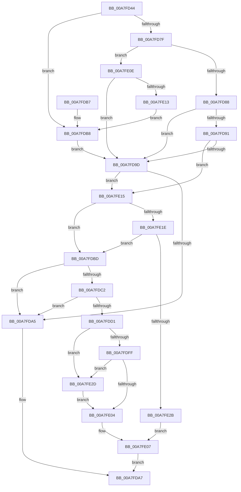

# LdrInitSecurityCookie

- RVA: `0x00A7FD44`–`0x00A7FE39` (길이 `245` bytes)
- VA: `0x0000000140A7FD44`
- 실행 섹션: `PAGE`
- PDB 이름 있음: `예`; PDB Function 태그: `아니요`
- unwind 정보 RVA: `0x000B6F34`
- 디코드: `71`개 명령, `245/245` bytes 표시
- 미해석 바이트: `0` (있으면 어셈블리에 `.byte`로 보존)

> 이 문서는 커널 이미지의 기계어와 PDB 기호를 분석해 생성했습니다. 4번과 5번은 함수 원형과 자료형을 바이너리 사용 방식에서 추정한 C 해석이며 원본 소스 복구 결과는 아닙니다.

## 1. Dependencies

- 직접 호출 지점: **2**; 고유 호출 대상: **2**
- 직접 호출자로 확인된 함수: **1**
- RIP 상대 이미지 참조: **0**

### Outgoing calls
- `0x00A7FD6A` → [RtlImageNtHeaderEx](../../text/41/RtlImageNtHeaderEx_function_0041EAA0.md) (function, `0x0041EAA0`)
- `0x00A7FD72` → [LdrImageDirectoryEntryToLoadConfigEx](../../text/4F/LdrImageDirectoryEntryToLoadConfigEx_function_004F087C.md) (function, `0x004F087C`)

### Direct callers
- [MiProcessLoadConfigForDriver](MiProcessLoadConfigForDriver_function_00A7FCE4.md) at `0x00A7FD2B`

### Static image references
- 디코드된 RIP-relative 메모리 참조가 없습니다.

## 2. Other-region calls and transfers

- 다른 실행 섹션으로 향하는 call: **2**
  - `0x00A7FD6A` → [RtlImageNtHeaderEx](../../text/41/RtlImageNtHeaderEx_function_0041EAA0.md) (`PAGE` → `.text`)
  - `0x00A7FD72` → [LdrImageDirectoryEntryToLoadConfigEx](../../text/4F/LdrImageDirectoryEntryToLoadConfigEx_function_004F087C.md) (`PAGE` → `.text`)
- 별도 외부 분기/꼬리 이동을 확인하지 못했습니다.

## 3. Assembly (complete function range)

```asm
00A7FD44  48 89 5C 24 08                  mov qword ptr [rsp + 8], rbx
00A7FD49  48 89 74 24 10                  mov qword ptr [rsp + 0x10], rsi
00A7FD4E  57                              push rdi
00A7FD4F  48 83 EC 20                     sub rsp, 0x20
00A7FD53  45 33 C0                        xor r8d, r8d
00A7FD56  8B FA                           mov edi, edx
00A7FD58  49 8B F1                        mov rsi, r9
00A7FD5B  48 8B D9                        mov rbx, rcx
00A7FD5E  48 8B D1                        mov rdx, rcx
00A7FD61  4C 8D 4C 24 40                  lea r9, [rsp + 0x40]
00A7FD66  41 8D 48 01                     lea ecx, [r8 + 1]
00A7FD6A  E8 31 ED 99 FF                  call 0x14041eaa0
00A7FD6F  48 8B CB                        mov rcx, rbx
00A7FD72  E8 05 0B A7 FF                  call 0x1404f087c
00A7FD77  4C 8B C0                        mov r8, rax
00A7FD7A  48 85 C0                        test rax, rax
00A7FD7D  74 39                           je 0x140a7fdb8
00A7FD7F  83 38 70                        cmp dword ptr [rax], 0x70
00A7FD82  0F 82 86 00 00 00               jb 0x140a7fe0e
00A7FD88  4C 8B 48 58                     mov r9, qword ptr [rax + 0x58]
00A7FD8C  4C 3B CB                        cmp r9, rbx
00A7FD8F  76 0C                           jbe 0x140a7fd9d
00A7FD91  48 8D 4F F8                     lea rcx, [rdi - 8]
00A7FD95  48 03 CB                        add rcx, rbx
00A7FD98  4C 3B C9                        cmp r9, rcx
00A7FD9B  72 78                           jb 0x140a7fe15
00A7FD9D  45 33 C9                        xor r9d, r9d
00A7FDA0  4D 85 C0                        test r8, r8
00A7FDA3  75 70                           jne 0x140a7fe15
00A7FDA5  33 C0                           xor eax, eax
00A7FDA7  48 8B 5C 24 30                  mov rbx, qword ptr [rsp + 0x30]
00A7FDAC  48 8B 74 24 38                  mov rsi, qword ptr [rsp + 0x38]
00A7FDB1  48 83 C4 20                     add rsp, 0x20
00A7FDB5  5F                              pop rdi
00A7FDB6  C3                              ret
00A7FDB7  CC                              int3
00A7FDB8  45 33 C0                        xor r8d, r8d
00A7FDBB  EB E0                           jmp 0x140a7fd9d
00A7FDBD  4D 85 C9                        test r9, r9
00A7FDC0  74 E3                           je 0x140a7fda5
00A7FDC2  49 B8 32 A2 DF 2D 99 2B 00 00   movabs r8, 0x2b992ddfa232
00A7FDCC  4D 39 01                        cmp qword ptr [r9], r8
00A7FDCF  75 D4                           jne 0x140a7fda5
00A7FDD1  0F 31                           rdtsc
00A7FDD3  8B CE                           mov ecx, esi
00A7FDD5  48 C1 E1 10                     shl rcx, 0x10
00A7FDD9  48 C1 E2 20                     shl rdx, 0x20
00A7FDDD  48 0B C2                        or rax, rdx
00A7FDE0  48 C1 EE 20                     shr rsi, 0x20
00A7FDE4  48 33 CE                        xor rcx, rsi
00A7FDE7  48 33 C8                        xor rcx, rax
00A7FDEA  48 B8 FF FF FF FF FF FF 00 00   movabs rax, 0xffffffffffff
00A7FDF4  49 33 C9                        xor rcx, r9
00A7FDF7  48 23 C8                        and rcx, rax
00A7FDFA  49 3B C8                        cmp rcx, r8
00A7FDFD  74 2E                           je 0x140a7fe2d
00A7FDFF  48 85 C9                        test rcx, rcx
00A7FE02  74 29                           je 0x140a7fe2d
00A7FE04  49 89 09                        mov qword ptr [r9], rcx
00A7FE07  B8 01 00 00 00                  mov eax, 1
00A7FE0C  EB 99                           jmp 0x140a7fda7
00A7FE0E  83 38 04                        cmp dword ptr [rax], 4
00A7FE11  73 8A                           jae 0x140a7fd9d
00A7FE13  EB A3                           jmp 0x140a7fdb8
00A7FE15  41 81 38 94 00 00 00            cmp dword ptr [r8], 0x94
00A7FE1C  72 9F                           jb 0x140a7fdbd
00A7FE1E  41 F7 80 90 00 00 00 00 08 00 00  test dword ptr [r8 + 0x90], 0x800
00A7FE29  74 92                           je 0x140a7fdbd
00A7FE2B  EB DA                           jmp 0x140a7fe07
00A7FE2D  48 B9 33 A2 DF 2D 99 2B 00 00   movabs rcx, 0x2b992ddfa233
00A7FE37  EB CB                           jmp 0x140a7fe04
```

## 4. C-style interpretation (structured pseudocode)

```c
__int64 __fastcall LdrInitSecurityCookie(__int64 a1, int a2, int a3, __int64 a4)
{
    __int64 result;
    __int64 v_rsi;
    __int64 v_rsp;
    unsigned __int64 v_stack_p10;
    unsigned __int64 v_stack_p18;
    unsigned __int64 v_stack_p8;

    v_stack_p8 = v_rbx;
    v_stack_p10 = v_rsi;
    v_rsp = (v_rsp) - (32);
    a3 = 0;
    result = RtlImageNtHeaderEx(a3 + 1, a1, a3, v_stack_p18);
    result = LdrImageDirectoryEntryToLoadConfigEx(a1, a1, a3, v_stack_p18);
    if (result == 0) goto loc_00A7FDB8;
    if ((*(unsigned int *)(result)) < 112) goto loc_00A7FE0E;
    if ((*(unsigned __int64 *)(result + 88)) <= a1) goto loc_00A7FD9D;
    a1 = ((unsigned int)(a2) - 8) + (a1);
    if ((*(unsigned __int64 *)(result + 88)) < a1) goto loc_00A7FE15;
loc_00A7FD9D:
    a4 = 0;
    if (result != 0) goto loc_00A7FE15;
loc_00A7FDA5:
    result = 0;
loc_00A7FDA7:
    v_rsp = (v_rsp) + (32);
    return result;
loc_00A7FDB8:
    a3 = 0;
    goto loc_00A7FD9D;
loc_00A7FDBD:
    if (0 == 0) goto loc_00A7FDA5;
    if ((*(unsigned __int64 *)(a4)) != 0) goto loc_00A7FDA5;
    a1 = ((unsigned int)((unsigned int)(v_stack_p10))) << (16);
    a2 = (a1) << (32);
    result = (result) | (a2);
    v_rsi = (v_stack_p10) >> (32);
    a1 = (a1) ^ (v_rsi);
    a1 = (a1) ^ (result);
    a1 = (a1) ^ (0);
    a1 = (a1) & (result);
    if (a1 == 0) goto loc_00A7FE2D;
    if (a1 == 0) goto loc_00A7FE2D;
loc_00A7FE04:
    *(unsigned __int64 *)(a4) = a1;
loc_00A7FE07:
    goto loc_00A7FDA7;
loc_00A7FE0E:
    if ((*(unsigned int *)(1)) >= 4) goto loc_00A7FD9D;
    goto loc_00A7FDB8;
loc_00A7FE15:
    if ((*(unsigned int *)(a3)) < 148) goto loc_00A7FDBD;
    if (((*(unsigned int *)(a3 + 144)) & (0x800ULL)) == 0) goto loc_00A7FDBD;
    goto loc_00A7FE07;
loc_00A7FE2D:
    goto loc_00A7FE04;
}
```

## 5. (Beta) C Style

```c
int64_t LdrInitSecurityCookie(int64_t Arg1, void *Arg2, int32_t Arg3, int64_t Arg4)
{
    uint8_t *arg2 = (uint8_t *)Arg2;

    int64_t result;
    int64_t local_rsi;
    int64_t local_rsp;
    uint64_t v_stack_p10;
    uint64_t v_stack_p18;
    uint64_t v_stack_p8;

    v_stack_p8 = local_rbx;
    v_stack_p10 = local_rsi;
    local_rsp = (local_rsp) - (32);
    Arg3 = 0;
    result = RtlImageNtHeaderEx(Arg3 + 1, Arg1, Arg3, v_stack_p18);
    result = LdrImageDirectoryEntryToLoadConfigEx(Arg1, Arg1, Arg3, v_stack_p18);
    if (result == 0) goto loc_00A7FDB8;
    if ((*(uint32_t *)(result)) < 112) goto loc_00A7FE0E;
    if ((*(uint64_t *)(result + 0x58)) <= Arg1) goto loc_00A7FD9D;
    Arg1 = ((uint32_t)(Arg2) - 8) + (Arg1);
    if ((*(uint64_t *)(result + 0x58)) < Arg1) goto loc_00A7FE15;
loc_00A7FD9D:
    Arg4 = 0;
    if (result != 0) goto loc_00A7FE15;
loc_00A7FDA5:
    result = 0;
loc_00A7FDA7:
    local_rsp = (local_rsp) + (32);
    return result;
loc_00A7FDB8:
    Arg3 = 0;
    goto loc_00A7FD9D;
loc_00A7FDBD:
    if (0 == 0) goto loc_00A7FDA5;
    if ((*(uint64_t *)(Arg4)) != 0) goto loc_00A7FDA5;
    Arg1 = ((uint32_t)((uint32_t)(v_stack_p10))) << (16);
    Arg2 = (Arg1) << (32);
    result = (result) | (Arg2);
    local_rsi = (v_stack_p10) >> (32);
    Arg1 = (Arg1) ^ (local_rsi);
    Arg1 = (Arg1) ^ (result);
    Arg1 = (Arg1) ^ (0);
    Arg1 = (Arg1) & (result);
    if (Arg1 == 0) goto loc_00A7FE2D;
    if (Arg1 == 0) goto loc_00A7FE2D;
loc_00A7FE04:
    *(uint64_t *)(Arg4) = Arg1;
loc_00A7FE07:
    goto loc_00A7FDA7;
loc_00A7FE0E:
    if ((*(uint32_t *)(1)) >= 4) goto loc_00A7FD9D;
    goto loc_00A7FDB8;
loc_00A7FE15:
    if ((*(uint32_t *)(Arg3)) < 148) goto loc_00A7FDBD;
    if (((*(uint32_t *)(Arg3 + 0x90)) & (0x800ULL)) == 0) goto loc_00A7FDBD;
    goto loc_00A7FE07;
loc_00A7FE2D:
    goto loc_00A7FE04;
}
```

### 관측된 메모리 오프셋

구조체 형식이 확인되지 않은 접근은 인자 기준의 오프셋으로만 기록했습니다.

| 기준 인자 | 오프셋 표현 | 폭 (bit) | 접근 |
|---|---:|---:|---|
| `Arg2` | `- 0x8` | `64` | `R` |

## 6. Execution-region graph

[열기: 2D/3D 그래프와 함수 탐색 컨트롤 패널](../../../control-panel.html?section=page&rva=0x00A7FD44&view=graph)

- 2D 그래프는 위에서 아래로 흐르고, 3D 그래프는 빈 공간을 드래그해 회전합니다. Shift+드래그는 이동, 휠은 확대·축소, 함수 노드 선택은 대상 보고서 이동입니다.

### Static fallback


