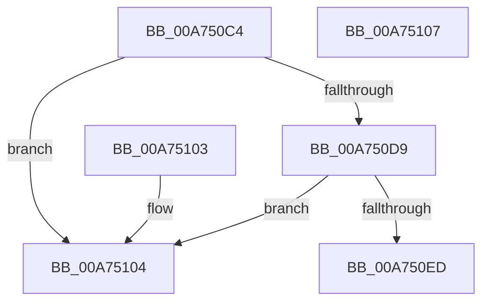

# MiBytesToMapSystemImage

- RVA: `0x00A750C4`–`0x00A75108` (길이 `68` bytes)
- VA: `0x0000000140A750C4`
- 실행 섹션: `PAGE`
- PDB 이름 있음: `예`; PDB Function 태그: `아니요`
- unwind 정보 RVA: `0x000DB714`
- 디코드: `21`개 명령, `68/68` bytes 표시
- 미해석 바이트: `0` (있으면 어셈블리에 `.byte`로 보존)

> 이 문서는 커널 이미지의 기계어와 PDB 기호를 분석해 생성했습니다. 4번과 5번은 함수 원형과 자료형을 바이너리 사용 방식에서 추정한 C 해석이며 원본 소스 복구 결과는 아닙니다.

## 1. Dependencies

- 직접 호출 지점: **0**; 고유 호출 대상: **0**
- 직접 호출자로 확인된 함수: **3**
- RIP 상대 이미지 참조: **3**

### Outgoing calls
- 직접 디코드된 call 명령이 없습니다.

### Direct callers
- [MiSelectImageBase](../98/MiSelectImageBase_function_009887B0.md) at `0x00988A3D`
- [MiGetSystemAddressForImage](MiGetSystemAddressForImage_function_00A74EEC.md) at `0x00A74F5F`
- [MiUnloadSystemImage](../AA/MiUnloadSystemImage_function_00AA2FD4.md) at `0x00AA320C`

### Static image references
- `0x00A750D9` → RVA `0x00E375B0` (`.data`; read)
- `0x00A750DF` → RVA `0x00E375AC` (`.data`; read)
- `0x00A750ED` → RVA `0x00E2D838` (`.data`; read)

## 2. Other-region calls and transfers

- 다른 실행 섹션으로 향하는 call: **0**
- 별도 외부 분기/꼬리 이동을 확인하지 못했습니다.

## 3. Assembly (complete function range)

```asm
00A750C4  48 8D 81 FF 0F 00 00            lea rax, [rcx + 0xfff]
00A750CB  4C 8B C9                        mov r9, rcx
00A750CE  48 25 00 F0 FF FF               and rax, 0xfffffffffffff000
00A750D4  48 3B C1                        cmp rax, rcx
00A750D7  72 2B                           jb 0x140a75104
00A750D9  8B 15 D1 24 3C 00               mov edx, dword ptr [rip + 0x3c24d1]
00A750DF  03 15 C7 24 3C 00               add edx, dword ptr [rip + 0x3c24c7]
00A750E5  48 03 C2                        add rax, rdx
00A750E8  48 3B C1                        cmp rax, rcx
00A750EB  72 17                           jb 0x140a75104
00A750ED  8B 0D 45 87 3B 00               mov ecx, dword ptr [rip + 0x3b8745]
00A750F3  C1 E1 0C                        shl ecx, 0xc
00A750F6  48 03 C1                        add rax, rcx
00A750F9  33 C9                           xor ecx, ecx
00A750FB  49 3B C1                        cmp rax, r9
00A750FE  48 0F 42 C1                     cmovb rax, rcx
00A75102  C3                              ret
00A75103  CC                              int3
00A75104  33 C0                           xor eax, eax
00A75106  C3                              ret
00A75107  CC                              int3
```

## 4. C-style interpretation (structured pseudocode)

```c
__int64 __fastcall MiBytesToMapSystemImage(__int64 a1)
{
    __int64 result;

    result = (a1 + 4095) & (0xFFFFFFFFFFFFF000ULL);
    if (result < a1) goto loc_00A75104;
    a2 = (unsigned int)(((unsigned int)(*(unsigned int *)(v_rip + 3941585))) + (*(unsigned int *)(v_rip + 3941575)));
    result = (result) + (a2);
    if (result < a1) goto loc_00A75104;
    a1 = (unsigned int)(((unsigned int)(*(unsigned int *)(v_rip + 3901253))) << (12));
    result = (result) + (a1);
    a1 = 0;
    if (result < 0) { result = 0; }
    return result;
loc_00A75104:
    result = 0;
    return result;
}
```

## 5. (Beta) C Style

```c
int64_t MiBytesToMapSystemImage(void *Arg1)
{
    uint8_t *arg1 = (uint8_t *)Arg1;

    int64_t result;

    result = (Arg1 + 4095) & (0xFFFFFFFFFFFFF000ULL);
    if (result < Arg1) goto loc_00A75104;
    a2 = (uint32_t)(((uint32_t)(*(uint32_t *)(v_rip + 0x3C24D1))) + (*(uint32_t *)(v_rip + 0x3C24C7)));
    result = (result) + (a2);
    if (result < Arg1) goto loc_00A75104;
    Arg1 = (uint32_t)(((uint32_t)(*(uint32_t *)(v_rip + 0x3B8745))) << (12));
    result = (result) + (Arg1);
    Arg1 = 0;
    if (result < 0) { result = 0; }
    return result;
loc_00A75104:
    result = 0;
    return result;
}
```

### 관측된 메모리 오프셋

구조체 형식이 확인되지 않은 접근은 인자 기준의 오프셋으로만 기록했습니다.

| 기준 인자 | 오프셋 표현 | 폭 (bit) | 접근 |
|---|---:|---:|---|
| `Arg1` | `+ 0xFFF` | `64` | `R` |

## 6. Execution-region graph

[열기: 2D/3D 그래프와 함수 탐색 컨트롤 패널](../../../control-panel.html?section=page&rva=0x00A750C4&view=graph)

- 2D 그래프는 위에서 아래로 흐르고, 3D 그래프는 빈 공간을 드래그해 회전합니다. Shift+드래그는 이동, 휠은 확대·축소, 함수 노드 선택은 대상 보고서 이동입니다.

### Static fallback


