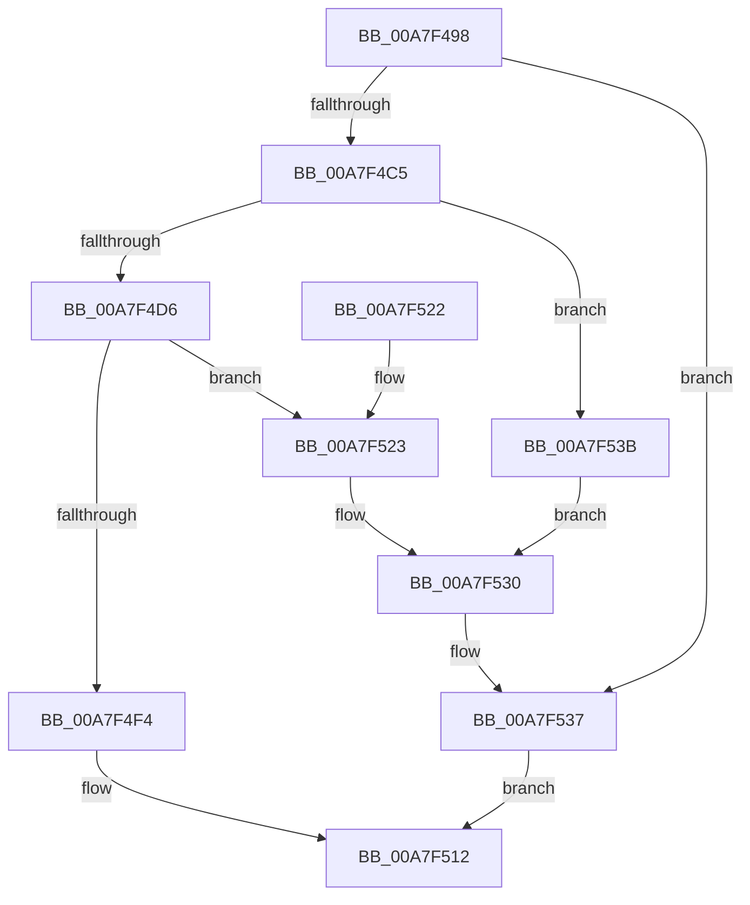

# MiCreateRotateView

- RVA: `0x00A7F498`–`0x00A7F540` (길이 `168` bytes)
- VA: `0x0000000140A7F498`
- 실행 섹션: `PAGE`
- PDB 이름 있음: `예`; PDB Function 태그: `아니요`
- unwind 정보 RVA: `0x0006B600`
- 디코드: `47`개 명령, `168/168` bytes 표시
- 미해석 바이트: `0` (있으면 어셈블리에 `.byte`로 보존)

> 이 문서는 커널 이미지의 기계어와 PDB 기호를 분석해 생성했습니다. 4번과 5번은 함수 원형과 자료형을 바이너리 사용 방식에서 추정한 C 해석이며 원본 소스 복구 결과는 아닙니다.

## 1. Dependencies

- 직접 호출 지점: **6**; 고유 호출 대상: **5**
- 직접 호출자로 확인된 함수: **2**
- RIP 상대 이미지 참조: **0**

### Outgoing calls
- `0x00A7F4B8` → [MiAllocatePool](../../text/35/MiAllocatePool_function_0035B540.md) (function, `0x0035B540`)
- `0x00A7F4C9` → [MiGetInPageSupportBlock](../../text/36/MiGetInPageSupportBlock_function_00362500.md) (function, `0x00362500`)
- `0x00A7F4EB` → [PsChargeProcessNonPagedPoolQuota](../../text/2A/PsChargeProcessNonPagedPoolQuota_function_002A7B80.md) (function, `0x002A7B80`)
- `0x00A7F508` → [MiInsertVadEvent](../../text/43/MiInsertVadEvent_function_00430E74.md) (function, `0x00430E74`)
- `0x00A7F528` → [ExFreePoolWithTag](../../poolcode/B8/ExFreePoolWithTag_function_00B82870.md) (function, `0x00B82870`)
- `0x00A7F532` → [ExFreePoolWithTag](../../poolcode/B8/ExFreePoolWithTag_function_00B82870.md) (function, `0x00B82870`)

### Direct callers
- [MiReserveUserMemory](../88/MiReserveUserMemory_function_00884498.md) at `0x00884C27`
- [MiInitializePartialVad](../88/MiInitializePartialVad_function_00887954.md) at `0x00887ACE`

### Static image references
- 디코드된 RIP-relative 메모리 참조가 없습니다.

## 2. Other-region calls and transfers

- 다른 실행 섹션으로 향하는 call: **6**
  - `0x00A7F4B8` → [MiAllocatePool](../../text/35/MiAllocatePool_function_0035B540.md) (`PAGE` → `.text`)
  - `0x00A7F4C9` → [MiGetInPageSupportBlock](../../text/36/MiGetInPageSupportBlock_function_00362500.md) (`PAGE` → `.text`)
  - `0x00A7F4EB` → [PsChargeProcessNonPagedPoolQuota](../../text/2A/PsChargeProcessNonPagedPoolQuota_function_002A7B80.md) (`PAGE` → `.text`)
  - `0x00A7F508` → [MiInsertVadEvent](../../text/43/MiInsertVadEvent_function_00430E74.md) (`PAGE` → `.text`)
  - `0x00A7F528` → [ExFreePoolWithTag](../../poolcode/B8/ExFreePoolWithTag_function_00B82870.md) (`PAGE` → `POOLCODE`)
  - `0x00A7F532` → [ExFreePoolWithTag](../../poolcode/B8/ExFreePoolWithTag_function_00B82870.md) (`PAGE` → `POOLCODE`)
- 별도 외부 분기/꼬리 이동을 확인하지 못했습니다.

## 3. Assembly (complete function range)

```asm
00A7F498  48 89 5C 24 08                  mov qword ptr [rsp + 8], rbx
00A7F49D  48 89 74 24 10                  mov qword ptr [rsp + 0x10], rsi
00A7F4A2  57                              push rdi
00A7F4A3  48 83 EC 20                     sub rsp, 0x20
00A7F4A7  BA 58 00 00 00                  mov edx, 0x58
00A7F4AC  48 8B F1                        mov rsi, rcx
00A7F4AF  41 B8 4D 6D 77 77               mov r8d, 0x77776d4d
00A7F4B5  8D 4A E8                        lea ecx, [rdx - 0x18]
00A7F4B8  E8 83 C0 8D FF                  call 0x14035b540
00A7F4BD  48 8B D8                        mov rbx, rax
00A7F4C0  48 85 C0                        test rax, rax
00A7F4C3  74 72                           je 0x140a7f537
00A7F4C5  33 D2                           xor edx, edx
00A7F4C7  33 C9                           xor ecx, ecx
00A7F4C9  E8 32 30 8E FF                  call 0x140362500
00A7F4CE  48 8B F8                        mov rdi, rax
00A7F4D1  48 85 C0                        test rax, rax
00A7F4D4  74 65                           je 0x140a7f53b
00A7F4D6  65 48 8B 04 25 88 01 00 00      mov rax, qword ptr gs:[0x188]
00A7F4DF  BA 18 02 00 00                  mov edx, 0x218
00A7F4E4  48 8B 88 B8 00 00 00            mov rcx, qword ptr [rax + 0xb8]
00A7F4EB  E8 90 86 82 FF                  call 0x1402a7b80
00A7F4F0  85 C0                           test eax, eax
00A7F4F2  78 2F                           js 0x140a7f523
00A7F4F4  45 33 C0                        xor r8d, r8d
00A7F4F7  C7 43 50 08 00 00 00            mov dword ptr [rbx + 0x50], 8
00A7F4FE  48 8B D3                        mov rdx, rbx
00A7F501  48 89 7B 08                     mov qword ptr [rbx + 8], rdi
00A7F505  48 8B CE                        mov rcx, rsi
00A7F508  E8 67 19 9B FF                  call 0x140430e74
00A7F50D  B8 01 00 00 00                  mov eax, 1
00A7F512  48 8B 5C 24 30                  mov rbx, qword ptr [rsp + 0x30]
00A7F517  48 8B 74 24 38                  mov rsi, qword ptr [rsp + 0x38]
00A7F51C  48 83 C4 20                     add rsp, 0x20
00A7F520  5F                              pop rdi
00A7F521  C3                              ret
00A7F522  CC                              int3
00A7F523  33 D2                           xor edx, edx
00A7F525  48 8B CB                        mov rcx, rbx
00A7F528  E8 43 33 10 00                  call 0x140b82870
00A7F52D  48 8B CF                        mov rcx, rdi
00A7F530  33 D2                           xor edx, edx
00A7F532  E8 39 33 10 00                  call 0x140b82870
00A7F537  33 C0                           xor eax, eax
00A7F539  EB D7                           jmp 0x140a7f512
00A7F53B  48 8B CB                        mov rcx, rbx
00A7F53E  EB F0                           jmp 0x140a7f530
```

## 4. C-style interpretation (structured pseudocode)

```c
__int64 __fastcall MiCreateRotateView(__int64 a1)
{
    __int64 result;
    __int64 v_rsp;
    unsigned __int64 v_stack_p10;
    unsigned __int64 v_stack_p8;

    v_stack_p8 = v_rbx;
    v_stack_p10 = v_rsi;
    v_rsp = (v_rsp) - (32);
    result = MiAllocatePool(88 - 24, 88, (unsigned int)(0x77776D4DULL), a4);
    if (result == 0) goto loc_00A7F537;
    a2 = 0;
    a1 = 0;
    result = MiGetInPageSupportBlock(a1, a2, (unsigned int)(0x77776D4DULL), a4);
    if (result == 0) goto loc_00A7F53B;
    result = PsChargeProcessNonPagedPoolQuota(*(unsigned __int64 *)(*(unsigned __int64 *)(gs_base + (0 + 392)) + 184), 536, (unsigned int)(0x77776D4DULL), a4);
    if (sign_flag) goto loc_00A7F523;
    a3 = 0;
    *(unsigned int *)(result + 80) = 8;
    *(unsigned __int64 *)(result + 8) = result;
    result = MiInsertVadEvent(0, result, a3, a4);
loc_00A7F512:
    v_rsp = (v_rsp) + (32);
    return 1;
loc_00A7F523:
    a2 = 0;
    result = ExFreePoolWithTag(v_stack_p8, a2, a3, a4);
loc_00A7F530:
    a2 = 0;
    result = ExFreePoolWithTag(result, a2, a3, a4);
loc_00A7F537:
    result = 0;
    goto loc_00A7F512;
loc_00A7F53B:
    goto loc_00A7F530;
}
```

## 5. (Beta) C Style

```c
int64_t MiCreateRotateView(int64_t Arg1)
{
    int64_t result;
    int64_t local_rsp;
    uint64_t v_stack_p10;
    uint64_t v_stack_p8;

    v_stack_p8 = local_rbx;
    v_stack_p10 = local_rsi;
    local_rsp = (local_rsp) - (32);
    result = MiAllocatePool(88 - 24, 88, (uint32_t)(0x77776D4DULL), a4);
    if (result == 0) goto loc_00A7F537;
    a2 = 0;
    Arg1 = 0;
    result = MiGetInPageSupportBlock(Arg1, a2, (uint32_t)(0x77776D4DULL), a4);
    if (result == 0) goto loc_00A7F53B;
    result = PsChargeProcessNonPagedPoolQuota(*(uint64_t *)(*(uint64_t *)(gs_base + (0 + 0x188)) + 0xB8), 536, (uint32_t)(0x77776D4DULL), a4);
    if (sign_flag) goto loc_00A7F523;
    a3 = 0;
    *(uint32_t *)(result + 0x50) = 8;
    *(uint64_t *)(result + 0x8) = result;
    result = MiInsertVadEvent(0, result, a3, a4);
loc_00A7F512:
    local_rsp = (local_rsp) + (32);
    return 1;
loc_00A7F523:
    a2 = 0;
    result = ExFreePoolWithTag(v_stack_p8, a2, a3, a4);
loc_00A7F530:
    a2 = 0;
    result = ExFreePoolWithTag(result, a2, a3, a4);
loc_00A7F537:
    result = 0;
    goto loc_00A7F512;
loc_00A7F53B:
    goto loc_00A7F530;
}
```

## 6. Execution-region graph

[열기: 2D/3D 그래프와 함수 탐색 컨트롤 패널](../../../control-panel.html?section=page&rva=0x00A7F498&view=graph)

- 2D 그래프는 위에서 아래로 흐르고, 3D 그래프는 빈 공간을 드래그해 회전합니다. Shift+드래그는 이동, 휠은 확대·축소, 함수 노드 선택은 대상 보고서 이동입니다.

### Static fallback


