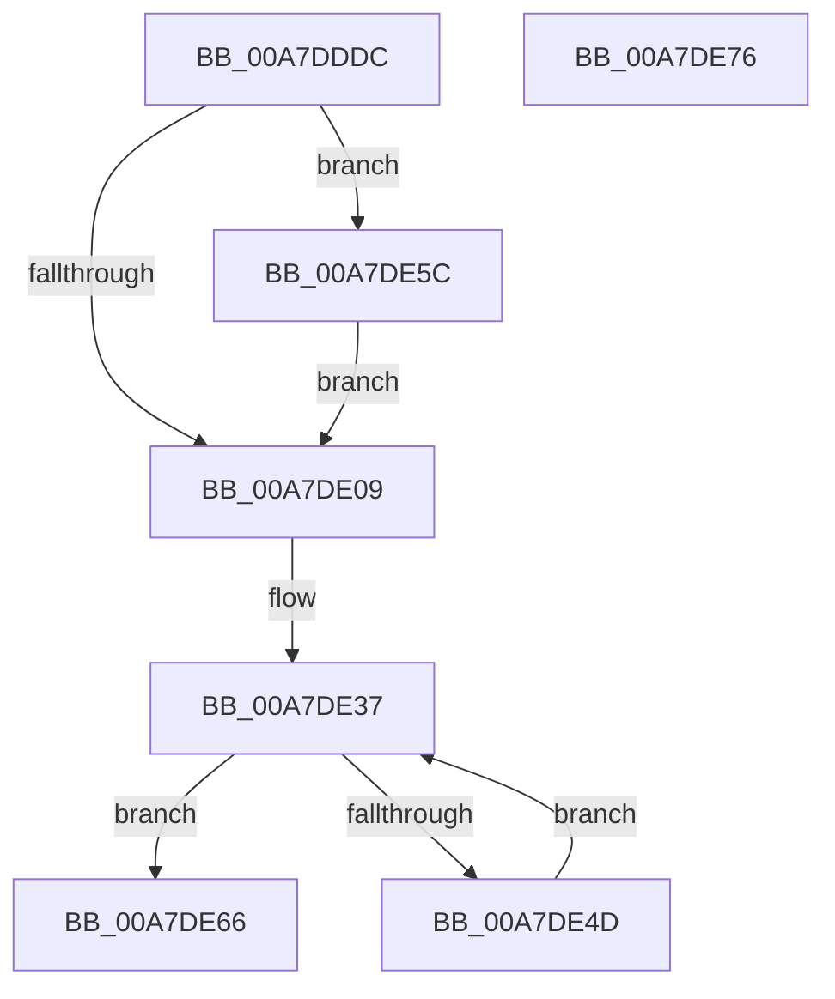

# MiDoneWithThisPageGetAnother

- RVA: `0x00A7DDDC`–`0x00A7DE77` (길이 `155` bytes)
- VA: `0x0000000140A7DDDC`
- 실행 섹션: `PAGE`
- PDB 이름 있음: `예`; PDB Function 태그: `아니요`
- unwind 정보 RVA: `0x000B6B54`
- 디코드: `44`개 명령, `155/155` bytes 표시
- 미해석 바이트: `0` (있으면 어셈블리에 `.byte`로 보존)

> 이 문서는 커널 이미지의 기계어와 PDB 기호를 분석해 생성했습니다. 4번과 5번은 함수 원형과 자료형을 바이너리 사용 방식에서 추정한 C 해석이며 원본 소스 복구 결과는 아닙니다.

## 1. Dependencies

- 직접 호출 지점: **6**; 고유 호출 대상: **6**
- 직접 호출자로 확인된 함수: **1**
- RIP 상대 이미지 참조: **0**

### Outgoing calls
- `0x00A7DE18` → [MiInitializePageColorBase](../../text/32/MiInitializePageColorBase_function_00320410.md) (function, `0x00320410`)
- `0x00A7DE22` → [MiGetNextPageColor](../../text/44/MiGetNextPageColor_function_00442D64.md) (function, `0x00442D64`)
- `0x00A7DE2C` → [MiGetProcessPartition](../../text/44/MiGetProcessPartition_function_00443B10.md) (function, `0x00443B10`)
- `0x00A7DE3F` → [MiGetPage](../../text/28/MiGetPage_function_002884C0.md) (function, `0x002884C0`)
- `0x00A7DE52` → [MiWaitForFreePage](../../text/2A/MiWaitForFreePage_function_002A3324.md) (function, `0x002A3324`)
- `0x00A7DE5F` → [MiFinishLastForkPageTable](../../text/4B/MiFinishLastForkPageTable_function_004B2AD4.md) (function, `0x004B2AD4`)

### Direct callers
- [MiUpdateForkMaps](MiUpdateForkMaps_function_00A7DAF8.md) at `0x00A7DCF2`

### Static image references
- 디코드된 RIP-relative 메모리 참조가 없습니다.

## 2. Other-region calls and transfers

- 다른 실행 섹션으로 향하는 call: **6**
  - `0x00A7DE18` → [MiInitializePageColorBase](../../text/32/MiInitializePageColorBase_function_00320410.md) (`PAGE` → `.text`)
  - `0x00A7DE22` → [MiGetNextPageColor](../../text/44/MiGetNextPageColor_function_00442D64.md) (`PAGE` → `.text`)
  - `0x00A7DE2C` → [MiGetProcessPartition](../../text/44/MiGetProcessPartition_function_00443B10.md) (`PAGE` → `.text`)
  - `0x00A7DE3F` → [MiGetPage](../../text/28/MiGetPage_function_002884C0.md) (`PAGE` → `.text`)
  - `0x00A7DE52` → [MiWaitForFreePage](../../text/2A/MiWaitForFreePage_function_002A3324.md) (`PAGE` → `.text`)
  - `0x00A7DE5F` → [MiFinishLastForkPageTable](../../text/4B/MiFinishLastForkPageTable_function_004B2AD4.md) (`PAGE` → `.text`)
- 별도 외부 분기/꼬리 이동을 확인하지 못했습니다.

## 3. Assembly (complete function range)

```asm
00A7DDDC  48 89 5C 24 08                  mov qword ptr [rsp + 8], rbx
00A7DDE1  48 89 6C 24 10                  mov qword ptr [rsp + 0x10], rbp
00A7DDE6  56                              push rsi
00A7DDE7  48 83 EC 30                     sub rsp, 0x30
00A7DDEB  48 8D 9A 00 04 00 00            lea rbx, [rdx + 0x400]
00A7DDF2  0F 57 C0                        xorps xmm0, xmm0
00A7DDF5  48 8B 11                        mov rdx, qword ptr [rcx]
00A7DDF8  49 8B E8                        mov rbp, r8
00A7DDFB  48 8B F1                        mov rsi, rcx
00A7DDFE  0F 11 44 24 20                  movups xmmword ptr [rsp + 0x20], xmm0
00A7DE03  48 83 FA FF                     cmp rdx, -1
00A7DE07  75 53                           jne 0x140a7de5c
00A7DE09  45 33 C0                        xor r8d, r8d
00A7DE0C  4C 8D 4C 24 20                  lea r9, [rsp + 0x20]
00A7DE11  48 8B CB                        mov rcx, rbx
00A7DE14  41 8D 50 03                     lea edx, [r8 + 3]
00A7DE18  E8 F3 25 8A FF                  call 0x140320410
00A7DE1D  48 8D 4C 24 20                  lea rcx, [rsp + 0x20]
00A7DE22  E8 3D 4F 9C FF                  call 0x140442d64
00A7DE27  48 8B CD                        mov rcx, rbp
00A7DE2A  8B D8                           mov ebx, eax
00A7DE2C  E8 DF 5C 9C FF                  call 0x140443b10
00A7DE31  48 8B E8                        mov rbp, rax
00A7DE34  48 8B C8                        mov rcx, rax
00A7DE37  41 B8 30 00 00 00               mov r8d, 0x30
00A7DE3D  8B D3                           mov edx, ebx
00A7DE3F  E8 7C A6 80 FF                  call 0x1402884c0
00A7DE44  48 89 06                        mov qword ptr [rsi], rax
00A7DE47  48 83 F8 FF                     cmp rax, -1
00A7DE4B  75 19                           jne 0x140a7de66
00A7DE4D  33 D2                           xor edx, edx
00A7DE4F  48 8B CD                        mov rcx, rbp
00A7DE52  E8 CD 54 82 FF                  call 0x1402a3324
00A7DE57  48 8B CD                        mov rcx, rbp
00A7DE5A  EB DB                           jmp 0x140a7de37
00A7DE5C  48 8B CD                        mov rcx, rbp
00A7DE5F  E8 70 4C A3 FF                  call 0x1404b2ad4
00A7DE64  EB A3                           jmp 0x140a7de09
00A7DE66  48 8B 5C 24 40                  mov rbx, qword ptr [rsp + 0x40]
00A7DE6B  48 8B 6C 24 48                  mov rbp, qword ptr [rsp + 0x48]
00A7DE70  48 83 C4 30                     add rsp, 0x30
00A7DE74  5E                              pop rsi
00A7DE75  C3                              ret
00A7DE76  CC                              int3
```

## 4. C-style interpretation (structured pseudocode)

```c
__int64 __fastcall MiDoneWithThisPageGetAnother(__int64 a1, __int64 a2, __int64 a3)
{
    __int64 result;
    __int64 v_rsp;
    unsigned __int64 v_stack_m18;
    unsigned __int64 v_stack_p10;
    unsigned __int64 v_stack_p8;

    v_stack_p8 = v_rbx;
    v_stack_p10 = v_rbp;
    v_rsp = (v_rsp) - (48);
    v_stack_m18 = v_xmm0;
    if ((*(unsigned __int64 *)(a1)) != -1) goto loc_00A7DE5C;
loc_00A7DE09:
    a3 = 0;
    result = MiInitializePageColorBase(a2 + 1024, a3 + 3, a3, v_stack_m18);
    result = MiGetNextPageColor(v_stack_m18, a3 + 3, a3, v_stack_m18);
    result = MiGetProcessPartition(0, a3 + 3, a3, v_stack_m18);
loc_00A7DE37:
    result = MiGetPage(result, (unsigned int)((unsigned int)((unsigned int)((unsigned int)(result)))), 48, v_stack_m18);
    *(unsigned __int64 *)(a1) = result;
    if (result != -1) goto loc_00A7DE66;
    a2 = 0;
    result = MiWaitForFreePage(result, a2, 48, v_stack_m18);
    goto loc_00A7DE37;
loc_00A7DE5C:
    result = MiFinishLastForkPageTable(result, a2, 48, v_stack_m18);
    goto loc_00A7DE09;
loc_00A7DE66:
    v_rsp = (v_rsp) + (48);
    return result;
}
```

## 5. (Beta) C Style

```c
int64_t MiDoneWithThisPageGetAnother(void *Arg1, void *Arg2, int64_t Arg3)
{
    uint8_t *arg1 = (uint8_t *)Arg1;
    uint8_t *arg2 = (uint8_t *)Arg2;

    int64_t result;
    int64_t local_rsp;
    uint64_t v_stack_m18;
    uint64_t v_stack_p10;
    uint64_t v_stack_p8;

    v_stack_p8 = local_rbx;
    v_stack_p10 = local_rbp;
    local_rsp = (local_rsp) - (48);
    v_stack_m18 = v_xmm0;
    if ((*(uint64_t *)(arg1)) != -1) goto loc_00A7DE5C;
loc_00A7DE09:
    Arg3 = 0;
    result = MiInitializePageColorBase(Arg2 + 1024, Arg3 + 3, Arg3, v_stack_m18);
    result = MiGetNextPageColor(v_stack_m18, Arg3 + 3, Arg3, v_stack_m18);
    result = MiGetProcessPartition(0, Arg3 + 3, Arg3, v_stack_m18);
loc_00A7DE37:
    result = MiGetPage(result, (uint32_t)((uint32_t)((uint32_t)((uint32_t)(result)))), 48, v_stack_m18);
    *(uint64_t *)(arg1) = result;
    if (result != -1) goto loc_00A7DE66;
    Arg2 = 0;
    result = MiWaitForFreePage(result, Arg2, 48, v_stack_m18);
    goto loc_00A7DE37;
loc_00A7DE5C:
    result = MiFinishLastForkPageTable(result, Arg2, 48, v_stack_m18);
    goto loc_00A7DE09;
loc_00A7DE66:
    local_rsp = (local_rsp) + (48);
    return result;
}
```

### 관측된 메모리 오프셋

구조체 형식이 확인되지 않은 접근은 인자 기준의 오프셋으로만 기록했습니다.

| 기준 인자 | 오프셋 표현 | 폭 (bit) | 접근 |
|---|---:|---:|---|
| `Arg1` | `+ 0x0` | `64` | `R` |
| `Arg1` | `+ 0x0` | `64` | `W` |
| `Arg2` | `+ 0x400` | `64` | `R` |

## 6. Execution-region graph

[열기: 2D/3D 그래프와 함수 탐색 컨트롤 패널](../../../control-panel.html?section=page&rva=0x00A7DDDC&view=graph)

- 2D 그래프는 위에서 아래로 흐르고, 3D 그래프는 빈 공간을 드래그해 회전합니다. Shift+드래그는 이동, 휠은 확대·축소, 함수 노드 선택은 대상 보고서 이동입니다.

### Static fallback


