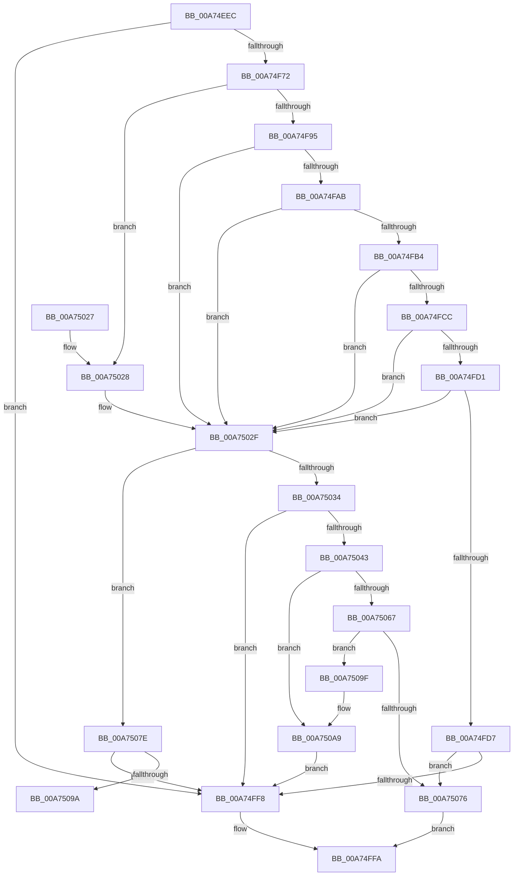

# MiGetSystemAddressForImage

- RVA: `0x00A74EEC`–`0x00A750BB` (길이 `463` bytes)
- VA: `0x0000000140A74EEC`
- 실행 섹션: `PAGE`
- PDB 이름 있음: `예`; PDB Function 태그: `예`
- unwind 정보 RVA: `0x000B5940`
- 디코드: `128`개 명령, `463/463` bytes 표시
- 미해석 바이트: `0` (있으면 어셈블리에 `.byte`로 보존)

> 이 문서는 커널 이미지의 기계어와 PDB 기호를 분석해 생성했습니다. 4번과 5번은 함수 원형과 자료형을 바이너리 사용 방식에서 추정한 C 해석이며 원본 소스 복구 결과는 아닙니다.

## 1. Dependencies

- 직접 호출 지점: **15**; 고유 호출 대상: **12**
- 직접 호출자로 확인된 함수: **1**
- RIP 상대 이미지 참조: **1**

### Outgoing calls
- `0x00A74F30` → [memset](../../text/6C/memset_function_006C6C40.md) (function, `0x006C6C40`)
- `0x00A74F40` → [memset](../../text/6C/memset_function_006C6C40.md) (function, `0x006C6C40`)
- `0x00A74F49` → [MiSectionControlArea](../../text/29/MiSectionControlArea_function_00294CB0.md) (function, `0x00294CB0`)
- `0x00A74F5F` → [MiBytesToMapSystemImage](MiBytesToMapSystemImage_function_00A750C4.md) (function, `0x00A750C4`)
- `0x00A74FB7` → [MiGetBaseLoaderPortion](../../text/4D/MiGetBaseLoaderPortion_function_004D9D34.md) (function, `0x004D9D34`)
- `0x00A74FDE` → [MiGetPteAddress](../../text/43/MiGetPteAddress_function_0043E130.md) (function, `0x0043E130`)
- `0x00A74FEF` → [MiReservePrivilegedPtes](MiReservePrivilegedPtes_function_00A75394.md) (function, `0x00A75394`)
- `0x00A75005` → [_security_check_cookie](../../text/6A/_security_check_cookie_function_006AC640.md) (function, `0x006AC640`)
- `0x00A75036` → [MiSelectSystemImageAddress](MiSelectSystemImageAddress_function_00A75110.md) (function, `0x00A75110`)
- `0x00A75046` → [MiGetPteAddress](../../text/43/MiGetPteAddress_function_0043E130.md) (function, `0x0043E130`)
- `0x00A7505E` → [MiReservePrivilegedPtes](MiReservePrivilegedPtes_function_00A75394.md) (function, `0x00A75394`)
- `0x00A7506D` → [MiAddPrivateFixupEntryForSystemImage](../../text/4B/MiAddPrivateFixupEntryForSystemImage_function_004BAA18.md) (function, `0x004BAA18`)
- `0x00A7508B` → [MiMapImageInSystemSpace](../94/MiMapImageInSystemSpace_function_00941DD8.md) (function, `0x00941DD8`)
- `0x00A750A4` → [MiReleasePrivilegedPtes](../7F/MiReleasePrivilegedPtes_function_007F9264.md) (function, `0x007F9264`)
- `0x00A750B1` → [MiReturnSystemImageAddress](MiReturnSystemImageAddress_function_00A7F190.md) (function, `0x00A7F190`)

### Direct callers
- [MmLoadSystemImageEx](../99/MmLoadSystemImageEx_function_00999B8C.md) at `0x00999D8E`

### Static image references
- `0x00A74F06` → RVA `0x00E0A740` (`.data`; read)

## 2. Other-region calls and transfers

- 다른 실행 섹션으로 향하는 call: **8**
  - `0x00A74F30` → [memset](../../text/6C/memset_function_006C6C40.md) (`PAGE` → `.text`)
  - `0x00A74F40` → [memset](../../text/6C/memset_function_006C6C40.md) (`PAGE` → `.text`)
  - `0x00A74F49` → [MiSectionControlArea](../../text/29/MiSectionControlArea_function_00294CB0.md) (`PAGE` → `.text`)
  - `0x00A74FB7` → [MiGetBaseLoaderPortion](../../text/4D/MiGetBaseLoaderPortion_function_004D9D34.md) (`PAGE` → `.text`)
  - `0x00A74FDE` → [MiGetPteAddress](../../text/43/MiGetPteAddress_function_0043E130.md) (`PAGE` → `.text`)
  - `0x00A75005` → [_security_check_cookie](../../text/6A/_security_check_cookie_function_006AC640.md) (`PAGE` → `.text`)
  - `0x00A75046` → [MiGetPteAddress](../../text/43/MiGetPteAddress_function_0043E130.md) (`PAGE` → `.text`)
  - `0x00A7506D` → [MiAddPrivateFixupEntryForSystemImage](../../text/4B/MiAddPrivateFixupEntryForSystemImage_function_004BAA18.md) (`PAGE` → `.text`)
- call이 아닌 외부 분기/꼬리 이동: **1**
  - `0x00A7509A` → [sub_00B40C48](../B4/Unknown_function_00B40C48.md) (`tail-transfer`)

## 3. Assembly (complete function range)

```asm
00A74EEC  48 89 5C 24 18                  mov qword ptr [rsp + 0x18], rbx
00A74EF1  48 89 74 24 20                  mov qword ptr [rsp + 0x20], rsi
00A74EF6  57                              push rdi
00A74EF7  41 54                           push r12
00A74EF9  41 55                           push r13
00A74EFB  41 56                           push r14
00A74EFD  41 57                           push r15
00A74EFF  48 81 EC 20 01 00 00            sub rsp, 0x120
00A74F06  48 8B 05 33 58 39 00            mov rax, qword ptr [rip + 0x395833]
00A74F0D  48 33 C4                        xor rax, rsp
00A74F10  48 89 84 24 10 01 00 00         mov qword ptr [rsp + 0x110], rax
00A74F18  44 8B E2                        mov r12d, edx
00A74F1B  4C 8B E9                        mov r13, rcx
00A74F1E  89 54 24 40                     mov dword ptr [rsp + 0x40], edx
00A74F22  33 D2                           xor edx, edx
00A74F24  44 8D 42 70                     lea r8d, [rdx + 0x70]
00A74F28  48 8D 8C 24 A0 00 00 00         lea rcx, [rsp + 0xa0]
00A74F30  E8 0B 1D C5 FF                  call 0x1406c6c40
00A74F35  33 D2                           xor edx, edx
00A74F37  44 8D 42 50                     lea r8d, [rdx + 0x50]
00A74F3B  48 8D 4C 24 50                  lea rcx, [rsp + 0x50]
00A74F40  E8 FB 1C C5 FF                  call 0x1406c6c40
00A74F45  49 8B 4D 70                     mov rcx, qword ptr [r13 + 0x70]
00A74F49  E8 62 FD 81 FF                  call 0x140294cb0
00A74F4E  4C 8B F0                        mov r14, rax
00A74F51  48 89 44 24 48                  mov qword ptr [rsp + 0x48], rax
00A74F56  48 8B 30                        mov rsi, qword ptr [rax]
00A74F59  8B 4E 08                        mov ecx, dword ptr [rsi + 8]
00A74F5C  C1 E1 0C                        shl ecx, 0xc
00A74F5F  E8 60 01 00 00                  call 0x140a750c4
00A74F64  48 8B F8                        mov rdi, rax
00A74F67  33 DB                           xor ebx, ebx
00A74F69  48 85 C0                        test rax, rax
00A74F6C  0F 84 86 00 00 00               je 0x140a74ff8
00A74F72  48 C1 EF 0C                     shr rdi, 0xc
00A74F76  89 7C 24 38                     mov dword ptr [rsp + 0x38], edi
00A74F7A  8B D3                           mov edx, ebx
00A74F7C  49 8B 4E 60                     mov rcx, qword ptr [r14 + 0x60]
00A74F80  48 83 E1 F8                     and rcx, 0xfffffffffffffff8
00A74F84  48 8B 49 20                     mov rcx, qword ptr [rcx + 0x20]
00A74F88  44 8D 7B 01                     lea r15d, [rbx + 1]
00A74F8C  48 85 C9                        test rcx, rcx
00A74F8F  0F 84 93 00 00 00               je 0x140a75028
00A74F95  45 8B C7                        mov r8d, r15d
00A74F98  44 89 7C 24 30                  mov dword ptr [rsp + 0x30], r15d
00A74F9D  41 F7 46 38 00 00 00 20         test dword ptr [r14 + 0x38], 0x20000000
00A74FA5  0F 84 84 00 00 00               je 0x140a7502f
00A74FAB  48 8B 76 20                     mov rsi, qword ptr [rsi + 0x20]
00A74FAF  48 85 F6                        test rsi, rsi
00A74FB2  74 7B                           je 0x140a7502f
00A74FB4  49 8B CD                        mov rcx, r13
00A74FB7  E8 78 4D A6 FF                  call 0x1404d9d34
00A74FBC  F6 80 B8 00 00 00 04            test byte ptr [rax + 0xb8], 4
00A74FC3  41 0F 45 D7                     cmovne edx, r15d
00A74FC7  48 85 F6                        test rsi, rsi
00A74FCA  74 63                           je 0x140a7502f
00A74FCC  41 3B D7                        cmp edx, r15d
00A74FCF  74 5E                           je 0x140a7502f
00A74FD1  41 F6 C4 02                     test r12b, 2
00A74FD5  75 58                           jne 0x140a7502f
00A74FD7  41 83 E4 20                     and r12d, 0x20
00A74FDB  48 8B CE                        mov rcx, rsi
00A74FDE  E8 4D 91 9C FF                  call 0x14043e130
00A74FE3  48 8B D0                        mov rdx, rax
00A74FE6  45 8B CC                        mov r9d, r12d
00A74FE9  44 8B C7                        mov r8d, edi
00A74FEC  49 8B CE                        mov rcx, r14
00A74FEF  E8 A0 03 00 00                  call 0x140a75394
00A74FF4  85 C0                           test eax, eax
00A74FF6  79 7E                           jns 0x140a75076
00A74FF8  33 C0                           xor eax, eax
00A74FFA  48 8B 8C 24 10 01 00 00         mov rcx, qword ptr [rsp + 0x110]
00A75002  48 33 CC                        xor rcx, rsp
00A75005  E8 36 76 C3 FF                  call 0x1406ac640
00A7500A  4C 8D 9C 24 20 01 00 00         lea r11, [rsp + 0x120]
00A75012  49 8B 5B 40                     mov rbx, qword ptr [r11 + 0x40]
00A75016  49 8B 73 48                     mov rsi, qword ptr [r11 + 0x48]
00A7501A  49 8B E3                        mov rsp, r11
00A7501D  41 5F                           pop r15
00A7501F  41 5E                           pop r14
00A75021  41 5D                           pop r13
00A75023  41 5C                           pop r12
00A75025  5F                              pop rdi
00A75026  C3                              ret
00A75027  CC                              int3
00A75028  44 8B C3                        mov r8d, ebx
00A7502B  89 5C 24 30                     mov dword ptr [rsp + 0x30], ebx
00A7502F  45 85 C0                        test r8d, r8d
00A75032  74 4A                           je 0x140a7507e
00A75034  8B CF                           mov ecx, edi
00A75036  E8 D5 00 00 00                  call 0x140a75110
00A7503B  48 8B F0                        mov rsi, rax
00A7503E  48 85 C0                        test rax, rax
00A75041  74 B5                           je 0x140a74ff8
00A75043  48 8B C8                        mov rcx, rax
00A75046  E8 E5 90 9C FF                  call 0x14043e130
00A7504B  4C 8B F8                        mov r15, rax
00A7504E  41 83 E4 20                     and r12d, 0x20
00A75052  45 8B CC                        mov r9d, r12d
00A75055  44 8B C7                        mov r8d, edi
00A75058  48 8B D0                        mov rdx, rax
00A7505B  49 8B CE                        mov rcx, r14
00A7505E  E8 31 03 00 00                  call 0x140a75394
00A75063  85 C0                           test eax, eax
00A75065  78 42                           js 0x140a750a9
00A75067  48 8B D6                        mov rdx, rsi
00A7506A  49 8B CE                        mov rcx, r14
00A7506D  E8 A6 59 A4 FF                  call 0x1404baa18
00A75072  85 C0                           test eax, eax
00A75074  74 29                           je 0x140a7509f
00A75076  48 8B C6                        mov rax, rsi
00A75079  E9 7C FF FF FF                  jmp 0x140a74ffa
00A7507E  4C 8D 44 24 50                  lea r8, [rsp + 0x50]
00A75083  BA 03 00 00 00                  mov edx, 3
00A75088  49 8B CE                        mov rcx, r14
00A7508B  E8 48 CD EC FF                  call 0x140941dd8
00A75090  8B F0                           mov esi, eax
00A75092  85 C0                           test eax, eax
00A75094  0F 88 5E FF FF FF               js 0x140a74ff8
00A7509A  E9 A9 BB 0C 00                  jmp 0x140b40c48
00A7509F  8B D7                           mov edx, edi
00A750A1  49 8B CF                        mov rcx, r15
00A750A4  E8 BB 41 D8 FF                  call 0x1407f9264
00A750A9  C1 E7 0C                        shl edi, 0xc
00A750AC  8B D7                           mov edx, edi
00A750AE  48 8B CE                        mov rcx, rsi
00A750B1  E8 DA A0 00 00                  call 0x140a7f190
00A750B6  E9 3D FF FF FF                  jmp 0x140a74ff8
```

## 4. C-style interpretation (structured pseudocode)

```c
__int64 __fastcall MiGetSystemAddressForImage(__int64 a1, int a2)
{
    __int64 result;
    __int64 v_r12;
    __int64 v_rbx;
    __int64 v_rdi;
    __int64 v_rsp;
    unsigned __int64 v_stack_m100;
    unsigned int v_stack_m108;
    unsigned int v_stack_m110;
    unsigned int v_stack_m118;
    unsigned __int64 v_stack_m28;
    unsigned __int64 v_stack_m38;
    unsigned __int64 v_stack_mA8;
    unsigned __int64 v_stack_mD0;
    unsigned int v_stack_mF0;
    unsigned __int64 v_stack_mF8;
    unsigned __int64 v_stack_p18;
    unsigned __int64 v_stack_p20;

    v_stack_p18 = v_rbx;
    v_stack_p20 = v_rsi;
    v_rsp = (v_rsp) - (288);
    result = (*(unsigned __int64 *)(v_rip + 3758131)) ^ (v_rsp);
    v_stack_m38 = result;
    v_stack_m108 = a2;
    a2 = 0;
    result = memset(v_stack_mA8, a2, a2 + 112, a4);
    a2 = 0;
    result = memset(v_stack_mF8, a2, a2 + 80, a4);
    result = MiSectionControlArea(*(unsigned __int64 *)(a1 + 112), a2, a2 + 80, a4);
    v_stack_m100 = result;
    a1 = (unsigned int)(((unsigned int)(*(unsigned int *)(*(unsigned __int64 *)(result) + 8))) << (12));
    result = MiBytesToMapSystemImage(a1, a2, a2 + 80, a4);
    v_rbx = 0;
    if (result == 0) goto loc_00A74FF8;
    v_rdi = (result) >> (12);
    v_stack_m110 = (unsigned int)(v_rdi);
    a1 = (*(unsigned __int64 *)(result + 96)) & (-8);
    if (*(unsigned __int64 *)(a1 + 32) == 0) goto loc_00A75028;
    v_stack_m118 = (unsigned int)(v_rbx + 1);
    if (((*(unsigned int *)(result + 56)) & (0x20000000ULL)) == 0) goto loc_00A7502F;
    if (*(unsigned __int64 *)(*(unsigned __int64 *)(result) + 32) == 0) goto loc_00A7502F;
    result = MiGetBaseLoaderPortion(a1, 0, (unsigned int)((unsigned int)(v_rbx + 1)), a4);
    a2 = 0;
    if (((*(unsigned __int8 *)(result + 184)) & (4)) != 0) { a2 = (unsigned int)(v_rbx + 1); }
    if (*(unsigned __int64 *)(*(unsigned __int64 *)(result) + 32) == 0) goto loc_00A7502F;
    if (a2 == ((unsigned int)(v_rbx + 1))) goto loc_00A7502F;
    if ((((unsigned __int8)((unsigned int)(a2))) & (2)) != 0) goto loc_00A7502F;
    v_r12 = (unsigned int)(((unsigned int)(a2)) & (32));
    result = MiGetPteAddress(*(unsigned __int64 *)(*(unsigned __int64 *)(result) + 32), a2, (unsigned int)((unsigned int)(v_rbx + 1)), a4);
    result = MiReservePrivilegedPtes(result, result, (unsigned int)((unsigned int)(v_rdi)), (unsigned int)((unsigned int)(v_r12)));
    if (!sign_flag) goto loc_00A75076;
loc_00A74FF8:
    result = 0;
loc_00A74FFA:
    a1 = (v_stack_m38) ^ (v_rsp);
    result = _security_check_cookie(a1, result, (unsigned int)((unsigned int)(v_rdi)), (unsigned int)((unsigned int)(v_r12)));
    return result;
loc_00A75028:
    v_stack_mF0 = (unsigned int)(*(unsigned __int64 *)(v_stack_m28 + 64));
loc_00A7502F:
    if ((unsigned int)((unsigned int)((unsigned int)(*(unsigned __int64 *)(v_stack_m28 + 64)))) == 0) goto loc_00A7507E;
    result = MiSelectSystemImageAddress((unsigned int)((unsigned int)(v_rdi)), result, (unsigned int)((unsigned int)(*(unsigned __int64 *)(v_stack_m28 + 64))), (unsigned int)((unsigned int)(v_r12)));
    if (result == 0) goto loc_00A74FF8;
    result = MiGetPteAddress(result, result, (unsigned int)((unsigned int)(*(unsigned __int64 *)(v_stack_m28 + 64))), (unsigned int)((unsigned int)(v_r12)));
    v_r12 = (unsigned int)((v_r12) & (32));
    result = MiReservePrivilegedPtes(result, result, (unsigned int)((unsigned int)(v_rdi)), (unsigned int)((unsigned int)(v_r12)));
    if (sign_flag) goto loc_00A750A9;
    result = MiAddPrivateFixupEntryForSystemImage(result, result, (unsigned int)((unsigned int)(v_rdi)), (unsigned int)((unsigned int)(v_r12)));
    if ((unsigned int)(result) == 0) goto loc_00A7509F;
loc_00A75076:
    goto loc_00A74FFA;
loc_00A7507E:
    result = MiMapImageInSystemSpace(result, 3, v_stack_mD0, (unsigned int)((unsigned int)(v_r12)));
    if (sign_flag) goto loc_00A74FF8;
loc_00A7509F:
    result = MiReleasePrivilegedPtes(result, (unsigned int)((unsigned int)(v_rdi)), v_stack_mD0, (unsigned int)((unsigned int)(v_r12)));
loc_00A750A9:
    v_rdi = (unsigned int)((v_rdi) << (12));
    result = MiReturnSystemImageAddress((unsigned int)((unsigned int)(result)), (unsigned int)((unsigned int)(v_rdi)), v_stack_mD0, (unsigned int)((unsigned int)(v_r12)));
    goto loc_00A74FF8;
}
```

## 5. (Beta) C Style

```c
int64_t MiGetSystemAddressForImage(void *Arg1, int32_t Arg2)
{
    uint8_t *arg1 = (uint8_t *)Arg1;

    int64_t result;
    int64_t local_r12;
    int64_t local_rbx;
    int64_t local_rdi;
    int64_t local_rsp;
    uint64_t v_stack_m100;
    uint32_t v_stack_m108;
    uint32_t v_stack_m110;
    uint32_t v_stack_m118;
    uint64_t v_stack_m28;
    uint64_t v_stack_m38;
    uint64_t v_stack_mA8;
    uint64_t v_stack_mD0;
    uint32_t v_stack_mF0;
    uint64_t v_stack_mF8;
    uint64_t v_stack_p18;
    uint64_t v_stack_p20;

    v_stack_p18 = local_rbx;
    v_stack_p20 = local_rsi;
    local_rsp = (local_rsp) - (288);
    result = (*(uint64_t *)(v_rip + 0x395833)) ^ (local_rsp);
    v_stack_m38 = result;
    v_stack_m108 = Arg2;
    Arg2 = 0;
    result = memset(v_stack_mA8, Arg2, Arg2 + 112, a4);
    Arg2 = 0;
    result = memset(v_stack_mF8, Arg2, Arg2 + 80, a4);
    result = MiSectionControlArea(*(uint64_t *)(arg1 + 0x70), Arg2, Arg2 + 80, a4);
    v_stack_m100 = result;
    Arg1 = (uint32_t)(((uint32_t)(*(uint32_t *)(*(uint64_t *)(result) + 0x8))) << (12));
    result = MiBytesToMapSystemImage(Arg1, Arg2, Arg2 + 80, a4);
    local_rbx = 0;
    if (result == 0) goto loc_00A74FF8;
    local_rdi = (result) >> (12);
    v_stack_m110 = (uint32_t)(local_rdi);
    Arg1 = (*(uint64_t *)(result + 0x60)) & (-8);
    if (*(uint64_t *)(arg1 + 0x20) == 0) goto loc_00A75028;
    v_stack_m118 = (uint32_t)(local_rbx + 1);
    if (((*(uint32_t *)(result + 0x38)) & (0x20000000ULL)) == 0) goto loc_00A7502F;
    if (*(uint64_t *)(*(uint64_t *)(result) + 0x20) == 0) goto loc_00A7502F;
    result = MiGetBaseLoaderPortion(Arg1, 0, (uint32_t)((uint32_t)(local_rbx + 1)), a4);
    Arg2 = 0;
    if (((*(uint8_t *)(result + 0xB8)) & (4)) != 0) { Arg2 = (uint32_t)(local_rbx + 1); }
    if (*(uint64_t *)(*(uint64_t *)(result) + 0x20) == 0) goto loc_00A7502F;
    if (Arg2 == ((uint32_t)(local_rbx + 1))) goto loc_00A7502F;
    if ((((uint8_t)((uint32_t)(Arg2))) & (2)) != 0) goto loc_00A7502F;
    local_r12 = (uint32_t)(((uint32_t)(Arg2)) & (32));
    result = MiGetPteAddress(*(uint64_t *)(*(uint64_t *)(result) + 0x20), Arg2, (uint32_t)((uint32_t)(local_rbx + 1)), a4);
    result = MiReservePrivilegedPtes(result, result, (uint32_t)((uint32_t)(local_rdi)), (uint32_t)((uint32_t)(local_r12)));
    if (!sign_flag) goto loc_00A75076;
loc_00A74FF8:
    result = 0;
loc_00A74FFA:
    Arg1 = (v_stack_m38) ^ (local_rsp);
    result = _security_check_cookie(Arg1, result, (uint32_t)((uint32_t)(local_rdi)), (uint32_t)((uint32_t)(local_r12)));
    return result;
loc_00A75028:
    v_stack_mF0 = (uint32_t)(*(uint64_t *)(v_stack_m28 + 0x40));
loc_00A7502F:
    if ((uint32_t)((uint32_t)((uint32_t)(*(uint64_t *)(v_stack_m28 + 0x40)))) == 0) goto loc_00A7507E;
    result = MiSelectSystemImageAddress((uint32_t)((uint32_t)(local_rdi)), result, (uint32_t)((uint32_t)(*(uint64_t *)(v_stack_m28 + 0x40))), (uint32_t)((uint32_t)(local_r12)));
    if (result == 0) goto loc_00A74FF8;
    result = MiGetPteAddress(result, result, (uint32_t)((uint32_t)(*(uint64_t *)(v_stack_m28 + 0x40))), (uint32_t)((uint32_t)(local_r12)));
    local_r12 = (uint32_t)((local_r12) & (32));
    result = MiReservePrivilegedPtes(result, result, (uint32_t)((uint32_t)(local_rdi)), (uint32_t)((uint32_t)(local_r12)));
    if (sign_flag) goto loc_00A750A9;
    result = MiAddPrivateFixupEntryForSystemImage(result, result, (uint32_t)((uint32_t)(local_rdi)), (uint32_t)((uint32_t)(local_r12)));
    if ((uint32_t)(result) == 0) goto loc_00A7509F;
loc_00A75076:
    goto loc_00A74FFA;
loc_00A7507E:
    result = MiMapImageInSystemSpace(result, 3, v_stack_mD0, (uint32_t)((uint32_t)(local_r12)));
    if (sign_flag) goto loc_00A74FF8;
loc_00A7509F:
    result = MiReleasePrivilegedPtes(result, (uint32_t)((uint32_t)(local_rdi)), v_stack_mD0, (uint32_t)((uint32_t)(local_r12)));
loc_00A750A9:
    local_rdi = (uint32_t)((local_rdi) << (12));
    result = MiReturnSystemImageAddress((uint32_t)((uint32_t)(result)), (uint32_t)((uint32_t)(local_rdi)), v_stack_mD0, (uint32_t)((uint32_t)(local_r12)));
    goto loc_00A74FF8;
}
```

### 관측된 메모리 오프셋

구조체 형식이 확인되지 않은 접근은 인자 기준의 오프셋으로만 기록했습니다.

| 기준 인자 | 오프셋 표현 | 폭 (bit) | 접근 |
|---|---:|---:|---|
| `Arg1` | `+ 0x70` | `64` | `R` |

## 6. Execution-region graph

[열기: 2D/3D 그래프와 함수 탐색 컨트롤 패널](../../../control-panel.html?section=page&rva=0x00A74EEC&view=graph)

- 2D 그래프는 위에서 아래로 흐르고, 3D 그래프는 빈 공간을 드래그해 회전합니다. Shift+드래그는 이동, 휠은 확대·축소, 함수 노드 선택은 대상 보고서 이동입니다.

### Static fallback


