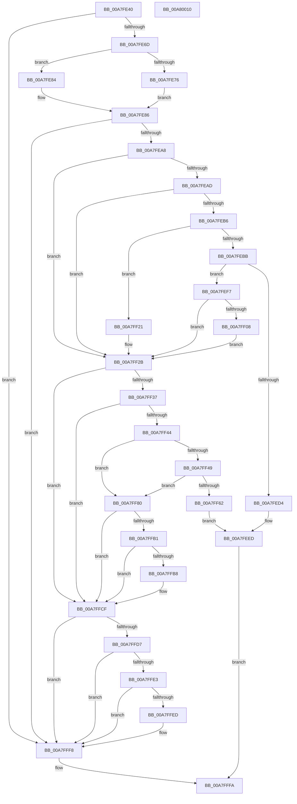

# MiProcessKernelCfgImageLoadConfig

- RVA: `0x00A7FE40`–`0x00A80011` (길이 `465` bytes)
- VA: `0x0000000140A7FE40`
- 실행 섹션: `PAGE`
- PDB 이름 있음: `예`; PDB Function 태그: `아니요`
- unwind 정보 RVA: `0x0008CED4`
- 디코드: `111`개 명령, `465/465` bytes 표시
- 미해석 바이트: `0` (있으면 어셈블리에 `.byte`로 보존)

> 이 문서는 커널 이미지의 기계어와 PDB 기호를 분석해 생성했습니다. 4번과 5번은 함수 원형과 자료형을 바이너리 사용 방식에서 추정한 C 해석이며 원본 소스 복구 결과는 아닙니다.

## 1. Dependencies

- 직접 호출 지점: **9**; 고유 호출 대상: **5**
- 직접 호출자로 확인된 함수: **2**
- RIP 상대 이미지 참조: **8**

### Outgoing calls
- `0x00A7FE76` → [MiSectionControlArea](../../text/29/MiSectionControlArea_function_00294CB0.md) (function, `0x00294CB0`)
- `0x00A7FE97` → [RtlImageDirectoryEntryToData](../../text/43/RtlImageDirectoryEntryToData_function_004328D0.md) (function, `0x004328D0`)
- `0x00A7FECB` → [MiSetImageProtection](../../text/38/MiSetImageProtection_function_003843D0.md) (function, `0x003843D0`)
- `0x00A7FEDE` → [MiLogStrongCodeDriverLoadFailure](../AC/MiLogStrongCodeDriverLoadFailure_function_00AC2E6C.md) (function, `0x00AC2E6C`)
- `0x00A7FF1A` → [MiSetImageProtection](../../text/38/MiSetImageProtection_function_003843D0.md) (function, `0x003843D0`)
- `0x00A7FF59` → [MiSetImageProtection](../../text/38/MiSetImageProtection_function_003843D0.md) (function, `0x003843D0`)
- `0x00A7FF6C` → [MiLogStrongCodeDriverLoadFailure](../AC/MiLogStrongCodeDriverLoadFailure_function_00AC2E6C.md) (function, `0x00AC2E6C`)
- `0x00A7FFCA` → [MiSetImageProtection](../../text/38/MiSetImageProtection_function_003843D0.md) (function, `0x003843D0`)
- `0x00A7FFF3` → [MiCheckForDiscardableLongJumpTable](../../text/68/MiCheckForDiscardableLongJumpTable_function_0068F748.md) (function, `0x0068F748`)

### Direct callers
- [MiProcessLoadConfigForDriver](MiProcessLoadConfigForDriver_function_00A7FCE4.md) at `0x00A7FCFC`
- [MiInitializeKernelCfgImages](../../init/C6/MiInitializeKernelCfgImages_function_00C6A430.md) at `0x00C6A4C1`

### Static image references
- `0x00A7FE5C` → RVA `0x00FC6A88` (`ALMOSTRO`; read)
- `0x00A7FED7` → RVA `0x00B0A0A0` (` ?? ::NNGAKEGL::`string'`; read)
- `0x00A7FEE3` → RVA `0x00E2D7F8` (`.data`; write)
- `0x00A7FEF7` → RVA `0x006BAA80` (`guard_check_icall`; read)
- `0x00A7FF80` → RVA `0x006BAAD0` (`guard_dispatch_icall`; read)
- `0x00A7FF8A` → RVA `0x00BCE7C0` (`KscpCfgDispatchUserCallTargetEsNoSmep`; read)
- `0x00A7FF91` → RVA `0x00FC6B30` (`ALMOSTRO`; read)
- `0x00A7FF98` → RVA `0x00BCE760` (`KscpCfgDispatchUserCallTargetEsSmep`; read)

## 2. Other-region calls and transfers

- 다른 실행 섹션으로 향하는 call: **7**
  - `0x00A7FE76` → [MiSectionControlArea](../../text/29/MiSectionControlArea_function_00294CB0.md) (`PAGE` → `.text`)
  - `0x00A7FE97` → [RtlImageDirectoryEntryToData](../../text/43/RtlImageDirectoryEntryToData_function_004328D0.md) (`PAGE` → `.text`)
  - `0x00A7FECB` → [MiSetImageProtection](../../text/38/MiSetImageProtection_function_003843D0.md) (`PAGE` → `.text`)
  - `0x00A7FF1A` → [MiSetImageProtection](../../text/38/MiSetImageProtection_function_003843D0.md) (`PAGE` → `.text`)
  - `0x00A7FF59` → [MiSetImageProtection](../../text/38/MiSetImageProtection_function_003843D0.md) (`PAGE` → `.text`)
  - `0x00A7FFCA` → [MiSetImageProtection](../../text/38/MiSetImageProtection_function_003843D0.md) (`PAGE` → `.text`)
  - `0x00A7FFF3` → [MiCheckForDiscardableLongJumpTable](../../text/68/MiCheckForDiscardableLongJumpTable_function_0068F748.md) (`PAGE` → `.text`)
- 별도 외부 분기/꼬리 이동을 확인하지 못했습니다.

## 3. Assembly (complete function range)

```asm
00A7FE40  48 8B C4                        mov rax, rsp
00A7FE43  48 89 58 08                     mov qword ptr [rax + 8], rbx
00A7FE47  48 89 70 18                     mov qword ptr [rax + 0x18], rsi
00A7FE4B  48 89 78 20                     mov qword ptr [rax + 0x20], rdi
00A7FE4F  41 56                           push r14
00A7FE51  48 83 EC 20                     sub rsp, 0x20
00A7FE55  83 60 10 00                     and dword ptr [rax + 0x10], 0
00A7FE59  48 8B F9                        mov rdi, rcx
00A7FE5C  48 F7 05 21 6C 54 00 00 00 04 00  test qword ptr [rip + 0x546c21], 0x40000
00A7FE67  0F 84 8B 01 00 00               je 0x140a7fff8
00A7FE6D  48 8B 49 70                     mov rcx, qword ptr [rcx + 0x70]
00A7FE71  48 85 C9                        test rcx, rcx
00A7FE74  74 0E                           je 0x140a7fe84
00A7FE76  E8 35 4E 81 FF                  call 0x140294cb0
00A7FE7B  48 8D B0 80 00 00 00            lea rsi, [rax + 0x80]
00A7FE82  EB 02                           jmp 0x140a7fe86
00A7FE84  33 F6                           xor esi, esi
00A7FE86  48 8B 4F 30                     mov rcx, qword ptr [rdi + 0x30]
00A7FE8A  4C 8D 4C 24 38                  lea r9, [rsp + 0x38]
00A7FE8F  41 B8 0A 00 00 00               mov r8d, 0xa
00A7FE95  B2 01                           mov dl, 1
00A7FE97  E8 34 2A 9B FF                  call 0x1404328d0
00A7FE9C  48 8B D8                        mov rbx, rax
00A7FE9F  48 85 C0                        test rax, rax
00A7FEA2  0F 84 50 01 00 00               je 0x140a7fff8
00A7FEA8  83 38 78                        cmp dword ptr [rax], 0x78
00A7FEAB  72 7E                           jb 0x140a7ff2b
00A7FEAD  4C 8B 70 70                     mov r14, qword ptr [rax + 0x70]
00A7FEB1  4D 85 F6                        test r14, r14
00A7FEB4  74 75                           je 0x140a7ff2b
00A7FEB6  48 85 F6                        test rsi, rsi
00A7FEB9  74 66                           je 0x140a7ff21
00A7FEBB  41 B9 04 00 00 00               mov r9d, 4
00A7FEC1  49 8B D6                        mov rdx, r14
00A7FEC4  48 8B CF                        mov rcx, rdi
00A7FEC7  45 8D 41 04                     lea r8d, [r9 + 4]
00A7FECB  E8 00 45 90 FF                  call 0x1403843d0
00A7FED0  85 C0                           test eax, eax
00A7FED2  75 23                           jne 0x140a7fef7
00A7FED4  48 8B D7                        mov rdx, rdi
00A7FED7  48 8D 0D C2 A1 08 00            lea rcx, [rip + 0x8a1c2]
00A7FEDE  E8 89 2F 04 00                  call 0x140ac2e6c
00A7FEE3  C7 05 0B D9 3A 00 67 00 00 00   mov dword ptr [rip + 0x3ad90b], 0x67
00A7FEED  B8 7B 00 00 C0                  mov eax, 0xc000007b
00A7FEF2  E9 03 01 00 00                  jmp 0x140a7fffa
00A7FEF7  48 8D 05 82 AB C3 FF            lea rax, [rip - 0x3c547e]
00A7FEFE  49 89 06                        mov qword ptr [r14], rax
00A7FF01  48 83 7E 10 00                  cmp qword ptr [rsi + 0x10], 0
00A7FF06  74 23                           je 0x140a7ff2b
00A7FF08  41 B9 00 01 00 00               mov r9d, 0x100
00A7FF0E  41 B8 08 00 00 00               mov r8d, 8
00A7FF14  49 8B D6                        mov rdx, r14
00A7FF17  48 8B CF                        mov rcx, rdi
00A7FF1A  E8 B1 44 90 FF                  call 0x1403843d0
00A7FF1F  EB 0A                           jmp 0x140a7ff2b
00A7FF21  48 8D 05 58 AB C3 FF            lea rax, [rip - 0x3c54a8]
00A7FF28  49 89 06                        mov qword ptr [r14], rax
00A7FF2B  81 3B 80 00 00 00               cmp dword ptr [rbx], 0x80
00A7FF31  0F 82 98 00 00 00               jb 0x140a7ffcf
00A7FF37  4C 8B 73 78                     mov r14, qword ptr [rbx + 0x78]
00A7FF3B  4D 85 F6                        test r14, r14
00A7FF3E  0F 84 8B 00 00 00               je 0x140a7ffcf
00A7FF44  48 85 F6                        test rsi, rsi
00A7FF47  74 37                           je 0x140a7ff80
00A7FF49  41 B9 04 00 00 00               mov r9d, 4
00A7FF4F  49 8B D6                        mov rdx, r14
00A7FF52  48 8B CF                        mov rcx, rdi
00A7FF55  45 8D 41 04                     lea r8d, [r9 + 4]
00A7FF59  E8 72 44 90 FF                  call 0x1403843d0
00A7FF5E  85 C0                           test eax, eax
00A7FF60  75 1E                           jne 0x140a7ff80
00A7FF62  48 8B D7                        mov rdx, rdi
00A7FF65  48 8D 0D 34 A1 08 00            lea rcx, [rip + 0x8a134]
00A7FF6C  E8 FB 2E 04 00                  call 0x140ac2e6c
00A7FF71  C7 05 7D D8 3A 00 68 00 00 00   mov dword ptr [rip + 0x3ad87d], 0x68
00A7FF7B  E9 6D FF FF FF                  jmp 0x140a7feed
00A7FF80  48 8D 05 49 AB C3 FF            lea rax, [rip - 0x3c54b7]
00A7FF87  49 89 06                        mov qword ptr [r14], rax
00A7FF8A  48 8D 15 2F E8 14 00            lea rdx, [rip + 0x14e82f]
00A7FF91  48 8B 0D 98 6B 54 00            mov rcx, qword ptr [rip + 0x546b98]
00A7FF98  48 8D 05 C1 E7 14 00            lea rax, [rip + 0x14e7c1]
00A7FF9F  83 E1 01                        and ecx, 1
00A7FFA2  48 85 C9                        test rcx, rcx
00A7FFA5  48 0F 44 C2                     cmove rax, rdx
00A7FFA9  49 89 06                        mov qword ptr [r14], rax
00A7FFAC  48 85 F6                        test rsi, rsi
00A7FFAF  74 1E                           je 0x140a7ffcf
00A7FFB1  48 83 7E 10 00                  cmp qword ptr [rsi + 0x10], 0
00A7FFB6  74 17                           je 0x140a7ffcf
00A7FFB8  41 B9 00 01 00 00               mov r9d, 0x100
00A7FFBE  41 B8 08 00 00 00               mov r8d, 8
00A7FFC4  49 8B D6                        mov rdx, r14
00A7FFC7  48 8B CF                        mov rcx, rdi
00A7FFCA  E8 01 44 90 FF                  call 0x1403843d0
00A7FFCF  81 3B C0 00 00 00               cmp dword ptr [rbx], 0xc0
00A7FFD5  72 21                           jb 0x140a7fff8
00A7FFD7  F7 83 90 00 00 00 00 00 01 00   test dword ptr [rbx + 0x90], 0x10000
00A7FFE1  74 15                           je 0x140a7fff8
00A7FFE3  48 83 BB B8 00 00 00 00         cmp qword ptr [rbx + 0xb8], 0
00A7FFEB  74 0B                           je 0x140a7fff8
00A7FFED  48 8B D3                        mov rdx, rbx
00A7FFF0  48 8B CF                        mov rcx, rdi
00A7FFF3  E8 50 F7 C0 FF                  call 0x14068f748
00A7FFF8  33 C0                           xor eax, eax
00A7FFFA  48 8B 5C 24 30                  mov rbx, qword ptr [rsp + 0x30]
00A7FFFF  48 8B 74 24 40                  mov rsi, qword ptr [rsp + 0x40]
00A80004  48 8B 7C 24 48                  mov rdi, qword ptr [rsp + 0x48]
00A80009  48 83 C4 20                     add rsp, 0x20
00A8000D  41 5E                           pop r14
00A8000F  C3                              ret
00A80010  CC                              int3
```

## 4. C-style interpretation (structured pseudocode)

```c
__int64 __fastcall MiProcessKernelCfgImageLoadConfig(__int64 a1)
{
    __int64 result;
    __int64 v_rsi;
    __int64 v_rsp;
    unsigned __int64 v_stack_p10;
    unsigned __int64 v_stack_p18;
    unsigned __int64 v_stack_p20;
    unsigned __int64 v_stack_p8;

    *(unsigned __int64 *)(v_rsp + 8) = v_rbx;
    *(unsigned __int64 *)(v_rsp + 24) = v_rsi;
    *(unsigned __int64 *)(v_rsp + 32) = v_rdi;
    v_rsp = (v_rsp) - (32);
    if (((*(unsigned __int64 *)(v_rip + 5532705)) & (0x40000ULL)) == 0) goto loc_00A7FFF8;
    if (*(unsigned __int64 *)(a1 + 112) == 0) goto loc_00A7FE84;
    result = MiSectionControlArea(*(unsigned __int64 *)(a1 + 112), a2, a3, a4);
    goto loc_00A7FE86;
loc_00A7FE84:
    v_rsi = 0;
loc_00A7FE86:
    result = RtlImageDirectoryEntryToData(*(unsigned __int64 *)(a1 + 48), 1, 10, v_stack_p10);
    if (result == 0) goto loc_00A7FFF8;
    if ((*(unsigned int *)(result)) < 120) goto loc_00A7FF2B;
    if (*(unsigned __int64 *)(result + 112) == 0) goto loc_00A7FF2B;
    if (0 == 0) goto loc_00A7FF21;
    result = MiSetImageProtection(a1, *(unsigned __int64 *)(result + 112), 4 + 4, 4);
    if ((unsigned int)(result) != 0) goto loc_00A7FEF7;
    result = MiLogStrongCodeDriverLoadFailure(v_rip + 565698, a1, 4 + 4, 4);
    *(unsigned int *)(v_rip + 3856651) = 103;
loc_00A7FEED:
    goto loc_00A7FFFA;
loc_00A7FEF7:
    *(unsigned __int64 *)(*(unsigned __int64 *)(result + 112)) = v_rip - 3953790;
    if ((*(unsigned __int64 *)(v_rsi + 16)) == 0) goto loc_00A7FF2B;
    result = MiSetImageProtection(a1, *(unsigned __int64 *)(result + 112), 8, 256);
    goto loc_00A7FF2B;
loc_00A7FF21:
    *(unsigned __int64 *)(*(unsigned __int64 *)(result + 112)) = v_rip - 3953832;
loc_00A7FF2B:
    if ((*(unsigned int *)(result)) < 128) goto loc_00A7FFCF;
    if (*(unsigned __int64 *)(result + 120) == 0) goto loc_00A7FFCF;
    if (0 == 0) goto loc_00A7FF80;
    result = MiSetImageProtection(a1, *(unsigned __int64 *)(result + 120), 4 + 4, 4);
    if ((unsigned int)(result) != 0) goto loc_00A7FF80;
    result = MiLogStrongCodeDriverLoadFailure(v_rip + 565556, a1, 4 + 4, 4);
    *(unsigned int *)(v_rip + 3856509) = 104;
    goto loc_00A7FEED;
loc_00A7FF80:
    *(unsigned __int64 *)(*(unsigned __int64 *)(result + 120)) = v_rip - 3953847;
    a1 = (unsigned int)((*(unsigned __int64 *)(v_rip + 5532568)) & (1));
    result = v_rip + 1370049;
    if (a1 == 0) { result = v_rip + 1370159; }
    *(unsigned __int64 *)(*(unsigned __int64 *)(result + 120)) = result;
    if (0 == 0) goto loc_00A7FFCF;
    if ((*(unsigned __int64 *)(v_rsi + 16)) != 0) {
        a4 = 256;
        a3 = 8;
        a2 = *(unsigned __int64 *)(result + 120);
        a1 = a1;
        result = MiSetImageProtection(a1, a2, a3, a4);
    }
    if ((*(unsigned int *)(result)) < 192) goto loc_00A7FFF8;
    if (((*(unsigned int *)(result + 144)) & (0x10000ULL)) == 0) goto loc_00A7FFF8;
    if ((*(unsigned __int64 *)(result + 184)) != 0) {
        a2 = result;
        a1 = a1;
        result = MiCheckForDiscardableLongJumpTable(a1, a2, a3, a4);
    }
    result = 0;
loc_00A7FFFA:
    v_rsp = (v_rsp) + (32);
    return result;
}
```

## 5. (Beta) C Style

```c
int64_t MiProcessKernelCfgImageLoadConfig(void *Arg1)
{
    uint8_t *arg1 = (uint8_t *)Arg1;

    int64_t result;
    int64_t local_rsi;
    int64_t local_rsp;
    uint64_t v_stack_p10;
    uint64_t v_stack_p18;
    uint64_t v_stack_p20;
    uint64_t v_stack_p8;

    *(uint64_t *)(local_rsp + 0x8) = local_rbx;
    *(uint64_t *)(local_rsp + 0x18) = local_rsi;
    *(uint64_t *)(local_rsp + 0x20) = local_rdi;
    local_rsp = (local_rsp) - (32);
    if (((*(uint64_t *)(v_rip + 0x546C21)) & (0x40000ULL)) == 0) goto loc_00A7FFF8;
    if (*(uint64_t *)(arg1 + 0x70) == 0) goto loc_00A7FE84;
    result = MiSectionControlArea(*(uint64_t *)(arg1 + 0x70), a2, a3, a4);
    goto loc_00A7FE86;
loc_00A7FE84:
    local_rsi = 0;
loc_00A7FE86:
    result = RtlImageDirectoryEntryToData(*(uint64_t *)(arg1 + 0x30), 1, 10, v_stack_p10);
    if (result == 0) goto loc_00A7FFF8;
    if ((*(uint32_t *)(result)) < 120) goto loc_00A7FF2B;
    if (*(uint64_t *)(result + 0x70) == 0) goto loc_00A7FF2B;
    if (0 == 0) goto loc_00A7FF21;
    result = MiSetImageProtection(Arg1, *(uint64_t *)(result + 0x70), 4 + 4, 4);
    if ((uint32_t)(result) != 0) goto loc_00A7FEF7;
    result = MiLogStrongCodeDriverLoadFailure(v_rip + 565698, Arg1, 4 + 4, 4);
    *(uint32_t *)(v_rip + 0x3AD90B) = 103;
loc_00A7FEED:
    goto loc_00A7FFFA;
loc_00A7FEF7:
    *(uint64_t *)(*(uint64_t *)(result + 0x70)) = v_rip - 3953790;
    if ((*(uint64_t *)(local_rsi + 0x10)) == 0) goto loc_00A7FF2B;
    result = MiSetImageProtection(Arg1, *(uint64_t *)(result + 0x70), 8, 256);
    goto loc_00A7FF2B;
loc_00A7FF21:
    *(uint64_t *)(*(uint64_t *)(result + 0x70)) = v_rip - 3953832;
loc_00A7FF2B:
    if ((*(uint32_t *)(result)) < 128) goto loc_00A7FFCF;
    if (*(uint64_t *)(result + 0x78) == 0) goto loc_00A7FFCF;
    if (0 == 0) goto loc_00A7FF80;
    result = MiSetImageProtection(Arg1, *(uint64_t *)(result + 0x78), 4 + 4, 4);
    if ((uint32_t)(result) != 0) goto loc_00A7FF80;
    result = MiLogStrongCodeDriverLoadFailure(v_rip + 565556, Arg1, 4 + 4, 4);
    *(uint32_t *)(v_rip + 0x3AD87D) = 104;
    goto loc_00A7FEED;
loc_00A7FF80:
    *(uint64_t *)(*(uint64_t *)(result + 0x78)) = v_rip - 3953847;
    Arg1 = (uint32_t)((*(uint64_t *)(v_rip + 0x546B98)) & (1));
    result = v_rip + 1370049;
    if (Arg1 == NULL) { result = v_rip + 1370159; }
    *(uint64_t *)(*(uint64_t *)(result + 0x78)) = result;
    if (0 == 0) goto loc_00A7FFCF;
    if ((*(uint64_t *)(local_rsi + 0x10)) != 0) {
        a4 = 256;
        a3 = 8;
        a2 = *(uint64_t *)(result + 0x78);
        Arg1 = Arg1;
        result = MiSetImageProtection(Arg1, a2, a3, a4);
    }
    if ((*(uint32_t *)(result)) < 192) goto loc_00A7FFF8;
    if (((*(uint32_t *)(result + 0x90)) & (0x10000ULL)) == 0) goto loc_00A7FFF8;
    if ((*(uint64_t *)(result + 0xB8)) != 0) {
        a2 = result;
        Arg1 = Arg1;
        result = MiCheckForDiscardableLongJumpTable(Arg1, a2, a3, a4);
    }
    result = 0;
loc_00A7FFFA:
    local_rsp = (local_rsp) + (32);
    return result;
}
```

### 관측된 메모리 오프셋

구조체 형식이 확인되지 않은 접근은 인자 기준의 오프셋으로만 기록했습니다.

| 기준 인자 | 오프셋 표현 | 폭 (bit) | 접근 |
|---|---:|---:|---|
| `Arg1` | `+ 0x30` | `64` | `R` |
| `Arg1` | `+ 0x70` | `64` | `R` |

## 6. Execution-region graph

[열기: 2D/3D 그래프와 함수 탐색 컨트롤 패널](../../../control-panel.html?section=page&rva=0x00A7FE40&view=graph)

- 2D 그래프는 위에서 아래로 흐르고, 3D 그래프는 빈 공간을 드래그해 회전합니다. Shift+드래그는 이동, 휠은 확대·축소, 함수 노드 선택은 대상 보고서 이동입니다.

### Static fallback


