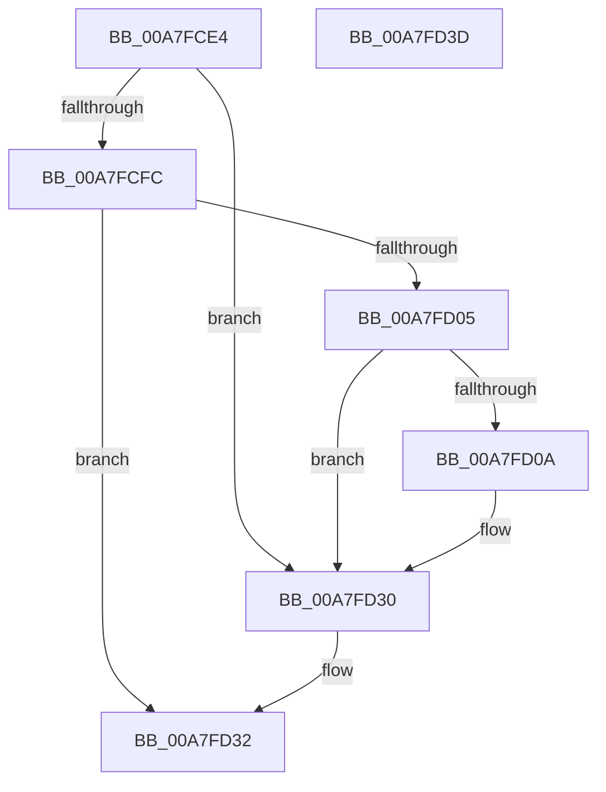

# MiProcessLoadConfigForDriver

- RVA: `0x00A7FCE4`–`0x00A7FD3E` (길이 `90` bytes)
- VA: `0x0000000140A7FCE4`
- 실행 섹션: `PAGE`
- PDB 이름 있음: `예`; PDB Function 태그: `아니요`
- unwind 정보 RVA: `0x0006E5F8`
- 디코드: `29`개 명령, `90/90` bytes 표시
- 미해석 바이트: `0` (있으면 어셈블리에 `.byte`로 보존)

> 이 문서는 커널 이미지의 기계어와 PDB 기호를 분석해 생성했습니다. 4번과 5번은 함수 원형과 자료형을 바이너리 사용 방식에서 추정한 C 해석이며 원본 소스 복구 결과는 아닙니다.

## 1. Dependencies

- 직접 호출 지점: **4**; 고유 호출 대상: **3**
- 직접 호출자로 확인된 함수: **2**
- RIP 상대 이미지 참조: **0**

### Outgoing calls
- `0x00A7FCFC` → [MiProcessKernelCfgImageLoadConfig](MiProcessKernelCfgImageLoadConfig_function_00A7FE40.md) (function, `0x00A7FE40`)
- `0x00A7FD0C` → [ExGenRandom](../../text/41/ExGenRandom_function_0041B010.md) (function, `0x0041B010`)
- `0x00A7FD19` → [ExGenRandom](../../text/41/ExGenRandom_function_0041B010.md) (function, `0x0041B010`)
- `0x00A7FD2B` → [LdrInitSecurityCookie](LdrInitSecurityCookie_function_00A7FD44.md) (function, `0x00A7FD44`)

### Direct callers
- [MmLoadSystemImageEx](../99/MmLoadSystemImageEx_function_00999B8C.md) at `0x00999FA7`
- [MiReloadBootLoadedDrivers](../../init/C6/MiReloadBootLoadedDrivers_function_00C6C3F8.md) at `0x00C6C437`

### Static image references
- 디코드된 RIP-relative 메모리 참조가 없습니다.

## 2. Other-region calls and transfers

- 다른 실행 섹션으로 향하는 call: **2**
  - `0x00A7FD0C` → [ExGenRandom](../../text/41/ExGenRandom_function_0041B010.md) (`PAGE` → `.text`)
  - `0x00A7FD19` → [ExGenRandom](../../text/41/ExGenRandom_function_0041B010.md) (`PAGE` → `.text`)
- 별도 외부 분기/꼬리 이동을 확인하지 못했습니다.

## 3. Assembly (complete function range)

```asm
00A7FCE4  48 89 5C 24 08                  mov qword ptr [rsp + 8], rbx
00A7FCE9  57                              push rdi
00A7FCEA  48 83 EC 30                     sub rsp, 0x30
00A7FCEE  66 0F BA 61 6E 09               bt word ptr [rcx + 0x6e], 9
00A7FCF4  48 8B DA                        mov rbx, rdx
00A7FCF7  48 8B F9                        mov rdi, rcx
00A7FCFA  72 34                           jb 0x140a7fd30
00A7FCFC  E8 3F 01 00 00                  call 0x140a7fe40
00A7FD01  85 C0                           test eax, eax
00A7FD03  78 2D                           js 0x140a7fd32
00A7FD05  48 85 DB                        test rbx, rbx
00A7FD08  74 26                           je 0x140a7fd30
00A7FD0A  33 C9                           xor ecx, ecx
00A7FD0C  E8 FF B2 99 FF                  call 0x14041b010
00A7FD11  8B D8                           mov ebx, eax
00A7FD13  33 C9                           xor ecx, ecx
00A7FD15  48 C1 E3 20                     shl rbx, 0x20
00A7FD19  E8 F2 B2 99 FF                  call 0x14041b010
00A7FD1E  8B 57 40                        mov edx, dword ptr [rdi + 0x40]
00A7FD21  48 8B 4F 30                     mov rcx, qword ptr [rdi + 0x30]
00A7FD25  44 8B C8                        mov r9d, eax
00A7FD28  4C 0B CB                        or r9, rbx
00A7FD2B  E8 14 00 00 00                  call 0x140a7fd44
00A7FD30  33 C0                           xor eax, eax
00A7FD32  48 8B 5C 24 40                  mov rbx, qword ptr [rsp + 0x40]
00A7FD37  48 83 C4 30                     add rsp, 0x30
00A7FD3B  5F                              pop rdi
00A7FD3C  C3                              ret
00A7FD3D  CC                              int3
```

## 4. C-style interpretation (structured pseudocode)

```c
__int64 __fastcall MiProcessLoadConfigForDriver(__int64 a1, __int64 a2)
{
    __int64 result;
    __int64 v_rbx;
    __int64 v_rsp;
    unsigned __int64 v_stack_p8;

    v_stack_p8 = v_rbx;
    v_rsp = (v_rsp) - (48);
    if (condition_is_below) goto loc_00A7FD30;
    result = MiProcessKernelCfgImageLoadConfig(a1, a2, a3, a4);
    if (sign_flag) goto loc_00A7FD32;
    v_rbx = a2;
    if (a2 != 0) {
        a1 = 0;
        result = ExGenRandom(a1, a2, a3, a4);
        v_rbx = (unsigned int)(result);
        a1 = 0;
        v_rbx = (v_rbx) << (32);
        result = ExGenRandom(a1, a2, a3, a4);
        a2 = *(unsigned int *)(a1 + 64);
        a1 = *(unsigned __int64 *)(a1 + 48);
        a4 = (unsigned int)(result);
        a4 = (a4) | (v_rbx);
        result = LdrInitSecurityCookie(a1, a2, a3, a4);
    }
    result = 0;
loc_00A7FD32:
    v_rsp = (v_rsp) + (48);
    return result;
}
```

## 5. (Beta) C Style

```c
int64_t MiProcessLoadConfigForDriver(void *Arg1, int64_t Arg2)
{
    uint8_t *arg1 = (uint8_t *)Arg1;

    int64_t result;
    int64_t local_rbx;
    int64_t local_rsp;
    uint64_t v_stack_p8;

    v_stack_p8 = local_rbx;
    local_rsp = (local_rsp) - (48);
    if (condition_is_below) goto loc_00A7FD30;
    result = MiProcessKernelCfgImageLoadConfig(Arg1, Arg2, a3, a4);
    if (sign_flag) goto loc_00A7FD32;
    local_rbx = Arg2;
    if (Arg2 != 0) {
        Arg1 = 0;
        result = ExGenRandom(Arg1, Arg2, a3, a4);
        local_rbx = (uint32_t)(result);
        Arg1 = 0;
        local_rbx = (local_rbx) << (32);
        result = ExGenRandom(Arg1, Arg2, a3, a4);
        Arg2 = *(uint32_t *)(arg1 + 0x40);
        Arg1 = *(uint64_t *)(arg1 + 0x30);
        a4 = (uint32_t)(result);
        a4 = (a4) | (local_rbx);
        result = LdrInitSecurityCookie(Arg1, Arg2, a3, a4);
    }
    result = 0;
loc_00A7FD32:
    local_rsp = (local_rsp) + (48);
    return result;
}
```

### 관측된 메모리 오프셋

구조체 형식이 확인되지 않은 접근은 인자 기준의 오프셋으로만 기록했습니다.

| 기준 인자 | 오프셋 표현 | 폭 (bit) | 접근 |
|---|---:|---:|---|
| `Arg1` | `+ 0x30` | `64` | `R` |
| `Arg1` | `+ 0x40` | `32` | `R` |
| `Arg1` | `+ 0x6E` | `16` | `R` |

## 6. Execution-region graph

[열기: 2D/3D 그래프와 함수 탐색 컨트롤 패널](../../../control-panel.html?section=page&rva=0x00A7FCE4&view=graph)

- 2D 그래프는 위에서 아래로 흐르고, 3D 그래프는 빈 공간을 드래그해 회전합니다. Shift+드래그는 이동, 휠은 확대·축소, 함수 노드 선택은 대상 보고서 이동입니다.

### Static fallback


