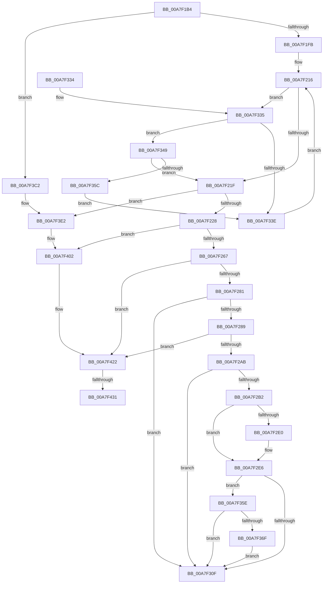

# MiReleaseDriverPtes

- RVA: `0x00A7F1B4`–`0x00A7F43D` (길이 `649` bytes)
- VA: `0x0000000140A7F1B4`
- 실행 섹션: `PAGE`
- PDB 이름 있음: `예`; PDB Function 태그: `예`
- unwind 정보 RVA: `0x000B6DA8`
- 디코드: `176`개 명령, `649/649` bytes 표시
- 미해석 바이트: `0` (있으면 어셈블리에 `.byte`로 보존)

> 이 문서는 커널 이미지의 기계어와 PDB 기호를 분석해 생성했습니다. 4번과 5번은 함수 원형과 자료형을 바이너리 사용 방식에서 추정한 C 해석이며 원본 소스 복구 결과는 아닙니다.

## 1. Dependencies

- 직접 호출 지점: **15**; 고유 호출 대상: **10**
- 직접 호출자로 확인된 함수: **3**
- RIP 상대 이미지 참조: **2**

### Outgoing calls
- `0x00A7F20A` → [MiLockDriverMappings](../../text/4B/MiLockDriverMappings_function_004B9D50.md) (function, `0x004B9D50`)
- `0x00A7F25A` → [RtlAreBitsSet](../../text/45/RtlAreBitsSet_function_00450EF0.md) (function, `0x00450EF0`)
- `0x00A7F296` → [RtlClearBits](../../text/3E/RtlClearBits_function_003E1A90.md) (function, `0x003E1A90`)
- `0x00A7F29E` → [RtlNumberOfSetBits](../../text/43/RtlNumberOfSetBits_function_00433F70.md) (function, `0x00433F70`)
- `0x00A7F2D7` → [RtlAreBitsClear](../../text/45/RtlAreBitsClear_function_00451800.md) (function, `0x00451800`)
- `0x00A7F2F4` → [RtlAreBitsClear](../../text/45/RtlAreBitsClear_function_00451800.md) (function, `0x00451800`)
- `0x00A7F312` → [MiUnlockDriverMappings](../../text/4B/MiUnlockDriverMappings_function_004B4E54.md) (function, `0x004B4E54`)
- `0x00A7F366` → [RtlAreBitsClear](../../text/45/RtlAreBitsClear_function_00451800.md) (function, `0x00451800`)
- `0x00A7F385` → [MiGetPteAddress](../../text/43/MiGetPteAddress_function_0043E130.md) (function, `0x0043E130`)
- `0x00A7F390` → [MiGetPdeAddress](../../text/41/MiGetPdeAddress_function_0041AFC0.md) (function, `0x0041AFC0`)
- `0x00A7F3A2` → [RtlClearBits](../../text/3E/RtlClearBits_function_003E1A90.md) (function, `0x003E1A90`)
- `0x00A7F3B8` → [MiDecommitSystemPageTables](../../text/2C/MiDecommitSystemPageTables_function_002C1054.md) (function, `0x002C1054`)
- `0x00A7F3DC` → [KeBugCheckEx](../../text/4F/KeBugCheckEx_function_004FD660.md) (function, `0x004FD660`)
- `0x00A7F3FC` → [KeBugCheckEx](../../text/4F/KeBugCheckEx_function_004FD660.md) (function, `0x004FD660`)
- `0x00A7F41C` → [KeBugCheckEx](../../text/4F/KeBugCheckEx_function_004FD660.md) (function, `0x004FD660`)

### Direct callers
- [MmUnmapLockedRestartPages](../7F/MmUnmapLockedRestartPages_function_007F90E0.md) at `0x007F9146`
- [MiReturnSystemImageAddress](MiReturnSystemImageAddress_function_00A7F190.md) at `0x00A7F1A2`
- [MiUnloadSystemImage](../AA/MiUnloadSystemImage_function_00AA2FD4.md) at `0x00AA33D6`

### Static image references
- `0x00A7F20F` → RVA `0x00E2D960` (`.data`; read)
- `0x00A7F431` → RVA `0x00E2D960` (`.data`; write)

## 2. Other-region calls and transfers

- 다른 실행 섹션으로 향하는 call: **15**
  - `0x00A7F20A` → [MiLockDriverMappings](../../text/4B/MiLockDriverMappings_function_004B9D50.md) (`PAGE` → `.text`)
  - `0x00A7F25A` → [RtlAreBitsSet](../../text/45/RtlAreBitsSet_function_00450EF0.md) (`PAGE` → `.text`)
  - `0x00A7F296` → [RtlClearBits](../../text/3E/RtlClearBits_function_003E1A90.md) (`PAGE` → `.text`)
  - `0x00A7F29E` → [RtlNumberOfSetBits](../../text/43/RtlNumberOfSetBits_function_00433F70.md) (`PAGE` → `.text`)
  - `0x00A7F2D7` → [RtlAreBitsClear](../../text/45/RtlAreBitsClear_function_00451800.md) (`PAGE` → `.text`)
  - `0x00A7F2F4` → [RtlAreBitsClear](../../text/45/RtlAreBitsClear_function_00451800.md) (`PAGE` → `.text`)
  - `0x00A7F312` → [MiUnlockDriverMappings](../../text/4B/MiUnlockDriverMappings_function_004B4E54.md) (`PAGE` → `.text`)
  - `0x00A7F366` → [RtlAreBitsClear](../../text/45/RtlAreBitsClear_function_00451800.md) (`PAGE` → `.text`)
  - `0x00A7F385` → [MiGetPteAddress](../../text/43/MiGetPteAddress_function_0043E130.md) (`PAGE` → `.text`)
  - `0x00A7F390` → [MiGetPdeAddress](../../text/41/MiGetPdeAddress_function_0041AFC0.md) (`PAGE` → `.text`)
  - `0x00A7F3A2` → [RtlClearBits](../../text/3E/RtlClearBits_function_003E1A90.md) (`PAGE` → `.text`)
  - `0x00A7F3B8` → [MiDecommitSystemPageTables](../../text/2C/MiDecommitSystemPageTables_function_002C1054.md) (`PAGE` → `.text`)
  - `0x00A7F3DC` → [KeBugCheckEx](../../text/4F/KeBugCheckEx_function_004FD660.md) (`PAGE` → `.text`)
  - `0x00A7F3FC` → [KeBugCheckEx](../../text/4F/KeBugCheckEx_function_004FD660.md) (`PAGE` → `.text`)
  - `0x00A7F41C` → [KeBugCheckEx](../../text/4F/KeBugCheckEx_function_004FD660.md) (`PAGE` → `.text`)
- call이 아닌 외부 분기/꼬리 이동: **2**
  - `0x00A7F42B` → [sub_00B42BDE](../B4/Unknown_function_00B42BDE.md) (`tail-transfer`)
  - `0x00A7F438` → [sub_00B42BDE + 0x3](../B4/Unknown_function_00B42BDE.md) (`tail-transfer`)

## 3. Assembly (complete function range)

```asm
00A7F1B4  48 89 5C 24 10                  mov qword ptr [rsp + 0x10], rbx
00A7F1B9  48 89 6C 24 18                  mov qword ptr [rsp + 0x18], rbp
00A7F1BE  48 89 74 24 20                  mov qword ptr [rsp + 0x20], rsi
00A7F1C3  57                              push rdi
00A7F1C4  41 54                           push r12
00A7F1C6  41 55                           push r13
00A7F1C8  41 56                           push r14
00A7F1CA  41 57                           push r15
00A7F1CC  48 83 EC 30                     sub rsp, 0x30
00A7F1D0  48 8B FA                        mov rdi, rdx
00A7F1D3  48 8B E9                        mov rbp, rcx
00A7F1D6  49 BC 00 00 00 00 80 F6 FF FF   movabs r12, 0xfffff68000000000
00A7F1E0  49 C1 E4 19                     shl r12, 0x19
00A7F1E4  48 8B F1                        mov rsi, rcx
00A7F1E7  48 C1 E6 19                     shl rsi, 0x19
00A7F1EB  49 2B F4                        sub rsi, r12
00A7F1EE  48 C1 FE 10                     sar rsi, 0x10
00A7F1F2  66 85 F6                        test si, si
00A7F1F5  0F 85 C7 01 00 00               jne 0x140a7f3c2
00A7F1FB  65 4C 8B 2C 25 88 01 00 00      mov r13, qword ptr gs:[0x188]
00A7F204  45 33 FF                        xor r15d, r15d
00A7F207  49 8B CD                        mov rcx, r13
00A7F20A  E8 41 AB A3 FF                  call 0x1404b9d50
00A7F20F  48 8B 1D 4A E7 3A 00            mov rbx, qword ptr [rip + 0x3ae74a]
00A7F216  48 85 DB                        test rbx, rbx
00A7F219  0F 85 16 01 00 00               jne 0x140a7f335
00A7F21F  48 85 DB                        test rbx, rbx
00A7F222  0F 84 BA 01 00 00               je 0x140a7f3e2
00A7F228  48 2B 6B 08                     sub rbp, qword ptr [rbx + 8]
00A7F22C  48 8D 4F 0F                     lea rcx, [rdi + 0xf]
00A7F230  41 B8 10 00 00 00               mov r8d, 0x10
00A7F236  48 C1 FD 03                     sar rbp, 3
00A7F23A  48 8B C5                        mov rax, rbp
00A7F23D  48 C1 E9 04                     shr rcx, 4
00A7F241  48 99                           cqo
00A7F243  48 89 4C 24 60                  mov qword ptr [rsp + 0x60], rcx
00A7F248  49 F7 F8                        idiv r8
00A7F24B  44 8B C1                        mov r8d, ecx
00A7F24E  4C 8D 73 10                     lea r14, [rbx + 0x10]
00A7F252  8B D0                           mov edx, eax
00A7F254  49 8B CE                        mov rcx, r14
00A7F257  48 8B E8                        mov rbp, rax
00A7F25A  E8 91 1C 9D FF                  call 0x140450ef0
00A7F25F  84 C0                           test al, al
00A7F261  0F 84 9B 01 00 00               je 0x140a7f402
00A7F267  48 8B 7B 08                     mov rdi, qword ptr [rbx + 8]
00A7F26B  8B 43 24                        mov eax, dword ptr [rbx + 0x24]
00A7F26E  48 C1 E7 19                     shl rdi, 0x19
00A7F272  49 2B FC                        sub rdi, r12
00A7F275  48 C1 FF 10                     sar rdi, 0x10
00A7F279  A8 01                           test al, 1
00A7F27B  0F 85 A1 01 00 00               jne 0x140a7f422
00A7F281  A8 02                           test al, 2
00A7F283  0F 85 86 00 00 00               jne 0x140a7f30f
00A7F289  48 8B 74 24 60                  mov rsi, qword ptr [rsp + 0x60]
00A7F28E  8B D5                           mov edx, ebp
00A7F290  44 8B C6                        mov r8d, esi
00A7F293  49 8B CE                        mov rcx, r14
00A7F296  E8 F5 27 96 FF                  call 0x1403e1a90
00A7F29B  49 8B CE                        mov rcx, r14
00A7F29E  E8 CD 4C 9B FF                  call 0x140433f70
00A7F2A3  85 C0                           test eax, eax
00A7F2A5  0F 84 77 01 00 00               je 0x140a7f422
00A7F2AB  48 83 7B 30 00                  cmp qword ptr [rbx + 0x30], 0
00A7F2B0  74 5D                           je 0x140a7f30f
00A7F2B2  8D 04 2E                        lea eax, [rsi + rbp]
00A7F2B5  B9 E0 FF FF FF                  mov ecx, 0xffffffe0
00A7F2BA  44 8D 78 1F                     lea r15d, [rax + 0x1f]
00A7F2BE  89 44 24 60                     mov dword ptr [rsp + 0x60], eax
00A7F2C2  8B F5                           mov esi, ebp
00A7F2C4  45 8B E7                        mov r12d, r15d
00A7F2C7  23 F1                           and esi, ecx
00A7F2C9  44 23 E1                        and r12d, ecx
00A7F2CC  49 8B CE                        mov rcx, r14
00A7F2CF  41 B8 20 00 00 00               mov r8d, 0x20
00A7F2D5  8B D6                           mov edx, esi
00A7F2D7  E8 24 25 9D FF                  call 0x140451800
00A7F2DC  84 C0                           test al, al
00A7F2DE  75 06                           jne 0x140a7f2e6
00A7F2E0  8D 75 1F                        lea esi, [rbp + 0x1f]
00A7F2E3  83 E6 E0                        and esi, 0xffffffe0
00A7F2E6  41 8D 54 24 E0                  lea edx, [r12 - 0x20]
00A7F2EB  41 B8 20 00 00 00               mov r8d, 0x20
00A7F2F1  49 8B CE                        mov rcx, r14
00A7F2F4  E8 07 25 9D FF                  call 0x140451800
00A7F2F9  84 C0                           test al, al
00A7F2FB  44 0F 44 7C 24 60               cmove r15d, dword ptr [rsp + 0x60]
00A7F301  41 83 E7 E0                     and r15d, 0xffffffe0
00A7F305  41 8B EF                        mov ebp, r15d
00A7F308  2B EE                           sub ebp, esi
00A7F30A  41 3B F7                        cmp esi, r15d
00A7F30D  72 4F                           jb 0x140a7f35e
00A7F30F  49 8B CD                        mov rcx, r13
00A7F312  E8 3D 5B A3 FF                  call 0x1404b4e54
00A7F317  48 8B 5C 24 68                  mov rbx, qword ptr [rsp + 0x68]
00A7F31C  48 8B 6C 24 70                  mov rbp, qword ptr [rsp + 0x70]
00A7F321  48 8B 74 24 78                  mov rsi, qword ptr [rsp + 0x78]
00A7F326  48 83 C4 30                     add rsp, 0x30
00A7F32A  41 5F                           pop r15
00A7F32C  41 5E                           pop r14
00A7F32E  41 5D                           pop r13
00A7F330  41 5C                           pop r12
00A7F332  5F                              pop rdi
00A7F333  C3                              ret
00A7F334  CC                              int3
00A7F335  48 8B 4B 08                     mov rcx, qword ptr [rbx + 8]
00A7F339  48 3B E9                        cmp rbp, rcx
00A7F33C  73 0B                           jae 0x140a7f349
00A7F33E  4C 8B FB                        mov r15, rbx
00A7F341  48 8B 1B                        mov rbx, qword ptr [rbx]
00A7F344  E9 CD FE FF FF                  jmp 0x140a7f216
00A7F349  8B 43 10                        mov eax, dword ptr [rbx + 0x10]
00A7F34C  C1 E0 04                        shl eax, 4
00A7F34F  48 8D 0C C1                     lea rcx, [rcx + rax*8]
00A7F353  48 3B E9                        cmp rbp, rcx
00A7F356  0F 82 C3 FE FF FF               jb 0x140a7f21f
00A7F35C  EB E0                           jmp 0x140a7f33e
00A7F35E  44 8B C5                        mov r8d, ebp
00A7F361  8B D6                           mov edx, esi
00A7F363  49 8B CE                        mov rcx, r14
00A7F366  E8 95 24 9D FF                  call 0x140451800
00A7F36B  84 C0                           test al, al
00A7F36D  74 A0                           je 0x140a7f30f
00A7F36F  48 8B 4B 08                     mov rcx, qword ptr [rbx + 8]
00A7F373  C1 E6 10                        shl esi, 0x10
00A7F376  8B C6                           mov eax, esi
00A7F378  C1 E5 04                        shl ebp, 4
00A7F37B  48 03 F8                        add rdi, rax
00A7F37E  44 8B C5                        mov r8d, ebp
00A7F381  41 C1 E8 09                     shr r8d, 9
00A7F385  E8 A6 ED 9B FF                  call 0x14043e130
00A7F38A  48 8B CF                        mov rcx, rdi
00A7F38D  4C 8B C8                        mov r9, rax
00A7F390  E8 2B BC 99 FF                  call 0x14041afc0
00A7F395  49 2B C1                        sub rax, r9
00A7F398  48 8D 4B 28                     lea rcx, [rbx + 0x28]
00A7F39C  48 C1 F8 03                     sar rax, 3
00A7F3A0  8B D0                           mov edx, eax
00A7F3A2  E8 E9 26 96 FF                  call 0x1403e1a90
00A7F3A7  C1 E5 0C                        shl ebp, 0xc
00A7F3AA  41 B8 0B 00 00 00               mov r8d, 0xb
00A7F3B0  8B D5                           mov edx, ebp
00A7F3B2  48 8B CF                        mov rcx, rdi
00A7F3B5  48 03 D7                        add rdx, rdi
00A7F3B8  E8 97 1C 84 FF                  call 0x1402c1054
00A7F3BD  E9 4D FF FF FF                  jmp 0x140a7f30f
00A7F3C2  48 83 64 24 20 00               and qword ptr [rsp + 0x20], 0
00A7F3C8  4C 8B C6                        mov r8, rsi
00A7F3CB  48 C1 E7 0C                     shl rdi, 0xc
00A7F3CF  BA 1A 10 00 00                  mov edx, 0x101a
00A7F3D4  4C 8B CF                        mov r9, rdi
00A7F3D7  B9 1A 00 00 00                  mov ecx, 0x1a
00A7F3DC  E8 7F E2 A7 FF                  call 0x1404fd660
00A7F3E1  CC                              int3
00A7F3E2  48 83 64 24 20 00               and qword ptr [rsp + 0x20], 0
00A7F3E8  4C 8B C6                        mov r8, rsi
00A7F3EB  48 C1 E7 0C                     shl rdi, 0xc
00A7F3EF  BA 17 10 00 00                  mov edx, 0x1017
00A7F3F4  4C 8B CF                        mov r9, rdi
00A7F3F7  B9 1A 00 00 00                  mov ecx, 0x1a
00A7F3FC  E8 5F E2 A7 FF                  call 0x1404fd660
00A7F401  CC                              int3
00A7F402  48 83 64 24 20 00               and qword ptr [rsp + 0x20], 0
00A7F408  4C 8B C6                        mov r8, rsi
00A7F40B  48 C1 E7 0C                     shl rdi, 0xc
00A7F40F  BA 18 10 00 00                  mov edx, 0x1018
00A7F414  4C 8B CF                        mov r9, rdi
00A7F417  B9 1A 00 00 00                  mov ecx, 0x1a
00A7F41C  E8 3F E2 A7 FF                  call 0x1404fd660
00A7F421  CC                              int3
00A7F422  41 8B 36                        mov esi, dword ptr [r14]
00A7F425  48 8B 03                        mov rax, qword ptr [rbx]
00A7F428  4D 85 FF                        test r15, r15
00A7F42B  0F 85 AD 37 0C 00               jne 0x140b42bde
00A7F431  48 89 05 28 E5 3A 00            mov qword ptr [rip + 0x3ae528], rax
00A7F438  E9 A4 37 0C 00                  jmp 0x140b42be1
```

## 4. C-style interpretation (structured pseudocode)

```c
__int64 __fastcall MiReleaseDriverPtes(__int64 a1, __int64 a2)
{
    __int64 result;
    __int64 v_r12;
    __int64 v_r15;
    __int64 v_rbp;
    __int64 v_rdi;
    __int64 v_rsi;
    __int64 v_rsp;
    unsigned __int64 v_stack_p10;
    unsigned __int64 v_stack_p18;
    unsigned __int64 v_stack_p20;
    unsigned __int64 v_stack_p8;

    v_stack_p10 = v_rbx;
    v_stack_p18 = v_rbp;
    v_stack_p20 = v_rsi;
    v_rsp = (v_rsp) - (48);
    v_r12 = (v_r12) << (25);
    v_rsi = (a1) << (25);
    v_rsi = (v_rsi) - (v_r12);
    v_rsi = (v_rsi) >> (16);
    if ((unsigned __int16)(v_rsi) != 0) goto loc_00A7F3C2;
    v_r15 = 0;
    result = MiLockDriverMappings(*(unsigned __int64 *)(gs_base + (0 + 392)), a2, a3, a4);
loc_00A7F216:
    if (*(unsigned __int64 *)(v_rip + 3860298) != 0) goto loc_00A7F335;
loc_00A7F21F:
    if (*(unsigned __int64 *)(v_rip + 3860298) == 0) goto loc_00A7F3E2;
    v_rbp = (a1) - (*(unsigned __int64 *)(*(unsigned __int64 *)(v_rip + 3860298) + 8));
    v_rbp = (v_rbp) >> (3);
    a1 = (a2 + 15) >> (4);
    v_stack_p8 = a1;
    result = RtlAreBitsSet(*(unsigned __int64 *)(v_rip + 3860298) + 16, (unsigned int)((unsigned int)(v_rbp)), (unsigned int)((unsigned int)(a1)), a4);
    if ((unsigned __int8)(result) == 0) goto loc_00A7F402;
    v_rdi = (*(unsigned __int64 *)(*(unsigned __int64 *)(v_rip + 3860298) + 8)) << (25);
    v_rdi = (v_rdi) - (v_r12);
    v_rdi = (v_rdi) >> (16);
    if ((((unsigned __int8)((unsigned int)(*(unsigned int *)(*(unsigned __int64 *)(v_rip + 3860298) + 36)))) & (1)) != 0) goto loc_00A7F422;
    if ((((unsigned __int8)((unsigned int)(*(unsigned int *)(*(unsigned __int64 *)(v_rip + 3860298) + 36)))) & (2)) != 0) goto loc_00A7F30F;
    result = RtlClearBits(*(unsigned __int64 *)(v_rip + 3860298) + 16, (unsigned int)((unsigned int)(v_rbp)), (unsigned int)((unsigned int)(v_stack_p8)), a4);
    result = RtlNumberOfSetBits(*(unsigned __int64 *)(v_rip + 3860298) + 16, (unsigned int)((unsigned int)(v_rbp)), (unsigned int)((unsigned int)(v_stack_p8)), a4);
    if ((unsigned int)(result) == 0) goto loc_00A7F422;
    if ((*(unsigned __int64 *)(*(unsigned __int64 *)(v_rip + 3860298) + 48)) == 0) goto loc_00A7F30F;
    v_stack_p8 = (unsigned int)(v_stack_p8 + v_rbp * 1);
    v_rsi = (unsigned int)(((unsigned int)((unsigned int)(v_rbp))) & ((unsigned int)((unsigned int)(0xFFFFFFE0ULL))));
    v_r12 = (unsigned int)(((unsigned int)((unsigned int)(v_stack_p8 + v_rbp * 1 + 31))) & ((unsigned int)((unsigned int)(0xFFFFFFE0ULL))));
    result = RtlAreBitsClear(*(unsigned __int64 *)(v_rip + 3860298) + 16, (unsigned int)((unsigned int)(v_rsi)), 32, a4);
    if ((unsigned __int8)(result) == 0) {
        v_rsi = v_rbp + 31;
        v_rsi = (unsigned int)((v_rsi) & (0xFFFFFFE0ULL));
    }
    result = RtlAreBitsClear(*(unsigned __int64 *)(v_rip + 3860298) + 16, v_r12 - 32, 32, a4);
    v_r15 = v_stack_p8 + v_rbp * 1 + 31;
    if ((unsigned __int8)(result) == 0) { v_r15 = v_stack_p8; }
    v_r15 = (unsigned int)((v_r15) & (0xFFFFFFE0ULL));
    v_rbp = (unsigned int)(((unsigned int)((unsigned int)(v_r15))) - ((unsigned int)(v_rsi)));
    if (((unsigned int)(v_rsi)) < ((unsigned int)(v_r15))) goto loc_00A7F35E;
loc_00A7F30F:
    result = MiUnlockDriverMappings(*(unsigned __int64 *)(gs_base + (0 + 392)), v_r12 - 32, 32, a4);
    v_rsp = (v_rsp) + (48);
    return result;
loc_00A7F335:
    if (v_stack_p18 >= (*(unsigned __int64 *)(v_stack_p10 + 8))) goto loc_00A7F349;
loc_00A7F33E:
    goto loc_00A7F216;
loc_00A7F349:
    result = (unsigned int)(((unsigned int)(*(unsigned int *)(*(unsigned __int64 *)(v_stack_p10) + 16))) << (4));
    if (v_stack_p18 < (*(unsigned __int64 *)(v_stack_p10 + 8) + result * 8)) goto loc_00A7F21F;
    goto loc_00A7F33E;
loc_00A7F35E:
    result = RtlAreBitsClear(*(unsigned __int64 *)(v_rip + 3860298) + 16, (unsigned int)((unsigned int)(v_stack_p20)), (unsigned int)((unsigned int)(v_stack_p18)), a4);
    if ((unsigned __int8)(result) == 0) goto loc_00A7F30F;
    v_rsi = (unsigned int)((v_stack_p20) << (16));
    v_rbp = (unsigned int)((v_stack_p18) << (4));
    v_rdi = (v_rdi) + ((unsigned int)((unsigned int)(v_rsi)));
    a3 = (unsigned int)(((unsigned int)((unsigned int)(v_rbp))) >> (9));
    result = MiGetPteAddress(*(unsigned __int64 *)(*(unsigned __int64 *)(v_stack_p10) + 8), (unsigned int)((unsigned int)(v_stack_p20)), a3, a4);
    result = MiGetPdeAddress(v_rdi, (unsigned int)((unsigned int)(v_stack_p20)), a3, result);
    result = (result) - (result);
    result = (result) >> (3);
    result = RtlClearBits(*(unsigned __int64 *)(v_stack_p10) + 40, (unsigned int)((unsigned int)(result)), a3, result);
    v_rbp = (unsigned int)((v_rbp) << (12));
    a2 = ((unsigned int)((unsigned int)(v_rbp))) + (v_rdi);
    result = MiDecommitSystemPageTables(v_rdi, a2, 11, result);
    goto loc_00A7F30F;
loc_00A7F3C2:
    v_rdi = (v_rdi) << (12);
    result = KeBugCheckEx(26, (unsigned int)(0x101AULL), v_rsi, v_rdi);
loc_00A7F3E2:
    v_rdi = (v_rdi) << (12);
    result = KeBugCheckEx(26, (unsigned int)(0x1017ULL), v_rsi, v_rdi);
loc_00A7F402:
    v_rdi = (v_rdi) << (12);
    result = KeBugCheckEx(26, (unsigned int)(0x1018ULL), v_rsi, v_rdi);
loc_00A7F422:
    *(unsigned __int64 *)(v_rip + 3859752) = *(unsigned __int64 *)(*(unsigned __int64 *)(v_stack_p10));
}
```

## 5. (Beta) C Style

```c
int64_t MiReleaseDriverPtes(int64_t Arg1, void *Arg2)
{
    uint8_t *arg2 = (uint8_t *)Arg2;

    int64_t result;
    int64_t local_r12;
    int64_t local_r15;
    int64_t local_rbp;
    int64_t local_rdi;
    int64_t local_rsi;
    int64_t local_rsp;
    uint64_t v_stack_p10;
    uint64_t v_stack_p18;
    uint64_t v_stack_p20;
    uint64_t v_stack_p8;

    v_stack_p10 = local_rbx;
    v_stack_p18 = local_rbp;
    v_stack_p20 = local_rsi;
    local_rsp = (local_rsp) - (48);
    local_r12 = (local_r12) << (25);
    local_rsi = (Arg1) << (25);
    local_rsi = (local_rsi) - (local_r12);
    local_rsi = (local_rsi) >> (16);
    if ((uint16_t)(local_rsi) != 0) goto loc_00A7F3C2;
    local_r15 = 0;
    result = MiLockDriverMappings(*(uint64_t *)(gs_base + (0 + 0x188)), Arg2, a3, a4);
loc_00A7F216:
    if (*(uint64_t *)(v_rip + 0x3AE74A) != 0) goto loc_00A7F335;
loc_00A7F21F:
    if (*(uint64_t *)(v_rip + 0x3AE74A) == 0) goto loc_00A7F3E2;
    local_rbp = (Arg1) - (*(uint64_t *)(*(uint64_t *)(v_rip + 0x3AE74A) + 0x8));
    local_rbp = (local_rbp) >> (3);
    Arg1 = (Arg2 + 15) >> (4);
    v_stack_p8 = Arg1;
    result = RtlAreBitsSet(*(uint64_t *)(v_rip + 0x3AE74A) + 16, (uint32_t)((uint32_t)(local_rbp)), (uint32_t)((uint32_t)(Arg1)), a4);
    if ((uint8_t)(result) == 0) goto loc_00A7F402;
    local_rdi = (*(uint64_t *)(*(uint64_t *)(v_rip + 0x3AE74A) + 0x8)) << (25);
    local_rdi = (local_rdi) - (local_r12);
    local_rdi = (local_rdi) >> (16);
    if ((((uint8_t)((uint32_t)(*(uint32_t *)(*(uint64_t *)(v_rip + 0x3AE74A) + 0x24)))) & (1)) != 0) goto loc_00A7F422;
    if ((((uint8_t)((uint32_t)(*(uint32_t *)(*(uint64_t *)(v_rip + 0x3AE74A) + 0x24)))) & (2)) != 0) goto loc_00A7F30F;
    result = RtlClearBits(*(uint64_t *)(v_rip + 0x3AE74A) + 16, (uint32_t)((uint32_t)(local_rbp)), (uint32_t)((uint32_t)(v_stack_p8)), a4);
    result = RtlNumberOfSetBits(*(uint64_t *)(v_rip + 0x3AE74A) + 16, (uint32_t)((uint32_t)(local_rbp)), (uint32_t)((uint32_t)(v_stack_p8)), a4);
    if ((uint32_t)(result) == 0) goto loc_00A7F422;
    if ((*(uint64_t *)(*(uint64_t *)(v_rip + 0x3AE74A) + 0x30)) == 0) goto loc_00A7F30F;
    v_stack_p8 = (uint32_t)(v_stack_p8 + local_rbp * 1);
    local_rsi = (uint32_t)(((uint32_t)((uint32_t)(local_rbp))) & ((uint32_t)((uint32_t)(0xFFFFFFE0ULL))));
    local_r12 = (uint32_t)(((uint32_t)((uint32_t)(v_stack_p8 + local_rbp * 1 + 31))) & ((uint32_t)((uint32_t)(0xFFFFFFE0ULL))));
    result = RtlAreBitsClear(*(uint64_t *)(v_rip + 0x3AE74A) + 16, (uint32_t)((uint32_t)(local_rsi)), 32, a4);
    if ((uint8_t)(result) == 0) {
        local_rsi = local_rbp + 31;
        local_rsi = (uint32_t)((local_rsi) & (0xFFFFFFE0ULL));
    }
    result = RtlAreBitsClear(*(uint64_t *)(v_rip + 0x3AE74A) + 16, local_r12 - 32, 32, a4);
    local_r15 = v_stack_p8 + local_rbp * 1 + 31;
    if ((uint8_t)(result) == 0) { local_r15 = v_stack_p8; }
    local_r15 = (uint32_t)((local_r15) & (0xFFFFFFE0ULL));
    local_rbp = (uint32_t)(((uint32_t)((uint32_t)(local_r15))) - ((uint32_t)(local_rsi)));
    if (((uint32_t)(local_rsi)) < ((uint32_t)(local_r15))) goto loc_00A7F35E;
loc_00A7F30F:
    result = MiUnlockDriverMappings(*(uint64_t *)(gs_base + (0 + 0x188)), local_r12 - 32, 32, a4);
    local_rsp = (local_rsp) + (48);
    return result;
loc_00A7F335:
    if (v_stack_p18 >= (*(uint64_t *)(v_stack_p10 + 0x8))) goto loc_00A7F349;
loc_00A7F33E:
    goto loc_00A7F216;
loc_00A7F349:
    result = (uint32_t)(((uint32_t)(*(uint32_t *)(*(uint64_t *)(v_stack_p10) + 0x10))) << (4));
    if (v_stack_p18 < (*(uint64_t *)(v_stack_p10 + 0x8) + result * 8)) goto loc_00A7F21F;
    goto loc_00A7F33E;
loc_00A7F35E:
    result = RtlAreBitsClear(*(uint64_t *)(v_rip + 0x3AE74A) + 16, (uint32_t)((uint32_t)(v_stack_p20)), (uint32_t)((uint32_t)(v_stack_p18)), a4);
    if ((uint8_t)(result) == 0) goto loc_00A7F30F;
    local_rsi = (uint32_t)((v_stack_p20) << (16));
    local_rbp = (uint32_t)((v_stack_p18) << (4));
    local_rdi = (local_rdi) + ((uint32_t)((uint32_t)(local_rsi)));
    a3 = (uint32_t)(((uint32_t)((uint32_t)(local_rbp))) >> (9));
    result = MiGetPteAddress(*(uint64_t *)(*(uint64_t *)(v_stack_p10) + 0x8), (uint32_t)((uint32_t)(v_stack_p20)), a3, a4);
    result = MiGetPdeAddress(local_rdi, (uint32_t)((uint32_t)(v_stack_p20)), a3, result);
    result = (result) - (result);
    result = (result) >> (3);
    result = RtlClearBits(*(uint64_t *)(v_stack_p10) + 40, (uint32_t)((uint32_t)(result)), a3, result);
    local_rbp = (uint32_t)((local_rbp) << (12));
    Arg2 = ((uint32_t)((uint32_t)(local_rbp))) + (local_rdi);
    result = MiDecommitSystemPageTables(local_rdi, Arg2, 11, result);
    goto loc_00A7F30F;
loc_00A7F3C2:
    local_rdi = (local_rdi) << (12);
    result = KeBugCheckEx(26, (uint32_t)(0x101AULL), local_rsi, local_rdi);
loc_00A7F3E2:
    local_rdi = (local_rdi) << (12);
    result = KeBugCheckEx(26, (uint32_t)(0x1017ULL), local_rsi, local_rdi);
loc_00A7F402:
    local_rdi = (local_rdi) << (12);
    result = KeBugCheckEx(26, (uint32_t)(0x1018ULL), local_rsi, local_rdi);
loc_00A7F422:
    *(uint64_t *)(v_rip + 0x3AE528) = *(uint64_t *)(*(uint64_t *)(v_stack_p10));
}
```

### 관측된 메모리 오프셋

구조체 형식이 확인되지 않은 접근은 인자 기준의 오프셋으로만 기록했습니다.

| 기준 인자 | 오프셋 표현 | 폭 (bit) | 접근 |
|---|---:|---:|---|
| `Arg2` | `+ 0xF` | `64` | `R` |

## 6. Execution-region graph

[열기: 2D/3D 그래프와 함수 탐색 컨트롤 패널](../../../control-panel.html?section=page&rva=0x00A7F1B4&view=graph)

- 2D 그래프는 위에서 아래로 흐르고, 3D 그래프는 빈 공간을 드래그해 회전합니다. Shift+드래그는 이동, 휠은 확대·축소, 함수 노드 선택은 대상 보고서 이동입니다.

### Static fallback


