# MiReplaceRotateWithDemandZero

- RVA: `0x00A7C010`–`0x00A7C2CD` (길이 `701` bytes)
- VA: `0x0000000140A7C010`
- 실행 섹션: `PAGE`
- PDB 이름 있음: `예`; PDB Function 태그: `아니요`
- unwind 정보 RVA: `0x000B67FC`
- 디코드: `183`개 명령, `701/701` bytes 표시
- 미해석 바이트: `0` (있으면 어셈블리에 `.byte`로 보존)

> 이 문서는 커널 이미지의 기계어와 PDB 기호를 분석해 생성했습니다. 4번과 5번은 함수 원형과 자료형을 바이너리 사용 방식에서 추정한 C 해석이며 원본 소스 복구 결과는 아닙니다.

## 1. Dependencies

- 직접 호출 지점: **19**; 고유 호출 대상: **15**
- 직접 호출자로 확인된 함수: **1**
- RIP 상대 이미지 참조: **2**

### Outgoing calls
- `0x00A7C06D` → [memset](../../text/6C/memset_function_006C6C40.md) (function, `0x006C6C40`)
- `0x00A7C07F` → [memset](../../text/6C/memset_function_006C6C40.md) (function, `0x006C6C40`)
- `0x00A7C0A4` → [MmSizeOfMdl](../../text/46/MmSizeOfMdl_function_00460A10.md) (function, `0x00460A10`)
- `0x00A7C0BB` → [MiAllocatePool](../../text/35/MiAllocatePool_function_0035B540.md) (function, `0x0035B540`)
- `0x00A7C0D2` → [MmSizeOfMdl](../../text/46/MmSizeOfMdl_function_00460A10.md) (function, `0x00460A10`)
- `0x00A7C0E0` → [MiAllocatePool](../../text/35/MiAllocatePool_function_0035B540.md) (function, `0x0035B540`)
- `0x00A7C145` → [MmBuildMdlForNonPagedPool](../../text/23/MmBuildMdlForNonPagedPool_function_0023A870.md) (function, `0x0023A870`)
- `0x00A7C171` → [MiGetVadCacheAttribute](../../text/4A/MiGetVadCacheAttribute_function_004AF624.md) (function, `0x004AF624`)
- `0x00A7C17F` → [MiSwitchToTransition](../../text/4C/MiSwitchToTransition_function_004C0F5C.md) (function, `0x004C0F5C`)
- `0x00A7C1AA` → [guard_dispatch_icall](../../text/6B/guard_dispatch_icall_function_006BAAD0.md) (function, `0x006BAAD0`)
- `0x00A7C1BD` → [MiMarkMdlComplete](../../text/2A/MiMarkMdlComplete_function_002A75D0.md) (function, `0x002A75D0`)
- `0x00A7C1DC` → [MiIsPfn](../../text/46/MiIsPfn_function_00462450.md) (function, `0x00462450`)
- `0x00A7C1EE` → [MiDereferenceIoPages](../../text/2A/MiDereferenceIoPages_function_002AB1B0.md) (function, `0x002AB1B0`)
- `0x00A7C237` → [ExFreePoolWithTag](../../poolcode/B8/ExFreePoolWithTag_function_00B82870.md) (function, `0x00B82870`)
- `0x00A7C251` → [_security_check_cookie](../../text/6A/_security_check_cookie_function_006AC640.md) (function, `0x006AC640`)
- `0x00A7C288` → [MiSlowRotateCopy](../../text/67/MiSlowRotateCopy_function_0067E2B0.md) (function, `0x0067E2B0`)
- `0x00A7C2A7` → [MiLogVirtualRotateEvent](../7F/MiLogVirtualRotateEvent_function_007FE704.md) (function, `0x007FE704`)
- `0x00A7C2B6` → [ExFreePoolWithTag](../../poolcode/B8/ExFreePoolWithTag_function_00B82870.md) (function, `0x00B82870`)
- `0x00A7C2C3` → [MmUnlockPages](../../text/29/MmUnlockPages_function_0029EEE0.md) (function, `0x0029EEE0`)

### Direct callers
- [sub_00B3A19A](../B3/Unknown_function_00B3A19A.md) at `0x00B3A1CF`

### Static image references
- `0x00A7C024` → RVA `0x00E0A740` (`.data`; read)
- `0x00A7C1FC` → RVA `0x00FC6B04` (`ALMOSTRO`; read)

## 2. Other-region calls and transfers

- 다른 실행 섹션으로 향하는 call: **18**
  - `0x00A7C06D` → [memset](../../text/6C/memset_function_006C6C40.md) (`PAGE` → `.text`)
  - `0x00A7C07F` → [memset](../../text/6C/memset_function_006C6C40.md) (`PAGE` → `.text`)
  - `0x00A7C0A4` → [MmSizeOfMdl](../../text/46/MmSizeOfMdl_function_00460A10.md) (`PAGE` → `.text`)
  - `0x00A7C0BB` → [MiAllocatePool](../../text/35/MiAllocatePool_function_0035B540.md) (`PAGE` → `.text`)
  - `0x00A7C0D2` → [MmSizeOfMdl](../../text/46/MmSizeOfMdl_function_00460A10.md) (`PAGE` → `.text`)
  - `0x00A7C0E0` → [MiAllocatePool](../../text/35/MiAllocatePool_function_0035B540.md) (`PAGE` → `.text`)
  - `0x00A7C145` → [MmBuildMdlForNonPagedPool](../../text/23/MmBuildMdlForNonPagedPool_function_0023A870.md) (`PAGE` → `.text`)
  - `0x00A7C171` → [MiGetVadCacheAttribute](../../text/4A/MiGetVadCacheAttribute_function_004AF624.md) (`PAGE` → `.text`)
  - `0x00A7C17F` → [MiSwitchToTransition](../../text/4C/MiSwitchToTransition_function_004C0F5C.md) (`PAGE` → `.text`)
  - `0x00A7C1AA` → [guard_dispatch_icall](../../text/6B/guard_dispatch_icall_function_006BAAD0.md) (`PAGE` → `.text`)
  - `0x00A7C1BD` → [MiMarkMdlComplete](../../text/2A/MiMarkMdlComplete_function_002A75D0.md) (`PAGE` → `.text`)
  - `0x00A7C1DC` → [MiIsPfn](../../text/46/MiIsPfn_function_00462450.md) (`PAGE` → `.text`)
  - `0x00A7C1EE` → [MiDereferenceIoPages](../../text/2A/MiDereferenceIoPages_function_002AB1B0.md) (`PAGE` → `.text`)
  - `0x00A7C237` → [ExFreePoolWithTag](../../poolcode/B8/ExFreePoolWithTag_function_00B82870.md) (`PAGE` → `POOLCODE`)
  - `0x00A7C251` → [_security_check_cookie](../../text/6A/_security_check_cookie_function_006AC640.md) (`PAGE` → `.text`)
  - `0x00A7C288` → [MiSlowRotateCopy](../../text/67/MiSlowRotateCopy_function_0067E2B0.md) (`PAGE` → `.text`)
  - `0x00A7C2B6` → [ExFreePoolWithTag](../../poolcode/B8/ExFreePoolWithTag_function_00B82870.md) (`PAGE` → `POOLCODE`)
  - `0x00A7C2C3` → [MmUnlockPages](../../text/29/MmUnlockPages_function_0029EEE0.md) (`PAGE` → `.text`)
- 별도 외부 분기/꼬리 이동을 확인하지 못했습니다.

## 3. Assembly (complete function range)

```asm
00A7C010  40 53                           push rbx
00A7C012  55                              push rbp
00A7C013  56                              push rsi
00A7C014  57                              push rdi
00A7C015  41 54                           push r12
00A7C017  41 55                           push r13
00A7C019  41 56                           push r14
00A7C01B  41 57                           push r15
00A7C01D  48 81 EC D8 01 00 00            sub rsp, 0x1d8
00A7C024  48 8B 05 15 E7 38 00            mov rax, qword ptr [rip + 0x38e715]
00A7C02B  48 33 C4                        xor rax, rsp
00A7C02E  48 89 84 24 C0 01 00 00         mov qword ptr [rsp + 0x1c0], rax
00A7C036  48 8B 84 24 40 02 00 00         mov rax, qword ptr [rsp + 0x240]
00A7C03E  49 8B E8                        mov rbp, r8
00A7C041  48 89 44 24 20                  mov qword ptr [rsp + 0x20], rax
00A7C046  4C 8B E2                        mov r12, rdx
00A7C049  48 8B 84 24 48 02 00 00         mov rax, qword ptr [rsp + 0x248]
00A7C051  4C 8B E9                        mov r13, rcx
00A7C054  BB B8 00 00 00                  mov ebx, 0xb8
00A7C059  48 89 44 24 30                  mov qword ptr [rsp + 0x30], rax
00A7C05E  44 8B C3                        mov r8d, ebx
00A7C061  4C 89 4C 24 28                  mov qword ptr [rsp + 0x28], r9
00A7C066  33 D2                           xor edx, edx
00A7C068  48 8D 4C 24 40                  lea rcx, [rsp + 0x40]
00A7C06D  E8 CE AB C4 FF                  call 0x1406c6c40
00A7C072  44 8B C3                        mov r8d, ebx
00A7C075  48 8D 8C 24 00 01 00 00         lea rcx, [rsp + 0x100]
00A7C07D  33 D2                           xor edx, edx
00A7C07F  E8 BC AB C4 FF                  call 0x1406c6c40
00A7C084  33 DB                           xor ebx, ebx
00A7C086  BF 00 00 01 00                  mov edi, 0x10000
00A7C08B  48 3B EF                        cmp rbp, rdi
00A7C08E  76 61                           jbe 0x140a7c0f1
00A7C090  B8 FF FF FF FF                  mov eax, 0xffffffff
00A7C095  48 3B E8                        cmp rbp, rax
00A7C098  0F 87 CD 01 00 00               ja 0x140a7c26b
00A7C09E  48 8B D5                        mov rdx, rbp
00A7C0A1  49 8B CC                        mov rcx, r12
00A7C0A4  E8 67 49 9E FF                  call 0x140460a10
00A7C0A9  BE 49 6E 66 6F                  mov esi, 0x6f666e49
00A7C0AE  44 8D 7B 40                     lea r15d, [rbx + 0x40]
00A7C0B2  44 8B C6                        mov r8d, esi
00A7C0B5  41 8B CF                        mov ecx, r15d
00A7C0B8  48 8B D0                        mov rdx, rax
00A7C0BB  E8 80 F4 8D FF                  call 0x14035b540
00A7C0C0  4C 8B F0                        mov r14, rax
00A7C0C3  48 85 C0                        test rax, rax
00A7C0C6  0F 84 9F 01 00 00               je 0x140a7c26b
00A7C0CC  48 8B D5                        mov rdx, rbp
00A7C0CF  49 8B CC                        mov rcx, r12
00A7C0D2  E8 39 49 9E FF                  call 0x140460a10
00A7C0D7  48 8B D0                        mov rdx, rax
00A7C0DA  44 8B C6                        mov r8d, esi
00A7C0DD  41 8B CF                        mov ecx, r15d
00A7C0E0  E8 5B F4 8D FF                  call 0x14035b540
00A7C0E5  4C 8B F8                        mov r15, rax
00A7C0E8  48 85 C0                        test rax, rax
00A7C0EB  75 11                           jne 0x140a7c0fe
00A7C0ED  8B EF                           mov ebp, edi
00A7C0EF  EB 05                           jmp 0x140a7c0f6
00A7C0F1  4C 8D 74 24 40                  lea r14, [rsp + 0x40]
00A7C0F6  4C 8D BC 24 00 01 00 00         lea r15, [rsp + 0x100]
00A7C0FE  B9 FF 0F 00 00                  mov ecx, 0xfff
00A7C103  49 89 1E                        mov qword ptr [r14], rbx
00A7C106  66 41 89 5E 0A                  mov word ptr [r14 + 0xa], bx
00A7C10B  41 8B F4                        mov esi, r12d
00A7C10E  8B FE                           mov edi, esi
00A7C110  41 89 6E 28                     mov dword ptr [r14 + 0x28], ebp
00A7C114  48 23 F9                        and rdi, rcx
00A7C117  23 F1                           and esi, ecx
00A7C119  48 03 F9                        add rdi, rcx
00A7C11C  41 89 76 2C                     mov dword ptr [r14 + 0x2c], esi
00A7C120  48 03 FD                        add rdi, rbp
00A7C123  49 8B DC                        mov rbx, r12
00A7C126  48 C1 EF 0C                     shr rdi, 0xc
00A7C12A  48 81 E3 00 F0 FF FF            and rbx, 0xfffffffffffff000
00A7C131  66 83 C7 06                     add di, 6
00A7C135  49 89 5E 20                     mov qword ptr [r14 + 0x20], rbx
00A7C139  66 C1 E7 03                     shl di, 3
00A7C13D  49 8B CE                        mov rcx, r14
00A7C140  66 41 89 7E 08                  mov word ptr [r14 + 8], di
00A7C145  E8 26 E7 7B FF                  call 0x14023a870
00A7C14A  B8 00 20 00 00                  mov eax, 0x2000
00A7C14F  49 8B CD                        mov rcx, r13
00A7C152  66 41 09 46 0A                  or word ptr [r14 + 0xa], ax
00A7C157  49 83 27 00                     and qword ptr [r15], 0
00A7C15B  66 41 89 7F 08                  mov word ptr [r15 + 8], di
00A7C160  49 89 5F 20                     mov qword ptr [r15 + 0x20], rbx
00A7C164  41 89 77 2C                     mov dword ptr [r15 + 0x2c], esi
00A7C168  41 89 6F 28                     mov dword ptr [r15 + 0x28], ebp
00A7C16C  66 41 89 47 0A                  mov word ptr [r15 + 0xa], ax
00A7C171  E8 AE 34 A3 FF                  call 0x1404af624
00A7C176  44 8B C0                        mov r8d, eax
00A7C179  49 8B D5                        mov rdx, r13
00A7C17C  49 8B CF                        mov rcx, r15
00A7C17F  E8 D8 4D A4 FF                  call 0x1404c0f5c
00A7C184  41 8B 4F 28                     mov ecx, dword ptr [r15 + 0x28]
00A7C188  8B F0                           mov esi, eax
00A7C18A  48 3B CD                        cmp rcx, rbp
00A7C18D  0F 85 E0 00 00 00               jne 0x140a7c273
00A7C193  41 83 7F 28 00                  cmp dword ptr [r15 + 0x28], 0
00A7C198  74 62                           je 0x140a7c1fc
00A7C19A  4C 8B 44 24 20                  mov r8, qword ptr [rsp + 0x20]
00A7C19F  49 8B D6                        mov rdx, r14
00A7C1A2  48 8B 44 24 28                  mov rax, qword ptr [rsp + 0x28]
00A7C1A7  49 8B CF                        mov rcx, r15
00A7C1AA  E8 21 E9 C3 FF                  call 0x1406baad0
00A7C1AF  85 C0                           test eax, eax
00A7C1B1  0F 88 C8 00 00 00               js 0x140a7c27f
00A7C1B7  49 8B D5                        mov rdx, r13
00A7C1BA  49 8B CF                        mov rcx, r15
00A7C1BD  E8 0E B4 82 FF                  call 0x1402a75d0
00A7C1C2  41 8B 5E 28                     mov ebx, dword ptr [r14 + 0x28]
00A7C1C6  49 8D 7E 30                     lea rdi, [r14 + 0x30]
00A7C1CA  48 C1 EB 0C                     shr rbx, 0xc
00A7C1CE  48 85 DB                        test rbx, rbx
00A7C1D1  74 29                           je 0x140a7c1fc
00A7C1D3  41 BD 01 00 00 00               mov r13d, 1
00A7C1D9  48 8B 0F                        mov rcx, qword ptr [rdi]
00A7C1DC  E8 6F 62 9E FF                  call 0x140462450
00A7C1E1  85 C0                           test eax, eax
00A7C1E3  75 0E                           jne 0x140a7c1f3
00A7C1E5  48 8B 17                        mov rdx, qword ptr [rdi]
00A7C1E8  4D 8B C5                        mov r8, r13
00A7C1EB  41 8B CD                        mov ecx, r13d
00A7C1EE  E8 BD EF 82 FF                  call 0x1402ab1b0
00A7C1F3  48 83 C7 08                     add rdi, 8
00A7C1F7  49 2B DD                        sub rbx, r13
00A7C1FA  75 DD                           jne 0x140a7c1d9
00A7C1FC  F7 05 FE A8 54 00 00 80 00 00   test dword ptr [rip + 0x54a8fe], 0x8000
00A7C206  0F 85 86 00 00 00               jne 0x140a7c292
00A7C20C  48 8D 44 24 40                  lea rax, [rsp + 0x40]
00A7C211  4C 3B F0                        cmp r14, rax
00A7C214  0F 85 97 00 00 00               jne 0x140a7c2b1
00A7C21A  41 83 7F 28 00                  cmp dword ptr [r15 + 0x28], 0
00A7C21F  0F 85 9B 00 00 00               jne 0x140a7c2c0
00A7C225  48 8D 84 24 00 01 00 00         lea rax, [rsp + 0x100]
00A7C22D  4C 3B F8                        cmp r15, rax
00A7C230  74 0A                           je 0x140a7c23c
00A7C232  33 D2                           xor edx, edx
00A7C234  49 8B CF                        mov rcx, r15
00A7C237  E8 34 66 10 00                  call 0x140b82870
00A7C23C  48 8B 44 24 30                  mov rax, qword ptr [rsp + 0x30]
00A7C241  48 89 28                        mov qword ptr [rax], rbp
00A7C244  8B C6                           mov eax, esi
00A7C246  48 8B 8C 24 C0 01 00 00         mov rcx, qword ptr [rsp + 0x1c0]
00A7C24E  48 33 CC                        xor rcx, rsp
00A7C251  E8 EA 03 C3 FF                  call 0x1406ac640
00A7C256  48 81 C4 D8 01 00 00            add rsp, 0x1d8
00A7C25D  41 5F                           pop r15
00A7C25F  41 5E                           pop r14
00A7C261  41 5D                           pop r13
00A7C263  41 5C                           pop r12
00A7C265  5F                              pop rdi
00A7C266  5E                              pop rsi
00A7C267  5D                              pop rbp
00A7C268  5B                              pop rbx
00A7C269  C3                              ret
00A7C26A  CC                              int3
00A7C26B  48 8B EF                        mov rbp, rdi
00A7C26E  E9 7E FE FF FF                  jmp 0x140a7c0f1
00A7C273  48 8B E9                        mov rbp, rcx
00A7C276  41 89 4E 28                     mov dword ptr [r14 + 0x28], ecx
00A7C27A  E9 14 FF FF FF                  jmp 0x140a7c193
00A7C27F  4D 8B C5                        mov r8, r13
00A7C282  49 8B D6                        mov rdx, r14
00A7C285  49 8B CF                        mov rcx, r15
00A7C288  E8 23 20 C0 FF                  call 0x14067e2b0
00A7C28D  E9 25 FF FF FF                  jmp 0x140a7c1b7
00A7C292  48 85 ED                        test rbp, rbp
00A7C295  0F 84 71 FF FF FF               je 0x140a7c20c
00A7C29B  41 B8 02 00 00 00               mov r8d, 2
00A7C2A1  48 8B D5                        mov rdx, rbp
00A7C2A4  49 8B CC                        mov rcx, r12
00A7C2A7  E8 58 24 D8 FF                  call 0x1407fe704
00A7C2AC  E9 5B FF FF FF                  jmp 0x140a7c20c
00A7C2B1  33 D2                           xor edx, edx
00A7C2B3  49 8B CE                        mov rcx, r14
00A7C2B6  E8 B5 65 10 00                  call 0x140b82870
00A7C2BB  E9 5A FF FF FF                  jmp 0x140a7c21a
00A7C2C0  49 8B CF                        mov rcx, r15
00A7C2C3  E8 18 2C 82 FF                  call 0x14029eee0
00A7C2C8  E9 58 FF FF FF                  jmp 0x140a7c225
```

## 4. C-style interpretation (structured pseudocode)

```c
__int64 __fastcall MiReplaceRotateWithDemandZero(__int64 a1, __int64 a2, __int64 a3, __int64 a4, __int64 a5, __int64 a6)
{
    __int64 result;
    __int64 v_rbx;
    __int64 v_rdi;
    __int64 v_rsi;
    __int64 v_rsp;
    unsigned __int64 v_stack_m118;
    unsigned __int64 v_stack_m1D8;
    unsigned __int64 v_stack_m1E8;
    unsigned __int64 v_stack_m1F0;
    unsigned __int64 v_stack_m1F8;
    unsigned __int64 v_stack_m58;

    v_rsp = (v_rsp) - (472);
    result = (*(unsigned __int64 *)(v_rip + 3729173)) ^ (v_rsp);
    v_stack_m58 = result;
    v_stack_m1F8 = a5;
    v_stack_m1E8 = a6;
    v_stack_m1F0 = a4;
    a2 = 0;
    result = memset(v_stack_m1D8, a2, 184, a4);
    a2 = 0;
    result = memset(v_stack_m118, a2, 184, a4);
    v_rbx = 0;
    if (a3 <= ((unsigned int)(0x10000ULL))) goto loc_00A7C0F1;
    if (a3 > ((unsigned int)(0xFFFFFFFFULL))) goto loc_00A7C26B;
    result = MmSizeOfMdl(0, a3, 184, a4);
    result = MiAllocatePool((unsigned int)((unsigned int)(v_rbx + 64)), result, (unsigned int)((unsigned int)((unsigned int)(0x6F666E49ULL))), a4);
    if (result == 0) goto loc_00A7C26B;
    result = MmSizeOfMdl(0, a3, (unsigned int)((unsigned int)((unsigned int)(0x6F666E49ULL))), a4);
    result = MiAllocatePool((unsigned int)((unsigned int)(v_rbx + 64)), result, (unsigned int)((unsigned int)((unsigned int)(0x6F666E49ULL))), a4);
    if (result != 0) goto loc_00A7C0FE;
    goto loc_00A7C0F6;
loc_00A7C0F1:
loc_00A7C0F6:
loc_00A7C0FE:
    *(unsigned __int64 *)(v_stack_m1D8) = 0;
    *(unsigned __int16 *)(v_stack_m1D8 + 10) = 0;
    *(unsigned int *)(v_stack_m1D8 + 40) = (unsigned int)((unsigned int)((unsigned int)((unsigned int)(0x10000ULL))));
    v_rdi = (0) & ((unsigned int)(0xFFFULL));
    v_rsi = (unsigned int)((0) & ((unsigned int)((unsigned int)(0xFFFULL))));
    v_rdi = (v_rdi) + ((unsigned int)(0xFFFULL));
    *(unsigned int *)(v_stack_m1D8 + 44) = (unsigned int)(v_rsi);
    v_rdi = (v_rdi) + ((unsigned int)((unsigned int)((unsigned int)(0x10000ULL))));
    v_rdi = (v_rdi) >> (12);
    v_rbx = (0) & (0xFFFFFFFFFFFFF000ULL);
    v_rdi = (unsigned __int16)((v_rdi) + (6));
    *(unsigned __int64 *)(v_stack_m1D8 + 32) = v_rbx;
    v_rdi = (unsigned __int16)((v_rdi) << (3));
    *(unsigned __int16 *)(v_stack_m1D8 + 8) = (unsigned __int16)(v_rdi);
    result = MmBuildMdlForNonPagedPool(v_stack_m1D8, result, (unsigned int)((unsigned int)((unsigned int)(0x6F666E49ULL))), a4);
    *(unsigned __int16 *)(v_stack_m118 + 8) = (unsigned __int16)(v_rdi);
    *(unsigned __int64 *)(v_stack_m118 + 32) = v_rbx;
    *(unsigned int *)(v_stack_m118 + 44) = (unsigned int)(v_rsi);
    *(unsigned int *)(v_stack_m118 + 40) = (unsigned int)((unsigned int)((unsigned int)((unsigned int)(0x10000ULL))));
    *(unsigned __int16 *)(v_stack_m118 + 10) = (unsigned __int16)((unsigned int)(0x2000ULL));
    result = MiGetVadCacheAttribute(a1, result, (unsigned int)((unsigned int)((unsigned int)(0x6F666E49ULL))), a4);
    result = MiSwitchToTransition(v_stack_m118, a1, (unsigned int)((unsigned int)(result)), a4);
    if (((unsigned int)(*(unsigned int *)(v_stack_m118 + 40))) != ((unsigned int)((unsigned int)((unsigned int)(0x10000ULL))))) goto loc_00A7C273;
loc_00A7C193:
    if ((*(unsigned int *)(v_stack_m118 + 40)) == 0) goto loc_00A7C1FC;
    result = guard_dispatch_icall(v_stack_m118, v_stack_m1D8, v_stack_m1F8, a4);
    if (sign_flag) goto loc_00A7C27F;
loc_00A7C1B7:
    result = MiMarkMdlComplete(v_stack_m118, a1, v_stack_m1F8, a4);
    v_rbx = ((unsigned int)(*(unsigned int *)(v_stack_m1D8 + 40))) >> (12);
    if (v_rbx == 0) goto loc_00A7C1FC;
loc_00A7C1D9:
    result = MiIsPfn(*(unsigned __int64 *)(v_stack_m1D8 + 48), a1, v_stack_m1F8, a4);
    if ((unsigned int)(result) == 0) {
        a2 = *(unsigned __int64 *)(v_stack_m1D8 + 48);
        a3 = 1;
        a1 = 1;
        result = MiDereferenceIoPages(a1, a2, a3, a4);
    }
    v_rdi = (v_stack_m1D8 + 48) + (8);
    v_rbx = (v_rbx) - (1);
    if (condition_is_not_equal) goto loc_00A7C1D9;
loc_00A7C1FC:
    if (((*(unsigned int *)(v_rip + 5548286)) & (0x8000ULL)) != 0) goto loc_00A7C292;
loc_00A7C20C:
    if (v_stack_m1D8 != v_stack_m1D8) goto loc_00A7C2B1;
loc_00A7C21A:
    if ((*(unsigned int *)(v_stack_m118 + 40)) != 0) goto loc_00A7C2C0;
loc_00A7C225:
    result = v_stack_m118;
    if (v_stack_m118 != v_stack_m118) {
        a2 = 0;
        a1 = v_stack_m118;
        result = ExFreePoolWithTag(a1, a2, a3, a4);
    }
    *(unsigned __int64 *)(v_stack_m1E8) = (unsigned int)((unsigned int)((unsigned int)(0x10000ULL)));
    a1 = (v_stack_m58) ^ (v_rsp);
    result = _security_check_cookie(a1, a2, a3, a4);
    v_rsp = (v_rsp) + (472);
    return result;
loc_00A7C26B:
    goto loc_00A7C0F1;
loc_00A7C273:
    *(unsigned int *)(v_stack_m1D8 + 40) = (unsigned int)(a1);
    goto loc_00A7C193;
loc_00A7C27F:
    result = MiSlowRotateCopy(v_stack_m118, v_stack_m1D8, 1, a4);
    goto loc_00A7C1B7;
loc_00A7C292:
    if (a1 == 0) goto loc_00A7C20C;
    result = MiLogVirtualRotateEvent(0, a1, 2, a4);
    goto loc_00A7C20C;
loc_00A7C2B1:
    a2 = 0;
    result = ExFreePoolWithTag(v_stack_m1D8, a2, 2, a4);
    goto loc_00A7C21A;
loc_00A7C2C0:
    result = MmUnlockPages(v_stack_m118, a2, 2, a4);
    goto loc_00A7C225;
}
```

## 5. (Beta) C Style

```c
int64_t MiReplaceRotateWithDemandZero(int64_t Arg1, int64_t Arg2, int64_t Arg3, int64_t Arg4, int64_t Arg5, int64_t Arg6)
{
    int64_t result;
    int64_t local_rbx;
    int64_t local_rdi;
    int64_t local_rsi;
    int64_t local_rsp;
    uint64_t v_stack_m118;
    uint64_t v_stack_m1D8;
    uint64_t v_stack_m1E8;
    uint64_t v_stack_m1F0;
    uint64_t v_stack_m1F8;
    uint64_t v_stack_m58;

    local_rsp = (local_rsp) - (472);
    result = (*(uint64_t *)(v_rip + 0x38E715)) ^ (local_rsp);
    v_stack_m58 = result;
    v_stack_m1F8 = Arg5;
    v_stack_m1E8 = Arg6;
    v_stack_m1F0 = Arg4;
    Arg2 = 0;
    result = memset(v_stack_m1D8, Arg2, 184, Arg4);
    Arg2 = 0;
    result = memset(v_stack_m118, Arg2, 184, Arg4);
    local_rbx = 0;
    if (Arg3 <= ((uint32_t)(0x10000ULL))) goto loc_00A7C0F1;
    if (Arg3 > ((uint32_t)(0xFFFFFFFFULL))) goto loc_00A7C26B;
    result = MmSizeOfMdl(0, Arg3, 184, Arg4);
    result = MiAllocatePool((uint32_t)((uint32_t)(local_rbx + 64)), result, (uint32_t)((uint32_t)((uint32_t)(0x6F666E49ULL))), Arg4);
    if (result == 0) goto loc_00A7C26B;
    result = MmSizeOfMdl(0, Arg3, (uint32_t)((uint32_t)((uint32_t)(0x6F666E49ULL))), Arg4);
    result = MiAllocatePool((uint32_t)((uint32_t)(local_rbx + 64)), result, (uint32_t)((uint32_t)((uint32_t)(0x6F666E49ULL))), Arg4);
    if (result != 0) goto loc_00A7C0FE;
    goto loc_00A7C0F6;
loc_00A7C0F1:
loc_00A7C0F6:
loc_00A7C0FE:
    *(uint64_t *)(v_stack_m1D8) = 0;
    *(uint16_t *)(v_stack_m1D8 + 0xA) = 0;
    *(uint32_t *)(v_stack_m1D8 + 0x28) = (uint32_t)((uint32_t)((uint32_t)((uint32_t)(0x10000ULL))));
    local_rdi = (0) & ((uint32_t)(0xFFFULL));
    local_rsi = (uint32_t)((0) & ((uint32_t)((uint32_t)(0xFFFULL))));
    local_rdi = (local_rdi) + ((uint32_t)(0xFFFULL));
    *(uint32_t *)(v_stack_m1D8 + 0x2C) = (uint32_t)(local_rsi);
    local_rdi = (local_rdi) + ((uint32_t)((uint32_t)((uint32_t)(0x10000ULL))));
    local_rdi = (local_rdi) >> (12);
    local_rbx = (0) & (0xFFFFFFFFFFFFF000ULL);
    local_rdi = (uint16_t)((local_rdi) + (6));
    *(uint64_t *)(v_stack_m1D8 + 0x20) = local_rbx;
    local_rdi = (uint16_t)((local_rdi) << (3));
    *(uint16_t *)(v_stack_m1D8 + 0x8) = (uint16_t)(local_rdi);
    result = MmBuildMdlForNonPagedPool(v_stack_m1D8, result, (uint32_t)((uint32_t)((uint32_t)(0x6F666E49ULL))), Arg4);
    *(uint16_t *)(v_stack_m118 + 0x8) = (uint16_t)(local_rdi);
    *(uint64_t *)(v_stack_m118 + 0x20) = local_rbx;
    *(uint32_t *)(v_stack_m118 + 0x2C) = (uint32_t)(local_rsi);
    *(uint32_t *)(v_stack_m118 + 0x28) = (uint32_t)((uint32_t)((uint32_t)((uint32_t)(0x10000ULL))));
    *(uint16_t *)(v_stack_m118 + 0xA) = (uint16_t)((uint32_t)(0x2000ULL));
    result = MiGetVadCacheAttribute(Arg1, result, (uint32_t)((uint32_t)((uint32_t)(0x6F666E49ULL))), Arg4);
    result = MiSwitchToTransition(v_stack_m118, Arg1, (uint32_t)((uint32_t)(result)), Arg4);
    if (((uint32_t)(*(uint32_t *)(v_stack_m118 + 0x28))) != ((uint32_t)((uint32_t)((uint32_t)(0x10000ULL))))) goto loc_00A7C273;
loc_00A7C193:
    if ((*(uint32_t *)(v_stack_m118 + 0x28)) == 0) goto loc_00A7C1FC;
    result = guard_dispatch_icall(v_stack_m118, v_stack_m1D8, v_stack_m1F8, Arg4);
    if (sign_flag) goto loc_00A7C27F;
loc_00A7C1B7:
    result = MiMarkMdlComplete(v_stack_m118, Arg1, v_stack_m1F8, Arg4);
    local_rbx = ((uint32_t)(*(uint32_t *)(v_stack_m1D8 + 0x28))) >> (12);
    if (local_rbx == 0) goto loc_00A7C1FC;
loc_00A7C1D9:
    result = MiIsPfn(*(uint64_t *)(v_stack_m1D8 + 0x30), Arg1, v_stack_m1F8, Arg4);
    if ((uint32_t)(result) == 0) {
        Arg2 = *(uint64_t *)(v_stack_m1D8 + 0x30);
        Arg3 = 1;
        Arg1 = 1;
        result = MiDereferenceIoPages(Arg1, Arg2, Arg3, Arg4);
    }
    local_rdi = (v_stack_m1D8 + 48) + (8);
    local_rbx = (local_rbx) - (1);
    if (condition_is_not_equal) goto loc_00A7C1D9;
loc_00A7C1FC:
    if (((*(uint32_t *)(v_rip + 0x54A8FE)) & (0x8000ULL)) != 0) goto loc_00A7C292;
loc_00A7C20C:
    if (v_stack_m1D8 != v_stack_m1D8) goto loc_00A7C2B1;
loc_00A7C21A:
    if ((*(uint32_t *)(v_stack_m118 + 0x28)) != 0) goto loc_00A7C2C0;
loc_00A7C225:
    result = v_stack_m118;
    if (v_stack_m118 != v_stack_m118) {
        Arg2 = 0;
        Arg1 = v_stack_m118;
        result = ExFreePoolWithTag(Arg1, Arg2, Arg3, Arg4);
    }
    *(uint64_t *)(v_stack_m1E8) = (uint32_t)((uint32_t)((uint32_t)(0x10000ULL)));
    Arg1 = (v_stack_m58) ^ (local_rsp);
    result = _security_check_cookie(Arg1, Arg2, Arg3, Arg4);
    local_rsp = (local_rsp) + (472);
    return result;
loc_00A7C26B:
    goto loc_00A7C0F1;
loc_00A7C273:
    *(uint32_t *)(v_stack_m1D8 + 0x28) = (uint32_t)(Arg1);
    goto loc_00A7C193;
loc_00A7C27F:
    result = MiSlowRotateCopy(v_stack_m118, v_stack_m1D8, 1, Arg4);
    goto loc_00A7C1B7;
loc_00A7C292:
    if (Arg1 == 0) goto loc_00A7C20C;
    result = MiLogVirtualRotateEvent(0, Arg1, 2, Arg4);
    goto loc_00A7C20C;
loc_00A7C2B1:
    Arg2 = 0;
    result = ExFreePoolWithTag(v_stack_m1D8, Arg2, 2, Arg4);
    goto loc_00A7C21A;
loc_00A7C2C0:
    result = MmUnlockPages(v_stack_m118, Arg2, 2, Arg4);
    goto loc_00A7C225;
}
```

## 6. Execution-region graph

[열기: 2D/3D 그래프와 함수 탐색 컨트롤 패널](../../../control-panel.html?section=page&rva=0x00A7C010&view=graph)

- 2D 그래프는 위에서 아래로 흐르고, 3D 그래프는 빈 공간을 드래그해 회전합니다. Shift+드래그는 이동, 휠은 확대·축소, 함수 노드 선택은 대상 보고서 이동입니다.

### Static fallback

```mermaid
flowchart TD
  bb_00A7C010[BB_00A7C010]
  bb_00A7C090[BB_00A7C090]
  bb_00A7C09E[BB_00A7C09E]
  bb_00A7C0CC[BB_00A7C0CC]
  bb_00A7C0ED[BB_00A7C0ED]
  bb_00A7C0F1[BB_00A7C0F1]
  bb_00A7C0F6[BB_00A7C0F6]
  bb_00A7C0FE[BB_00A7C0FE]
  bb_00A7C193[BB_00A7C193]
  bb_00A7C19A[BB_00A7C19A]
  bb_00A7C1B7[BB_00A7C1B7]
  bb_00A7C1D3[BB_00A7C1D3]
  bb_00A7C1D9[BB_00A7C1D9]
  bb_00A7C1E5[BB_00A7C1E5]
  bb_00A7C1F3[BB_00A7C1F3]
  bb_00A7C1FC[BB_00A7C1FC]
  bb_00A7C20C[BB_00A7C20C]
  bb_00A7C21A[BB_00A7C21A]
  bb_00A7C225[BB_00A7C225]
  bb_00A7C232[BB_00A7C232]
  bb_00A7C23C[BB_00A7C23C]
  bb_00A7C26A[BB_00A7C26A]
  bb_00A7C26B[BB_00A7C26B]
  bb_00A7C273[BB_00A7C273]
  bb_00A7C27F[BB_00A7C27F]
  bb_00A7C292[BB_00A7C292]
  bb_00A7C29B[BB_00A7C29B]
  bb_00A7C2B1[BB_00A7C2B1]
  bb_00A7C2C0[BB_00A7C2C0]
  bb_00A7C010 -->|branch| bb_00A7C0F1
  bb_00A7C010 -->|fallthrough| bb_00A7C090
  bb_00A7C090 -->|branch| bb_00A7C26B
  bb_00A7C090 -->|fallthrough| bb_00A7C09E
  bb_00A7C09E -->|branch| bb_00A7C26B
  bb_00A7C09E -->|fallthrough| bb_00A7C0CC
  bb_00A7C0CC -->|branch| bb_00A7C0FE
  bb_00A7C0CC -->|fallthrough| bb_00A7C0ED
  bb_00A7C0ED -->|branch| bb_00A7C0F6
  bb_00A7C0F1 -->|flow| bb_00A7C0F6
  bb_00A7C0F6 -->|flow| bb_00A7C0FE
  bb_00A7C0FE -->|branch| bb_00A7C273
  bb_00A7C0FE -->|fallthrough| bb_00A7C193
  bb_00A7C193 -->|branch| bb_00A7C1FC
  bb_00A7C193 -->|fallthrough| bb_00A7C19A
  bb_00A7C19A -->|branch| bb_00A7C27F
  bb_00A7C19A -->|fallthrough| bb_00A7C1B7
  bb_00A7C1B7 -->|branch| bb_00A7C1FC
  bb_00A7C1B7 -->|fallthrough| bb_00A7C1D3
  bb_00A7C1D3 -->|flow| bb_00A7C1D9
  bb_00A7C1D9 -->|branch| bb_00A7C1F3
  bb_00A7C1D9 -->|fallthrough| bb_00A7C1E5
  bb_00A7C1E5 -->|flow| bb_00A7C1F3
  bb_00A7C1F3 -->|branch| bb_00A7C1D9
  bb_00A7C1F3 -->|fallthrough| bb_00A7C1FC
  bb_00A7C1FC -->|branch| bb_00A7C292
  bb_00A7C1FC -->|fallthrough| bb_00A7C20C
  bb_00A7C20C -->|branch| bb_00A7C2B1
  bb_00A7C20C -->|fallthrough| bb_00A7C21A
  bb_00A7C21A -->|branch| bb_00A7C2C0
  bb_00A7C21A -->|fallthrough| bb_00A7C225
  bb_00A7C225 -->|branch| bb_00A7C23C
  bb_00A7C225 -->|fallthrough| bb_00A7C232
  bb_00A7C232 -->|flow| bb_00A7C23C
  bb_00A7C26A -->|flow| bb_00A7C26B
  bb_00A7C26B -->|branch| bb_00A7C0F1
  bb_00A7C273 -->|branch| bb_00A7C193
  bb_00A7C27F -->|branch| bb_00A7C1B7
  bb_00A7C292 -->|branch| bb_00A7C20C
  bb_00A7C292 -->|fallthrough| bb_00A7C29B
  bb_00A7C29B -->|branch| bb_00A7C20C
  bb_00A7C2B1 -->|branch| bb_00A7C21A
  bb_00A7C2C0 -->|branch| bb_00A7C225
```


