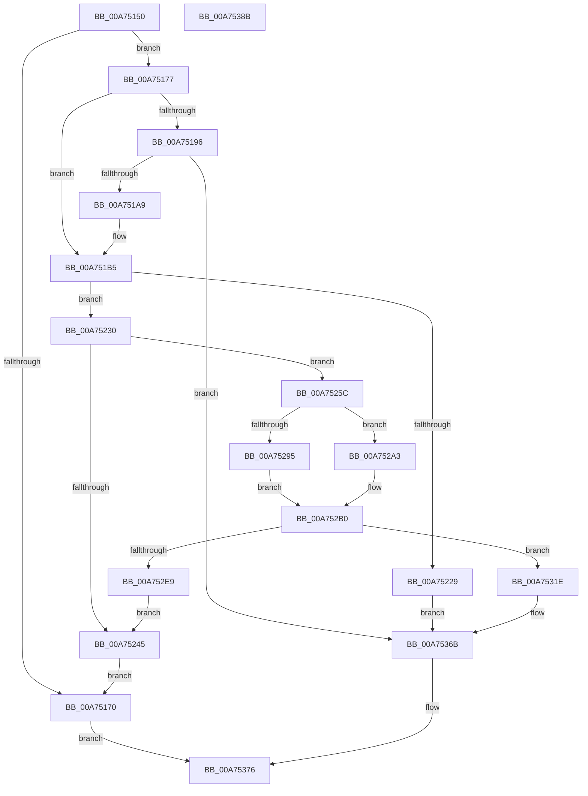

# MiReserveDriverPtes

- RVA: `0x00A75150`–`0x00A7538C` (길이 `572` bytes)
- VA: `0x0000000140A75150`
- 실행 섹션: `PAGE`
- PDB 이름 있음: `예`; PDB Function 태그: `아니요`
- unwind 정보 RVA: `0x000AA2A0`
- 디코드: `157`개 명령, `572/572` bytes 표시
- 미해석 바이트: `0` (있으면 어셈블리에 `.byte`로 보존)

> 이 문서는 커널 이미지의 기계어와 PDB 기호를 분석해 생성했습니다. 4번과 5번은 함수 원형과 자료형을 바이너리 사용 방식에서 추정한 C 해석이며 원본 소스 복구 결과는 아닙니다.

## 1. Dependencies

- 직접 호출 지점: **17**; 고유 호출 대상: **12**
- 직접 호출자로 확인된 함수: **2**
- RIP 상대 이미지 참조: **3**

### Outgoing calls
- `0x00A7518C` → [MiLockDriverMappings](../../text/4B/MiLockDriverMappings_function_004B9D50.md) (function, `0x004B9D50`)
- `0x00A75198` → [MiReserveExistingDriverPtes](../AF/MiReserveExistingDriverPtes_function_00AF84DC.md) (function, `0x00AF84DC`)
- `0x00A751AC` → [ExGenRandom](../../text/41/ExGenRandom_function_0041B010.md) (function, `0x0041B010`)
- `0x00A7521C` → [MiAllocatePool](../../text/35/MiAllocatePool_function_0035B540.md) (function, `0x0035B540`)
- `0x00A75238` → [MiObtainSystemVa](../../text/3B/MiObtainSystemVa_function_003B4F44.md) (function, `0x003B4F44`)
- `0x00A75248` → [MiUnlockDriverMappings](../../text/4B/MiUnlockDriverMappings_function_004B4E54.md) (function, `0x004B4E54`)
- `0x00A75252` → [ExFreePoolWithTag](../../poolcode/B8/ExFreePoolWithTag_function_00B82870.md) (function, `0x00B82870`)
- `0x00A7525F` → [MiGetPteAddress](../../text/43/MiGetPteAddress_function_0043E130.md) (function, `0x0043E130`)
- `0x00A75298` → [RtlSetAllBits](../../text/36/RtlSetAllBits_function_00362490.md) (function, `0x00362490`)
- `0x00A752A9` → [RtlSetBits](../../text/3E/RtlSetBits_function_003E1610.md) (function, `0x003E1610`)
- `0x00A752E0` → [MiMakeZeroedPageTables](../../text/3B/MiMakeZeroedPageTables_function_003B4F6C.md) (function, `0x003B4F6C`)
- `0x00A75314` → [MiReturnSystemVa](../../text/23/MiReturnSystemVa_function_002394C4.md) (function, `0x002394C4`)
- `0x00A75321` → [MiGetPteAddress](../../text/43/MiGetPteAddress_function_0043E130.md) (function, `0x0043E130`)
- `0x00A7532D` → [MiGetPteAddress](../../text/43/MiGetPteAddress_function_0043E130.md) (function, `0x0043E130`)
- `0x00A75342` → [MiGetPteAddress](../../text/43/MiGetPteAddress_function_0043E130.md) (function, `0x0043E130`)
- `0x00A75352` → [RtlSetBits](../../text/3E/RtlSetBits_function_003E1610.md) (function, `0x003E1610`)
- `0x00A7536E` → [MiUnlockDriverMappings](../../text/4B/MiUnlockDriverMappings_function_004B4E54.md) (function, `0x004B4E54`)

### Direct callers
- [MmMapLockedRestartPages](../7F/MmMapLockedRestartPages_function_007F9020.md) at `0x007F9073`
- [MiSelectSystemImageAddress](MiSelectSystemImageAddress_function_00A75110.md) at `0x00A75116`

### Static image references
- `0x00A75205` → RVA `0x00FC6A88` (`ALMOSTRO`; read)
- `0x00A75357` → RVA `0x00E2D960` (`.data`; read)
- `0x00A75364` → RVA `0x00E2D960` (`.data`; write)

## 2. Other-region calls and transfers

- 다른 실행 섹션으로 향하는 call: **16**
  - `0x00A7518C` → [MiLockDriverMappings](../../text/4B/MiLockDriverMappings_function_004B9D50.md) (`PAGE` → `.text`)
  - `0x00A751AC` → [ExGenRandom](../../text/41/ExGenRandom_function_0041B010.md) (`PAGE` → `.text`)
  - `0x00A7521C` → [MiAllocatePool](../../text/35/MiAllocatePool_function_0035B540.md) (`PAGE` → `.text`)
  - `0x00A75238` → [MiObtainSystemVa](../../text/3B/MiObtainSystemVa_function_003B4F44.md) (`PAGE` → `.text`)
  - `0x00A75248` → [MiUnlockDriverMappings](../../text/4B/MiUnlockDriverMappings_function_004B4E54.md) (`PAGE` → `.text`)
  - `0x00A75252` → [ExFreePoolWithTag](../../poolcode/B8/ExFreePoolWithTag_function_00B82870.md) (`PAGE` → `POOLCODE`)
  - `0x00A7525F` → [MiGetPteAddress](../../text/43/MiGetPteAddress_function_0043E130.md) (`PAGE` → `.text`)
  - `0x00A75298` → [RtlSetAllBits](../../text/36/RtlSetAllBits_function_00362490.md) (`PAGE` → `.text`)
  - `0x00A752A9` → [RtlSetBits](../../text/3E/RtlSetBits_function_003E1610.md) (`PAGE` → `.text`)
  - `0x00A752E0` → [MiMakeZeroedPageTables](../../text/3B/MiMakeZeroedPageTables_function_003B4F6C.md) (`PAGE` → `.text`)
  - `0x00A75314` → [MiReturnSystemVa](../../text/23/MiReturnSystemVa_function_002394C4.md) (`PAGE` → `.text`)
  - `0x00A75321` → [MiGetPteAddress](../../text/43/MiGetPteAddress_function_0043E130.md) (`PAGE` → `.text`)
  - `0x00A7532D` → [MiGetPteAddress](../../text/43/MiGetPteAddress_function_0043E130.md) (`PAGE` → `.text`)
  - `0x00A75342` → [MiGetPteAddress](../../text/43/MiGetPteAddress_function_0043E130.md) (`PAGE` → `.text`)
  - `0x00A75352` → [RtlSetBits](../../text/3E/RtlSetBits_function_003E1610.md) (`PAGE` → `.text`)
  - `0x00A7536E` → [MiUnlockDriverMappings](../../text/4B/MiUnlockDriverMappings_function_004B4E54.md) (`PAGE` → `.text`)
- 별도 외부 분기/꼬리 이동을 확인하지 못했습니다.

## 3. Assembly (complete function range)

```asm
00A75150  48 89 5C 24 08                  mov qword ptr [rsp + 8], rbx
00A75155  55                              push rbp
00A75156  56                              push rsi
00A75157  57                              push rdi
00A75158  41 54                           push r12
00A7515A  41 55                           push r13
00A7515C  41 56                           push r14
00A7515E  41 57                           push r15
00A75160  48 83 EC 20                     sub rsp, 0x20
00A75164  4C 8B FA                        mov r15, rdx
00A75167  48 F7 C2 FF FF DF FF            test rdx, -0x200001
00A7516E  74 07                           je 0x140a75177
00A75170  33 C0                           xor eax, eax
00A75172  E9 FF 01 00 00                  jmp 0x140a75376
00A75177  65 48 8B 2C 25 88 01 00 00      mov rbp, qword ptr gs:[0x188]
00A75180  8D 79 0F                        lea edi, [rcx + 0xf]
00A75183  48 8B CD                        mov rcx, rbp
00A75186  C1 EF 04                        shr edi, 4
00A75189  45 33 F6                        xor r14d, r14d
00A7518C  E8 BF 4B A4 FF                  call 0x1404b9d50
00A75191  4D 85 FF                        test r15, r15
00A75194  75 1F                           jne 0x140a751b5
00A75196  8B CF                           mov ecx, edi
00A75198  E8 3F 33 08 00                  call 0x140af84dc
00A7519D  48 8B D8                        mov rbx, rax
00A751A0  48 85 C0                        test rax, rax
00A751A3  0F 85 C2 01 00 00               jne 0x140a7536b
00A751A9  8D 48 01                        lea ecx, [rax + 1]
00A751AC  E8 5F 5E 9A FF                  call 0x14041b010
00A751B1  44 0F B6 F0                     movzx r14d, al
00A751B5  46 8D 2C 37                     lea r13d, [rdi + r14]
00A751B9  41 B8 4D 6D 44 70               mov r8d, 0x70446d4d
00A751BF  41 C1 E5 04                     shl r13d, 4
00A751C3  41 81 C5 FF 01 00 00            add r13d, 0x1ff
00A751CA  41 81 E5 00 FE FF FF            and r13d, 0xfffffe00
00A751D1  41 8B C5                        mov eax, r13d
00A751D4  48 89 44 24 78                  mov qword ptr [rsp + 0x78], rax
00A751D9  48 C1 E8 04                     shr rax, 4
00A751DD  48 89 44 24 68                  mov qword ptr [rsp + 0x68], rax
00A751E2  48 C1 E8 03                     shr rax, 3
00A751E6  48 83 C0 3F                     add rax, 0x3f
00A751EA  41 C1 ED 09                     shr r13d, 9
00A751EE  48 83 E0 F8                     and rax, 0xfffffffffffffff8
00A751F2  41 8B D5                        mov edx, r13d
00A751F5  48 83 C2 07                     add rdx, 7
00A751F9  48 89 44 24 70                  mov qword ptr [rsp + 0x70], rax
00A751FE  48 83 E2 F8                     and rdx, 0xfffffffffffffff8
00A75202  48 03 D0                        add rdx, rax
00A75205  8A 05 7D 18 55 00               mov al, byte ptr [rip + 0x55187d]
00A7520B  24 30                           and al, 0x30
00A7520D  F6 D8                           neg al
00A7520F  48 1B C9                        sbb rcx, rcx
00A75212  81 E1 C0 00 00 00               and ecx, 0xc0
00A75218  48 83 C1 40                     add rcx, 0x40
00A7521C  E8 1F 63 8E FF                  call 0x14035b540
00A75221  48 8B F0                        mov rsi, rax
00A75224  48 85 C0                        test rax, rax
00A75227  75 07                           jne 0x140a75230
00A75229  33 DB                           xor ebx, ebx
00A7522B  E9 3B 01 00 00                  jmp 0x140a7536b
00A75230  BA 0B 00 00 00                  mov edx, 0xb
00A75235  41 8B CD                        mov ecx, r13d
00A75238  E8 07 FD 93 FF                  call 0x1403b4f44
00A7523D  4C 8B E0                        mov r12, rax
00A75240  48 85 C0                        test rax, rax
00A75243  75 17                           jne 0x140a7525c
00A75245  48 8B CD                        mov rcx, rbp
00A75248  E8 07 FC A3 FF                  call 0x1404b4e54
00A7524D  33 D2                           xor edx, edx
00A7524F  48 8B CE                        mov rcx, rsi
00A75252  E8 19 D6 10 00                  call 0x140b82870
00A75257  E9 14 FF FF FF                  jmp 0x140a75170
00A7525C  49 8B CC                        mov rcx, r12
00A7525F  E8 CC 8E 9C FF                  call 0x14043e130
00A75264  48 8D 56 38                     lea rdx, [rsi + 0x38]
00A75268  48 8B D8                        mov rbx, rax
00A7526B  48 8B 44 24 68                  mov rax, qword ptr [rsp + 0x68]
00A75270  48 8D 4E 10                     lea rcx, [rsi + 0x10]
00A75274  48 89 51 08                     mov qword ptr [rcx + 8], rdx
00A75278  41 8D 55 07                     lea edx, [r13 + 7]
00A7527C  83 E2 F8                        and edx, 0xfffffff8
00A7527F  89 01                           mov dword ptr [rcx], eax
00A75281  89 56 28                        mov dword ptr [rsi + 0x28], edx
00A75284  48 8B 54 24 70                  mov rdx, qword ptr [rsp + 0x70]
00A75289  48 03 D6                        add rdx, rsi
00A7528C  48 89 56 30                     mov qword ptr [rsi + 0x30], rdx
00A75290  4D 85 FF                        test r15, r15
00A75293  74 0E                           je 0x140a752a3
00A75295  45 33 F6                        xor r14d, r14d
00A75298  E8 F3 D1 8E FF                  call 0x140362490
00A7529D  41 8D 46 01                     lea eax, [r14 + 1]
00A752A1  EB 0D                           jmp 0x140a752b0
00A752A3  44 8B C7                        mov r8d, edi
00A752A6  41 8B D6                        mov edx, r14d
00A752A9  E8 62 C3 96 FF                  call 0x1403e1610
00A752AE  33 C0                           xor eax, eax
00A752B0  89 46 24                        mov dword ptr [rsi + 0x24], eax
00A752B3  41 BF 0B 00 00 00               mov r15d, 0xb
00A752B9  42 8D 04 37                     lea eax, [rdi + r14]
00A752BD  48 89 5E 08                     mov qword ptr [rsi + 8], rbx
00A752C1  49 C1 E6 07                     shl r14, 7
00A752C5  45 8B CF                        mov r9d, r15d
00A752C8  4C 03 F3                        add r14, rbx
00A752CB  C1 E7 04                        shl edi, 4
00A752CE  45 8D 47 F6                     lea r8d, [r15 - 0xa]
00A752D2  89 46 20                        mov dword ptr [rsi + 0x20], eax
00A752D5  49 8B CE                        mov rcx, r14
00A752D8  49 8D 3C FE                     lea rdi, [r14 + rdi*8]
00A752DC  48 8D 57 F8                     lea rdx, [rdi - 8]
00A752E0  E8 87 FC 93 FF                  call 0x1403b4f6c
00A752E5  85 C0                           test eax, eax
00A752E7  75 35                           jne 0x140a7531e
00A752E9  48 C1 E3 19                     shl rbx, 0x19
00A752ED  48 B8 00 00 00 00 80 F6 FF FF   movabs rax, 0xfffff68000000000
00A752F7  48 8B 54 24 78                  mov rdx, qword ptr [rsp + 0x78]
00A752FC  45 8B C7                        mov r8d, r15d
00A752FF  48 C1 E2 1C                     shl rdx, 0x1c
00A75303  49 8B CC                        mov rcx, r12
00A75306  48 C1 E0 19                     shl rax, 0x19
00A7530A  48 2B D8                        sub rbx, rax
00A7530D  48 03 D3                        add rdx, rbx
00A75310  48 C1 FA 10                     sar rdx, 0x10
00A75314  E8 AB 41 7C FF                  call 0x1402394c4
00A75319  E9 27 FF FF FF                  jmp 0x140a75245
00A7531E  49 8B CE                        mov rcx, r14
00A75321  E8 0A 8E 9C FF                  call 0x14043e130
00A75326  48 8D 4F F8                     lea rcx, [rdi - 8]
00A7532A  48 8B D0                        mov rdx, rax
00A7532D  E8 FE 8D 9C FF                  call 0x14043e130
00A75332  4C 8B C0                        mov r8, rax
00A75335  48 8B CB                        mov rcx, rbx
00A75338  4C 2B C2                        sub r8, rdx
00A7533B  49 C1 F8 03                     sar r8, 3
00A7533F  41 FF C0                        inc r8d
00A75342  E8 E9 8D 9C FF                  call 0x14043e130
00A75347  48 2B D0                        sub rdx, rax
00A7534A  48 8D 4E 28                     lea rcx, [rsi + 0x28]
00A7534E  48 C1 FA 03                     sar rdx, 3
00A75352  E8 B9 C2 96 FF                  call 0x1403e1610
00A75357  48 8B 05 02 86 3B 00            mov rax, qword ptr [rip + 0x3b8602]
00A7535E  49 8B DE                        mov rbx, r14
00A75361  48 89 06                        mov qword ptr [rsi], rax
00A75364  48 89 35 F5 85 3B 00            mov qword ptr [rip + 0x3b85f5], rsi
00A7536B  48 8B CD                        mov rcx, rbp
00A7536E  E8 E1 FA A3 FF                  call 0x1404b4e54
00A75373  48 8B C3                        mov rax, rbx
00A75376  48 8B 5C 24 60                  mov rbx, qword ptr [rsp + 0x60]
00A7537B  48 83 C4 20                     add rsp, 0x20
00A7537F  41 5F                           pop r15
00A75381  41 5E                           pop r14
00A75383  41 5D                           pop r13
00A75385  41 5C                           pop r12
00A75387  5F                              pop rdi
00A75388  5E                              pop rsi
00A75389  5D                              pop rbp
00A7538A  C3                              ret
00A7538B  CC                              int3
```

## 4. C-style interpretation (structured pseudocode)

```c
__int64 __fastcall MiReserveDriverPtes(__int64 a1, __int64 a2)
{
    __int64 result;
    __int64 v_r13;
    __int64 v_r14;
    __int64 v_rbx;
    __int64 v_rdi;
    __int64 v_rsp;
    unsigned __int64 v_stack_p10;
    unsigned __int64 v_stack_p18;
    unsigned __int64 v_stack_p20;
    unsigned __int64 v_stack_p8;

    v_stack_p8 = v_rbx;
    v_rsp = (v_rsp) - (32);
    if (((a2) & (0xFFFFFFFFFFDFFFFFULL)) == 0) goto loc_00A75177;
loc_00A75170:
    result = 0;
    goto loc_00A75376;
loc_00A75177:
    v_rdi = (unsigned int)((a1 + 15) >> (4));
    v_r14 = 0;
    result = MiLockDriverMappings(*(unsigned __int64 *)(gs_base + (0 + 392)), a2, a3, a4);
    if (a2 != 0) goto loc_00A751B5;
    result = MiReserveExistingDriverPtes((unsigned int)((unsigned int)(v_rdi)), a2, a3, a4);
    if (result != 0) goto loc_00A7536B;
    result = ExGenRandom(result + 1, a2, a3, a4);
loc_00A751B5:
    v_r13 = (unsigned int)((v_rdi + (unsigned __int8)(result) * 1) << (4));
    v_r13 = (unsigned int)((v_r13) + (511));
    v_r13 = (unsigned int)((v_r13) & (0xFFFFFE00ULL));
    v_stack_p20 = (unsigned int)((unsigned int)(v_r13));
    result = ((unsigned int)((unsigned int)(v_r13))) >> (4);
    v_stack_p10 = result;
    result = (result) >> (3);
    result = (result) + (63);
    v_r13 = (unsigned int)((v_r13) >> (9));
    result = (result) & (-8);
    a2 = ((unsigned int)((unsigned int)(v_r13))) + (7);
    v_stack_p18 = result;
    a2 = (a2) & (-8);
    a2 = (a2) + (result);
    result = (unsigned __int8)((*(unsigned __int8 *)(v_rip + 5576829)) & (48));
    result = (unsigned __int8)(-(result));
    a1 = (unsigned int)((result + 1) & (192));
    a1 = (a1) + (64);
    result = MiAllocatePool(a1, a2, (unsigned int)(0x70446D4DULL), a4);
    if (result != 0) goto loc_00A75230;
    v_rbx = 0;
    goto loc_00A7536B;
loc_00A75230:
    result = MiObtainSystemVa((unsigned int)((unsigned int)(v_r13)), 11, (unsigned int)(0x70446D4DULL), a4);
    if (result != 0) goto loc_00A7525C;
loc_00A75245:
    result = MiUnlockDriverMappings(*(unsigned __int64 *)(gs_base + (0 + 392)), 11, (unsigned int)(0x70446D4DULL), a4);
    a2 = 0;
    result = ExFreePoolWithTag(result, a2, (unsigned int)(0x70446D4DULL), a4);
    goto loc_00A75170;
loc_00A7525C:
    result = MiGetPteAddress(result, a2, (unsigned int)(0x70446D4DULL), a4);
    *(unsigned __int64 *)(result + 16 + 8) = result + 56;
    a2 = (unsigned int)((v_r13 + 7) & (0xFFFFFFF8ULL));
    *(unsigned int *)(result + 16) = (unsigned int)(v_stack_p10);
    *(unsigned int *)(result + 40) = (unsigned int)(a2);
    a2 = (v_stack_p18) + (result);
    *(unsigned __int64 *)(result + 48) = a2;
    if (a2 == 0) goto loc_00A752A3;
    v_r14 = 0;
    result = RtlSetAllBits(result + 16, a2, (unsigned int)(0x70446D4DULL), a4);
    goto loc_00A752B0;
loc_00A752A3:
    result = RtlSetBits(result + 16, 0, (unsigned int)((unsigned int)(v_rdi)), a4);
    result = 0;
loc_00A752B0:
    *(unsigned int *)(result + 36) = 0;
    *(unsigned __int64 *)(result + 8) = 0;
    v_r14 = (v_r14) << (7);
    v_r14 = (v_r14) + (0);
    v_rdi = (unsigned int)((v_rdi) << (4));
    *(unsigned int *)(result + 32) = (unsigned int)(v_rdi + v_r14 * 1);
    result = MiMakeZeroedPageTables(v_r14, v_r14 + v_rdi * 8 - 8, 11 - 10, 11);
    if ((unsigned int)(result) != 0) goto loc_00A7531E;
    v_rbx = (result) << (25);
    a2 = (v_stack_p20) << (28);
    result = (result) << (25);
    v_rbx = (v_rbx) - (result);
    a2 = (a2) + (v_rbx);
    a2 = (a2) >> (16);
    result = MiReturnSystemVa(result, a2, 11, 11);
    goto loc_00A75245;
loc_00A7531E:
    result = MiGetPteAddress(v_r14, a2, 11, 11);
    result = MiGetPteAddress(v_r14 + v_rdi * 8 - 8, result, 11, 11);
    a3 = (result) - (result);
    a3 = (a3) >> (3);
    a3 = (unsigned int)((a3) + 1);
    result = MiGetPteAddress(v_rbx, result, a3, 11);
    a2 = (result) - (result);
    a2 = (a2) >> (3);
    result = RtlSetBits(result + 40, a2, a3, 11);
    *(unsigned __int64 *)(result) = *(unsigned __int64 *)(v_rip + 3900930);
    *(unsigned __int64 *)(v_rip + 3900917) = result;
loc_00A7536B:
    result = MiUnlockDriverMappings(*(unsigned __int64 *)(gs_base + (0 + 392)), a2, a3, 11);
loc_00A75376:
    v_rsp = (v_rsp) + (32);
    return v_r14;
}
```

## 5. (Beta) C Style

```c
int64_t MiReserveDriverPtes(void *Arg1, int64_t Arg2)
{
    uint8_t *arg1 = (uint8_t *)Arg1;

    int64_t result;
    int64_t local_r13;
    int64_t local_r14;
    int64_t local_rbx;
    int64_t local_rdi;
    int64_t local_rsp;
    uint64_t v_stack_p10;
    uint64_t v_stack_p18;
    uint64_t v_stack_p20;
    uint64_t v_stack_p8;

    v_stack_p8 = local_rbx;
    local_rsp = (local_rsp) - (32);
    if (((Arg2) & (0xFFFFFFFFFFDFFFFFULL)) == 0) goto loc_00A75177;
loc_00A75170:
    result = 0;
    goto loc_00A75376;
loc_00A75177:
    local_rdi = (uint32_t)((Arg1 + 15) >> (4));
    local_r14 = 0;
    result = MiLockDriverMappings(*(uint64_t *)(gs_base + (0 + 0x188)), Arg2, a3, a4);
    if (Arg2 != 0) goto loc_00A751B5;
    result = MiReserveExistingDriverPtes((uint32_t)((uint32_t)(local_rdi)), Arg2, a3, a4);
    if (result != 0) goto loc_00A7536B;
    result = ExGenRandom(result + 1, Arg2, a3, a4);
loc_00A751B5:
    local_r13 = (uint32_t)((local_rdi + (uint8_t)(result) * 1) << (4));
    local_r13 = (uint32_t)((local_r13) + (511));
    local_r13 = (uint32_t)((local_r13) & (0xFFFFFE00ULL));
    v_stack_p20 = (uint32_t)((uint32_t)(local_r13));
    result = ((uint32_t)((uint32_t)(local_r13))) >> (4);
    v_stack_p10 = result;
    result = (result) >> (3);
    result = (result) + (63);
    local_r13 = (uint32_t)((local_r13) >> (9));
    result = (result) & (-8);
    Arg2 = ((uint32_t)((uint32_t)(local_r13))) + (7);
    v_stack_p18 = result;
    Arg2 = (Arg2) & (-8);
    Arg2 = (Arg2) + (result);
    result = (uint8_t)((*(uint8_t *)(v_rip + 0x55187D)) & (48));
    result = (uint8_t)(-(result));
    Arg1 = (uint32_t)((result + 1) & (192));
    Arg1 = (Arg1) + (64);
    result = MiAllocatePool(Arg1, Arg2, (uint32_t)(0x70446D4DULL), a4);
    if (result != 0) goto loc_00A75230;
    local_rbx = 0;
    goto loc_00A7536B;
loc_00A75230:
    result = MiObtainSystemVa((uint32_t)((uint32_t)(local_r13)), 11, (uint32_t)(0x70446D4DULL), a4);
    if (result != 0) goto loc_00A7525C;
loc_00A75245:
    result = MiUnlockDriverMappings(*(uint64_t *)(gs_base + (0 + 0x188)), 11, (uint32_t)(0x70446D4DULL), a4);
    Arg2 = 0;
    result = ExFreePoolWithTag(result, Arg2, (uint32_t)(0x70446D4DULL), a4);
    goto loc_00A75170;
loc_00A7525C:
    result = MiGetPteAddress(result, Arg2, (uint32_t)(0x70446D4DULL), a4);
    *(uint64_t *)(result + 0x10 + 0x8) = result + 56;
    Arg2 = (uint32_t)((local_r13 + 7) & (0xFFFFFFF8ULL));
    *(uint32_t *)(result + 0x10) = (uint32_t)(v_stack_p10);
    *(uint32_t *)(result + 0x28) = (uint32_t)(Arg2);
    Arg2 = (v_stack_p18) + (result);
    *(uint64_t *)(result + 0x30) = Arg2;
    if (Arg2 == 0) goto loc_00A752A3;
    local_r14 = 0;
    result = RtlSetAllBits(result + 16, Arg2, (uint32_t)(0x70446D4DULL), a4);
    goto loc_00A752B0;
loc_00A752A3:
    result = RtlSetBits(result + 16, 0, (uint32_t)((uint32_t)(local_rdi)), a4);
    result = 0;
loc_00A752B0:
    *(uint32_t *)(result + 0x24) = 0;
    *(uint64_t *)(result + 0x8) = 0;
    local_r14 = (local_r14) << (7);
    local_r14 = (local_r14) + (0);
    local_rdi = (uint32_t)((local_rdi) << (4));
    *(uint32_t *)(result + 0x20) = (uint32_t)(local_rdi + local_r14 * 1);
    result = MiMakeZeroedPageTables(local_r14, local_r14 + local_rdi * 8 - 8, 11 - 10, 11);
    if ((uint32_t)(result) != 0) goto loc_00A7531E;
    local_rbx = (result) << (25);
    Arg2 = (v_stack_p20) << (28);
    result = (result) << (25);
    local_rbx = (local_rbx) - (result);
    Arg2 = (Arg2) + (local_rbx);
    Arg2 = (Arg2) >> (16);
    result = MiReturnSystemVa(result, Arg2, 11, 11);
    goto loc_00A75245;
loc_00A7531E:
    result = MiGetPteAddress(local_r14, Arg2, 11, 11);
    result = MiGetPteAddress(local_r14 + local_rdi * 8 - 8, result, 11, 11);
    a3 = (result) - (result);
    a3 = (a3) >> (3);
    a3 = (uint32_t)((a3) + 1);
    result = MiGetPteAddress(local_rbx, result, a3, 11);
    Arg2 = (result) - (result);
    Arg2 = (Arg2) >> (3);
    result = RtlSetBits(result + 40, Arg2, a3, 11);
    *(uint64_t *)(result) = *(uint64_t *)(v_rip + 0x3B8602);
    *(uint64_t *)(v_rip + 0x3B85F5) = result;
loc_00A7536B:
    result = MiUnlockDriverMappings(*(uint64_t *)(gs_base + (0 + 0x188)), Arg2, a3, 11);
loc_00A75376:
    local_rsp = (local_rsp) + (32);
    return local_r14;
}
```

### 관측된 메모리 오프셋

구조체 형식이 확인되지 않은 접근은 인자 기준의 오프셋으로만 기록했습니다.

| 기준 인자 | 오프셋 표현 | 폭 (bit) | 접근 |
|---|---:|---:|---|
| `Arg1` | `+ 0xF` | `32` | `R` |

## 6. Execution-region graph

[열기: 2D/3D 그래프와 함수 탐색 컨트롤 패널](../../../control-panel.html?section=page&rva=0x00A75150&view=graph)

- 2D 그래프는 위에서 아래로 흐르고, 3D 그래프는 빈 공간을 드래그해 회전합니다. Shift+드래그는 이동, 휠은 확대·축소, 함수 노드 선택은 대상 보고서 이동입니다.

### Static fallback


