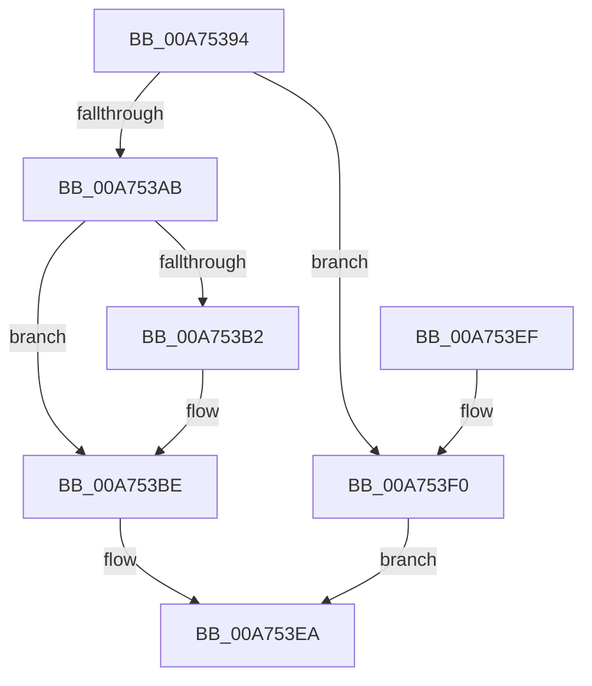

# MiReservePrivilegedPtes

- RVA: `0x00A75394`–`0x00A753F4` (길이 `96` bytes)
- VA: `0x0000000140A75394`
- 실행 섹션: `PAGE`
- PDB 이름 있음: `예`; PDB Function 태그: `아니요`
- unwind 정보 RVA: `0x00069B1C`
- 디코드: `25`개 명령, `96/96` bytes 표시
- 미해석 바이트: `0` (있으면 어셈블리에 `.byte`로 보존)

> 이 문서는 커널 이미지의 기계어와 PDB 기호를 분석해 생성했습니다. 4번과 5번은 함수 원형과 자료형을 바이너리 사용 방식에서 추정한 C 해석이며 원본 소스 복구 결과는 아닙니다.

## 1. Dependencies

- 직접 호출 지점: **1**; 고유 호출 대상: **1**
- 직접 호출자로 확인된 함수: **1**
- RIP 상대 이미지 참조: **1**

### Outgoing calls
- `0x00A753E5` → [KeReservePrivilegedPages](../../text/4B/KeReservePrivilegedPages_function_004BEAE8.md) (function, `0x004BEAE8`)

### Direct callers
- [MiGetSystemAddressForImage](MiGetSystemAddressForImage_function_00A74EEC.md) at `0x00A74FEF`
- [MiGetSystemAddressForImage](MiGetSystemAddressForImage_function_00A74EEC.md) at `0x00A7505E`

### Static image references
- `0x00A75398` → RVA `0x00FC6A88` (`ALMOSTRO`; read)

## 2. Other-region calls and transfers

- 다른 실행 섹션으로 향하는 call: **1**
  - `0x00A753E5` → [KeReservePrivilegedPages](../../text/4B/KeReservePrivilegedPages_function_004BEAE8.md) (`PAGE` → `.text`)
- 별도 외부 분기/꼬리 이동을 확인하지 못했습니다.

## 3. Assembly (complete function range)

```asm
00A75394  48 83 EC 28                     sub rsp, 0x28
00A75398  48 F7 05 E5 16 55 00 00 40 00 00  test qword ptr [rip + 0x5516e5], 0x4000
00A753A3  45 8B D9                        mov r11d, r9d
00A753A6  4C 8B D1                        mov r10, rcx
00A753A9  74 45                           je 0x140a753f0
00A753AB  33 C9                           xor ecx, ecx
00A753AD  4D 85 D2                        test r10, r10
00A753B0  74 0C                           je 0x140a753be
00A753B2  49 8B 42 60                     mov rax, qword ptr [r10 + 0x60]
00A753B6  48 83 E0 F8                     and rax, 0xfffffffffffffff8
00A753BA  48 8B 48 40                     mov rcx, qword ptr [rax + 0x40]
00A753BE  41 F6 C3 20                     test r11b, 0x20
00A753C2  41 B9 04 00 00 00               mov r9d, 4
00A753C8  45 0F 44 CB                     cmove r9d, r11d
00A753CC  48 C1 E2 19                     shl rdx, 0x19
00A753D0  48 B8 00 00 00 00 80 F6 FF FF   movabs rax, 0xfffff68000000000
00A753DA  48 C1 E0 19                     shl rax, 0x19
00A753DE  48 2B D0                        sub rdx, rax
00A753E1  48 C1 FA 10                     sar rdx, 0x10
00A753E5  E8 FE 96 A4 FF                  call 0x1404beae8
00A753EA  48 83 C4 28                     add rsp, 0x28
00A753EE  C3                              ret
00A753EF  CC                              int3
00A753F0  33 C0                           xor eax, eax
00A753F2  EB F6                           jmp 0x140a753ea
```

## 4. C-style interpretation (structured pseudocode)

```c
__int64 __fastcall MiReservePrivilegedPtes(__int64 a1, __int64 a2, __int64 a3, int a4)
{
    __int64 result;
    __int64 v_rsp;

    v_rsp = (v_rsp) - (40);
    if (((*(unsigned __int64 *)(v_rip + 5576421)) & (0x4000ULL)) == 0) goto loc_00A753F0;
    a1 = 0;
    if (0 != 0) {
        result = *(unsigned __int64 *)(a1 + 96);
        result = (result) & (-8);
        a1 = *(unsigned __int64 *)(result + 64);
    }
    a4 = 4;
    if ((((unsigned __int8)((unsigned int)(a4))) & (32)) == 0) { a4 = (unsigned int)((unsigned int)(a4)); }
    a2 = (a2) << (25);
    result = (result) << (25);
    a2 = (a2) - (result);
    a2 = (a2) >> (16);
    result = KeReservePrivilegedPages(a1, a2, a3, a4);
loc_00A753EA:
    v_rsp = (v_rsp) + (40);
    return result;
loc_00A753F0:
    result = 0;
    goto loc_00A753EA;
}
```

## 5. (Beta) C Style

```c
int64_t MiReservePrivilegedPtes(int64_t Arg1, int64_t Arg2, int64_t Arg3, int32_t Arg4)
{
    int64_t result;
    int64_t local_rsp;

    local_rsp = (local_rsp) - (40);
    if (((*(uint64_t *)(v_rip + 0x5516E5)) & (0x4000ULL)) == 0) goto loc_00A753F0;
    Arg1 = 0;
    if (0 != 0) {
        result = *(uint64_t *)(Arg1 + 0x60);
        result = (result) & (-8);
        Arg1 = *(uint64_t *)(result + 0x40);
    }
    Arg4 = 4;
    if ((((uint8_t)((uint32_t)(Arg4))) & (32)) == 0) { Arg4 = (uint32_t)((uint32_t)(Arg4)); }
    Arg2 = (Arg2) << (25);
    result = (result) << (25);
    Arg2 = (Arg2) - (result);
    Arg2 = (Arg2) >> (16);
    result = KeReservePrivilegedPages(Arg1, Arg2, Arg3, Arg4);
loc_00A753EA:
    local_rsp = (local_rsp) + (40);
    return result;
loc_00A753F0:
    result = 0;
    goto loc_00A753EA;
}
```

## 6. Execution-region graph

[열기: 2D/3D 그래프와 함수 탐색 컨트롤 패널](../../../control-panel.html?section=page&rva=0x00A75394&view=graph)

- 2D 그래프는 위에서 아래로 흐르고, 3D 그래프는 빈 공간을 드래그해 회전합니다. Shift+드래그는 이동, 휠은 확대·축소, 함수 노드 선택은 대상 보고서 이동입니다.

### Static fallback


