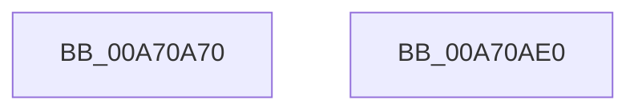

# MiResolveMemoryEvent

- RVA: `0x00A70A70`–`0x00A70AE1` (길이 `113` bytes)
- VA: `0x0000000140A70A70`
- 실행 섹션: `PAGE`
- PDB 이름 있음: `예`; PDB Function 태그: `아니요`
- unwind 정보 RVA: `0x00063458`
- 디코드: `24`개 명령, `113/113` bytes 표시
- 미해석 바이트: `0` (있으면 어셈블리에 `.byte`로 보존)

> 이 문서는 커널 이미지의 기계어와 PDB 기호를 분석해 생성했습니다. 4번과 5번은 함수 원형과 자료형을 바이너리 사용 방식에서 추정한 C 해석이며 원본 소스 복구 결과는 아닙니다.

## 1. Dependencies

- 직접 호출 지점: **2**; 고유 호출 대상: **2**
- 직접 호출자로 확인된 함수: **0**
- RIP 상대 이미지 참조: **1**

### Outgoing calls
- `0x00A70A7D` → [MiGetThreadPartition](../../text/43/MiGetThreadPartition_function_0043F570.md) (function, `0x0043F570`)
- `0x00A70AD6` → [ObpReferenceObjectByHandleWithTag](../86/ObpReferenceObjectByHandleWithTag_function_00869650.md) (function, `0x00869650`)

### Direct callers
- 이 함수 시작 RVA로 연결되는 직접 call은 확인되지 않았습니다. 간접 호출은 완전히 역산할 수 없습니다.

### Static image references
- `0x00A70A91` → RVA `0x00003030` (`.rdata`; read)

## 2. Other-region calls and transfers

- 다른 실행 섹션으로 향하는 call: **1**
  - `0x00A70A7D` → [MiGetThreadPartition](../../text/43/MiGetThreadPartition_function_0043F570.md) (`PAGE` → `.text`)
- 별도 외부 분기/꼬리 이동을 확인하지 못했습니다.

## 3. Assembly (complete function range)

```asm
00A70A70  48 83 EC 48                     sub rsp, 0x48
00A70A74  65 48 8B 0C 25 88 01 00 00      mov rcx, qword ptr gs:[0x188]
00A70A7D  E8 EE EA 9C FF                  call 0x14043f570
00A70A82  48 83 64 24 38 00               and qword ptr [rsp + 0x38], 0
00A70A88  48 83 64 24 30 00               and qword ptr [rsp + 0x30], 0
00A70A8E  48 63 CA                        movsxd rcx, edx
00A70A91  48 8D 15 98 25 59 FF            lea rdx, [rip - 0xa6da68]
00A70A98  48 03 C9                        add rcx, rcx
00A70A9B  4C 89 4C 24 28                  mov qword ptr [rsp + 0x28], r9
00A70AA0  45 33 C9                        xor r9d, r9d
00A70AA3  C7 44 24 20 4D 6D 50 6F         mov dword ptr [rsp + 0x20], 0x6f506d4d
00A70AAB  0F 10 04 CA                     movups xmm0, xmmword ptr [rdx + rcx*8]
00A70AAF  B9 FE FF 00 00                  mov ecx, 0xfffe
00A70AB4  BA 0F 00 0F 00                  mov edx, 0xf000f
00A70AB9  F3 41 0F 7F 00                  movdqu xmmword ptr [r8], xmm0
00A70ABE  49 83 40 08 02                  add qword ptr [r8 + 8], 2
00A70AC3  66 41 01 08                     add word ptr [r8], cx
00A70AC7  66 41 01 48 02                  add word ptr [r8 + 2], cx
00A70ACC  45 33 C0                        xor r8d, r8d
00A70ACF  48 8B 88 E8 00 00 00            mov rcx, qword ptr [rax + 0xe8]
00A70AD6  E8 75 8B DF FF                  call 0x140869650
00A70ADB  48 83 C4 48                     add rsp, 0x48
00A70ADF  C3                              ret
00A70AE0  CC                              int3
```

## 4. C-style interpretation (structured pseudocode)

```c
__int64 __fastcall MiResolveMemoryEvent(__int64 a1, int a2, __int64 a3, __int64 a4)
{
    __int64 result;
    __int64 v_rsp;
    unsigned __int64 v_stack_m10;
    unsigned __int64 v_stack_m18;
    unsigned __int64 v_stack_m20;
    unsigned int v_stack_m28;

    v_rsp = (v_rsp) - (72);
    result = MiGetThreadPartition(*(unsigned __int64 *)(gs_base + (0 + 392)), a2, a3, a4);
    a1 = ((int)(a2)) + ((int)(a2));
    v_stack_m20 = a4;
    a4 = 0;
    v_stack_m28 = 0x6F506D4DULL;
    *(unsigned __int64 *)(a3) = v_xmm0;
    a3 = 0;
    result = ObpReferenceObjectByHandleWithTag(*(unsigned __int64 *)(result + 232), (unsigned int)(0xF000FULL), a3, a4);
    v_rsp = (v_rsp) + (72);
    return result;
}
```

## 5. (Beta) C Style

```c
int64_t MiResolveMemoryEvent(int64_t Arg1, int32_t Arg2, int64_t Arg3, int64_t Arg4)
{
    int64_t result;
    int64_t local_rsp;
    uint64_t v_stack_m10;
    uint64_t v_stack_m18;
    uint64_t v_stack_m20;
    uint32_t v_stack_m28;

    local_rsp = (local_rsp) - (72);
    result = MiGetThreadPartition(*(uint64_t *)(gs_base + (0 + 0x188)), Arg2, Arg3, Arg4);
    Arg1 = ((int32_t)(Arg2)) + ((int32_t)(Arg2));
    v_stack_m20 = Arg4;
    Arg4 = 0;
    v_stack_m28 = 0x6F506D4DULL;
    *(uint64_t *)(Arg3) = v_xmm0;
    Arg3 = 0;
    result = ObpReferenceObjectByHandleWithTag(*(uint64_t *)(result + 0xE8), (uint32_t)(0xF000FULL), Arg3, Arg4);
    local_rsp = (local_rsp) + (72);
    return result;
}
```

## 6. Execution-region graph

[열기: 2D/3D 그래프와 함수 탐색 컨트롤 패널](../../../control-panel.html?section=page&rva=0x00A70A70&view=graph)

- 2D 그래프는 위에서 아래로 흐르고, 3D 그래프는 빈 공간을 드래그해 회전합니다. Shift+드래그는 이동, 휠은 확대·축소, 함수 노드 선택은 대상 보고서 이동입니다.

### Static fallback


