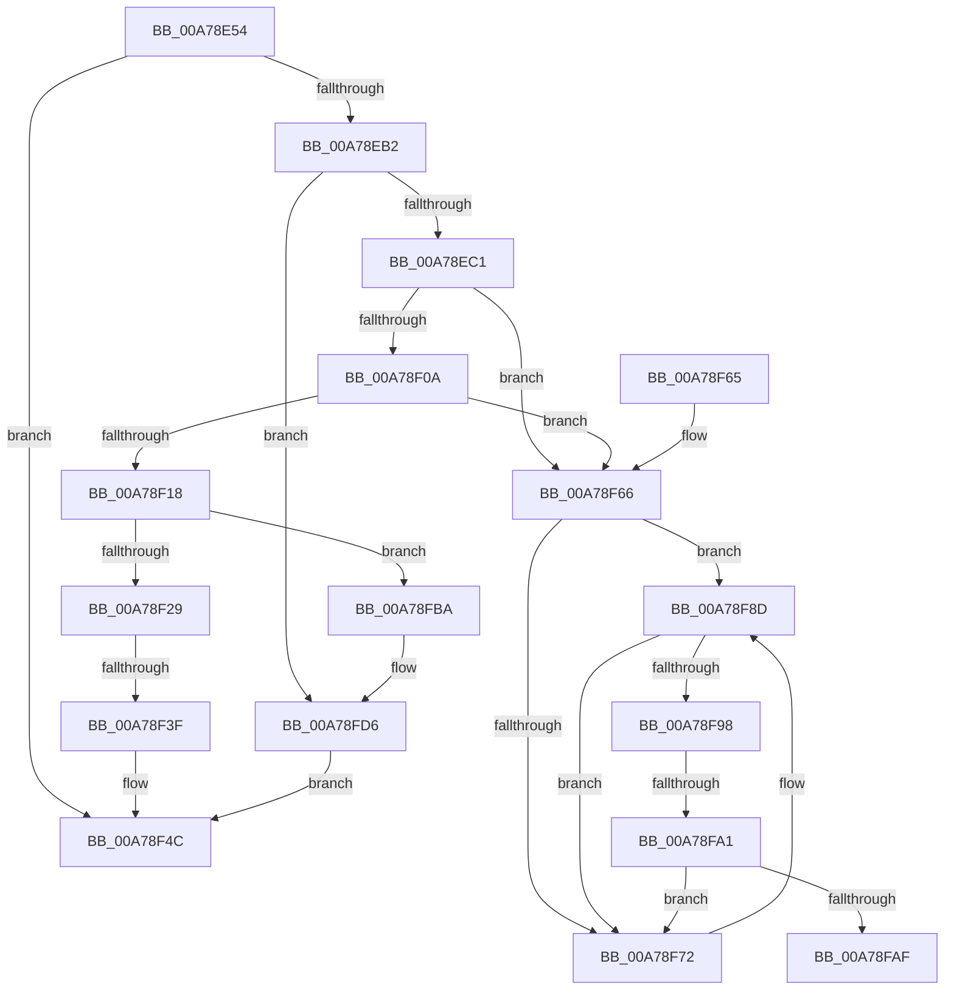

# MiUnmapLockedPagesInUserSpace

- RVA: `0x00A78E54`–`0x00A78FE3` (길이 `399` bytes)
- VA: `0x0000000140A78E54`
- 실행 섹션: `PAGE`
- PDB 이름 있음: `예`; PDB Function 태그: `예`
- unwind 정보 RVA: `0x000B6124`
- 디코드: `110`개 명령, `399/399` bytes 표시
- 미해석 바이트: `0` (있으면 어셈블리에 `.byte`로 보존)

> 이 문서는 커널 이미지의 기계어와 PDB 기호를 분석해 생성했습니다. 4번과 5번은 함수 원형과 자료형을 바이너리 사용 방식에서 추정한 C 해석이며 원본 소스 복구 결과는 아닙니다.

## 1. Dependencies

- 직접 호출 지점: **9**; 고유 호출 대상: **8**
- 직접 호출자로 확인된 함수: **1**
- RIP 상대 이미지 참조: **0**

### Outgoing calls
- `0x00A78E79` → [MiGetPteAddress](../../text/43/MiGetPteAddress_function_0043E130.md) (function, `0x0043E130`)
- `0x00A78EA1` → [MiObtainReferencedVadEx](../../text/31/MiObtainReferencedVadEx_function_00316690.md) (function, `0x00316690`)
- `0x00A78F1B` → [MiLocateOldestSecure](../../text/43/MiLocateOldestSecure_function_00430D10.md) (function, `0x00430D10`)
- `0x00A78F2F` → [MiRemoveSecureEntry](../../text/43/MiRemoveSecureEntry_function_00430D5C.md) (function, `0x00430D5C`)
- `0x00A78F47` → [MiDeleteVad](../88/MiDeleteVad_function_00888C80.md) (function, `0x00888C80`)
- `0x00A78F87` → [KeBugCheckEx](../../text/4F/KeBugCheckEx_function_004FD660.md) (function, `0x004FD660`)
- `0x00A78FA5` → [MI_READ_PTE_LOCK_FREE](../../text/28/MI_READ_PTE_LOCK_FREE_function_002828A0.md) (function, `0x002828A0`)
- `0x00A78FD0` → [KeBugCheckEx](../../text/4F/KeBugCheckEx_function_004FD660.md) (function, `0x004FD660`)
- `0x00A78FD9` → [MiUnlockAndDereferenceVad](../../text/31/MiUnlockAndDereferenceVad_function_00316E60.md) (function, `0x00316E60`)

### Direct callers
- [sub_002471AF](../../text/24/Unknown_function_002471AF.md) at `0x002471B5`

### Static image references
- 디코드된 RIP-relative 메모리 참조가 없습니다.

## 2. Other-region calls and transfers

- 다른 실행 섹션으로 향하는 call: **8**
  - `0x00A78E79` → [MiGetPteAddress](../../text/43/MiGetPteAddress_function_0043E130.md) (`PAGE` → `.text`)
  - `0x00A78EA1` → [MiObtainReferencedVadEx](../../text/31/MiObtainReferencedVadEx_function_00316690.md) (`PAGE` → `.text`)
  - `0x00A78F1B` → [MiLocateOldestSecure](../../text/43/MiLocateOldestSecure_function_00430D10.md) (`PAGE` → `.text`)
  - `0x00A78F2F` → [MiRemoveSecureEntry](../../text/43/MiRemoveSecureEntry_function_00430D5C.md) (`PAGE` → `.text`)
  - `0x00A78F87` → [KeBugCheckEx](../../text/4F/KeBugCheckEx_function_004FD660.md) (`PAGE` → `.text`)
  - `0x00A78FA5` → [MI_READ_PTE_LOCK_FREE](../../text/28/MI_READ_PTE_LOCK_FREE_function_002828A0.md) (`PAGE` → `.text`)
  - `0x00A78FD0` → [KeBugCheckEx](../../text/4F/KeBugCheckEx_function_004FD660.md) (`PAGE` → `.text`)
  - `0x00A78FD9` → [MiUnlockAndDereferenceVad](../../text/31/MiUnlockAndDereferenceVad_function_00316E60.md) (`PAGE` → `.text`)
- call이 아닌 외부 분기/꼬리 이동: **3**
  - `0x00A78F39` → [sub_00B41C12 + 0x27](../B4/Unknown_function_00B41C12.md) (`tail-transfer`)
  - `0x00A78F9B` → [sub_00B41C12](../B4/Unknown_function_00B41C12.md) (`tail-transfer`)
  - `0x00A78FB5` → [sub_00B41C12](../B4/Unknown_function_00B41C12.md) (`tail-transfer`)

## 3. Assembly (complete function range)

```asm
00A78E54  48 8B C4                        mov rax, rsp
00A78E57  48 89 58 08                     mov qword ptr [rax + 8], rbx
00A78E5B  48 89 68 10                     mov qword ptr [rax + 0x10], rbp
00A78E5F  4C 89 40 18                     mov qword ptr [rax + 0x18], r8
00A78E63  56                              push rsi
00A78E64  57                              push rdi
00A78E65  41 55                           push r13
00A78E67  41 56                           push r14
00A78E69  41 57                           push r15
00A78E6B  48 83 EC 70                     sub rsp, 0x70
00A78E6F  83 60 18 00                     and dword ptr [rax + 0x18], 0
00A78E73  48 8B F2                        mov rsi, rdx
00A78E76  48 8B F9                        mov rdi, rcx
00A78E79  E8 B2 52 9C FF                  call 0x14043e130
00A78E7E  65 4C 8B 04 25 88 01 00 00      mov r8, qword ptr gs:[0x188]
00A78E87  BA 01 00 00 00                  mov edx, 1
00A78E8C  48 8B CF                        mov rcx, rdi
00A78E8F  4C 8B F0                        mov r14, rax
00A78E92  4D 8B A8 B8 00 00 00            mov r13, qword ptr [r8 + 0xb8]
00A78E99  4C 8D 84 24 B0 00 00 00         lea r8, [rsp + 0xb0]
00A78EA1  E8 EA D7 89 FF                  call 0x140316690
00A78EA6  48 8B D8                        mov rbx, rax
00A78EA9  48 85 C0                        test rax, rax
00A78EAC  0F 84 9A 00 00 00               je 0x140a78f4c
00A78EB2  8B 48 30                        mov ecx, dword ptr [rax + 0x30]
00A78EB5  80 E1 70                        and cl, 0x70
00A78EB8  80 F9 10                        cmp cl, 0x10
00A78EBB  0F 85 15 01 00 00               jne 0x140a78fd6
00A78EC1  44 8B 40 18                     mov r8d, dword ptr [rax + 0x18]
00A78EC5  41 BA FF 0F 00 00               mov r10d, 0xfff
00A78ECB  0F B6 48 20                     movzx ecx, byte ptr [rax + 0x20]
00A78ECF  41 8B E8                        mov ebp, r8d
00A78ED2  8B 53 1C                        mov edx, dword ptr [rbx + 0x1c]
00A78ED5  4C 8B CF                        mov r9, rdi
00A78ED8  0F B6 40 21                     movzx eax, byte ptr [rax + 0x21]
00A78EDC  44 8B FA                        mov r15d, edx
00A78EDF  48 C1 E0 20                     shl rax, 0x20
00A78EE3  49 81 E1 00 F0 FF FF            and r9, 0xfffffffffffff000
00A78EEA  4C 0B F8                        or r15, rax
00A78EED  48 C1 E1 20                     shl rcx, 0x20
00A78EF1  49 C1 E7 0C                     shl r15, 0xc
00A78EF5  48 0B E9                        or rbp, rcx
00A78EF8  4D 0B FA                        or r15, r10
00A78EFB  48 C1 E5 0C                     shl rbp, 0xc
00A78EFF  4C 0B C1                        or r8, rcx
00A78F02  48 0B D0                        or rdx, rax
00A78F05  4C 3B CD                        cmp r9, rbp
00A78F08  75 5C                           jne 0x140a78f66
00A78F0A  48 8B C2                        mov rax, rdx
00A78F0D  49 2B C0                        sub rax, r8
00A78F10  48 FF C0                        inc rax
00A78F13  48 3B F0                        cmp rsi, rax
00A78F16  75 4E                           jne 0x140a78f66
00A78F18  48 8B CB                        mov rcx, rbx
00A78F1B  E8 F0 7D 9B FF                  call 0x140430d10
00A78F20  48 85 C0                        test rax, rax
00A78F23  0F 84 91 00 00 00               je 0x140a78fba
00A78F29  48 8B D0                        mov rdx, rax
00A78F2C  48 8B CB                        mov rcx, rbx
00A78F2F  E8 28 7E 9B FF                  call 0x140430d5c
00A78F34  8B 43 30                        mov eax, dword ptr [rbx + 0x30]
00A78F37  A8 08                           test al, 8
00A78F39  0F 85 FA 8C 0C 00               jne 0x140b41c39
00A78F3F  45 33 C0                        xor r8d, r8d
00A78F42  33 D2                           xor edx, edx
00A78F44  48 8B CB                        mov rcx, rbx
00A78F47  E8 34 FD E0 FF                  call 0x140888c80
00A78F4C  4C 8D 5C 24 70                  lea r11, [rsp + 0x70]
00A78F51  49 8B 5B 30                     mov rbx, qword ptr [r11 + 0x30]
00A78F55  49 8B 6B 38                     mov rbp, qword ptr [r11 + 0x38]
00A78F59  49 8B E3                        mov rsp, r11
00A78F5C  41 5F                           pop r15
00A78F5E  41 5E                           pop r14
00A78F60  41 5D                           pop r13
00A78F62  5F                              pop rdi
00A78F63  5E                              pop rsi
00A78F64  C3                              ret
00A78F65  CC                              int3
00A78F66  48 8D 85 00 10 00 00            lea rax, [rbp + 0x1000]
00A78F6D  49 3B C1                        cmp rax, r9
00A78F70  74 1B                           je 0x140a78f8d
00A78F72  4C 8B CF                        mov r9, rdi
00A78F75  48 89 74 24 20                  mov qword ptr [rsp + 0x20], rsi
00A78F7A  4C 8B C3                        mov r8, rbx
00A78F7D  BA 30 12 00 00                  mov edx, 0x1230
00A78F82  B9 1A 00 00 00                  mov ecx, 0x1a
00A78F87  E8 D4 46 A8 FF                  call 0x1404fd660
00A78F8C  CC                              int3
00A78F8D  49 2B D0                        sub rdx, r8
00A78F90  48 FF CA                        dec rdx
00A78F93  48 3B F2                        cmp rsi, rdx
00A78F96  75 DA                           jne 0x140a78f72
00A78F98  4D 85 F2                        test r10, r14
00A78F9B  0F 84 71 8C 0C 00               je 0x140b41c12
00A78FA1  49 8D 4E F8                     lea rcx, [r14 - 8]
00A78FA5  E8 F6 98 80 FF                  call 0x1402828a0
00A78FAA  48 85 C0                        test rax, rax
00A78FAD  75 C3                           jne 0x140a78f72
00A78FAF  41 BA FF 0F 00 00               mov r10d, 0xfff
00A78FB5  E9 58 8C 0C 00                  jmp 0x140b41c12
00A78FBA  48 83 64 24 20 00               and qword ptr [rsp + 0x20], 0
00A78FC0  4C 8B CB                        mov r9, rbx
00A78FC3  4C 8B C7                        mov r8, rdi
00A78FC6  BA 31 12 00 00                  mov edx, 0x1231
00A78FCB  B9 1A 00 00 00                  mov ecx, 0x1a
00A78FD0  E8 8B 46 A8 FF                  call 0x1404fd660
00A78FD5  CC                              int3
00A78FD6  48 8B CB                        mov rcx, rbx
00A78FD9  E8 82 DE 89 FF                  call 0x140316e60
00A78FDE  E9 69 FF FF FF                  jmp 0x140a78f4c
```

## 4. C-style interpretation (structured pseudocode)

```c
__int64 __fastcall MiUnmapLockedPagesInUserSpace(__int64 a1, __int64 a2, __int64 a3)
{
    __int64 result;
    __int64 v_r15;
    __int64 v_rbp;
    __int64 v_rsp;
    unsigned __int64 v_stack_m28;
    unsigned __int64 v_stack_m50;
    unsigned __int64 v_stack_p18;

    *(unsigned __int64 *)(v_rsp + 8) = v_rbx;
    *(unsigned __int64 *)(v_rsp + 16) = v_rbp;
    *(unsigned __int64 *)(v_rsp + 24) = a3;
    v_rsp = (v_rsp) - (112);
    result = MiGetPteAddress(a1, a2, a3, a4);
    result = MiObtainReferencedVadEx(a1, 1, v_stack_p18, a4);
    if (result == 0) goto loc_00A78F4C;
    a1 = (unsigned __int8)(((unsigned int)(*(unsigned int *)(result + 48))) & (112));
    if (((unsigned __int8)(a1)) != 16) goto loc_00A78FD6;
    result = (*(unsigned __int8 *)(result + 33)) << (32);
    a4 = (a1) & (0xFFFFFFFFFFFFF000ULL);
    v_r15 = ((unsigned int)((unsigned int)((unsigned int)(*(unsigned int *)(result + 28))))) | (result);
    a1 = (*(unsigned __int8 *)(result + 32)) << (32);
    v_r15 = (v_r15) << (12);
    v_rbp = ((unsigned int)((unsigned int)((unsigned int)(*(unsigned int *)(result + 24))))) | (a1);
    v_r15 = (v_r15) | ((unsigned int)(0xFFFULL));
    v_rbp = (v_rbp) << (12);
    a3 = ((unsigned int)(*(unsigned int *)(result + 24))) | (a1);
    a2 = ((unsigned int)(*(unsigned int *)(result + 28))) | (result);
    if (a4 != v_rbp) goto loc_00A78F66;
    result = (a2) - (a3);
    result = (result) + 1;
    if (a2 != result) goto loc_00A78F66;
    result = MiLocateOldestSecure(result, a2, a3, a4);
    if (result == 0) goto loc_00A78FBA;
    result = MiRemoveSecureEntry(result, result, a3, a4);
    a3 = 0;
    a2 = 0;
    result = MiDeleteVad(result, a2, a3, a4);
loc_00A78F4C:
    return result;
loc_00A78F66:
    result = *(unsigned __int64 *)(v_stack_m28 + 56) + 4096;
    if ((*(unsigned __int64 *)(v_stack_m28 + 56) + 4096) != a4) {
        a4 = a1;
        v_stack_m50 = 0;
        a3 = *(unsigned __int64 *)(v_stack_m28 + 48);
        a2 = 0x1230ULL;
        a1 = 26;
        result = KeBugCheckEx(a1, a2, a3, a4);
    }
    a2 = (a2) - (a3);
    a2 = (a2) - 1;
    if (a2 != a2) goto loc_00A78F72;
    result = MI_READ_PTE_LOCK_FREE(result - 8, a2, a3, a4);
    if (result != 0) goto loc_00A78F72;
loc_00A78FBA:
    result = KeBugCheckEx(26, (unsigned int)(0x1231ULL), a1, *(unsigned __int64 *)(v_stack_m28 + 48));
loc_00A78FD6:
    result = MiUnlockAndDereferenceVad(*(unsigned __int64 *)(v_stack_m28 + 48), (unsigned int)(0x1231ULL), a1, *(unsigned __int64 *)(v_stack_m28 + 48));
    goto loc_00A78F4C;
}
```

## 5. (Beta) C Style

```c
int64_t MiUnmapLockedPagesInUserSpace(int64_t Arg1, int64_t Arg2, int64_t Arg3)
{
    int64_t result;
    int64_t local_r15;
    int64_t local_rbp;
    int64_t local_rsp;
    uint64_t v_stack_m28;
    uint64_t v_stack_m50;
    uint64_t v_stack_p18;

    *(uint64_t *)(local_rsp + 0x8) = local_rbx;
    *(uint64_t *)(local_rsp + 0x10) = local_rbp;
    *(uint64_t *)(local_rsp + 0x18) = Arg3;
    local_rsp = (local_rsp) - (112);
    result = MiGetPteAddress(Arg1, Arg2, Arg3, a4);
    result = MiObtainReferencedVadEx(Arg1, 1, v_stack_p18, a4);
    if (result == 0) goto loc_00A78F4C;
    Arg1 = (uint8_t)(((uint32_t)(*(uint32_t *)(result + 0x30))) & (112));
    if (((uint8_t)(Arg1)) != 16) goto loc_00A78FD6;
    result = (*(uint8_t *)(result + 0x21)) << (32);
    a4 = (Arg1) & (0xFFFFFFFFFFFFF000ULL);
    local_r15 = ((uint32_t)((uint32_t)((uint32_t)(*(uint32_t *)(result + 0x1C))))) | (result);
    Arg1 = (*(uint8_t *)(result + 0x20)) << (32);
    local_r15 = (local_r15) << (12);
    local_rbp = ((uint32_t)((uint32_t)((uint32_t)(*(uint32_t *)(result + 0x18))))) | (Arg1);
    local_r15 = (local_r15) | ((uint32_t)(0xFFFULL));
    local_rbp = (local_rbp) << (12);
    Arg3 = ((uint32_t)(*(uint32_t *)(result + 0x18))) | (Arg1);
    Arg2 = ((uint32_t)(*(uint32_t *)(result + 0x1C))) | (result);
    if (a4 != local_rbp) goto loc_00A78F66;
    result = (Arg2) - (Arg3);
    result = (result) + 1;
    if (Arg2 != result) goto loc_00A78F66;
    result = MiLocateOldestSecure(result, Arg2, Arg3, a4);
    if (result == 0) goto loc_00A78FBA;
    result = MiRemoveSecureEntry(result, result, Arg3, a4);
    Arg3 = 0;
    Arg2 = 0;
    result = MiDeleteVad(result, Arg2, Arg3, a4);
loc_00A78F4C:
    return result;
loc_00A78F66:
    result = *(uint64_t *)(v_stack_m28 + 0x38) + 4096;
    if ((*(uint64_t *)(v_stack_m28 + 0x38) + 4096) != a4) {
        a4 = Arg1;
        v_stack_m50 = 0;
        Arg3 = *(uint64_t *)(v_stack_m28 + 0x30);
        Arg2 = 0x1230ULL;
        Arg1 = 26;
        result = KeBugCheckEx(Arg1, Arg2, Arg3, a4);
    }
    Arg2 = (Arg2) - (Arg3);
    Arg2 = (Arg2) - 1;
    if (Arg2 != Arg2) goto loc_00A78F72;
    result = MI_READ_PTE_LOCK_FREE(result - 8, Arg2, Arg3, a4);
    if (result != 0) goto loc_00A78F72;
loc_00A78FBA:
    result = KeBugCheckEx(26, (uint32_t)(0x1231ULL), Arg1, *(uint64_t *)(v_stack_m28 + 0x30));
loc_00A78FD6:
    result = MiUnlockAndDereferenceVad(*(uint64_t *)(v_stack_m28 + 0x30), (uint32_t)(0x1231ULL), Arg1, *(uint64_t *)(v_stack_m28 + 0x30));
    goto loc_00A78F4C;
}
```

## 6. Execution-region graph

[열기: 2D/3D 그래프와 함수 탐색 컨트롤 패널](../../../control-panel.html?section=page&rva=0x00A78E54&view=graph)

- 2D 그래프는 위에서 아래로 흐르고, 3D 그래프는 빈 공간을 드래그해 회전합니다. Shift+드래그는 이동, 휠은 확대·축소, 함수 노드 선택은 대상 보고서 이동입니다.

### Static fallback


