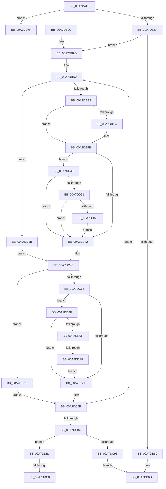

# MiUpdateForkMaps

- RVA: `0x00A7DAF8`–`0x00A7DDD4` (길이 `732` bytes)
- VA: `0x0000000140A7DAF8`
- 실행 섹션: `PAGE`
- PDB 이름 있음: `예`; PDB Function 태그: `예`
- unwind 정보 RVA: `0x000B6B28`
- 디코드: `179`개 명령, `732/732` bytes 표시
- 미해석 바이트: `0` (있으면 어셈블리에 `.byte`로 보존)

> 이 문서는 커널 이미지의 기계어와 PDB 기호를 분석해 생성했습니다. 4번과 5번은 함수 원형과 자료형을 바이너리 사용 방식에서 추정한 C 해석이며 원본 소스 복구 결과는 아닙니다.

## 1. Dependencies

- 직접 호출 지점: **13**; 고유 호출 대상: **9**
- 직접 호출자로 확인된 함수: **1**
- RIP 상대 이미지 참조: **3**

### Outgoing calls
- `0x00A7DB4A` → [MI_IS_PHYSICAL_ADDRESS](../../text/23/MI_IS_PHYSICAL_ADDRESS_function_0023B3A0.md) (function, `0x0023B3A0`)
- `0x00A7DBAA` → [MiFillPteHierarchy](../../text/3F/MiFillPteHierarchy_function_003F7F90.md) (function, `0x003F7F90`)
- `0x00A7DBF3` → [MiGetPteAddress](../../text/43/MiGetPteAddress_function_0043E130.md) (function, `0x0043E130`)
- `0x00A7DC08` → [MiGetUltraMapping](../../text/32/MiGetUltraMapping_function_00323270.md) (function, `0x00323270`)
- `0x00A7DC17` → [MiGetPteAddress](../../text/43/MiGetPteAddress_function_0043E130.md) (function, `0x0043E130`)
- `0x00A7DC2B` → [MiMakeValidPte](../../text/2C/MiMakeValidPte_function_002C5590.md) (function, `0x002C5590`)
- `0x00A7DCA6` → [MiMapSinglePage](../../text/22/MiMapSinglePage_function_00229D00.md) (function, `0x00229D00`)
- `0x00A7DCF2` → [MiDoneWithThisPageGetAnother](MiDoneWithThisPageGetAnother_function_00A7DDDC.md) (function, `0x00A7DDDC`)
- `0x00A7DD16` → [MiBuildForkPageTable](../../text/4A/MiBuildForkPageTable_function_004ACF5C.md) (function, `0x004ACF5C`)
- `0x00A7DD3B` → [MiMapSinglePage](../../text/22/MiMapSinglePage_function_00229D00.md) (function, `0x00229D00`)
- `0x00A7DD5B` → [MiGetPteAddress](../../text/43/MiGetPteAddress_function_0043E130.md) (function, `0x0043E130`)
- `0x00A7DD75` → [MiCheckLinearProtectedPteAccessedBit](../../text/29/MiCheckLinearProtectedPteAccessedBit_function_00292D80.md) (function, `0x00292D80`)
- `0x00A7DDC7` → [MiGetPteAddress](../../text/43/MiGetPteAddress_function_0043E130.md) (function, `0x0043E130`)

### Direct callers
- [MiCloneVads](../../text/22/MiCloneVads_function_0022DC1C.md) at `0x0022DF44`

### Static image references
- `0x00A7DBEC` → RVA `0x00010880` (`.rdata`; read)
- `0x00A7DC30` → RVA `0x00FC6A88` (`ALMOSTRO`; read)
- `0x00A7DD8F` → RVA `0x00E2DC80` (`.data`; read)

## 2. Other-region calls and transfers

- 다른 실행 섹션으로 향하는 call: **12**
  - `0x00A7DB4A` → [MI_IS_PHYSICAL_ADDRESS](../../text/23/MI_IS_PHYSICAL_ADDRESS_function_0023B3A0.md) (`PAGE` → `.text`)
  - `0x00A7DBAA` → [MiFillPteHierarchy](../../text/3F/MiFillPteHierarchy_function_003F7F90.md) (`PAGE` → `.text`)
  - `0x00A7DBF3` → [MiGetPteAddress](../../text/43/MiGetPteAddress_function_0043E130.md) (`PAGE` → `.text`)
  - `0x00A7DC08` → [MiGetUltraMapping](../../text/32/MiGetUltraMapping_function_00323270.md) (`PAGE` → `.text`)
  - `0x00A7DC17` → [MiGetPteAddress](../../text/43/MiGetPteAddress_function_0043E130.md) (`PAGE` → `.text`)
  - `0x00A7DC2B` → [MiMakeValidPte](../../text/2C/MiMakeValidPte_function_002C5590.md) (`PAGE` → `.text`)
  - `0x00A7DCA6` → [MiMapSinglePage](../../text/22/MiMapSinglePage_function_00229D00.md) (`PAGE` → `.text`)
  - `0x00A7DD16` → [MiBuildForkPageTable](../../text/4A/MiBuildForkPageTable_function_004ACF5C.md) (`PAGE` → `.text`)
  - `0x00A7DD3B` → [MiMapSinglePage](../../text/22/MiMapSinglePage_function_00229D00.md) (`PAGE` → `.text`)
  - `0x00A7DD5B` → [MiGetPteAddress](../../text/43/MiGetPteAddress_function_0043E130.md) (`PAGE` → `.text`)
  - `0x00A7DD75` → [MiCheckLinearProtectedPteAccessedBit](../../text/29/MiCheckLinearProtectedPteAccessedBit_function_00292D80.md) (`PAGE` → `.text`)
  - `0x00A7DDC7` → [MiGetPteAddress](../../text/43/MiGetPteAddress_function_0043E130.md) (`PAGE` → `.text`)
- call이 아닌 외부 분기/꼬리 이동: **4**
  - `0x00A7DD8A` → [sub_00B42A1A](../B4/Unknown_function_00B42A1A.md) (`tail-transfer`)
  - `0x00A7DDA2` → [sub_00B42A1A + 0x32](../B4/Unknown_function_00B42A1A.md) (`tail-transfer`)
  - `0x00A7DDBA` → [sub_00B42A1A + 0x3B](../B4/Unknown_function_00B42A1A.md) (`tail-transfer`)
  - `0x00A7DDCF` → [sub_00B42A1A + 0x3B](../B4/Unknown_function_00B42A1A.md) (`tail-transfer`)

## 3. Assembly (complete function range)

```asm
00A7DAF8  48 8B C4                        mov rax, rsp
00A7DAFB  48 89 58 08                     mov qword ptr [rax + 8], rbx
00A7DAFF  4C 89 48 20                     mov qword ptr [rax + 0x20], r9
00A7DB03  4C 89 40 18                     mov qword ptr [rax + 0x18], r8
00A7DB07  48 89 50 10                     mov qword ptr [rax + 0x10], rdx
00A7DB0B  55                              push rbp
00A7DB0C  56                              push rsi
00A7DB0D  57                              push rdi
00A7DB0E  41 54                           push r12
00A7DB10  41 55                           push r13
00A7DB12  41 56                           push r14
00A7DB14  41 57                           push r15
00A7DB16  48 83 EC 70                     sub rsp, 0x70
00A7DB1A  0F 57 C0                        xorps xmm0, xmm0
00A7DB1D  48 8B F2                        mov rsi, rdx
00A7DB20  0F 11 40 A0                     movups xmmword ptr [rax - 0x60], xmm0
00A7DB24  4C 8B F1                        mov r14, rcx
00A7DB27  0F 11 40 B0                     movups xmmword ptr [rax - 0x50], xmm0
00A7DB2B  48 BD 00 00 00 00 80 F6 FF FF   movabs rbp, 0xfffff68000000000
00A7DB35  48 8B DA                        mov rbx, rdx
00A7DB38  48 C1 E5 19                     shl rbp, 0x19
00A7DB3C  48 C1 E3 19                     shl rbx, 0x19
00A7DB40  48 2B DD                        sub rbx, rbp
00A7DB43  48 C1 FB 10                     sar rbx, 0x10
00A7DB47  48 8B CB                        mov rcx, rbx
00A7DB4A  E8 51 D8 7B FF                  call 0x14023b3a0
00A7DB4F  44 8B C0                        mov r8d, eax
00A7DB52  85 C0                           test eax, eax
00A7DB54  0F 85 25 02 00 00               jne 0x140a7dd7f
00A7DB5A  48 8B C6                        mov rax, rsi
00A7DB5D  49 33 46 30                     xor rax, qword ptr [r14 + 0x30]
00A7DB61  48 A9 00 F0 FF FF               test rax, -0x1000
00A7DB67  75 34                           jne 0x140a7db9d
00A7DB69  4D 8B 7E 20                     mov r15, qword ptr [r14 + 0x20]
00A7DB6D  48 8B C6                        mov rax, rsi
00A7DB70  48 C1 E8 03                     shr rax, 3
00A7DB74  25 FF 01 00 00                  and eax, 0x1ff
00A7DB79  49 8D 04 C7                     lea rax, [r15 + rax*8]
00A7DB7D  49 89 46 28                     mov qword ptr [r14 + 0x28], rax
00A7DB81  48 8B 9C 24 B0 00 00 00         mov rbx, qword ptr [rsp + 0xb0]
00A7DB89  48 8B C6                        mov rax, rsi
00A7DB8C  48 83 C4 70                     add rsp, 0x70
00A7DB90  41 5F                           pop r15
00A7DB92  41 5E                           pop r14
00A7DB94  41 5D                           pop r13
00A7DB96  41 5C                           pop r12
00A7DB98  5F                              pop rdi
00A7DB99  5E                              pop rsi
00A7DB9A  5D                              pop rbp
00A7DB9B  C3                              ret
00A7DB9C  CC                              int3
00A7DB9D  48 8D 54 24 48                  lea rdx, [rsp + 0x48]
00A7DBA2  48 8B CB                        mov rcx, rbx
00A7DBA5  BD 04 00 00 00                  mov ebp, 4
00A7DBAA  E8 E1 A3 97 FF                  call 0x1403f7f90
00A7DBAF  49 8B 1E                        mov rbx, qword ptr [r14]
00A7DBB2  4C 8D 64 24 68                  lea r12, [rsp + 0x68]
00A7DBB7  49 89 76 30                     mov qword ptr [r14 + 0x30], rsi
00A7DBBB  8D 7D FD                        lea edi, [rbp - 3]
00A7DBBE  49 8D B6 A8 00 00 00            lea rsi, [r14 + 0xa8]
00A7DBC5  48 8B 5B 28                     mov rbx, qword ptr [rbx + 0x28]
00A7DBC9  48 C1 EB 0C                     shr rbx, 0xc
00A7DBCD  48 89 5C 24 30                  mov qword ptr [rsp + 0x30], rbx
00A7DBD2  2B EF                           sub ebp, edi
00A7DBD4  4D 8D 64 24 F8                  lea r12, [r12 - 8]
00A7DBD9  80 7E 18 00                     cmp byte ptr [rsi + 0x18], 0
00A7DBDD  0F 84 48 01 00 00               je 0x140a7dd2b
00A7DBE3  49 8B 4E 20                     mov rcx, qword ptr [r14 + 0x20]
00A7DBE7  48 85 C9                        test rcx, rcx
00A7DBEA  74 0F                           je 0x140a7dbfb
00A7DBEC  48 8B 15 8D 2C 59 FF            mov rdx, qword ptr [rip - 0xa6d373]
00A7DBF3  E8 38 05 9C FF                  call 0x14043e130
00A7DBF8  48 89 10                        mov qword ptr [rax], rdx
00A7DBFB  45 33 C9                        xor r9d, r9d
00A7DBFE  4C 8B C7                        mov r8, rdi
00A7DC01  48 8B CE                        mov rcx, rsi
00A7DC04  41 8D 51 03                     lea edx, [r9 + 3]
00A7DC08  E8 63 56 8A FF                  call 0x140323270
00A7DC0D  48 8B C8                        mov rcx, rax
00A7DC10  49 89 46 20                     mov qword ptr [r14 + 0x20], rax
00A7DC14  4C 8B E8                        mov r13, rax
00A7DC17  E8 14 05 9C FF                  call 0x14043e130
00A7DC1C  48 8B C8                        mov rcx, rax
00A7DC1F  41 B8 04 00 00 A0               mov r8d, 0xa0000004
00A7DC25  48 8B D3                        mov rdx, rbx
00A7DC28  4C 8B F8                        mov r15, rax
00A7DC2B  E8 60 79 84 FF                  call 0x1402c5590
00A7DC30  48 0F BA 25 4F 8E 54 00 24      bt qword ptr [rip + 0x548e4f], 0x24
00A7DC39  48 8B D8                        mov rbx, rax
00A7DC3C  0F 82 06 01 00 00               jb 0x140a7dd48
00A7DC42  49 89 1F                        mov qword ptr [r15], rbx
00A7DC45  41 8B 04 24                     mov eax, dword ptr [r12]
00A7DC49  48 C1 E8 03                     shr rax, 3
00A7DC4D  25 FF 01 00 00                  and eax, 0x1ff
00A7DC52  4C 8D 3C C5 00 00 00 00         lea r15, [rax*8]
00A7DC5A  4D 03 FD                        add r15, r13
00A7DC5D  49 8B 1F                        mov rbx, qword ptr [r15]
00A7DC60  48 85 DB                        test rbx, rbx
00A7DC63  74 73                           je 0x140a7dcd8
00A7DC65  40 84 DF                        test dil, bl
00A7DC68  0F 84 21 01 00 00               je 0x140a7dd8f
00A7DC6E  48 B8 FF FF FF FF FF 00 00 00   movabs rax, 0xffffffffff
00A7DC78  48 C1 EB 0C                     shr rbx, 0xc
00A7DC7C  48 23 D8                        and rbx, rax
00A7DC7F  48 89 5C 24 30                  mov qword ptr [rsp + 0x30], rbx
00A7DC84  3B EF                           cmp ebp, edi
00A7DC86  0F 85 46 FF FF FF               jne 0x140a7dbd2
00A7DC8C  80 7E 18 00                     cmp byte ptr [rsi + 0x18], 0
00A7DC90  0F 85 1D 01 00 00               jne 0x140a7ddb3
00A7DC96  49 8B 4E 38                     mov rcx, qword ptr [r14 + 0x38]
00A7DC9A  45 33 C9                        xor r9d, r9d
00A7DC9D  41 B8 20 00 00 40               mov r8d, 0x40000020
00A7DCA3  48 8B D3                        mov rdx, rbx
00A7DCA6  E8 55 C0 7A FF                  call 0x140229d00
00A7DCAB  4C 8B F8                        mov r15, rax
00A7DCAE  48 8D 04 5B                     lea rax, [rbx + rbx*2]
00A7DCB2  4D 89 7E 20                     mov qword ptr [r14 + 0x20], r15
00A7DCB6  48 C1 E0 04                     shl rax, 4
00A7DCBA  48 B9 00 00 00 00 00 DE FF FF   movabs rcx, 0xffffde0000000000
00A7DCC4  48 8B B4 24 B8 00 00 00         mov rsi, qword ptr [rsp + 0xb8]
00A7DCCC  48 03 C1                        add rax, rcx
00A7DCCF  49 89 46 40                     mov qword ptr [r14 + 0x40], rax
00A7DCD3  E9 95 FE FF FF                  jmp 0x140a7db6d
00A7DCD8  4D 8B 06                        mov r8, qword ptr [r14]
00A7DCDB  B8 03 00 00 00                  mov eax, 3
00A7DCE0  48 8B 94 24 C8 00 00 00         mov rdx, qword ptr [rsp + 0xc8]
00A7DCE8  2B C5                           sub eax, ebp
00A7DCEA  49 8D 1C C6                     lea rbx, [r14 + rax*8]
00A7DCEE  48 8D 4B 08                     lea rcx, [rbx + 8]
00A7DCF2  E8 E5 00 00 00                  call 0x140a7dddc
00A7DCF7  48 8B 5B 08                     mov rbx, qword ptr [rbx + 8]
00A7DCFB  4D 8B CF                        mov r9, r15
00A7DCFE  48 8B 44 24 30                  mov rax, qword ptr [rsp + 0x30]
00A7DD03  48 8B D3                        mov rdx, rbx
00A7DD06  4D 8B 04 24                     mov r8, qword ptr [r12]
00A7DD0A  49 8B 0E                        mov rcx, qword ptr [r14]
00A7DD0D  89 6C 24 28                     mov dword ptr [rsp + 0x28], ebp
00A7DD11  48 89 44 24 20                  mov qword ptr [rsp + 0x20], rax
00A7DD16  E8 41 F2 A2 FF                  call 0x1404acf5c
00A7DD1B  4C 8B BC 24 C0 00 00 00         mov r15, qword ptr [rsp + 0xc0]
00A7DD23  49 01 3F                        add qword ptr [r15], rdi
00A7DD26  E9 54 FF FF FF                  jmp 0x140a7dc7f
00A7DD2B  49 8B 4E 38                     mov rcx, qword ptr [r14 + 0x38]
00A7DD2F  45 33 C9                        xor r9d, r9d
00A7DD32  41 B8 20 00 00 40               mov r8d, 0x40000020
00A7DD38  48 8B D3                        mov rdx, rbx
00A7DD3B  E8 C0 BF 7A FF                  call 0x140229d00
00A7DD40  4C 8B E8                        mov r13, rax
00A7DD43  E9 FD FE FF FF                  jmp 0x140a7dc45
00A7DD48  F6 C3 20                        test bl, 0x20
00A7DD4B  0F 85 F1 FE FF FF               jne 0x140a7dc42
00A7DD51  48 B9 00 00 00 00 00 80 FF FF   movabs rcx, 0xffff800000000000
00A7DD5B  E8 D0 03 9C FF                  call 0x14043e130
00A7DD60  4C 3B F8                        cmp r15, rax
00A7DD63  0F 82 D9 FE FF FF               jb 0x140a7dc42
00A7DD69  41 B8 80 00 00 00               mov r8d, 0x80
00A7DD6F  48 8B D3                        mov rdx, rbx
00A7DD72  49 8B CF                        mov rcx, r15
00A7DD75  E8 06 50 81 FF                  call 0x140292d80
00A7DD7A  E9 C3 FE FF FF                  jmp 0x140a7dc42
00A7DD7F  49 8B D0                        mov rdx, r8
00A7DD82  BF 01 00 00 00                  mov edi, 1
00A7DD87  4C 8B CA                        mov r9, rdx
00A7DD8A  E9 8B 4C 0C 00                  jmp 0x140b42a1a
00A7DD8F  48 8B 05 EA FE 3A 00            mov rax, qword ptr [rip + 0x3afeea]
00A7DD96  48 85 C0                        test rax, rax
00A7DD99  0F 84 CF FE FF FF               je 0x140a7dc6e
00A7DD9F  F6 C3 10                        test bl, 0x10
00A7DDA2  0F 85 A4 4C 0C 00               jne 0x140b42a4c
00A7DDA8  48 F7 D0                        not rax
00A7DDAB  48 23 D8                        and rbx, rax
00A7DDAE  E9 BB FE FF FF                  jmp 0x140a7dc6e
00A7DDB3  49 8B 4E 20                     mov rcx, qword ptr [r14 + 0x20]
00A7DDB7  48 85 C9                        test rcx, rcx
00A7DDBA  0F 84 95 4C 0C 00               je 0x140b42a55
00A7DDC0  4C 8B 0D B9 2A 59 FF            mov r9, qword ptr [rip - 0xa6d547]
00A7DDC7  E8 64 03 9C FF                  call 0x14043e130
00A7DDCC  4C 89 08                        mov qword ptr [rax], r9
00A7DDCF  E9 81 4C 0C 00                  jmp 0x140b42a55
```

## 4. C-style interpretation (structured pseudocode)

```c
__int64 __fastcall MiUpdateForkMaps(__int64 a1, __int64 a2, __int64 a3, __int64 a4)
{
    __int64 result;
    __int64 v_r15;
    __int64 v_rbp;
    __int64 v_rbx;
    __int64 v_rsp;
    unsigned __int64 v_stack_p20;
    unsigned int v_stack_p28;
    unsigned __int64 v_stack_p30;
    unsigned __int64 v_stack_p48;
    unsigned __int64 v_stack_p68;
    unsigned __int64 v_stack_p8;
    unsigned __int64 v_stack_pB8;
    unsigned __int64 v_stack_pC0;
    unsigned __int64 v_stack_pC8;

    *(unsigned __int64 *)(v_rsp + 8) = v_rbx;
    *(unsigned __int64 *)(v_rsp + 32) = a4;
    *(unsigned __int64 *)(v_rsp + 24) = a3;
    *(unsigned __int64 *)(v_rsp + 16) = a2;
    v_rsp = (v_rsp) - (112);
    *(unsigned __int64 *)(v_rsp - 96) = v_xmm0;
    *(unsigned __int64 *)(v_rsp - 80) = v_xmm0;
    v_rbp = (v_rbp) << (25);
    v_rbx = (a2) << (25);
    v_rbx = (v_rbx) - (v_rbp);
    v_rbx = (v_rbx) >> (16);
    result = MI_IS_PHYSICAL_ADDRESS(v_rbx, a2, a3, a4);
    if ((unsigned int)(result) != 0) goto loc_00A7DD7F;
    result = (a2) ^ (*(unsigned __int64 *)(a1 + 48));
    if (((result) & (0xFFFFFFFFFFFFF000ULL)) != 0) goto loc_00A7DB9D;
loc_00A7DB6D:
    result = (a2) >> (3);
    result = (unsigned int)((result) & (511));
    *(unsigned __int64 *)(a1 + 40) = *(unsigned __int64 *)(a1 + 32) + result * 8;
    v_rsp = (v_rsp) + (112);
    return a2;
loc_00A7DB9D:
    result = MiFillPteHierarchy(v_stack_p8, v_stack_p48, (unsigned int)((unsigned int)(result)), a4);
    *(unsigned __int64 *)(a1 + 48) = a2;
    v_rbx = (*(unsigned __int64 *)(*(unsigned __int64 *)(a1) + 40)) >> (12);
    v_stack_p30 = v_rbx;
loc_00A7DBD2:
    v_rbp = (unsigned int)((4) - ((unsigned int)(4 - 3)));
    if ((*(unsigned __int8 *)(a1 + 168 + 24)) == 0) goto loc_00A7DD2B;
    if (*(unsigned __int64 *)(a1 + 32) != 0) {
        a2 = *(unsigned __int64 *)(v_rip - 10933107);
        result = MiGetPteAddress(*(unsigned __int64 *)(a1 + 32), a2, (unsigned int)((unsigned int)(result)), a4);
        *(unsigned __int64 *)(result) = a2;
    }
    a4 = 0;
    result = MiGetUltraMapping(a1 + 168, a4 + 3, 4 - 3, a4);
    *(unsigned __int64 *)(a1 + 32) = result;
    result = MiGetPteAddress(result, a4 + 3, 4 - 3, a4);
    result = MiMakeValidPte(result, v_rbx, (unsigned int)(0xA0000004ULL), a4);
    if (condition_is_below) goto loc_00A7DD48;
loc_00A7DC42:
    *(unsigned __int64 *)(result) = result;
loc_00A7DC45:
    result = ((unsigned int)(*(unsigned int *)(v_stack_p68 - 8))) >> (3);
    result = (unsigned int)((result) & (511));
    v_r15 = (result * 8) + (result);
    if (*(unsigned __int64 *)(v_r15) == 0) goto loc_00A7DCD8;
    if ((((unsigned __int8)(4 - 3)) & ((unsigned __int8)(*(unsigned __int64 *)(v_r15)))) == 0) goto loc_00A7DD8F;
loc_00A7DC6E:
    v_rbx = (*(unsigned __int64 *)(v_r15)) >> (12);
    v_rbx = (v_rbx) & (result);
loc_00A7DC7F:
    v_stack_p30 = v_rbx;
    if (((unsigned int)(v_rbp)) != ((unsigned int)(4 - 3))) goto loc_00A7DBD2;
    if ((*(unsigned __int8 *)(a1 + 168 + 24)) != 0) goto loc_00A7DDB3;
    a4 = 0;
    result = MiMapSinglePage(*(unsigned __int64 *)(a1 + 56), v_rbx, (unsigned int)(0x40000020ULL), a4);
    *(unsigned __int64 *)(a1 + 32) = result;
    result = (v_rbx + v_rbx * 2) << (4);
    result = (result) + (*(unsigned __int64 *)(a1 + 56));
    *(unsigned __int64 *)(a1 + 64) = result;
    goto loc_00A7DB6D;
loc_00A7DCD8:
    result = (unsigned int)((3) - ((unsigned int)(v_rbp)));
    result = MiDoneWithThisPageGetAnother(a1 + result * 8 + 8, v_stack_pC8, *(unsigned __int64 *)(a1), a4);
    v_stack_p28 = (unsigned int)(v_rbp);
    v_stack_p20 = v_stack_p30;
    result = MiBuildForkPageTable(*(unsigned __int64 *)(a1), *(unsigned __int64 *)(a1 + result * 8 + 8), *(unsigned __int64 *)(v_stack_p68 - 8), result);
    goto loc_00A7DC7F;
loc_00A7DD2B:
    a4 = 0;
    result = MiMapSinglePage(*(unsigned __int64 *)(a1 + 56), *(unsigned __int64 *)(a1 + result * 8 + 8), (unsigned int)(0x40000020ULL), a4);
    goto loc_00A7DC45;
loc_00A7DD48:
    if ((((unsigned __int8)(*(unsigned __int64 *)(a1 + result * 8 + 8))) & (32)) != 0) goto loc_00A7DC42;
    result = MiGetPteAddress(*(unsigned __int64 *)(a1 + 56), *(unsigned __int64 *)(a1 + result * 8 + 8), (unsigned int)(0x40000020ULL), a4);
    if (v_stack_pC0 < result) goto loc_00A7DC42;
    result = MiCheckLinearProtectedPteAccessedBit(v_stack_pC0, *(unsigned __int64 *)(a1 + result * 8 + 8), 128, a4);
    goto loc_00A7DC42;
loc_00A7DD7F:
loc_00A7DD8F:
    if (*(unsigned __int64 *)(v_rip + 3866346) == 0) goto loc_00A7DC6E;
    result = ~(*(unsigned __int64 *)(v_rip + 3866346));
    v_rbx = (*(unsigned __int64 *)(a1 + result * 8 + 8)) & (result);
    goto loc_00A7DC6E;
loc_00A7DDB3:
    result = MiGetPteAddress(*(unsigned __int64 *)(a1 + 32), 128, 128, *(unsigned __int64 *)(v_rip - 10933575));
    *(unsigned __int64 *)(result) = *(unsigned __int64 *)(v_rip - 10933575);
}
```

## 5. (Beta) C Style

```c
int64_t MiUpdateForkMaps(void *Arg1, int64_t Arg2, int64_t Arg3, int64_t Arg4)
{
    uint8_t *arg1 = (uint8_t *)Arg1;

    int64_t result;
    int64_t local_r15;
    int64_t local_rbp;
    int64_t local_rbx;
    int64_t local_rsp;
    uint64_t v_stack_p20;
    uint32_t v_stack_p28;
    uint64_t v_stack_p30;
    uint64_t v_stack_p48;
    uint64_t v_stack_p68;
    uint64_t v_stack_p8;
    uint64_t v_stack_pB8;
    uint64_t v_stack_pC0;
    uint64_t v_stack_pC8;

    *(uint64_t *)(local_rsp + 0x8) = local_rbx;
    *(uint64_t *)(local_rsp + 0x20) = Arg4;
    *(uint64_t *)(local_rsp + 0x18) = Arg3;
    *(uint64_t *)(local_rsp + 0x10) = Arg2;
    local_rsp = (local_rsp) - (112);
    *(uint64_t *)(local_rsp - 0x60) = v_xmm0;
    *(uint64_t *)(local_rsp - 0x50) = v_xmm0;
    local_rbp = (local_rbp) << (25);
    local_rbx = (Arg2) << (25);
    local_rbx = (local_rbx) - (local_rbp);
    local_rbx = (local_rbx) >> (16);
    result = MI_IS_PHYSICAL_ADDRESS(local_rbx, Arg2, Arg3, Arg4);
    if ((uint32_t)(result) != 0) goto loc_00A7DD7F;
    result = (Arg2) ^ (*(uint64_t *)(arg1 + 0x30));
    if (((result) & (0xFFFFFFFFFFFFF000ULL)) != 0) goto loc_00A7DB9D;
loc_00A7DB6D:
    result = (Arg2) >> (3);
    result = (uint32_t)((result) & (511));
    *(uint64_t *)(arg1 + 0x28) = *(uint64_t *)(arg1 + 0x20) + result * 8;
    local_rsp = (local_rsp) + (112);
    return Arg2;
loc_00A7DB9D:
    result = MiFillPteHierarchy(v_stack_p8, v_stack_p48, (uint32_t)((uint32_t)(result)), Arg4);
    *(uint64_t *)(arg1 + 0x30) = Arg2;
    local_rbx = (*(uint64_t *)(*(uint64_t *)(arg1) + 0x28)) >> (12);
    v_stack_p30 = local_rbx;
loc_00A7DBD2:
    local_rbp = (uint32_t)((4) - ((uint32_t)(4 - 3)));
    if ((*(uint8_t *)(arg1 + 0xA8 + 0x18)) == 0) goto loc_00A7DD2B;
    if (*(uint64_t *)(arg1 + 0x20) != 0) {
        Arg2 = *(uint64_t *)(v_rip - 0xA6D373);
        result = MiGetPteAddress(*(uint64_t *)(arg1 + 0x20), Arg2, (uint32_t)((uint32_t)(result)), Arg4);
        *(uint64_t *)(result) = Arg2;
    }
    Arg4 = 0;
    result = MiGetUltraMapping(Arg1 + 168, Arg4 + 3, 4 - 3, Arg4);
    *(uint64_t *)(arg1 + 0x20) = result;
    result = MiGetPteAddress(result, Arg4 + 3, 4 - 3, Arg4);
    result = MiMakeValidPte(result, local_rbx, (uint32_t)(0xA0000004ULL), Arg4);
    if (condition_is_below) goto loc_00A7DD48;
loc_00A7DC42:
    *(uint64_t *)(result) = result;
loc_00A7DC45:
    result = ((uint32_t)(*(uint32_t *)(v_stack_p68 - 0x8))) >> (3);
    result = (uint32_t)((result) & (511));
    local_r15 = (result * 8) + (result);
    if (*(uint64_t *)(local_r15) == 0) goto loc_00A7DCD8;
    if ((((uint8_t)(4 - 3)) & ((uint8_t)(*(uint64_t *)(local_r15)))) == 0) goto loc_00A7DD8F;
loc_00A7DC6E:
    local_rbx = (*(uint64_t *)(local_r15)) >> (12);
    local_rbx = (local_rbx) & (result);
loc_00A7DC7F:
    v_stack_p30 = local_rbx;
    if (((uint32_t)(local_rbp)) != ((uint32_t)(4 - 3))) goto loc_00A7DBD2;
    if ((*(uint8_t *)(arg1 + 0xA8 + 0x18)) != 0) goto loc_00A7DDB3;
    Arg4 = 0;
    result = MiMapSinglePage(*(uint64_t *)(arg1 + 0x38), local_rbx, (uint32_t)(0x40000020ULL), Arg4);
    *(uint64_t *)(arg1 + 0x20) = result;
    result = (local_rbx + local_rbx * 2) << (4);
    result = (result) + (*(uint64_t *)(arg1 + 0x38));
    *(uint64_t *)(arg1 + 0x40) = result;
    goto loc_00A7DB6D;
loc_00A7DCD8:
    result = (uint32_t)((3) - ((uint32_t)(local_rbp)));
    result = MiDoneWithThisPageGetAnother(Arg1 + result * 8 + 8, v_stack_pC8, *(uint64_t *)(arg1), Arg4);
    v_stack_p28 = (uint32_t)(local_rbp);
    v_stack_p20 = v_stack_p30;
    result = MiBuildForkPageTable(*(uint64_t *)(arg1), *(uint64_t *)(arg1 + result * 8 + 0x8), *(uint64_t *)(v_stack_p68 - 0x8), result);
    goto loc_00A7DC7F;
loc_00A7DD2B:
    Arg4 = 0;
    result = MiMapSinglePage(*(uint64_t *)(arg1 + 0x38), *(uint64_t *)(arg1 + result * 8 + 0x8), (uint32_t)(0x40000020ULL), Arg4);
    goto loc_00A7DC45;
loc_00A7DD48:
    if ((((uint8_t)(*(uint64_t *)(arg1 + result * 8 + 0x8))) & (32)) != 0) goto loc_00A7DC42;
    result = MiGetPteAddress(*(uint64_t *)(arg1 + 0x38), *(uint64_t *)(arg1 + result * 8 + 0x8), (uint32_t)(0x40000020ULL), Arg4);
    if (v_stack_pC0 < result) goto loc_00A7DC42;
    result = MiCheckLinearProtectedPteAccessedBit(v_stack_pC0, *(uint64_t *)(arg1 + result * 8 + 0x8), 128, Arg4);
    goto loc_00A7DC42;
loc_00A7DD7F:
loc_00A7DD8F:
    if (*(uint64_t *)(v_rip + 0x3AFEEA) == 0) goto loc_00A7DC6E;
    result = ~(*(uint64_t *)(v_rip + 0x3AFEEA));
    local_rbx = (*(uint64_t *)(arg1 + result * 8 + 0x8)) & (result);
    goto loc_00A7DC6E;
loc_00A7DDB3:
    result = MiGetPteAddress(*(uint64_t *)(arg1 + 0x20), 128, 128, *(uint64_t *)(v_rip - 0xA6D547));
    *(uint64_t *)(result) = *(uint64_t *)(v_rip - 0xA6D547);
}
```

### 관측된 메모리 오프셋

구조체 형식이 확인되지 않은 접근은 인자 기준의 오프셋으로만 기록했습니다.

| 기준 인자 | 오프셋 표현 | 폭 (bit) | 접근 |
|---|---:|---:|---|
| `Arg1` | `+ 0x0` | `64` | `R` |
| `Arg1` | `+ 0x0 + rax*8` | `64` | `R` |
| `Arg1` | `+ 0x8` | `64` | `R` |
| `Arg1` | `+ 0x18` | `8` | `R` |
| `Arg1` | `+ 0x20` | `64` | `R` |
| `Arg1` | `+ 0x20` | `64` | `W` |
| `Arg1` | `+ 0x28` | `64` | `W` |
| `Arg1` | `+ 0x30` | `64` | `R` |
| `Arg1` | `+ 0x30` | `64` | `W` |
| `Arg1` | `+ 0x38` | `64` | `R` |
| `Arg1` | `+ 0x40` | `64` | `W` |
| `Arg1` | `+ 0xA8` | `64` | `R` |

## 6. Execution-region graph

[열기: 2D/3D 그래프와 함수 탐색 컨트롤 패널](../../../control-panel.html?section=page&rva=0x00A7DAF8&view=graph)

- 2D 그래프는 위에서 아래로 흐르고, 3D 그래프는 빈 공간을 드래그해 회전합니다. Shift+드래그는 이동, 휠은 확대·축소, 함수 노드 선택은 대상 보고서 이동입니다.

### Static fallback


