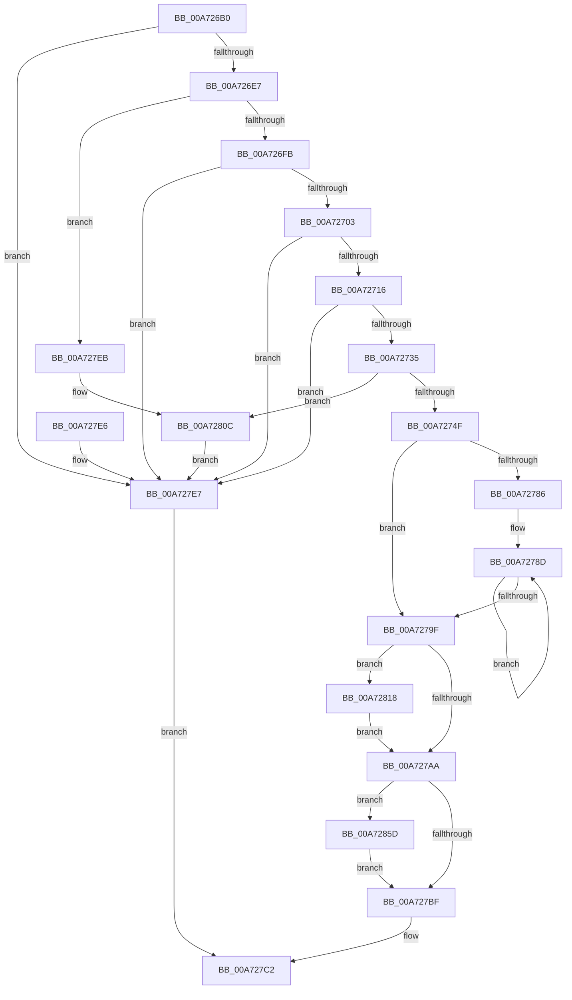

# MmAllocateMappingAddressEx

- RVA: `0x00A726B0`–`0x00A72873` (길이 `451` bytes)
- VA: `0x0000000140A726B0`
- 실행 섹션: `PAGE`
- PDB 이름 있음: `예`; PDB Function 태그: `아니요`
- unwind 정보 RVA: `0x000B5598`
- 디코드: `113`개 명령, `451/451` bytes 표시
- 미해석 바이트: `0` (있으면 어셈블리에 `.byte`로 보존)

> 이 문서는 커널 이미지의 기계어와 PDB 기호를 분석해 생성했습니다. 4번과 5번은 함수 원형과 자료형을 바이너리 사용 방식에서 추정한 C 해석이며 원본 소스 복구 결과는 아닙니다.

## 1. Dependencies

- 직접 호출 지점: **9**; 고유 호출 대상: **9**
- 직접 호출자로 확인된 함수: **4**
- RIP 상대 이미지 참조: **4**

### Outgoing calls
- `0x00A72724` → [MiAllocatePool](../../text/35/MiAllocatePool_function_0035B540.md) (function, `0x0035B540`)
- `0x00A7273E` → [MiReservePtes](../../text/31/MiReservePtes_function_00318D20.md) (function, `0x00318D20`)
- `0x00A727AD` → [MiInsertMappingNode](../../text/4A/MiInsertMappingNode_function_004A9560.md) (function, `0x004A9560`)
- `0x00A727B2` → [VfPtIsAptEnabledOnKernel](../../text/3E/VfPtIsAptEnabledOnKernel_function_003EA660.md) (function, `0x003EA660`)
- `0x00A727CA` → [_security_check_cookie](../../text/6A/_security_check_cookie_function_006AC640.md) (function, `0x006AC640`)
- `0x00A72806` → [KeBugCheckEx](../../text/4F/KeBugCheckEx_function_004FD660.md) (function, `0x004FD660`)
- `0x00A72811` → [ExFreePoolWithTag](../../poolcode/B8/ExFreePoolWithTag_function_00B82870.md) (function, `0x00B82870`)
- `0x00A72853` → [MiInsertPteTracker](../../text/69/MiInsertPteTracker_function_00697BE4.md) (function, `0x00697BE4`)
- `0x00A72869` → [VfPtMiscPoolNotification](../../text/3F/VfPtMiscPoolNotification_function_003FF310.md) (function, `0x003FF310`)

### Direct callers
- [DifMmAllocateMappingAddressExWrapper](../../text/63/DifMmAllocateMappingAddressExWrapper_function_00634260.md) at `0x00634344`
- [PnprInitializeMappingReserve](../73/PnprInitializeMappingReserve_function_00739D24.md) at `0x00739D4D`
- [EtwpSavePersistedLogger](../7B/EtwpSavePersistedLogger_function_007BF374.md) at `0x007BF457`
- [MmAllocateMappingAddress](MmAllocateMappingAddress_function_00A72690.md) at `0x00A72697`

### Static image references
- `0x00A726C3` → RVA `0x00E0A740` (`.data`; read)
- `0x00A72737` → RVA `0x00E37668` (`.data`; read)
- `0x00A72786` → RVA `0x00010880` (`.rdata`; read)
- `0x00A7279F` → RVA `0x00FC51FC` (`ALMOSTRO`; read)

## 2. Other-region calls and transfers

- 다른 실행 섹션으로 향하는 call: **9**
  - `0x00A72724` → [MiAllocatePool](../../text/35/MiAllocatePool_function_0035B540.md) (`PAGE` → `.text`)
  - `0x00A7273E` → [MiReservePtes](../../text/31/MiReservePtes_function_00318D20.md) (`PAGE` → `.text`)
  - `0x00A727AD` → [MiInsertMappingNode](../../text/4A/MiInsertMappingNode_function_004A9560.md) (`PAGE` → `.text`)
  - `0x00A727B2` → [VfPtIsAptEnabledOnKernel](../../text/3E/VfPtIsAptEnabledOnKernel_function_003EA660.md) (`PAGE` → `.text`)
  - `0x00A727CA` → [_security_check_cookie](../../text/6A/_security_check_cookie_function_006AC640.md) (`PAGE` → `.text`)
  - `0x00A72806` → [KeBugCheckEx](../../text/4F/KeBugCheckEx_function_004FD660.md) (`PAGE` → `.text`)
  - `0x00A72811` → [ExFreePoolWithTag](../../poolcode/B8/ExFreePoolWithTag_function_00B82870.md) (`PAGE` → `POOLCODE`)
  - `0x00A72853` → [MiInsertPteTracker](../../text/69/MiInsertPteTracker_function_00697BE4.md) (`PAGE` → `.text`)
  - `0x00A72869` → [VfPtMiscPoolNotification](../../text/3F/VfPtMiscPoolNotification_function_003FF310.md) (`PAGE` → `.text`)
- 별도 외부 분기/꼬리 이동을 확인하지 못했습니다.

## 3. Assembly (complete function range)

```asm
00A726B0  48 89 5C 24 18                  mov qword ptr [rsp + 0x18], rbx
00A726B5  55                              push rbp
00A726B6  56                              push rsi
00A726B7  57                              push rdi
00A726B8  41 56                           push r14
00A726BA  41 57                           push r15
00A726BC  48 81 EC 80 00 00 00            sub rsp, 0x80
00A726C3  48 8B 05 76 80 39 00            mov rax, qword ptr [rip + 0x398076]
00A726CA  48 33 C4                        xor rax, rsp
00A726CD  48 89 44 24 70                  mov qword ptr [rsp + 0x70], rax
00A726D2  8B EA                           mov ebp, edx
00A726D4  45 8B F8                        mov r15d, r8d
00A726D7  4C 8B F1                        mov r14, rcx
00A726DA  41 F7 C0 FE FF FF FF            test r8d, 0xfffffffe
00A726E1  0F 85 00 01 00 00               jne 0x140a727e7
00A726E7  48 8D 99 FF 0F 00 00            lea rbx, [rcx + 0xfff]
00A726EE  48 C1 EB 0C                     shr rbx, 0xc
00A726F2  48 85 DB                        test rbx, rbx
00A726F5  0F 84 F0 00 00 00               je 0x140a727eb
00A726FB  85 D2                           test edx, edx
00A726FD  0F 84 E4 00 00 00               je 0x140a727e7
00A72703  48 B8 00 00 00 00 01 00 00 00   movabs rax, 0x100000000
00A7270D  48 3B D8                        cmp rbx, rax
00A72710  0F 83 D1 00 00 00               jae 0x140a727e7
00A72716  BA 30 00 00 00                  mov edx, 0x30
00A7271B  41 B8 4D 69 72 6D               mov r8d, 0x6d72694d
00A72721  8D 4A 10                        lea ecx, [rdx + 0x10]
00A72724  E8 17 8E 8E FF                  call 0x14035b540
00A72729  48 8B F0                        mov rsi, rax
00A7272C  48 85 C0                        test rax, rax
00A7272F  0F 84 B2 00 00 00               je 0x140a727e7
00A72735  8B D3                           mov edx, ebx
00A72737  48 8D 0D 2A 4F 3C 00            lea rcx, [rip + 0x3c4f2a]
00A7273E  E8 DD 65 8A FF                  call 0x140318d20
00A72743  48 8B D0                        mov rdx, rax
00A72746  48 85 C0                        test rax, rax
00A72749  0F 84 BD 00 00 00               je 0x140a7280c
00A7274F  48 8B F8                        mov rdi, rax
00A72752  48 C1 E7 19                     shl rdi, 0x19
00A72756  48 B8 00 00 00 00 80 F6 FF FF   movabs rax, 0xfffff68000000000
00A72760  48 C1 E0 19                     shl rax, 0x19
00A72764  45 33 C0                        xor r8d, r8d
00A72767  48 2B F8                        sub rdi, rax
00A7276A  48 89 5E 20                     mov qword ptr [rsi + 0x20], rbx
00A7276E  48 C1 FF 10                     sar rdi, 0x10
00A72772  48 89 7E 18                     mov qword ptr [rsi + 0x18], rdi
00A72776  89 6E 28                        mov dword ptr [rsi + 0x28], ebp
00A72779  45 8D 48 01                     lea r9d, [r8 + 1]
00A7277D  44 89 7E 2C                     mov dword ptr [rsi + 0x2c], r15d
00A72781  48 85 DB                        test rbx, rbx
00A72784  74 19                           je 0x140a7279f
00A72786  48 8B 05 F3 E0 59 FF            mov rax, qword ptr [rip - 0xa61f0d]
00A7278D  45 03 C1                        add r8d, r9d
00A72790  48 89 02                        mov qword ptr [rdx], rax
00A72793  41 8B C8                        mov ecx, r8d
00A72796  48 8D 52 08                     lea rdx, [rdx + 8]
00A7279A  48 3B CB                        cmp rcx, rbx
00A7279D  72 EE                           jb 0x140a7278d
00A7279F  8B 05 57 2A 55 00               mov eax, dword ptr [rip + 0x552a57]
00A727A5  41 84 C1                        test r9b, al
00A727A8  75 6E                           jne 0x140a72818
00A727AA  48 8B CE                        mov rcx, rsi
00A727AD  E8 AE 6D A3 FF                  call 0x1404a9560
00A727B2  E8 A9 7E 97 FF                  call 0x1403ea660
00A727B7  84 C0                           test al, al
00A727B9  0F 85 9E 00 00 00               jne 0x140a7285d
00A727BF  48 8B C7                        mov rax, rdi
00A727C2  48 8B 4C 24 70                  mov rcx, qword ptr [rsp + 0x70]
00A727C7  48 33 CC                        xor rcx, rsp
00A727CA  E8 71 9E C3 FF                  call 0x1406ac640
00A727CF  48 8B 9C 24 C0 00 00 00         mov rbx, qword ptr [rsp + 0xc0]
00A727D7  48 81 C4 80 00 00 00            add rsp, 0x80
00A727DE  41 5F                           pop r15
00A727E0  41 5E                           pop r14
00A727E2  5F                              pop rdi
00A727E3  5E                              pop rsi
00A727E4  5D                              pop rbp
00A727E5  C3                              ret
00A727E6  CC                              int3
00A727E7  33 C0                           xor eax, eax
00A727E9  EB D7                           jmp 0x140a727c2
00A727EB  48 8B 84 24 A8 00 00 00         mov rax, qword ptr [rsp + 0xa8]
00A727F3  BA 00 01 00 00                  mov edx, 0x100
00A727F8  4C 8B CD                        mov r9, rbp
00A727FB  48 89 44 24 20                  mov qword ptr [rsp + 0x20], rax
00A72800  4C 8B C3                        mov r8, rbx
00A72803  8D 4A DA                        lea ecx, [rdx - 0x26]
00A72806  E8 55 AE A8 FF                  call 0x1404fd660
00A7280B  CC                              int3
00A7280C  33 D2                           xor edx, edx
00A7280E  48 8B CE                        mov rcx, rsi
00A72811  E8 5A 00 11 00                  call 0x140b82870
00A72816  EB CF                           jmp 0x140a727e7
00A72818  48 83 64 24 38 00               and qword ptr [rsp + 0x38], 0
00A7281E  48 8D 4C 24 38                  lea rcx, [rsp + 0x38]
00A72823  48 83 64 24 40 00               and qword ptr [rsp + 0x40], 0
00A72829  45 33 C0                        xor r8d, r8d
00A7282C  83 64 24 60 00                  and dword ptr [rsp + 0x60], 0
00A72831  83 64 24 64 00                  and dword ptr [rsp + 0x64], 0
00A72836  48 83 64 24 68 00               and qword ptr [rsp + 0x68], 0
00A7283C  48 C1 E3 0C                     shl rbx, 0xc
00A72840  41 8D 50 02                     lea edx, [r8 + 2]
00A72844  48 89 7C 24 50                  mov qword ptr [rsp + 0x50], rdi
00A72849  48 89 6C 24 58                  mov qword ptr [rsp + 0x58], rbp
00A7284E  48 89 5C 24 48                  mov qword ptr [rsp + 0x48], rbx
00A72853  E8 8C 53 C2 FF                  call 0x140697be4
00A72858  E9 4D FF FF FF                  jmp 0x140a727aa
00A7285D  45 33 C9                        xor r9d, r9d
00A72860  44 8B C5                        mov r8d, ebp
00A72863  49 8B D6                        mov rdx, r14
00A72866  48 8B CF                        mov rcx, rdi
00A72869  E8 A2 CA 98 FF                  call 0x1403ff310
00A7286E  E9 4C FF FF FF                  jmp 0x140a727bf
```

## 4. C-style interpretation (structured pseudocode)

```c
__int64 __fastcall MmAllocateMappingAddressEx(__int64 a1, int a2, int a3)
{
    __int64 result;
    __int64 v_rbx;
    __int64 v_rdi;
    __int64 v_rsp;
    unsigned __int64 v_stack_m38;
    unsigned __int64 v_stack_p18;
    unsigned __int64 v_stack_p20;
    unsigned __int64 v_stack_p38;
    unsigned __int64 v_stack_p40;
    unsigned __int64 v_stack_p48;
    unsigned __int64 v_stack_p50;
    unsigned __int64 v_stack_p58;
    unsigned int v_stack_p60;
    unsigned int v_stack_p64;
    unsigned __int64 v_stack_p68;
    unsigned __int64 v_stack_pA8;

    v_stack_p18 = v_rbx;
    v_rsp = (v_rsp) - (128);
    result = (*(unsigned __int64 *)(v_rip + 3768438)) ^ (v_rsp);
    v_stack_m38 = result;
    if (((a3) & (0xFFFFFFFEULL)) != 0) goto loc_00A727E7;
    v_rbx = (a1 + 4095) >> (12);
    if (v_rbx == 0) goto loc_00A727EB;
    if (a2 == 0) goto loc_00A727E7;
    if (v_rbx >= result) goto loc_00A727E7;
    result = MiAllocatePool(48 + 16, 48, (unsigned int)(0x6D72694DULL), a4);
    if (result == 0) goto loc_00A727E7;
    result = MiReservePtes(v_rip + 3952426, (unsigned int)((unsigned int)(v_rbx)), (unsigned int)(0x6D72694DULL), a4);
    if (result == 0) goto loc_00A7280C;
    v_rdi = (result) << (25);
    result = (result) << (25);
    a3 = 0;
    v_rdi = (v_rdi) - (result);
    *(unsigned __int64 *)(result + 32) = v_rbx;
    v_rdi = (v_rdi) >> (16);
    *(unsigned __int64 *)(result + 24) = v_rdi;
    *(unsigned int *)(result + 40) = (unsigned int)((unsigned int)(a2));
    *(unsigned int *)(result + 44) = (unsigned int)((unsigned int)(a3));
    if (v_rbx == 0) goto loc_00A7279F;
loc_00A7278D:
    a3 = (unsigned int)((a3) + ((unsigned int)(a3 + 1)));
    *(unsigned __int64 *)(result) = *(unsigned __int64 *)(v_rip - 10886925);
    if (((unsigned int)(a3)) < v_rbx) goto loc_00A7278D;
loc_00A7279F:
    if ((((unsigned __int8)(a3 + 1)) & ((unsigned __int8)((unsigned int)(*(unsigned int *)(v_rip + 5581399))))) != 0) goto loc_00A72818;
loc_00A727AA:
    result = MiInsertMappingNode(result, result + 8, a3, a3 + 1);
    result = VfPtIsAptEnabledOnKernel(result, result + 8, a3, a3 + 1);
    if ((unsigned __int8)(result) != 0) goto loc_00A7285D;
loc_00A727BF:
loc_00A727C2:
    a1 = (v_stack_m38) ^ (v_rsp);
    result = _security_check_cookie(a1, result + 8, a3, a3 + 1);
    v_rsp = (v_rsp) + (128);
    return result;
loc_00A727E7:
    result = 0;
    goto loc_00A727C2;
loc_00A727EB:
    v_stack_p20 = v_stack_pA8;
    result = KeBugCheckEx(256 - 38, 256, v_stack_p18, (unsigned int)(a2));
loc_00A7280C:
    a2 = 0;
    result = ExFreePoolWithTag(result, a2, v_stack_p18, (unsigned int)(a2));
    goto loc_00A727E7;
loc_00A72818:
    a3 = 0;
    v_rbx = (v_stack_p18) << (12);
    v_stack_p50 = v_rdi;
    v_stack_p58 = (unsigned int)(a2);
    v_stack_p48 = v_rbx;
    result = MiInsertPteTracker(v_stack_p38, a3 + 2, a3, (unsigned int)(a2));
    goto loc_00A727AA;
loc_00A7285D:
    a4 = 0;
    result = VfPtMiscPoolNotification(v_rdi, a1, (unsigned int)((unsigned int)((unsigned int)(a2))), a4);
    goto loc_00A727BF;
}
```

## 5. (Beta) C Style

```c
int64_t MmAllocateMappingAddressEx(void *Arg1, int32_t Arg2, int32_t Arg3)
{
    uint8_t *arg1 = (uint8_t *)Arg1;

    int64_t result;
    int64_t local_rbx;
    int64_t local_rdi;
    int64_t local_rsp;
    uint64_t v_stack_m38;
    uint64_t v_stack_p18;
    uint64_t v_stack_p20;
    uint64_t v_stack_p38;
    uint64_t v_stack_p40;
    uint64_t v_stack_p48;
    uint64_t v_stack_p50;
    uint64_t v_stack_p58;
    uint32_t v_stack_p60;
    uint32_t v_stack_p64;
    uint64_t v_stack_p68;
    uint64_t v_stack_pA8;

    v_stack_p18 = local_rbx;
    local_rsp = (local_rsp) - (128);
    result = (*(uint64_t *)(v_rip + 0x398076)) ^ (local_rsp);
    v_stack_m38 = result;
    if (((Arg3) & (0xFFFFFFFEULL)) != 0) goto loc_00A727E7;
    local_rbx = (Arg1 + 4095) >> (12);
    if (local_rbx == 0) goto loc_00A727EB;
    if (Arg2 == 0) goto loc_00A727E7;
    if (local_rbx >= result) goto loc_00A727E7;
    result = MiAllocatePool(48 + 16, 48, (uint32_t)(0x6D72694DULL), a4);
    if (result == 0) goto loc_00A727E7;
    result = MiReservePtes(v_rip + 3952426, (uint32_t)((uint32_t)(local_rbx)), (uint32_t)(0x6D72694DULL), a4);
    if (result == 0) goto loc_00A7280C;
    local_rdi = (result) << (25);
    result = (result) << (25);
    Arg3 = 0;
    local_rdi = (local_rdi) - (result);
    *(uint64_t *)(result + 0x20) = local_rbx;
    local_rdi = (local_rdi) >> (16);
    *(uint64_t *)(result + 0x18) = local_rdi;
    *(uint32_t *)(result + 0x28) = (uint32_t)((uint32_t)(Arg2));
    *(uint32_t *)(result + 0x2C) = (uint32_t)((uint32_t)(Arg3));
    if (local_rbx == 0) goto loc_00A7279F;
loc_00A7278D:
    Arg3 = (uint32_t)((Arg3) + ((uint32_t)(Arg3 + 1)));
    *(uint64_t *)(result) = *(uint64_t *)(v_rip - 0xA61F0D);
    if (((uint32_t)(Arg3)) < local_rbx) goto loc_00A7278D;
loc_00A7279F:
    if ((((uint8_t)(Arg3 + 1)) & ((uint8_t)((uint32_t)(*(uint32_t *)(v_rip + 0x552A57))))) != 0) goto loc_00A72818;
loc_00A727AA:
    result = MiInsertMappingNode(result, result + 8, Arg3, Arg3 + 1);
    result = VfPtIsAptEnabledOnKernel(result, result + 8, Arg3, Arg3 + 1);
    if ((uint8_t)(result) != 0) goto loc_00A7285D;
loc_00A727BF:
loc_00A727C2:
    Arg1 = (v_stack_m38) ^ (local_rsp);
    result = _security_check_cookie(Arg1, result + 8, Arg3, Arg3 + 1);
    local_rsp = (local_rsp) + (128);
    return result;
loc_00A727E7:
    result = 0;
    goto loc_00A727C2;
loc_00A727EB:
    v_stack_p20 = v_stack_pA8;
    result = KeBugCheckEx(256 - 38, 256, v_stack_p18, (uint32_t)(Arg2));
loc_00A7280C:
    Arg2 = 0;
    result = ExFreePoolWithTag(result, Arg2, v_stack_p18, (uint32_t)(Arg2));
    goto loc_00A727E7;
loc_00A72818:
    Arg3 = 0;
    local_rbx = (v_stack_p18) << (12);
    v_stack_p50 = local_rdi;
    v_stack_p58 = (uint32_t)(Arg2);
    v_stack_p48 = local_rbx;
    result = MiInsertPteTracker(v_stack_p38, Arg3 + 2, Arg3, (uint32_t)(Arg2));
    goto loc_00A727AA;
loc_00A7285D:
    a4 = 0;
    result = VfPtMiscPoolNotification(local_rdi, Arg1, (uint32_t)((uint32_t)((uint32_t)(Arg2))), a4);
    goto loc_00A727BF;
}
```

### 관측된 메모리 오프셋

구조체 형식이 확인되지 않은 접근은 인자 기준의 오프셋으로만 기록했습니다.

| 기준 인자 | 오프셋 표현 | 폭 (bit) | 접근 |
|---|---:|---:|---|
| `Arg1` | `+ 0xFFF` | `64` | `R` |

## 6. Execution-region graph

[열기: 2D/3D 그래프와 함수 탐색 컨트롤 패널](../../../control-panel.html?section=page&rva=0x00A726B0&view=graph)

- 2D 그래프는 위에서 아래로 흐르고, 3D 그래프는 빈 공간을 드래그해 회전합니다. Shift+드래그는 이동, 휠은 확대·축소, 함수 노드 선택은 대상 보고서 이동입니다.

### Static fallback


