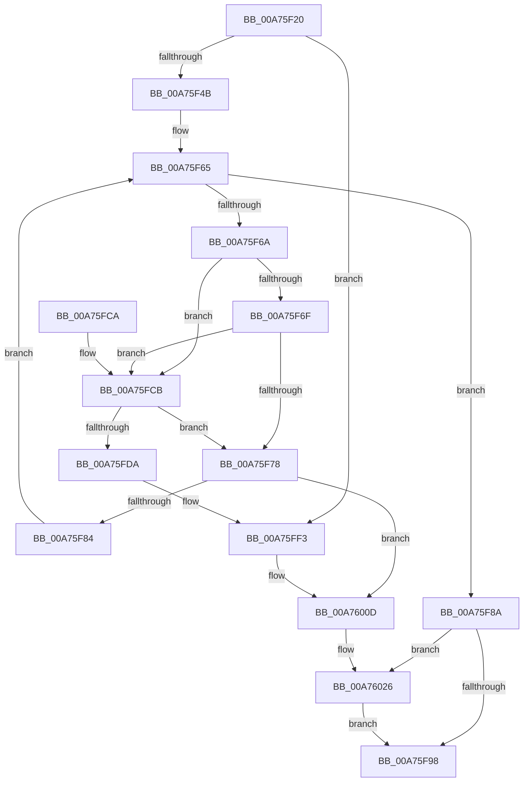

# MmFreeMappingAddress

- RVA: `0x00A75F20`–`0x00A76038` (길이 `280` bytes)
- VA: `0x0000000140A75F20`
- 실행 섹션: `PAGE`
- PDB 이름 있음: `예`; PDB Function 태그: `아니요`
- unwind 정보 RVA: `0x000B5A40`
- 디코드: `77`개 명령, `280/280` bytes 표시
- 미해석 바이트: `0` (있으면 어셈블리에 `.byte`로 보존)

> 이 문서는 커널 이미지의 기계어와 PDB 기호를 분석해 생성했습니다. 4번과 5번은 함수 원형과 자료형을 바이너리 사용 방식에서 추정한 C 해석이며 원본 소스 복구 결과는 아닙니다.

## 1. Dependencies

- 직접 호출 지점: **9**; 고유 호출 대상: **6**
- 직접 호출자로 확인된 함수: **7**
- RIP 상대 이미지 참조: **2**

### Outgoing calls
- `0x00A75F3A` → [MiRemoveMappingNode](../../text/4A/MiRemoveMappingNode_function_004AC85C.md) (function, `0x004AC85C`)
- `0x00A75F56` → [MiGetPteAddress](../../text/43/MiGetPteAddress_function_0043E130.md) (function, `0x0043E130`)
- `0x00A75FA5` → [MiReleasePtes](../../text/24/MiReleasePtes_function_00247240.md) (function, `0x00247240`)
- `0x00A75FAF` → [ExFreePoolWithTag](../../poolcode/B8/ExFreePoolWithTag_function_00B82870.md) (function, `0x00B82870`)
- `0x00A75FCE` → [MiGetPteAddress](../../text/43/MiGetPteAddress_function_0043E130.md) (function, `0x0043E130`)
- `0x00A75FED` → [KeBugCheckEx](../../text/4F/KeBugCheckEx_function_004FD660.md) (function, `0x004FD660`)
- `0x00A76007` → [KeBugCheckEx](../../text/4F/KeBugCheckEx_function_004FD660.md) (function, `0x004FD660`)
- `0x00A76020` → [KeBugCheckEx](../../text/4F/KeBugCheckEx_function_004FD660.md) (function, `0x004FD660`)
- `0x00A7602E` → [MiRemovePteTracker](../../text/4D/MiRemovePteTracker_function_004D8200.md) (function, `0x004D8200`)

### Direct callers
- [SmFpCleanup](../../text/3B/SmFpCleanup_function_003B082C.md) at `0x003B089D`
- [DifMmFreeMappingAddressWrapper](../../text/63/DifMmFreeMappingAddressWrapper_function_00635350.md) at `0x00635427`
- [PnprFreeMappingReserve](../73/PnprFreeMappingReserve_function_0073989C.md) at `0x007398C9`
- [PnprInitializeMappingReserve](../73/PnprInitializeMappingReserve_function_00739D24.md) at `0x00739DB9`
- [EtwpSavePersistedLogger](../7B/EtwpSavePersistedLogger_function_007BF374.md) at `0x007BF876`
- [HalpDmaAllocateEmergencyResources](../../init/C2/HalpDmaAllocateEmergencyResources_function_00C2075C.md) at `0x00C20850`
- [HalpDmaAllocateMappingResources](../../init/C2/HalpDmaAllocateMappingResources_function_00C2087C.md) at `0x00C209A2`

### Static image references
- `0x00A75F8A` → RVA `0x00FC51FC` (`ALMOSTRO`; read)
- `0x00A75F9B` → RVA `0x00E37668` (`.data`; read)

## 2. Other-region calls and transfers

- 다른 실행 섹션으로 향하는 call: **9**
  - `0x00A75F3A` → [MiRemoveMappingNode](../../text/4A/MiRemoveMappingNode_function_004AC85C.md) (`PAGE` → `.text`)
  - `0x00A75F56` → [MiGetPteAddress](../../text/43/MiGetPteAddress_function_0043E130.md) (`PAGE` → `.text`)
  - `0x00A75FA5` → [MiReleasePtes](../../text/24/MiReleasePtes_function_00247240.md) (`PAGE` → `.text`)
  - `0x00A75FAF` → [ExFreePoolWithTag](../../poolcode/B8/ExFreePoolWithTag_function_00B82870.md) (`PAGE` → `POOLCODE`)
  - `0x00A75FCE` → [MiGetPteAddress](../../text/43/MiGetPteAddress_function_0043E130.md) (`PAGE` → `.text`)
  - `0x00A75FED` → [KeBugCheckEx](../../text/4F/KeBugCheckEx_function_004FD660.md) (`PAGE` → `.text`)
  - `0x00A76007` → [KeBugCheckEx](../../text/4F/KeBugCheckEx_function_004FD660.md) (`PAGE` → `.text`)
  - `0x00A76020` → [KeBugCheckEx](../../text/4F/KeBugCheckEx_function_004FD660.md) (`PAGE` → `.text`)
  - `0x00A7602E` → [MiRemovePteTracker](../../text/4D/MiRemovePteTracker_function_004D8200.md) (`PAGE` → `.text`)
- 별도 외부 분기/꼬리 이동을 확인하지 못했습니다.

## 3. Assembly (complete function range)

```asm
00A75F20  48 89 5C 24 08                  mov qword ptr [rsp + 8], rbx
00A75F25  48 89 74 24 10                  mov qword ptr [rsp + 0x10], rsi
00A75F2A  48 89 7C 24 18                  mov qword ptr [rsp + 0x18], rdi
00A75F2F  41 56                           push r14
00A75F31  48 83 EC 30                     sub rsp, 0x30
00A75F35  8B DA                           mov ebx, edx
00A75F37  48 8B F9                        mov rdi, rcx
00A75F3A  E8 1D 69 A3 FF                  call 0x1404ac85c
00A75F3F  48 8B F0                        mov rsi, rax
00A75F42  39 58 28                        cmp dword ptr [rax + 0x28], ebx
00A75F45  0F 85 A8 00 00 00               jne 0x140a75ff3
00A75F4B  4C 8B 50 18                     mov r10, qword ptr [rax + 0x18]
00A75F4F  48 8B 78 20                     mov rdi, qword ptr [rax + 0x20]
00A75F53  49 8B CA                        mov rcx, r10
00A75F56  E8 D5 81 9C FF                  call 0x14043e130
00A75F5B  4C 8B F0                        mov r14, rax
00A75F5E  48 8B D0                        mov rdx, rax
00A75F61  4C 8D 04 F8                     lea r8, [rax + rdi*8]
00A75F65  49 3B D0                        cmp rdx, r8
00A75F68  73 20                           jae 0x140a75f8a
00A75F6A  49 3B D6                        cmp rdx, r14
00A75F6D  74 5C                           je 0x140a75fcb
00A75F6F  48 F7 C2 FF 0F 00 00            test rdx, 0xfff
00A75F76  74 53                           je 0x140a75fcb
00A75F78  48 8B 02                        mov rax, qword ptr [rdx]
00A75F7B  48 85 C0                        test rax, rax
00A75F7E  0F 85 89 00 00 00               jne 0x140a7600d
00A75F84  48 83 C2 08                     add rdx, 8
00A75F88  EB DB                           jmp 0x140a75f65
00A75F8A  8B 05 6C F2 54 00               mov eax, dword ptr [rip + 0x54f26c]
00A75F90  A8 01                           test al, 1
00A75F92  0F 85 8E 00 00 00               jne 0x140a76026
00A75F98  44 8B C7                        mov r8d, edi
00A75F9B  48 8D 0D C6 16 3C 00            lea rcx, [rip + 0x3c16c6]
00A75FA2  49 8B D6                        mov rdx, r14
00A75FA5  E8 96 12 7D FF                  call 0x140247240
00A75FAA  33 D2                           xor edx, edx
00A75FAC  48 8B CE                        mov rcx, rsi
00A75FAF  E8 BC C8 10 00                  call 0x140b82870
00A75FB4  48 8B 5C 24 40                  mov rbx, qword ptr [rsp + 0x40]
00A75FB9  48 8B 74 24 48                  mov rsi, qword ptr [rsp + 0x48]
00A75FBE  48 8B 7C 24 50                  mov rdi, qword ptr [rsp + 0x50]
00A75FC3  48 83 C4 30                     add rsp, 0x30
00A75FC7  41 5E                           pop r14
00A75FC9  C3                              ret
00A75FCA  CC                              int3
00A75FCB  48 8B CA                        mov rcx, rdx
00A75FCE  E8 5D 81 9C FF                  call 0x14043e130
00A75FD3  48 8B 00                        mov rax, qword ptr [rax]
00A75FD6  84 C0                           test al, al
00A75FD8  79 9E                           jns 0x140a75f78
00A75FDA  BA 09 01 00 00                  mov edx, 0x109
00A75FDF  48 89 7C 24 20                  mov qword ptr [rsp + 0x20], rdi
00A75FE4  4C 8B CB                        mov r9, rbx
00A75FE7  4D 8B C2                        mov r8, r10
00A75FEA  8D 4A D1                        lea ecx, [rdx - 0x2f]
00A75FED  E8 6E 76 A8 FF                  call 0x1404fd660
00A75FF2  CC                              int3
00A75FF3  48 83 64 24 20 00               and qword ptr [rsp + 0x20], 0
00A75FF9  BA 02 01 00 00                  mov edx, 0x102
00A75FFE  4C 8B CB                        mov r9, rbx
00A76001  4C 8B C7                        mov r8, rdi
00A76004  8D 4A D8                        lea ecx, [rdx - 0x28]
00A76007  E8 54 76 A8 FF                  call 0x1404fd660
00A7600C  CC                              int3
00A7600D  BA 03 01 00 00                  mov edx, 0x103
00A76012  48 89 7C 24 20                  mov qword ptr [rsp + 0x20], rdi
00A76017  4C 8B CB                        mov r9, rbx
00A7601A  4D 8B C2                        mov r8, r10
00A7601D  8D 4A D7                        lea ecx, [rdx - 0x29]
00A76020  E8 3B 76 A8 FF                  call 0x1404fd660
00A76025  CC                              int3
00A76026  4C 8B C7                        mov r8, rdi
00A76029  49 8B D2                        mov rdx, r10
00A7602C  33 C9                           xor ecx, ecx
00A7602E  E8 CD 21 A6 FF                  call 0x1404d8200
00A76033  E9 60 FF FF FF                  jmp 0x140a75f98
```

## 4. C-style interpretation (structured pseudocode)

```c
__int64 __fastcall MmFreeMappingAddress(__int64 a1, int a2)
{
    __int64 result;
    __int64 v_rsp;
    unsigned __int64 v_stack_p10;
    unsigned __int64 v_stack_p18;
    unsigned __int64 v_stack_p20;
    unsigned __int64 v_stack_p8;

    v_stack_p8 = v_rbx;
    v_stack_p10 = v_rsi;
    v_stack_p18 = v_rdi;
    v_rsp = (v_rsp) - (48);
    result = MiRemoveMappingNode(a1, a2, a3, a4);
    if ((*(unsigned int *)(result + 40)) != ((unsigned int)((unsigned int)(a2)))) goto loc_00A75FF3;
    result = MiGetPteAddress(*(unsigned __int64 *)(result + 24), a2, a3, a4);
loc_00A75F65:
    if (result >= (result + *(unsigned __int64 *)(result + 32) * 8)) goto loc_00A75F8A;
    if (result == result) goto loc_00A75FCB;
    if (((result) & (0xFFFULL)) == 0) goto loc_00A75FCB;
loc_00A75F78:
    if (*(unsigned __int64 *)(result) != 0) goto loc_00A7600D;
    a2 = (result) + (8);
    goto loc_00A75F65;
loc_00A75F8A:
    if ((((unsigned __int8)((unsigned int)(*(unsigned int *)(v_rip + 5567084)))) & (1)) != 0) goto loc_00A76026;
loc_00A75F98:
    result = MiReleasePtes(v_rip + 3937990, result, (unsigned int)((unsigned int)(*(unsigned __int64 *)(result + 32))), a4);
    a2 = 0;
    result = ExFreePoolWithTag(result, a2, (unsigned int)((unsigned int)(*(unsigned __int64 *)(result + 32))), a4);
    v_rsp = (v_rsp) + (48);
    return result;
loc_00A75FCB:
    result = MiGetPteAddress(0, a2, (unsigned int)((unsigned int)(*(unsigned __int64 *)(result + 32))), a4);
    if (!sign_flag) goto loc_00A75F78;
    v_stack_p20 = v_stack_p18;
    result = KeBugCheckEx(265 - 47, 265, *(unsigned __int64 *)(result + 24), v_stack_p8);
loc_00A75FF3:
    result = KeBugCheckEx(258 - 40, 258, v_stack_p18, v_stack_p8);
loc_00A7600D:
    v_stack_p20 = v_stack_p18;
    result = KeBugCheckEx(259 - 41, 259, *(unsigned __int64 *)(result + 24), v_stack_p8);
loc_00A76026:
    a1 = 0;
    result = MiRemovePteTracker(a1, *(unsigned __int64 *)(result + 24), v_stack_p18, v_stack_p8);
    goto loc_00A75F98;
}
```

## 5. (Beta) C Style

```c
int64_t MmFreeMappingAddress(int64_t Arg1, int32_t Arg2)
{
    int64_t result;
    int64_t local_rsp;
    uint64_t v_stack_p10;
    uint64_t v_stack_p18;
    uint64_t v_stack_p20;
    uint64_t v_stack_p8;

    v_stack_p8 = local_rbx;
    v_stack_p10 = local_rsi;
    v_stack_p18 = local_rdi;
    local_rsp = (local_rsp) - (48);
    result = MiRemoveMappingNode(Arg1, Arg2, a3, a4);
    if ((*(uint32_t *)(result + 0x28)) != ((uint32_t)((uint32_t)(Arg2)))) goto loc_00A75FF3;
    result = MiGetPteAddress(*(uint64_t *)(result + 0x18), Arg2, a3, a4);
loc_00A75F65:
    if (result >= (result + *(uint64_t *)(result + 0x20) * 8)) goto loc_00A75F8A;
    if (result == result) goto loc_00A75FCB;
    if (((result) & (0xFFFULL)) == 0) goto loc_00A75FCB;
loc_00A75F78:
    if (*(uint64_t *)(result) != 0) goto loc_00A7600D;
    Arg2 = (result) + (8);
    goto loc_00A75F65;
loc_00A75F8A:
    if ((((uint8_t)((uint32_t)(*(uint32_t *)(v_rip + 0x54F26C)))) & (1)) != 0) goto loc_00A76026;
loc_00A75F98:
    result = MiReleasePtes(v_rip + 3937990, result, (uint32_t)((uint32_t)(*(uint64_t *)(result + 0x20))), a4);
    Arg2 = 0;
    result = ExFreePoolWithTag(result, Arg2, (uint32_t)((uint32_t)(*(uint64_t *)(result + 0x20))), a4);
    local_rsp = (local_rsp) + (48);
    return result;
loc_00A75FCB:
    result = MiGetPteAddress(0, Arg2, (uint32_t)((uint32_t)(*(uint64_t *)(result + 0x20))), a4);
    if (!sign_flag) goto loc_00A75F78;
    v_stack_p20 = v_stack_p18;
    result = KeBugCheckEx(265 - 47, 265, *(uint64_t *)(result + 0x18), v_stack_p8);
loc_00A75FF3:
    result = KeBugCheckEx(258 - 40, 258, v_stack_p18, v_stack_p8);
loc_00A7600D:
    v_stack_p20 = v_stack_p18;
    result = KeBugCheckEx(259 - 41, 259, *(uint64_t *)(result + 0x18), v_stack_p8);
loc_00A76026:
    Arg1 = 0;
    result = MiRemovePteTracker(Arg1, *(uint64_t *)(result + 0x18), v_stack_p18, v_stack_p8);
    goto loc_00A75F98;
}
```

## 6. Execution-region graph

[열기: 2D/3D 그래프와 함수 탐색 컨트롤 패널](../../../control-panel.html?section=page&rva=0x00A75F20&view=graph)

- 2D 그래프는 위에서 아래로 흐르고, 3D 그래프는 빈 공간을 드래그해 회전합니다. Shift+드래그는 이동, 휠은 확대·축소, 함수 노드 선택은 대상 보고서 이동입니다.

### Static fallback


