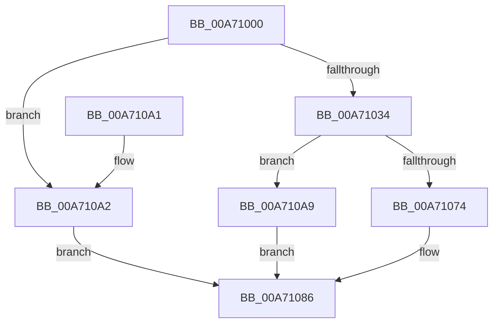

# MmGetChannelInformation

- RVA: `0x00A71000`–`0x00A710B0` (길이 `176` bytes)
- VA: `0x0000000140A71000`
- 실행 섹션: `PAGE`
- PDB 이름 있음: `예`; PDB Function 태그: `아니요`
- unwind 정보 RVA: `0x000B526C`
- 디코드: `46`개 명령, `176/176` bytes 표시
- 미해석 바이트: `0` (있으면 어셈블리에 `.byte`로 보존)

> 이 문서는 커널 이미지의 기계어와 PDB 기호를 분석해 생성했습니다. 4번과 5번은 함수 원형과 자료형을 바이너리 사용 방식에서 추정한 C 해석이며 원본 소스 복구 결과는 아닙니다.

## 1. Dependencies

- 직접 호출 지점: **4**; 고유 호출 대상: **4**
- 직접 호출자로 확인된 함수: **3**
- RIP 상대 이미지 참조: **3**

### Outgoing calls
- `0x00A7104C` → [MiGetChannelInformation](../../text/3B/MiGetChannelInformation_function_003B8738.md) (function, `0x003B8738`)
- `0x00A71067` → [MiAllocatePool](../../text/35/MiAllocatePool_function_0035B540.md) (function, `0x0035B540`)
- `0x00A7107F` → [memcpy](../../text/6C/memcpy_function_006C6840.md) (function, `0x006C6840`)
- `0x00A71091` → [_security_check_cookie](../../text/6A/_security_check_cookie_function_006AC640.md) (function, `0x006AC640`)

### Direct callers
- [ExpQueryNumaAvailableMemory](../7C/ExpQueryNumaAvailableMemory_function_007C4AA0.md) at `0x007C4B62`
- [ExpQueryChannelInformation](ExpQueryChannelInformation_function_00A70F20.md) at `0x00A70F82`
- [KiPopulateNodeInformation](../../init/C3/KiPopulateNodeInformation_function_00C3907C.md) at `0x00C3929C`

### Static image references
- `0x00A7100B` → RVA `0x00E0A740` (`.data`; read)
- `0x00A71026` → RVA `0x00FC5000` (`ALMOSTRO`; read)
- `0x00A7103C` → RVA `0x00E30088` (`.data`; read)

## 2. Other-region calls and transfers

- 다른 실행 섹션으로 향하는 call: **4**
  - `0x00A7104C` → [MiGetChannelInformation](../../text/3B/MiGetChannelInformation_function_003B8738.md) (`PAGE` → `.text`)
  - `0x00A71067` → [MiAllocatePool](../../text/35/MiAllocatePool_function_0035B540.md) (`PAGE` → `.text`)
  - `0x00A7107F` → [memcpy](../../text/6C/memcpy_function_006C6840.md) (`PAGE` → `.text`)
  - `0x00A71091` → [_security_check_cookie](../../text/6A/_security_check_cookie_function_006AC640.md) (`PAGE` → `.text`)
- 별도 외부 분기/꼬리 이동을 확인하지 못했습니다.

## 3. Assembly (complete function range)

```asm
00A71000  40 53                           push rbx
00A71002  56                              push rsi
00A71003  57                              push rdi
00A71004  48 81 EC 90 00 00 00            sub rsp, 0x90
00A7100B  48 8B 05 2E 97 39 00            mov rax, qword ptr [rip + 0x39972e]
00A71012  48 33 C4                        xor rax, rsp
00A71015  48 89 84 24 80 00 00 00         mov qword ptr [rsp + 0x80], rax
00A7101D  48 83 64 24 20 00               and qword ptr [rsp + 0x20], 0
00A71023  49 8B F1                        mov rsi, r9
00A71026  0F B7 05 D3 3F 55 00            movzx eax, word ptr [rip + 0x553fd3]
00A7102D  49 8B F8                        mov rdi, r8
00A71030  3B D0                           cmp edx, eax
00A71032  73 6E                           jae 0x140a710a2
00A71034  0F B7 C1                        movzx eax, cx
00A71037  4C 8D 4C 24 20                  lea r9, [rsp + 0x20]
00A7103C  48 8B 0D 45 F0 3B 00            mov rcx, qword ptr [rip + 0x3bf045]
00A71043  4C 8D 44 24 30                  lea r8, [rsp + 0x30]
00A71048  48 8B 0C C1                     mov rcx, qword ptr [rcx + rax*8]
00A7104C  E8 E7 76 94 FF                  call 0x1403b8738
00A71051  48 8B 5C 24 20                  mov rbx, qword ptr [rsp + 0x20]
00A71056  41 B8 4D 6D 50 68               mov r8d, 0x68506d4d
00A7105C  48 8B D3                        mov rdx, rbx
00A7105F  48 89 1E                        mov qword ptr [rsi], rbx
00A71062  B9 40 00 00 00                  mov ecx, 0x40
00A71067  E8 D4 A4 8E FF                  call 0x14035b540
00A7106C  48 89 07                        mov qword ptr [rdi], rax
00A7106F  48 85 C0                        test rax, rax
00A71072  74 35                           je 0x140a710a9
00A71074  4C 8B C3                        mov r8, rbx
00A71077  48 8D 54 24 30                  lea rdx, [rsp + 0x30]
00A7107C  48 8B C8                        mov rcx, rax
00A7107F  E8 BC 57 C5 FF                  call 0x1406c6840
00A71084  33 C0                           xor eax, eax
00A71086  48 8B 8C 24 80 00 00 00         mov rcx, qword ptr [rsp + 0x80]
00A7108E  48 33 CC                        xor rcx, rsp
00A71091  E8 AA B5 C3 FF                  call 0x1406ac640
00A71096  48 81 C4 90 00 00 00            add rsp, 0x90
00A7109D  5F                              pop rdi
00A7109E  5E                              pop rsi
00A7109F  5B                              pop rbx
00A710A0  C3                              ret
00A710A1  CC                              int3
00A710A2  B8 EF 00 00 C0                  mov eax, 0xc00000ef
00A710A7  EB DD                           jmp 0x140a71086
00A710A9  B8 9A 00 00 C0                  mov eax, 0xc000009a
00A710AE  EB D6                           jmp 0x140a71086
```

## 4. C-style interpretation (structured pseudocode)

```c
__int64 __fastcall MmGetChannelInformation(unsigned __int16 a1, int a2, __int64 a3, __int64 a4)
{
    __int64 result;
    __int64 v_rsp;
    unsigned __int64 v_stack_m28;
    unsigned __int64 v_stack_m78;
    unsigned __int64 v_stack_m88;

    v_rsp = (v_rsp) - (144);
    result = (*(unsigned __int64 *)(v_rip + 3774254)) ^ (v_rsp);
    v_stack_m28 = result;
    if (a2 >= ((unsigned int)(*(unsigned __int16 *)(v_rip + 5586899)))) goto loc_00A710A2;
    result = MiGetChannelInformation(*(unsigned __int64 *)(*(unsigned __int64 *)(v_rip + 3928133) + a1 * 8), a2, v_stack_m78, v_stack_m88);
    *(unsigned __int64 *)(a4) = v_stack_m88;
    result = MiAllocatePool(64, v_stack_m88, (unsigned int)(0x68506D4DULL), v_stack_m88);
    *(unsigned __int64 *)(a3) = result;
    if (result == 0) goto loc_00A710A9;
    result = memcpy(result, v_stack_m78, v_stack_m88, v_stack_m88);
    result = 0;
loc_00A71086:
    a1 = (v_stack_m28) ^ (v_rsp);
    result = _security_check_cookie(a1, v_stack_m78, v_stack_m88, v_stack_m88);
    v_rsp = (v_rsp) + (144);
    return result;
loc_00A710A2:
    goto loc_00A71086;
loc_00A710A9:
    goto loc_00A71086;
}
```

## 5. (Beta) C Style

```c
int64_t MmGetChannelInformation(uint16_t Arg1, int32_t Arg2, void *Arg3, void *Arg4)
{
    uint8_t *arg3 = (uint8_t *)Arg3;
    uint8_t *arg4 = (uint8_t *)Arg4;

    int64_t result;
    int64_t local_rsp;
    uint64_t v_stack_m28;
    uint64_t v_stack_m78;
    uint64_t v_stack_m88;

    local_rsp = (local_rsp) - (144);
    result = (*(uint64_t *)(v_rip + 0x39972E)) ^ (local_rsp);
    v_stack_m28 = result;
    if (Arg2 >= ((uint32_t)(*(uint16_t *)(v_rip + 0x553FD3)))) goto loc_00A710A2;
    result = MiGetChannelInformation(*(uint64_t *)(*(uint64_t *)(v_rip + 0x3BF045) + Arg1 * 8), Arg2, v_stack_m78, v_stack_m88);
    *(uint64_t *)(arg4) = v_stack_m88;
    result = MiAllocatePool(64, v_stack_m88, (uint32_t)(0x68506D4DULL), v_stack_m88);
    *(uint64_t *)(arg3) = result;
    if (result == 0) goto loc_00A710A9;
    result = memcpy(result, v_stack_m78, v_stack_m88, v_stack_m88);
    result = 0;
loc_00A71086:
    Arg1 = (v_stack_m28) ^ (local_rsp);
    result = _security_check_cookie(Arg1, v_stack_m78, v_stack_m88, v_stack_m88);
    local_rsp = (local_rsp) + (144);
    return result;
loc_00A710A2:
    goto loc_00A71086;
loc_00A710A9:
    goto loc_00A71086;
}
```

### 관측된 메모리 오프셋

구조체 형식이 확인되지 않은 접근은 인자 기준의 오프셋으로만 기록했습니다.

| 기준 인자 | 오프셋 표현 | 폭 (bit) | 접근 |
|---|---:|---:|---|
| `Arg3` | `+ 0x0` | `64` | `W` |
| `Arg4` | `+ 0x0` | `64` | `W` |

## 6. Execution-region graph

[열기: 2D/3D 그래프와 함수 탐색 컨트롤 패널](../../../control-panel.html?section=page&rva=0x00A71000&view=graph)

- 2D 그래프는 위에서 아래로 흐르고, 3D 그래프는 빈 공간을 드래그해 회전합니다. Shift+드래그는 이동, 휠은 확대·축소, 함수 노드 선택은 대상 보고서 이동입니다.

### Static fallback


