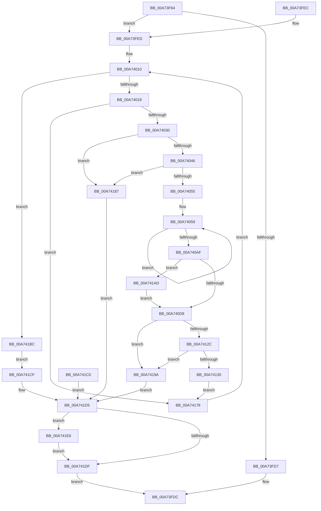

# MmGetPageFileInformation

- RVA: `0x00A73F64`–`0x00A741F4` (길이 `656` bytes)
- VA: `0x0000000140A73F64`
- 실행 섹션: `PAGE`
- PDB 이름 있음: `예`; PDB Function 태그: `아니요`
- unwind 정보 RVA: `0x000B56C8`
- 디코드: `168`개 명령, `656/656` bytes 표시
- 미해석 바이트: `0` (있으면 어셈블리에 `.byte`로 보존)

> 이 문서는 커널 이미지의 기계어와 PDB 기호를 분석해 생성했습니다. 4번과 5번은 함수 원형과 자료형을 바이너리 사용 방식에서 추정한 C 해석이며 원본 소스 복구 결과는 아닙니다.

## 1. Dependencies

- 직접 호출 지점: **3**; 고유 호출 대상: **3**
- 직접 호출자로 확인된 함수: **1**
- RIP 상대 이미지 참조: **0**

### Outgoing calls
- `0x00A73FC5` → [MiPartitionObjectToPartition](../../text/3E/MiPartitionObjectToPartition_function_003EAB0C.md) (function, `0x003EAB0C`)
- `0x00A74146` → [memcpy](../../text/6C/memcpy_function_006C6840.md) (function, `0x006C6840`)
- `0x00A741ED` → [PsDereferencePartition](../../text/34/PsDereferencePartition_function_00342E70.md) (function, `0x00342E70`)

### Direct callers
- [ExpQuerySystemInformation](../A5/ExpQuerySystemInformation_function_00A57858.md) at `0x00A59FFA`

### Static image references
- 디코드된 RIP-relative 메모리 참조가 없습니다.

## 2. Other-region calls and transfers

- 다른 실행 섹션으로 향하는 call: **3**
  - `0x00A73FC5` → [MiPartitionObjectToPartition](../../text/3E/MiPartitionObjectToPartition_function_003EAB0C.md) (`PAGE` → `.text`)
  - `0x00A74146` → [memcpy](../../text/6C/memcpy_function_006C6840.md) (`PAGE` → `.text`)
  - `0x00A741ED` → [PsDereferencePartition](../../text/34/PsDereferencePartition_function_00342E70.md) (`PAGE` → `.text`)
- 별도 외부 분기/꼬리 이동을 확인하지 못했습니다.

## 3. Assembly (complete function range)

```asm
00A73F64  4C 8B DC                        mov r11, rsp
00A73F67  45 89 4B 20                     mov dword ptr [r11 + 0x20], r9d
00A73F6B  45 89 43 18                     mov dword ptr [r11 + 0x18], r8d
00A73F6F  49 89 53 10                     mov qword ptr [r11 + 0x10], rdx
00A73F73  49 89 4B 08                     mov qword ptr [r11 + 8], rcx
00A73F77  53                              push rbx
00A73F78  56                              push rsi
00A73F79  57                              push rdi
00A73F7A  41 54                           push r12
00A73F7C  41 55                           push r13
00A73F7E  41 56                           push r14
00A73F80  41 57                           push r15
00A73F82  48 83 EC 60                     sub rsp, 0x60
00A73F86  41 8B C1                        mov eax, r9d
00A73F89  4C 8B EA                        mov r13, rdx
00A73F8C  0F 57 C0                        xorps xmm0, xmm0
00A73F8F  0F 11 44 24 48                  movups xmmword ptr [rsp + 0x48], xmm0
00A73F94  33 FF                           xor edi, edi
00A73F96  41 88 7B 08                     mov byte ptr [r11 + 8], dil
00A73F9A  F7 D8                           neg eax
00A73F9C  45 1B FF                        sbb r15d, r15d
00A73F9F  41 83 E7 08                     and r15d, 8
00A73FA3  41 83 C7 20                     add r15d, 0x20
00A73FA7  89 7C 24 20                     mov dword ptr [rsp + 0x20], edi
00A73FAB  4C 8B A4 24 C0 00 00 00         mov r12, qword ptr [rsp + 0xc0]
00A73FB3  41 89 3C 24                     mov dword ptr [r12], edi
00A73FB7  49 89 53 A8                     mov qword ptr [r11 - 0x58], rdx
00A73FBB  4D 8D 43 08                     lea r8, [r11 + 8]
00A73FBF  33 D2                           xor edx, edx
00A73FC1  48 83 C9 FF                     or rcx, 0xffffffffffffffff
00A73FC5  E8 42 6B 97 FF                  call 0x1403eab0c
00A73FCA  4C 8B F0                        mov r14, rax
00A73FCD  48 89 44 24 58                  mov qword ptr [rsp + 0x58], rax
00A73FD2  48 85 C0                        test rax, rax
00A73FD5  75 16                           jne 0x140a73fed
00A73FD7  B8 A0 04 00 C0                  mov eax, 0xc00004a0
00A73FDC  48 83 C4 60                     add rsp, 0x60
00A73FE0  41 5F                           pop r15
00A73FE2  41 5E                           pop r14
00A73FE4  41 5D                           pop r13
00A73FE6  41 5C                           pop r12
00A73FE8  5F                              pop rdi
00A73FE9  5E                              pop rsi
00A73FEA  5B                              pop rbx
00A73FEB  C3                              ret
00A73FEC  CC                              int3
00A73FED  8B 80 58 48 00 00               mov eax, dword ptr [rax + 0x4858]
00A73FF3  89 44 24 38                     mov dword ptr [rsp + 0x38], eax
00A73FF7  41 89 7D 04                     mov dword ptr [r13 + 4], edi
00A73FFB  8B D7                           mov edx, edi
00A73FFD  89 54 24 24                     mov dword ptr [rsp + 0x24], edx
00A74001  41 B9 02 00 00 00               mov r9d, 2
00A74007  8B 5C 24 20                     mov ebx, dword ptr [rsp + 0x20]
00A7400B  48 8B 74 24 40                  mov rsi, qword ptr [rsp + 0x40]
00A74010  3B D0                           cmp edx, eax
00A74012  0F 83 A4 01 00 00               jae 0x140a741bc
00A74018  44 8B C2                        mov r8d, edx
00A7401B  4B 8B 84 C6 60 48 00 00         mov rax, qword ptr [r14 + r8*8 + 0x4860]
00A74023  F6 80 AC 00 00 00 50            test byte ptr [rax + 0xac], 0x50
00A7402A  0F 85 48 01 00 00               jne 0x140a74178
00A74030  8B C3                           mov eax, ebx
00A74032  49 03 C5                        add rax, r13
00A74035  48 89 44 24 40                  mov qword ptr [rsp + 0x40], rax
00A7403A  41 8D 04 1F                     lea eax, [r15 + rbx]
00A7403E  3B C3                           cmp eax, ebx
00A74040  0F 86 41 01 00 00               jbe 0x140a74187
00A74046  8B 94 24 B0 00 00 00            mov edx, dword ptr [rsp + 0xb0]
00A7404D  3B C2                           cmp eax, edx
00A7404F  0F 87 32 01 00 00               ja 0x140a74187
00A74055  89 44 24 20                     mov dword ptr [rsp + 0x20], eax
00A74059  4B 8B 84 C6 60 48 00 00         mov rax, qword ptr [r14 + r8*8 + 0x4860]
00A74061  8B 08                           mov ecx, dword ptr [rax]
00A74063  89 4C 24 2C                     mov dword ptr [rsp + 0x2c], ecx
00A74067  4B 8B 84 C6 60 48 00 00         mov rax, qword ptr [r14 + r8*8 + 0x4860]
00A7406F  8B 40 0C                        mov eax, dword ptr [rax + 0xc]
00A74072  89 84 24 C0 00 00 00            mov dword ptr [rsp + 0xc0], eax
00A74079  4B 8B 84 C6 60 48 00 00         mov rax, qword ptr [r14 + r8*8 + 0x4860]
00A74081  8B 40 10                        mov eax, dword ptr [rax + 0x10]
00A74084  89 44 24 30                     mov dword ptr [rsp + 0x30], eax
00A74088  4B 8B 84 C6 60 48 00 00         mov rax, qword ptr [r14 + r8*8 + 0x4860]
00A74090  8B 40 08                        mov eax, dword ptr [rax + 8]
00A74093  89 44 24 34                     mov dword ptr [rsp + 0x34], eax
00A74097  4B 8B 84 C6 60 48 00 00         mov rax, qword ptr [r14 + r8*8 + 0x4860]
00A7409F  8B 48 04                        mov ecx, dword ptr [rax + 4]
00A740A2  8B 44 24 2C                     mov eax, dword ptr [rsp + 0x2c]
00A740A6  39 84 24 C0 00 00 00            cmp dword ptr [rsp + 0xc0], eax
00A740AD  73 AA                           jae 0x140a74059
00A740AF  48 8B 74 24 40                  mov rsi, qword ptr [rsp + 0x40]
00A740B4  89 46 04                        mov dword ptr [rsi + 4], eax
00A740B7  2B 84 24 C0 00 00 00            sub eax, dword ptr [rsp + 0xc0]
00A740BE  41 2B C1                        sub eax, r9d
00A740C1  89 46 08                        mov dword ptr [rsi + 8], eax
00A740C4  8B 44 24 30                     mov eax, dword ptr [rsp + 0x30]
00A740C8  89 46 0C                        mov dword ptr [rsi + 0xc], eax
00A740CB  39 BC 24 B8 00 00 00            cmp dword ptr [rsp + 0xb8], edi
00A740D2  0F 85 D5 00 00 00               jne 0x140a741ad
00A740D8  0F 57 C0                        xorps xmm0, xmm0
00A740DB  0F 11 44 24 48                  movups xmmword ptr [rsp + 0x48], xmm0
00A740E0  4B 8B 84 C6 60 48 00 00         mov rax, qword ptr [r14 + r8*8 + 0x4860]
00A740E8  44 0F B7 68 40                  movzx r13d, word ptr [rax + 0x40]
00A740ED  66 44 89 6C 24 48               mov word ptr [rsp + 0x48], r13w
00A740F3  43 8D 04 29                     lea eax, [r9 + r13]
00A740F7  0F B7 C8                        movzx ecx, ax
00A740FA  66 89 4C 24 4A                  mov word ptr [rsp + 0x4a], cx
00A740FF  45 8B CF                        mov r9d, r15d
00A74102  4C 03 CE                        add r9, rsi
00A74105  4C 89 4C 24 50                  mov qword ptr [rsp + 0x50], r9
00A7410A  0F 10 44 24 48                  movups xmm0, xmmword ptr [rsp + 0x48]
00A7410F  F3 0F 7F 46 10                  movdqu xmmword ptr [rsi + 0x10], xmm0
00A74114  83 C1 07                        add ecx, 7
00A74117  83 E1 F8                        and ecx, 0xfffffff8
00A7411A  89 8C 24 C0 00 00 00            mov dword ptr [rsp + 0xc0], ecx
00A74121  8B 44 24 20                     mov eax, dword ptr [rsp + 0x20]
00A74125  8D 1C 01                        lea ebx, [rcx + rax]
00A74128  3B D8                           cmp ebx, eax
00A7412A  76 6E                           jbe 0x140a7419a
00A7412C  3B DA                           cmp ebx, edx
00A7412E  77 6A                           ja 0x140a7419a
00A74130  89 5C 24 20                     mov dword ptr [rsp + 0x20], ebx
00A74134  4B 8B 94 C6 60 48 00 00         mov rdx, qword ptr [r14 + r8*8 + 0x4860]
00A7413C  45 8B C5                        mov r8d, r13d
00A7413F  48 8B 52 48                     mov rdx, qword ptr [rdx + 0x48]
00A74143  49 8B C9                        mov rcx, r9
00A74146  E8 F5 26 C5 FF                  call 0x1406c6840
00A7414B  49 D1 ED                        shr r13, 1
00A7414E  48 8B 44 24 50                  mov rax, qword ptr [rsp + 0x50]
00A74153  66 42 89 3C 68                  mov word ptr [rax + r13*2], di
00A74158  8B 84 24 C0 00 00 00            mov eax, dword ptr [rsp + 0xc0]
00A7415F  41 03 C7                        add eax, r15d
00A74162  89 06                           mov dword ptr [rsi], eax
00A74164  8B 54 24 24                     mov edx, dword ptr [rsp + 0x24]
00A74168  4C 8B AC 24 A8 00 00 00         mov r13, qword ptr [rsp + 0xa8]
00A74170  41 B9 02 00 00 00               mov r9d, 2
00A74176  EB 00                           jmp 0x140a74178
00A74178  FF C2                           inc edx
00A7417A  89 54 24 24                     mov dword ptr [rsp + 0x24], edx
00A7417E  8B 44 24 38                     mov eax, dword ptr [rsp + 0x38]
00A74182  E9 89 FE FF FF                  jmp 0x140a74010
00A74187  89 44 24 20                     mov dword ptr [rsp + 0x20], eax
00A7418B  41 89 04 24                     mov dword ptr [r12], eax
00A7418F  BB 04 00 00 C0                  mov ebx, 0xc0000004
00A74194  89 5C 24 28                     mov dword ptr [rsp + 0x28], ebx
00A74198  EB 3B                           jmp 0x140a741d5
00A7419A  89 5C 24 20                     mov dword ptr [rsp + 0x20], ebx
00A7419E  41 89 1C 24                     mov dword ptr [r12], ebx
00A741A2  BB 04 00 00 C0                  mov ebx, 0xc0000004
00A741A7  89 5C 24 28                     mov dword ptr [rsp + 0x28], ebx
00A741AB  EB 28                           jmp 0x140a741d5
00A741AD  8B 44 24 34                     mov eax, dword ptr [rsp + 0x34]
00A741B1  89 46 20                        mov dword ptr [rsi + 0x20], eax
00A741B4  89 4E 24                        mov dword ptr [rsi + 0x24], ecx
00A741B7  E9 1C FF FF FF                  jmp 0x140a740d8
00A741BC  89 3E                           mov dword ptr [rsi], edi
00A741BE  EB 0F                           jmp 0x140a741cf
00A741C0  8B D8                           mov ebx, eax
00A741C2  89 44 24 28                     mov dword ptr [rsp + 0x28], eax
00A741C6  33 FF                           xor edi, edi
00A741C8  4C 8B 74 24 58                  mov r14, qword ptr [rsp + 0x58]
00A741CD  EB 06                           jmp 0x140a741d5
00A741CF  41 89 1C 24                     mov dword ptr [r12], ebx
00A741D3  8B DF                           mov ebx, edi
00A741D5  40 38 BC 24 A0 00 00 00         cmp byte ptr [rsp + 0xa0], dil
00A741DD  75 07                           jne 0x140a741e6
00A741DF  8B C3                           mov eax, ebx
00A741E1  E9 F6 FD FF FF                  jmp 0x140a73fdc
00A741E6  49 8B 8E B8 00 00 00            mov rcx, qword ptr [r14 + 0xb8]
00A741ED  E8 7E EC 8C FF                  call 0x140342e70
00A741F2  EB EB                           jmp 0x140a741df
```

## 4. C-style interpretation (structured pseudocode)

```c
__int64 __fastcall MmGetPageFileInformation(__int64 a1, __int64 a2, int a3, int a4, unsigned int a5)
{
    __int64 result;
    __int64 v_r13;
    __int64 v_r15;
    __int64 v_rdi;
    __int64 v_rsp;
    unsigned __int64 v_stack_m40;
    unsigned __int64 v_stack_m50;
    unsigned int v_stack_m78;
    unsigned int v_stack_p20;
    unsigned int v_stack_p24;
    unsigned int v_stack_p28;
    unsigned int v_stack_p2C;
    unsigned int v_stack_p30;
    unsigned int v_stack_p34;
    unsigned int v_stack_p38;
    unsigned __int64 v_stack_p40;
    unsigned __int64 v_stack_p48;
    unsigned __int16 v_stack_p4A;
    unsigned __int64 v_stack_p50;
    unsigned __int64 v_stack_p58;
    unsigned __int8 v_stack_pA0;
    unsigned __int64 v_stack_pA8;
    unsigned int v_stack_pB0;
    unsigned int v_stack_pB8;
    unsigned int v_stack_pC0;

    *(unsigned int *)(v_rsp + 32) = a4;
    *(unsigned int *)(v_rsp + 24) = a3;
    *(unsigned __int64 *)(v_rsp + 16) = a2;
    *(unsigned __int64 *)(v_rsp + 8) = a1;
    v_rsp = (v_rsp) - (96);
    v_stack_m50 = v_xmm0;
    v_rdi = 0;
    *(unsigned __int8 *)(v_rsp + 8) = 0;
    result = (unsigned int)(-((unsigned int)(a4)));
    v_r15 = (unsigned int)((v_r15) & (8));
    v_r15 = (unsigned int)((v_r15) + (32));
    v_stack_m78 = 0;
    *(unsigned int *)(a5) = 0;
    *(unsigned __int64 *)(v_rsp - 88) = a2;
    a2 = 0;
    a1 = (a1) | (-1);
    result = MiPartitionObjectToPartition(a1, a2, v_rsp + 8, a4);
    v_stack_m40 = result;
    if (result != 0) goto loc_00A73FED;
loc_00A73FDC:
    v_rsp = (v_rsp) + (96);
    return (unsigned int)(0xC00004A0ULL);
loc_00A73FED:
    v_stack_p38 = (unsigned int)((unsigned int)(*(unsigned int *)((unsigned int)(0xC00004A0ULL) + 18520)));
    *(unsigned int *)(a2 + 4) = 0;
    v_stack_p24 = 0;
loc_00A74010:
    if (0 >= ((unsigned int)((unsigned int)(*(unsigned int *)((unsigned int)(0xC00004A0ULL) + 18520))))) goto loc_00A741BC;
    if (((*(unsigned __int8 *)(*(unsigned __int64 *)(result + 0 * 8 + 18528) + 172)) & (80)) != 0) goto loc_00A74178;
    result = ((unsigned int)((unsigned int)((unsigned int)(v_stack_p20)))) + (0);
    v_stack_p40 = result;
    if (((unsigned int)(v_r15 + (unsigned int)(v_stack_p20) * 1)) <= ((unsigned int)((unsigned int)(v_stack_p20)))) goto loc_00A74187;
    if (((unsigned int)(v_r15 + (unsigned int)(v_stack_p20) * 1)) > ((unsigned int)((unsigned int)(v_stack_pB0)))) goto loc_00A74187;
    v_stack_p20 = (unsigned int)(v_r15 + (unsigned int)(v_stack_p20) * 1);
loc_00A74059:
    v_stack_p2C = (unsigned int)((unsigned int)(*(unsigned int *)(*(unsigned __int64 *)(result + 0 * 8 + 18528))));
    v_stack_pC0 = (unsigned int)((unsigned int)(*(unsigned int *)(*(unsigned __int64 *)(result + 0 * 8 + 18528) + 12)));
    v_stack_p30 = (unsigned int)((unsigned int)(*(unsigned int *)(*(unsigned __int64 *)(result + 0 * 8 + 18528) + 16)));
    v_stack_p34 = (unsigned int)((unsigned int)(*(unsigned int *)(*(unsigned __int64 *)(result + 0 * 8 + 18528) + 8)));
    if (a5 >= ((unsigned int)((unsigned int)(v_stack_p2C)))) goto loc_00A74059;
    *(unsigned int *)(v_stack_p40 + 4) = (unsigned int)((unsigned int)(v_stack_p2C));
    result = (unsigned int)(((unsigned int)(v_stack_p2C)) - (a5));
    result = (unsigned int)((result) - (2));
    *(unsigned int *)(v_stack_p40 + 8) = (unsigned int)(result);
    *(unsigned int *)(v_stack_p40 + 12) = (unsigned int)((unsigned int)(v_stack_p30));
    if (v_stack_pB8 != 0) goto loc_00A741AD;
loc_00A740D8:
    v_stack_p48 = v_xmm0;
    v_stack_p48 = (unsigned __int16)(*(unsigned __int16 *)(*(unsigned __int64 *)(result + 0 * 8 + 18528) + 64));
    v_stack_p4A = (unsigned __int16)((unsigned __int16)(2 + *(unsigned __int16 *)(*(unsigned __int64 *)(result + 0 * 8 + 18528) + 64) * 1));
    a4 = ((unsigned int)((unsigned int)(v_r15))) + (v_stack_p40);
    v_stack_p50 = a4;
    *(unsigned __int64 *)(v_stack_p40 + 16) = v_xmm0;
    a1 = (unsigned int)(((unsigned __int16)(2 + *(unsigned __int16 *)(*(unsigned __int64 *)(result + 0 * 8 + 18528) + 64) * 1)) + (7));
    a1 = (unsigned int)((a1) & (0xFFFFFFF8ULL));
    v_stack_pC0 = (unsigned int)(a1);
    if (((unsigned int)(a1 + (unsigned int)(v_stack_p20) * 1)) <= ((unsigned int)((unsigned int)(v_stack_p20)))) goto loc_00A7419A;
    if (((unsigned int)(a1 + (unsigned int)(v_stack_p20) * 1)) > ((unsigned int)((unsigned int)(v_stack_pB0)))) goto loc_00A7419A;
    v_stack_p20 = (unsigned int)(a1 + (unsigned int)(v_stack_p20) * 1);
    result = memcpy(a4, *(unsigned __int64 *)(*(unsigned __int64 *)(result + 0 * 8 + 18528) + 72), (unsigned int)((unsigned int)(*(unsigned __int16 *)(*(unsigned __int64 *)(result + 0 * 8 + 18528) + 64))), a4);
    v_r13 = (*(unsigned __int16 *)(*(unsigned __int64 *)(result + 0 * 8 + 18528) + 64)) >> (1);
    *(unsigned __int16 *)(v_stack_p50 + v_r13 * 2) = 0;
    result = (unsigned int)(((unsigned int)(a5)) + ((unsigned int)(v_r15)));
    *(unsigned int *)(v_stack_p40) = (unsigned int)(result);
    goto loc_00A74178;
loc_00A74178:
    a2 = (unsigned int)(((unsigned int)(v_stack_p24)) + 1);
    v_stack_p24 = (unsigned int)(a2);
    goto loc_00A74010;
loc_00A74187:
    v_stack_p20 = (unsigned int)((unsigned int)(v_stack_p38));
    *(unsigned int *)(a5) = (unsigned int)((unsigned int)(v_stack_p38));
    v_stack_p28 = (unsigned int)((unsigned int)(0xC0000004ULL));
    goto loc_00A741D5;
loc_00A7419A:
    v_stack_p20 = (unsigned int)((unsigned int)(0xC0000004ULL));
    *(unsigned int *)(a5) = (unsigned int)((unsigned int)(0xC0000004ULL));
    v_stack_p28 = (unsigned int)((unsigned int)(0xC0000004ULL));
    goto loc_00A741D5;
loc_00A741AD:
    *(unsigned int *)(v_stack_p40 + 32) = (unsigned int)((unsigned int)(v_stack_p34));
    *(unsigned int *)(v_stack_p40 + 36) = a4;
    goto loc_00A740D8;
loc_00A741BC:
    *(unsigned int *)(v_stack_p40) = 0;
    goto loc_00A741CF;
loc_00A741CF:
    *(unsigned int *)(a5) = (unsigned int)((unsigned int)(0xC0000004ULL));
loc_00A741D5:
    if (v_stack_pA0 != 0) goto loc_00A741E6;
loc_00A741DF:
    goto loc_00A73FDC;
loc_00A741E6:
    result = PsDereferencePartition(*(unsigned __int64 *)(result + 184), a2, (unsigned int)((unsigned int)(*(unsigned __int16 *)(*(unsigned __int64 *)(result + 0 * 8 + 18528) + 64))), 2);
    goto loc_00A741DF;
}
```

## 5. (Beta) C Style

```c
int64_t MmGetPageFileInformation(int64_t Arg1, void *Arg2, int32_t Arg3, int32_t Arg4, void *Arg5)
{
    uint8_t *arg2 = (uint8_t *)Arg2;
    uint8_t *arg5 = (uint8_t *)Arg5;

    int64_t result;
    int64_t local_r13;
    int64_t local_r15;
    int64_t local_rdi;
    int64_t local_rsp;
    uint64_t v_stack_m40;
    uint64_t v_stack_m50;
    uint32_t v_stack_m78;
    uint32_t v_stack_p20;
    uint32_t v_stack_p24;
    uint32_t v_stack_p28;
    uint32_t v_stack_p2C;
    uint32_t v_stack_p30;
    uint32_t v_stack_p34;
    uint32_t v_stack_p38;
    uint64_t v_stack_p40;
    uint64_t v_stack_p48;
    uint16_t v_stack_p4A;
    uint64_t v_stack_p50;
    uint64_t v_stack_p58;
    uint8_t v_stack_pA0;
    uint64_t v_stack_pA8;
    uint32_t v_stack_pB0;
    uint32_t v_stack_pB8;
    uint32_t v_stack_pC0;

    *(uint32_t *)(local_rsp + 0x20) = Arg4;
    *(uint32_t *)(local_rsp + 0x18) = Arg3;
    *(void **)(local_rsp + 0x10) = Arg2;
    *(uint64_t *)(local_rsp + 0x8) = Arg1;
    local_rsp = (local_rsp) - (96);
    v_stack_m50 = v_xmm0;
    local_rdi = 0;
    *(uint8_t *)(local_rsp + 0x8) = 0;
    result = (uint32_t)(-((uint32_t)(Arg4)));
    local_r15 = (uint32_t)((local_r15) & (8));
    local_r15 = (uint32_t)((local_r15) + (32));
    v_stack_m78 = 0;
    *(uint32_t *)(arg5) = 0;
    *(void **)(local_rsp - 0x58) = Arg2;
    Arg2 = 0;
    Arg1 = (Arg1) | (-1);
    result = MiPartitionObjectToPartition(Arg1, Arg2, local_rsp + 8, Arg4);
    v_stack_m40 = result;
    if (result != 0) goto loc_00A73FED;
loc_00A73FDC:
    local_rsp = (local_rsp) + (96);
    return (uint32_t)(0xC00004A0ULL);
loc_00A73FED:
    v_stack_p38 = (uint32_t)((uint32_t)(*(uint32_t *)((uint32_t)(0xC00004A0ULL) + 0x4858)));
    *(uint32_t *)(arg2 + 0x4) = 0;
    v_stack_p24 = 0;
loc_00A74010:
    if (0 >= ((uint32_t)((uint32_t)(*(uint32_t *)((uint32_t)(0xC00004A0ULL) + 0x4858))))) goto loc_00A741BC;
    if (((*(uint8_t *)(*(uint64_t *)(result + 0x0 * 8 + 0x4860) + 0xAC)) & (80)) != 0) goto loc_00A74178;
    result = ((uint32_t)((uint32_t)((uint32_t)(v_stack_p20)))) + (0);
    v_stack_p40 = result;
    if (((uint32_t)(local_r15 + (uint32_t)(v_stack_p20) * 1)) <= ((uint32_t)((uint32_t)(v_stack_p20)))) goto loc_00A74187;
    if (((uint32_t)(local_r15 + (uint32_t)(v_stack_p20) * 1)) > ((uint32_t)((uint32_t)(v_stack_pB0)))) goto loc_00A74187;
    v_stack_p20 = (uint32_t)(local_r15 + (uint32_t)(v_stack_p20) * 1);
loc_00A74059:
    v_stack_p2C = (uint32_t)((uint32_t)(*(uint32_t *)(*(uint64_t *)(result + 0x0 * 8 + 0x4860))));
    v_stack_pC0 = (uint32_t)((uint32_t)(*(uint32_t *)(*(uint64_t *)(result + 0x0 * 8 + 0x4860) + 0xC)));
    v_stack_p30 = (uint32_t)((uint32_t)(*(uint32_t *)(*(uint64_t *)(result + 0x0 * 8 + 0x4860) + 0x10)));
    v_stack_p34 = (uint32_t)((uint32_t)(*(uint32_t *)(*(uint64_t *)(result + 0x0 * 8 + 0x4860) + 0x8)));
    if (Arg5 >= ((uint32_t)((uint32_t)(v_stack_p2C)))) goto loc_00A74059;
    *(uint32_t *)(v_stack_p40 + 0x4) = (uint32_t)((uint32_t)(v_stack_p2C));
    result = (uint32_t)(((uint32_t)(v_stack_p2C)) - (Arg5));
    result = (uint32_t)((result) - (2));
    *(uint32_t *)(v_stack_p40 + 0x8) = (uint32_t)(result);
    *(uint32_t *)(v_stack_p40 + 0xC) = (uint32_t)((uint32_t)(v_stack_p30));
    if (v_stack_pB8 != 0) goto loc_00A741AD;
loc_00A740D8:
    v_stack_p48 = v_xmm0;
    v_stack_p48 = (uint16_t)(*(uint16_t *)(*(uint64_t *)(result + 0x0 * 8 + 0x4860) + 0x40));
    v_stack_p4A = (uint16_t)((uint16_t)(2 + *(uint16_t *)(*(uint64_t *)(result + 0x0 * 8 + 0x4860) + 0x40) * 1));
    Arg4 = ((uint32_t)((uint32_t)(local_r15))) + (v_stack_p40);
    v_stack_p50 = Arg4;
    *(uint64_t *)(v_stack_p40 + 0x10) = v_xmm0;
    Arg1 = (uint32_t)(((uint16_t)(2 + *(uint16_t *)(*(uint64_t *)(result + 0x0 * 8 + 0x4860) + 0x40) * 1)) + (7));
    Arg1 = (uint32_t)((Arg1) & (0xFFFFFFF8ULL));
    v_stack_pC0 = (uint32_t)(Arg1);
    if (((uint32_t)(Arg1 + (uint32_t)(v_stack_p20) * 1)) <= ((uint32_t)((uint32_t)(v_stack_p20)))) goto loc_00A7419A;
    if (((uint32_t)(Arg1 + (uint32_t)(v_stack_p20) * 1)) > ((uint32_t)((uint32_t)(v_stack_pB0)))) goto loc_00A7419A;
    v_stack_p20 = (uint32_t)(Arg1 + (uint32_t)(v_stack_p20) * 1);
    result = memcpy(Arg4, *(uint64_t *)(*(uint64_t *)(result + 0x0 * 8 + 0x4860) + 0x48), (uint32_t)((uint32_t)(*(uint16_t *)(*(uint64_t *)(result + 0x0 * 8 + 0x4860) + 0x40))), Arg4);
    local_r13 = (*(uint16_t *)(*(uint64_t *)(result + 0x0 * 8 + 0x4860) + 0x40)) >> (1);
    *(uint16_t *)(v_stack_p50 + local_r13 * 2) = 0;
    result = (uint32_t)(((uint32_t)(Arg5)) + ((uint32_t)(local_r15)));
    *(uint32_t *)(v_stack_p40) = (uint32_t)(result);
    goto loc_00A74178;
loc_00A74178:
    Arg2 = (uint32_t)(((uint32_t)(v_stack_p24)) + 1);
    v_stack_p24 = (uint32_t)(Arg2);
    goto loc_00A74010;
loc_00A74187:
    v_stack_p20 = (uint32_t)((uint32_t)(v_stack_p38));
    *(uint32_t *)(arg5) = (uint32_t)((uint32_t)(v_stack_p38));
    v_stack_p28 = (uint32_t)((uint32_t)(0xC0000004ULL));
    goto loc_00A741D5;
loc_00A7419A:
    v_stack_p20 = (uint32_t)((uint32_t)(0xC0000004ULL));
    *(uint32_t *)(arg5) = (uint32_t)((uint32_t)(0xC0000004ULL));
    v_stack_p28 = (uint32_t)((uint32_t)(0xC0000004ULL));
    goto loc_00A741D5;
loc_00A741AD:
    *(uint32_t *)(v_stack_p40 + 0x20) = (uint32_t)((uint32_t)(v_stack_p34));
    *(uint32_t *)(v_stack_p40 + 0x24) = Arg4;
    goto loc_00A740D8;
loc_00A741BC:
    *(uint32_t *)(v_stack_p40) = 0;
    goto loc_00A741CF;
loc_00A741CF:
    *(uint32_t *)(arg5) = (uint32_t)((uint32_t)(0xC0000004ULL));
loc_00A741D5:
    if (v_stack_pA0 != 0) goto loc_00A741E6;
loc_00A741DF:
    goto loc_00A73FDC;
loc_00A741E6:
    result = PsDereferencePartition(*(uint64_t *)(result + 0xB8), Arg2, (uint32_t)((uint32_t)(*(uint16_t *)(*(uint64_t *)(result + 0x0 * 8 + 0x4860) + 0x40))), 2);
    goto loc_00A741DF;
}
```

### 관측된 메모리 오프셋

구조체 형식이 확인되지 않은 접근은 인자 기준의 오프셋으로만 기록했습니다.

| 기준 인자 | 오프셋 표현 | 폭 (bit) | 접근 |
|---|---:|---:|---|
| `Arg2` | `+ 0x4` | `32` | `W` |
| `Arg5` | `+ 0x0` | `32` | `W` |

## 6. Execution-region graph

[열기: 2D/3D 그래프와 함수 탐색 컨트롤 패널](../../../control-panel.html?section=page&rva=0x00A73F64&view=graph)

- 2D 그래프는 위에서 아래로 흐르고, 3D 그래프는 빈 공간을 드래그해 회전합니다. Shift+드래그는 이동, 휠은 확대·축소, 함수 노드 선택은 대상 보고서 이동입니다.

### Static fallback


