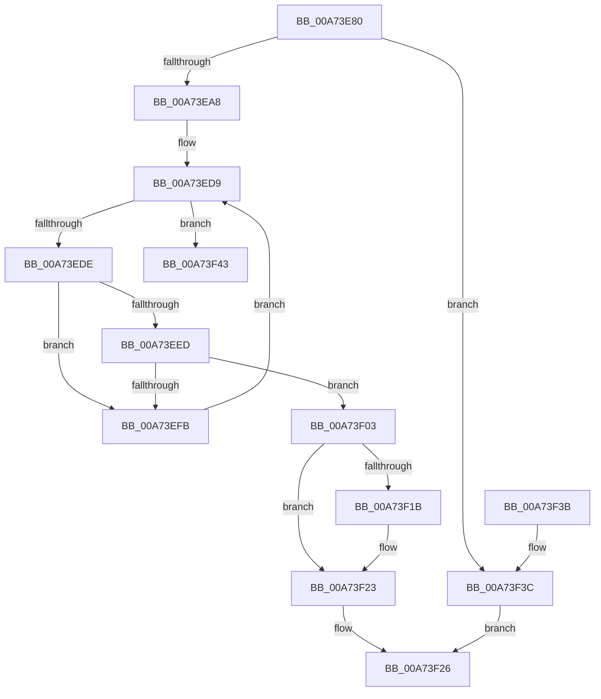

# MmLockPagableDataSection

- RVA: `0x00A73E80`–`0x00A73F5E` (길이 `222` bytes)
- VA: `0x0000000140A73E80`
- 실행 섹션: `PAGE`
- PDB 이름 있음: `예`; PDB Function 태그: `아니요`
- unwind 정보 RVA: `0x000B56B0`
- 디코드: `64`개 명령, `222/222` bytes 표시
- 미해석 바이트: `0` (있으면 어셈블리에 `.byte`로 보존)

> 이 문서는 커널 이미지의 기계어와 PDB 기호를 분석해 생성했습니다. 4번과 5번은 함수 원형과 자료형을 바이너리 사용 방식에서 추정한 C 해석이며 원본 소스 복구 결과는 아닙니다.

## 1. Dependencies

- 직접 호출 지점: **6**; 고유 호출 대상: **6**
- 직접 호출자로 확인된 함수: **7**
- RIP 상대 이미지 참조: **0**

### Outgoing calls
- `0x00A73E9B` → [MI_IS_PHYSICAL_ADDRESS](../../text/23/MI_IS_PHYSICAL_ADDRESS_function_0023B3A0.md) (function, `0x0023B3A0`)
- `0x00A73EB0` → [MiLockLoadedDataTableEntryIfNecessary](../../text/2A/MiLockLoadedDataTableEntryIfNecessary_function_002A38B4.md) (function, `0x002A38B4`)
- `0x00A73EC2` → [RtlImageNtHeader](../../text/44/RtlImageNtHeader_function_00443B60.md) (function, `0x00443B60`)
- `0x00A73F0F` → [MiLockPagableImageSection](../../text/2A/MiLockPagableImageSection_function_002A3A60.md) (function, `0x002A3A60`)
- `0x00A73F1E` → [MmUnlockLoadedDataTableEntry](../../text/2A/MmUnlockLoadedDataTableEntry_function_002A3C98.md) (function, `0x002A3C98`)
- `0x00A73F58` → [KeBugCheckEx](../../text/4F/KeBugCheckEx_function_004FD660.md) (function, `0x004FD660`)

### Direct callers
- [DifMmLockPagableDataSectionWrapper](../../text/63/DifMmLockPagableDataSectionWrapper_function_00635790.md) at `0x0063585D`
- [HalpPowerInitSystem](../../pagelk/B5/HalpPowerInitSystem_function_00B5C540.md) at `0x00B5C563`
- [VfInitDifWithoutReboot](../../pagevrfy/B9/VfInitDifWithoutReboot_function_00B938FC.md) at `0x00B93917`
- [VfInitDifWithoutReboot](../../pagevrfy/B9/VfInitDifWithoutReboot_function_00B938FC.md) at `0x00B9392A`
- [VfInitSystemNoRebootNeeded](../../pagevrfy/B9/VfInitSystemNoRebootNeeded_function_00B93970.md) at `0x00B939A4`
- [VfInitSystemNoRebootNeeded](../../pagevrfy/B9/VfInitSystemNoRebootNeeded_function_00B93970.md) at `0x00B939B7`
- [VfInitSystemNoRebootNeeded](../../pagevrfy/B9/VfInitSystemNoRebootNeeded_function_00B93970.md) at `0x00B939CA`
- [BgkpLockBgfxCodeSection](../../pagebgfx/BC/BgkpLockBgfxCodeSection_function_00BC04F0.md) at `0x00BC055B`
- [HeadlessInit](../../init/C5/HeadlessInit_function_00C52C28.md) at `0x00C52E6C`
- [MiInitSystem](../../init/C5/MiInitSystem_function_00C5E6C0.md) at `0x00C5E9E5`

### Static image references
- 디코드된 RIP-relative 메모리 참조가 없습니다.

## 2. Other-region calls and transfers

- 다른 실행 섹션으로 향하는 call: **6**
  - `0x00A73E9B` → [MI_IS_PHYSICAL_ADDRESS](../../text/23/MI_IS_PHYSICAL_ADDRESS_function_0023B3A0.md) (`PAGE` → `.text`)
  - `0x00A73EB0` → [MiLockLoadedDataTableEntryIfNecessary](../../text/2A/MiLockLoadedDataTableEntryIfNecessary_function_002A38B4.md) (`PAGE` → `.text`)
  - `0x00A73EC2` → [RtlImageNtHeader](../../text/44/RtlImageNtHeader_function_00443B60.md) (`PAGE` → `.text`)
  - `0x00A73F0F` → [MiLockPagableImageSection](../../text/2A/MiLockPagableImageSection_function_002A3A60.md) (`PAGE` → `.text`)
  - `0x00A73F1E` → [MmUnlockLoadedDataTableEntry](../../text/2A/MmUnlockLoadedDataTableEntry_function_002A3C98.md) (`PAGE` → `.text`)
  - `0x00A73F58` → [KeBugCheckEx](../../text/4F/KeBugCheckEx_function_004FD660.md) (`PAGE` → `.text`)
- 별도 외부 분기/꼬리 이동을 확인하지 못했습니다.

## 3. Assembly (complete function range)

```asm
00A73E80  48 8B C4                        mov rax, rsp
00A73E83  48 89 58 08                     mov qword ptr [rax + 8], rbx
00A73E87  48 89 68 18                     mov qword ptr [rax + 0x18], rbp
00A73E8B  48 89 70 20                     mov qword ptr [rax + 0x20], rsi
00A73E8F  57                              push rdi
00A73E90  48 83 EC 30                     sub rsp, 0x30
00A73E94  83 60 10 00                     and dword ptr [rax + 0x10], 0
00A73E98  48 8B F9                        mov rdi, rcx
00A73E9B  E8 00 75 7C FF                  call 0x14023b3a0
00A73EA0  85 C0                           test eax, eax
00A73EA2  0F 85 94 00 00 00               jne 0x140a73f3c
00A73EA8  48 8D 54 24 48                  lea rdx, [rsp + 0x48]
00A73EAD  48 8B CF                        mov rcx, rdi
00A73EB0  E8 FF F9 82 FF                  call 0x1402a38b4
00A73EB5  48 8B EF                        mov rbp, rdi
00A73EB8  48 8B F0                        mov rsi, rax
00A73EBB  48 8B 48 30                     mov rcx, qword ptr [rax + 0x30]
00A73EBF  48 2B E9                        sub rbp, rcx
00A73EC2  E8 99 FC 9C FF                  call 0x140443b60
00A73EC7  0F B7 48 14                     movzx ecx, word ptr [rax + 0x14]
00A73ECB  48 8D 58 18                     lea rbx, [rax + 0x18]
00A73ECF  44 0F B7 48 06                  movzx r9d, word ptr [rax + 6]
00A73ED4  48 03 D9                        add rbx, rcx
00A73ED7  33 C9                           xor ecx, ecx
00A73ED9  41 3B C9                        cmp ecx, r9d
00A73EDC  73 65                           jae 0x140a73f43
00A73EDE  8B 53 0C                        mov edx, dword ptr [rbx + 0xc]
00A73EE1  8B 43 10                        mov eax, dword ptr [rbx + 0x10]
00A73EE4  44 8B 43 08                     mov r8d, dword ptr [rbx + 8]
00A73EE8  48 3B EA                        cmp rbp, rdx
00A73EEB  72 0E                           jb 0x140a73efb
00A73EED  41 3B C0                        cmp eax, r8d
00A73EF0  41 0F 42 C0                     cmovb eax, r8d
00A73EF4  03 C2                           add eax, edx
00A73EF6  48 3B E8                        cmp rbp, rax
00A73EF9  72 08                           jb 0x140a73f03
00A73EFB  48 83 C3 28                     add rbx, 0x28
00A73EFF  FF C1                           inc ecx
00A73F01  EB D6                           jmp 0x140a73ed9
00A73F03  41 B8 01 00 00 00               mov r8d, 1
00A73F09  48 8B D3                        mov rdx, rbx
00A73F0C  48 8B CE                        mov rcx, rsi
00A73F0F  E8 4C FB 82 FF                  call 0x1402a3a60
00A73F14  83 7C 24 48 00                  cmp dword ptr [rsp + 0x48], 0
00A73F19  74 08                           je 0x140a73f23
00A73F1B  48 8B CE                        mov rcx, rsi
00A73F1E  E8 75 FD 82 FF                  call 0x1402a3c98
00A73F23  48 8B C3                        mov rax, rbx
00A73F26  48 8B 5C 24 40                  mov rbx, qword ptr [rsp + 0x40]
00A73F2B  48 8B 6C 24 50                  mov rbp, qword ptr [rsp + 0x50]
00A73F30  48 8B 74 24 58                  mov rsi, qword ptr [rsp + 0x58]
00A73F35  48 83 C4 30                     add rsp, 0x30
00A73F39  5F                              pop rdi
00A73F3A  C3                              ret
00A73F3B  CC                              int3
00A73F3C  B8 01 00 00 00                  mov eax, 1
00A73F41  EB E3                           jmp 0x140a73f26
00A73F43  48 83 64 24 20 00               and qword ptr [rsp + 0x20], 0
00A73F49  45 33 C9                        xor r9d, r9d
00A73F4C  4C 8B C7                        mov r8, rdi
00A73F4F  BA 34 12 00 00                  mov edx, 0x1234
00A73F54  41 8D 49 1A                     lea ecx, [r9 + 0x1a]
00A73F58  E8 03 97 A8 FF                  call 0x1404fd660
00A73F5D  CC                              int3
```

## 4. C-style interpretation (structured pseudocode)

```c
__int64 __fastcall MmLockPagableDataSection(__int64 a1)
{
    __int64 result;
    __int64 v_rbp;
    __int64 v_rbx;
    __int64 v_rsp;
    unsigned __int64 v_stack_p10;
    unsigned __int64 v_stack_p18;
    unsigned __int64 v_stack_p20;
    unsigned __int64 v_stack_p8;

    *(unsigned __int64 *)(v_rsp + 8) = v_rbx;
    *(unsigned __int64 *)(v_rsp + 24) = v_rbp;
    *(unsigned __int64 *)(v_rsp + 32) = v_rsi;
    v_rsp = (v_rsp) - (48);
    result = MI_IS_PHYSICAL_ADDRESS(a1, a2, a3, a4);
    if ((unsigned int)(result) != 0) goto loc_00A73F3C;
    result = MiLockLoadedDataTableEntryIfNecessary(a1, v_stack_p10, a3, a4);
    v_rbp = (a1) - (*(unsigned __int64 *)(result + 48));
    result = RtlImageNtHeader(*(unsigned __int64 *)(result + 48), v_stack_p10, a3, a4);
    v_rbx = (result + 24) + (*(unsigned __int16 *)(result + 20));
    a1 = 0;
loc_00A73ED9:
    if (0 >= ((unsigned int)(*(unsigned __int16 *)(result + 6)))) goto loc_00A73F43;
    if (v_rbp < ((unsigned int)(*(unsigned int *)(v_rbx + 12)))) goto loc_00A73EFB;
    result = (unsigned int)(*(unsigned int *)(v_rbx + 16));
    if (((unsigned int)((unsigned int)(*(unsigned int *)(v_rbx + 16)))) < ((unsigned int)((unsigned int)(*(unsigned int *)(v_rbx + 8))))) { result = (unsigned int)((unsigned int)(*(unsigned int *)(v_rbx + 8))); }
    result = (unsigned int)((result) + ((unsigned int)((unsigned int)(*(unsigned int *)(v_rbx + 12)))));
    if (v_rbp < result) goto loc_00A73F03;
loc_00A73EFB:
    v_rbx = (v_rbx) + (40);
    a1 = (unsigned int)((a1) + 1);
    goto loc_00A73ED9;
loc_00A73F03:
    result = MiLockPagableImageSection(result, v_rbx, 1, *(unsigned __int16 *)(result + 6));
    if (v_stack_p10 != 0) {
        a1 = result;
        result = MmUnlockLoadedDataTableEntry(a1, v_rbx, 1, *(unsigned __int16 *)(result + 6));
    }
loc_00A73F26:
    v_rsp = (v_rsp) + (48);
    return v_rbx;
loc_00A73F3C:
    goto loc_00A73F26;
loc_00A73F43:
    a4 = 0;
    result = KeBugCheckEx(a4 + 26, (unsigned int)(0x1234ULL), a1, a4);
    return result;
}
```

## 5. (Beta) C Style

```c
int64_t MmLockPagableDataSection(int64_t Arg1)
{
    int64_t result;
    int64_t local_rbp;
    int64_t local_rbx;
    int64_t local_rsp;
    uint64_t v_stack_p10;
    uint64_t v_stack_p18;
    uint64_t v_stack_p20;
    uint64_t v_stack_p8;

    *(uint64_t *)(local_rsp + 0x8) = local_rbx;
    *(uint64_t *)(local_rsp + 0x18) = local_rbp;
    *(uint64_t *)(local_rsp + 0x20) = local_rsi;
    local_rsp = (local_rsp) - (48);
    result = MI_IS_PHYSICAL_ADDRESS(Arg1, a2, a3, a4);
    if ((uint32_t)(result) != 0) goto loc_00A73F3C;
    result = MiLockLoadedDataTableEntryIfNecessary(Arg1, v_stack_p10, a3, a4);
    local_rbp = (Arg1) - (*(uint64_t *)(result + 0x30));
    result = RtlImageNtHeader(*(uint64_t *)(result + 0x30), v_stack_p10, a3, a4);
    local_rbx = (result + 24) + (*(uint16_t *)(result + 0x14));
    Arg1 = 0;
loc_00A73ED9:
    if (0 >= ((uint32_t)(*(uint16_t *)(result + 0x6)))) goto loc_00A73F43;
    if (local_rbp < ((uint32_t)(*(uint32_t *)(local_rbx + 0xC)))) goto loc_00A73EFB;
    result = (uint32_t)(*(uint32_t *)(local_rbx + 0x10));
    if (((uint32_t)((uint32_t)(*(uint32_t *)(local_rbx + 0x10)))) < ((uint32_t)((uint32_t)(*(uint32_t *)(local_rbx + 0x8))))) { result = (uint32_t)((uint32_t)(*(uint32_t *)(local_rbx + 0x8))); }
    result = (uint32_t)((result) + ((uint32_t)((uint32_t)(*(uint32_t *)(local_rbx + 0xC)))));
    if (local_rbp < result) goto loc_00A73F03;
loc_00A73EFB:
    local_rbx = (local_rbx) + (40);
    Arg1 = (uint32_t)((Arg1) + 1);
    goto loc_00A73ED9;
loc_00A73F03:
    result = MiLockPagableImageSection(result, local_rbx, 1, *(uint16_t *)(result + 0x6));
    if (v_stack_p10 != 0) {
        Arg1 = result;
        result = MmUnlockLoadedDataTableEntry(Arg1, local_rbx, 1, *(uint16_t *)(result + 0x6));
    }
loc_00A73F26:
    local_rsp = (local_rsp) + (48);
    return local_rbx;
loc_00A73F3C:
    goto loc_00A73F26;
loc_00A73F43:
    a4 = 0;
    result = KeBugCheckEx(a4 + 26, (uint32_t)(0x1234ULL), Arg1, a4);
    return result;
}
```

## 6. Execution-region graph

[열기: 2D/3D 그래프와 함수 탐색 컨트롤 패널](../../../control-panel.html?section=page&rva=0x00A73E80&view=graph)

- 2D 그래프는 위에서 아래로 흐르고, 3D 그래프는 빈 공간을 드래그해 회전합니다. Shift+드래그는 이동, 휠은 확대·축소, 함수 노드 선택은 대상 보고서 이동입니다.

### Static fallback


