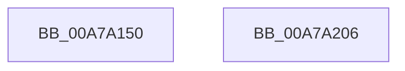

# NtCreateKey

- RVA: `0x00A7A150`–`0x00A7A207` (길이 `183` bytes)
- VA: `0x0000000140A7A150`
- 실행 섹션: `PAGE`
- PDB 이름 있음: `예`; PDB Function 태그: `아니요`
- unwind 정보 RVA: `0x000B6310`
- 디코드: `47`개 명령, `183/183` bytes 표시
- 미해석 바이트: `0` (있으면 어셈블리에 `.byte`로 보존)

> 이 문서는 커널 이미지의 기계어와 PDB 기호를 분석해 생성했습니다. 4번과 5번은 함수 원형과 자료형을 바이너리 사용 방식에서 추정한 C 해석이며 원본 소스 복구 결과는 아닙니다.

## 1. Dependencies

- 직접 호출 지점: **3**; 고유 호출 대상: **3**
- 직접 호출자로 확인된 함수: **0**
- RIP 상대 이미지 참조: **1**

### Outgoing calls
- `0x00A7A188` → [CmpInitializeThreadInfo](../../text/3F/CmpInitializeThreadInfo_function_003FBE70.md) (function, `0x003FBE70`)
- `0x00A7A1DA` → [KeExpandKernelStackAndCallout](../../text/46/KeExpandKernelStackAndCallout_function_004675F0.md) (function, `0x004675F0`)
- `0x00A7A1ED` → [CmCleanupThreadInfo](../../text/41/CmCleanupThreadInfo_function_0041FD50.md) (function, `0x0041FD50`)

### Direct callers
- 이 함수 시작 RVA로 연결되는 직접 call은 확인되지 않았습니다. 간접 호출은 완전히 역산할 수 없습니다.

### Static image references
- `0x00A7A19A` → RVA `0x00A629A0` (`CmCreateKeyCallout`; read)

## 2. Other-region calls and transfers

- 다른 실행 섹션으로 향하는 call: **3**
  - `0x00A7A188` → [CmpInitializeThreadInfo](../../text/3F/CmpInitializeThreadInfo_function_003FBE70.md) (`PAGE` → `.text`)
  - `0x00A7A1DA` → [KeExpandKernelStackAndCallout](../../text/46/KeExpandKernelStackAndCallout_function_004675F0.md) (`PAGE` → `.text`)
  - `0x00A7A1ED` → [CmCleanupThreadInfo](../../text/41/CmCleanupThreadInfo_function_0041FD50.md) (`PAGE` → `.text`)
- 별도 외부 분기/꼬리 이동을 확인하지 못했습니다.

## 3. Assembly (complete function range)

```asm
00A7A150  48 89 5C 24 08                  mov qword ptr [rsp + 8], rbx
00A7A155  55                              push rbp
00A7A156  48 8D 6C 24 C1                  lea rbp, [rsp - 0x3f]
00A7A15B  48 81 EC 90 00 00 00            sub rsp, 0x90
00A7A162  33 C0                           xor eax, eax
00A7A164  0F 57 C0                        xorps xmm0, xmm0
00A7A167  21 45 03                        and dword ptr [rbp + 3], eax
00A7A16A  4C 8B D1                        mov r10, rcx
00A7A16D  21 45 13                        and dword ptr [rbp + 0x13], eax
00A7A170  48 8D 4D CF                     lea rcx, [rbp - 0x31]
00A7A174  21 45 23                        and dword ptr [rbp + 0x23], eax
00A7A177  49 8B D8                        mov rbx, r8
00A7A17A  0F 11 45 CF                     movups xmmword ptr [rbp - 0x31], xmm0
00A7A17E  48 89 45 DF                     mov qword ptr [rbp - 0x21], rax
00A7A182  44 8B DA                        mov r11d, edx
00A7A185  89 45 F3                        mov dword ptr [rbp - 0xd], eax
00A7A188  E8 E3 1C 98 FF                  call 0x1403fbe70
00A7A18D  48 8B 45 6F                     mov rax, qword ptr [rbp + 0x6f]
00A7A191  48 8D 55 EF                     lea rdx, [rbp - 0x11]
00A7A195  48 83 65 EF 00                  and qword ptr [rbp - 0x11], 0
00A7A19A  48 8D 0D FF 87 FE FF            lea rcx, [rip - 0x17801]
00A7A1A1  83 65 03 00                     and dword ptr [rbp + 3], 0
00A7A1A5  41 B8 00 48 00 00               mov r8d, 0x4800
00A7A1AB  83 65 13 00                     and dword ptr [rbp + 0x13], 0
00A7A1AF  83 65 23 00                     and dword ptr [rbp + 0x23], 0
00A7A1B3  48 83 65 2F 00                  and qword ptr [rbp + 0x2f], 0
00A7A1B8  48 89 45 17                     mov qword ptr [rbp + 0x17], rax
00A7A1BC  8B 45 77                        mov eax, dword ptr [rbp + 0x77]
00A7A1BF  89 45 1F                        mov dword ptr [rbp + 0x1f], eax
00A7A1C2  48 8B 45 7F                     mov rax, qword ptr [rbp + 0x7f]
00A7A1C6  48 89 45 27                     mov qword ptr [rbp + 0x27], rax
00A7A1CA  4C 89 55 F7                     mov qword ptr [rbp - 9], r10
00A7A1CE  44 89 5D FF                     mov dword ptr [rbp - 1], r11d
00A7A1D2  48 89 5D 07                     mov qword ptr [rbp + 7], rbx
00A7A1D6  44 89 4D 0F                     mov dword ptr [rbp + 0xf], r9d
00A7A1DA  E8 11 D4 9E FF                  call 0x1404675f0
00A7A1DF  85 C0                           test eax, eax
00A7A1E1  44 8B C0                        mov r8d, eax
00A7A1E4  44 0F 49 45 EF                  cmovns r8d, dword ptr [rbp - 0x11]
00A7A1E9  48 8D 4D CF                     lea rcx, [rbp - 0x31]
00A7A1ED  E8 5E 5B 9A FF                  call 0x14041fd50
00A7A1F2  48 8B 9C 24 A0 00 00 00         mov rbx, qword ptr [rsp + 0xa0]
00A7A1FA  41 8B C0                        mov eax, r8d
00A7A1FD  48 81 C4 90 00 00 00            add rsp, 0x90
00A7A204  5D                              pop rbp
00A7A205  C3                              ret
00A7A206  CC                              int3
```

## 4. C-style interpretation (structured pseudocode)

```c
__int64 __fastcall NtCreateKey(__int64 a1, int a2, __int64 a3, int a4, __int64 a5, unsigned int a6, __int64 a7)
{
    __int64 result;
    __int64 v_rsp;
    unsigned __int64 v_stack_m18;
    unsigned __int64 v_stack_m20;
    unsigned int v_stack_m24;
    unsigned int v_stack_m28;
    unsigned __int64 v_stack_m30;
    unsigned int v_stack_m34;
    unsigned int v_stack_m38;
    unsigned __int64 v_stack_m40;
    unsigned int v_stack_m44;
    unsigned __int64 v_stack_m47;
    unsigned int v_stack_m48;
    unsigned __int64 v_stack_m50;
    unsigned int v_stack_m54;
    unsigned __int64 v_stack_m58;
    unsigned __int64 v_stack_m68;
    unsigned __int64 v_stack_m78;
    unsigned __int64 v_stack_p8;

    v_stack_p8 = v_rbx;
    v_rsp = (v_rsp) - (144);
    result = 0;
    v_stack_m78 = v_xmm0;
    v_stack_m68 = 0;
    v_stack_m54 = 0;
    result = CmpInitializeThreadInfo(v_stack_m78, a2, a3, a4);
    v_stack_m30 = a5;
    v_stack_m28 = (unsigned int)((unsigned int)(a6));
    v_stack_m20 = a7;
    v_stack_m50 = a1;
    v_stack_m48 = (unsigned int)((unsigned int)(a2));
    v_stack_m40 = a3;
    v_stack_m38 = a4;
    result = KeExpandKernelStackAndCallout(v_rip - 96257, v_stack_m58, (unsigned int)(0x4800ULL), a4);
    a3 = (unsigned int)((unsigned int)(result));
    if (!sign_flag) { a3 = v_stack_m58; }
    result = CmCleanupThreadInfo(v_stack_m78, v_stack_m58, a3, a4);
    v_rsp = (v_rsp) + (144);
    return (unsigned int)((unsigned int)(a3));
}
```

## 5. (Beta) C Style

```c
int64_t NtCreateKey(int64_t Arg1, int32_t Arg2, int64_t Arg3, int32_t Arg4, int64_t Arg5, uint32_t Arg6, int64_t Arg7)
{
    int64_t result;
    int64_t local_rsp;
    uint64_t v_stack_m18;
    uint64_t v_stack_m20;
    uint32_t v_stack_m24;
    uint32_t v_stack_m28;
    uint64_t v_stack_m30;
    uint32_t v_stack_m34;
    uint32_t v_stack_m38;
    uint64_t v_stack_m40;
    uint32_t v_stack_m44;
    uint64_t v_stack_m47;
    uint32_t v_stack_m48;
    uint64_t v_stack_m50;
    uint32_t v_stack_m54;
    uint64_t v_stack_m58;
    uint64_t v_stack_m68;
    uint64_t v_stack_m78;
    uint64_t v_stack_p8;

    v_stack_p8 = local_rbx;
    local_rsp = (local_rsp) - (144);
    result = 0;
    v_stack_m78 = v_xmm0;
    v_stack_m68 = 0;
    v_stack_m54 = 0;
    result = CmpInitializeThreadInfo(v_stack_m78, Arg2, Arg3, Arg4);
    v_stack_m30 = Arg5;
    v_stack_m28 = (uint32_t)((uint32_t)(Arg6));
    v_stack_m20 = Arg7;
    v_stack_m50 = Arg1;
    v_stack_m48 = (uint32_t)((uint32_t)(Arg2));
    v_stack_m40 = Arg3;
    v_stack_m38 = Arg4;
    result = KeExpandKernelStackAndCallout(v_rip - 96257, v_stack_m58, (uint32_t)(0x4800ULL), Arg4);
    Arg3 = (uint32_t)((uint32_t)(result));
    if (!sign_flag) { Arg3 = v_stack_m58; }
    result = CmCleanupThreadInfo(v_stack_m78, v_stack_m58, Arg3, Arg4);
    local_rsp = (local_rsp) + (144);
    return (uint32_t)((uint32_t)(Arg3));
}
```

## 6. Execution-region graph

[열기: 2D/3D 그래프와 함수 탐색 컨트롤 패널](../../../control-panel.html?section=page&rva=0x00A7A150&view=graph)

- 2D 그래프는 위에서 아래로 흐르고, 3D 그래프는 빈 공간을 드래그해 회전합니다. Shift+드래그는 이동, 휠은 확대·축소, 함수 노드 선택은 대상 보고서 이동입니다.

### Static fallback


