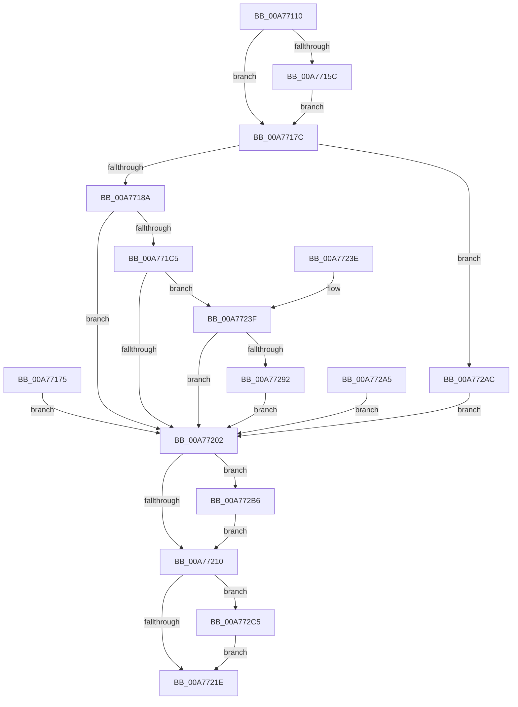

# NtCreateThreadStateChange

- RVA: `0x00A77110`–`0x00A772CF` (길이 `447` bytes)
- VA: `0x0000000140A77110`
- 실행 섹션: `PAGE`
- PDB 이름 있음: `예`; PDB Function 태그: `아니요`
- unwind 정보 RVA: `0x000B5DD0`
- 디코드: `105`개 명령, `447/447` bytes 표시
- 미해석 바이트: `0` (있으면 어셈블리에 `.byte`로 보존)

> 이 문서는 커널 이미지의 기계어와 PDB 기호를 분석해 생성했습니다. 4번과 5번은 함수 원형과 자료형을 바이너리 사용 방식에서 추정한 C 해석이며 원본 소스 복구 결과는 아닙니다.

## 1. Dependencies

- 직접 호출 지점: **5**; 고유 호출 대상: **5**
- 직접 호출자로 확인된 함수: **0**
- RIP 상대 이미지 참조: **2**

### Outgoing calls
- `0x00A771BA` → [ObpReferenceObjectByHandleWithTag](../86/ObpReferenceObjectByHandleWithTag_function_00869650.md) (function, `0x00869650`)
- `0x00A771F7` → [ObCreateObjectEx](../89/ObCreateObjectEx_function_0089B1E0.md) (function, `0x0089B1E0`)
- `0x00A77283` → [ObInsertObjectEx](../8B/ObInsertObjectEx_function_008B97A0.md) (function, `0x008B97A0`)
- `0x00A772BB` → [ObfDereferenceObjectWithTag](../../text/2F/ObfDereferenceObjectWithTag_function_002F78E0.md) (function, `0x002F78E0`)
- `0x00A772C5` → [NtClose](../86/NtClose_function_00868870.md) (function, `0x00868870`)

### Direct callers
- 이 함수 시작 RVA로 연결되는 직접 call은 확인되지 않았습니다. 간접 호출은 완전히 역산할 수 없습니다.

### Static image references
- `0x00A7718A` → RVA `0x00FC6AC8` (`ALMOSTRO`; read)
- `0x00A771C5` → RVA `0x00FC7230` (`ALMOSTRO`; read)

## 2. Other-region calls and transfers

- 다른 실행 섹션으로 향하는 call: **1**
  - `0x00A772BB` → [ObfDereferenceObjectWithTag](../../text/2F/ObfDereferenceObjectWithTag_function_002F78E0.md) (`PAGE` → `.text`)
- 별도 외부 분기/꼬리 이동을 확인하지 못했습니다.

## 3. Assembly (complete function range)

```asm
00A77110  48 8B C4                        mov rax, rsp
00A77113  48 89 70 08                     mov qword ptr [rax + 8], rsi
00A77117  48 89 78 10                     mov qword ptr [rax + 0x10], rdi
00A7711B  4C 89 60 18                     mov qword ptr [rax + 0x18], r12
00A7711F  4C 89 70 20                     mov qword ptr [rax + 0x20], r14
00A77123  41 57                           push r15
00A77125  48 81 EC 80 00 00 00            sub rsp, 0x80
00A7712C  4D 8B D1                        mov r10, r9
00A7712F  4D 8B F8                        mov r15, r8
00A77132  44 8B E2                        mov r12d, edx
00A77135  48 8B F1                        mov rsi, rcx
00A77138  48 83 60 D0 00                  and qword ptr [rax - 0x30], 0
00A7713D  48 83 60 E0 00                  and qword ptr [rax - 0x20], 0
00A77142  48 83 60 D8 00                  and qword ptr [rax - 0x28], 0
00A77147  65 48 8B 04 25 88 01 00 00      mov rax, qword ptr gs:[0x188]
00A77150  44 8A B0 32 02 00 00            mov r14b, byte ptr [rax + 0x232]
00A77157  45 84 F6                        test r14b, r14b
00A7715A  74 20                           je 0x140a7717c
00A7715C  48 B9 00 00 FF FF FF 7F 00 00   movabs rcx, 0x7fffffff0000
00A77166  48 3B F1                        cmp rsi, rcx
00A77169  48 0F 42 CE                     cmovb rcx, rsi
00A7716D  48 8B 01                        mov rax, qword ptr [rcx]
00A77170  48 89 01                        mov qword ptr [rcx], rax
00A77173  EB 07                           jmp 0x140a7717c
00A77175  8B F8                           mov edi, eax
00A77177  E9 86 00 00 00                  jmp 0x140a77202
00A7717C  83 BC 24 B0 00 00 00 00         cmp dword ptr [rsp + 0xb0], 0
00A77184  0F 85 22 01 00 00               jne 0x140a772ac
00A7718A  4C 8B 05 37 F9 54 00            mov r8, qword ptr [rip + 0x54f937]
00A77191  48 83 64 24 38 00               and qword ptr [rsp + 0x38], 0
00A77197  48 83 64 24 30 00               and qword ptr [rsp + 0x30], 0
00A7719D  48 8D 44 24 58                  lea rax, [rsp + 0x58]
00A771A2  48 89 44 24 28                  mov qword ptr [rsp + 0x28], rax
00A771A7  C7 44 24 20 50 73 54 63         mov dword ptr [rsp + 0x20], 0x63547350
00A771AF  45 8A CE                        mov r9b, r14b
00A771B2  BA 20 00 00 00                  mov edx, 0x20
00A771B7  49 8B CA                        mov rcx, r10
00A771BA  E8 91 24 DF FF                  call 0x140869650
00A771BF  8B F8                           mov edi, eax
00A771C1  85 C0                           test eax, eax
00A771C3  78 3D                           js 0x140a77202
00A771C5  48 8B 15 64 00 55 00            mov rdx, qword ptr [rip + 0x550064]
00A771CC  48 83 64 24 48 00               and qword ptr [rsp + 0x48], 0
00A771D2  48 8D 44 24 68                  lea rax, [rsp + 0x68]
00A771D7  48 89 44 24 40                  mov qword ptr [rsp + 0x40], rax
00A771DC  83 64 24 38 00                  and dword ptr [rsp + 0x38], 0
00A771E1  83 64 24 30 00                  and dword ptr [rsp + 0x30], 0
00A771E6  C7 44 24 28 18 00 00 00         mov dword ptr [rsp + 0x28], 0x18
00A771EE  45 8A CE                        mov r9b, r14b
00A771F1  4D 8B C7                        mov r8, r15
00A771F4  41 8A CE                        mov cl, r14b
00A771F7  E8 E4 3F E2 FF                  call 0x14089b1e0
00A771FC  8B F8                           mov edi, eax
00A771FE  85 C0                           test eax, eax
00A77200  79 3D                           jns 0x140a7723f
00A77202  48 8B 4C 24 58                  mov rcx, qword ptr [rsp + 0x58]
00A77207  48 85 C9                        test rcx, rcx
00A7720A  0F 85 A6 00 00 00               jne 0x140a772b6
00A77210  48 8B 4C 24 60                  mov rcx, qword ptr [rsp + 0x60]
00A77215  48 85 C9                        test rcx, rcx
00A77218  0F 85 A7 00 00 00               jne 0x140a772c5
00A7721E  8B C7                           mov eax, edi
00A77220  4C 8D 9C 24 80 00 00 00         lea r11, [rsp + 0x80]
00A77228  49 8B 73 10                     mov rsi, qword ptr [r11 + 0x10]
00A7722C  49 8B 7B 18                     mov rdi, qword ptr [r11 + 0x18]
00A77230  4D 8B 63 20                     mov r12, qword ptr [r11 + 0x20]
00A77234  4D 8B 73 28                     mov r14, qword ptr [r11 + 0x28]
00A77238  49 8B E3                        mov rsp, r11
00A7723B  41 5F                           pop r15
00A7723D  C3                              ret
00A7723E  CC                              int3
00A7723F  0F 57 C0                        xorps xmm0, xmm0
00A77242  33 C0                           xor eax, eax
00A77244  48 8B 4C 24 68                  mov rcx, qword ptr [rsp + 0x68]
00A77249  0F 11 01                        movups xmmword ptr [rcx], xmm0
00A7724C  48 89 41 10                     mov qword ptr [rcx + 0x10], rax
00A77250  48 21 41 08                     and qword ptr [rcx + 8], rax
00A77254  48 8B 44 24 58                  mov rax, qword ptr [rsp + 0x58]
00A77259  48 89 01                        mov qword ptr [rcx], rax
00A7725C  83 61 14 00                     and dword ptr [rcx + 0x14], 0
00A77260  48 83 64 24 58 00               and qword ptr [rsp + 0x58], 0
00A77266  48 8D 44 24 60                  lea rax, [rsp + 0x60]
00A7726B  48 89 44 24 30                  mov qword ptr [rsp + 0x30], rax
00A77270  48 83 64 24 28 00               and qword ptr [rsp + 0x28], 0
00A77276  83 64 24 20 00                  and dword ptr [rsp + 0x20], 0
00A7727B  45 33 C9                        xor r9d, r9d
00A7727E  45 8B C4                        mov r8d, r12d
00A77281  33 D2                           xor edx, edx
00A77283  E8 18 25 E4 FF                  call 0x1408b97a0
00A77288  8B F8                           mov edi, eax
00A7728A  85 C0                           test eax, eax
00A7728C  0F 88 70 FF FF FF               js 0x140a77202
00A77292  48 8B 44 24 60                  mov rax, qword ptr [rsp + 0x60]
00A77297  48 89 06                        mov qword ptr [rsi], rax
00A7729A  48 83 64 24 60 00               and qword ptr [rsp + 0x60], 0
00A772A0  E9 5D FF FF FF                  jmp 0x140a77202
00A772A5  8B F8                           mov edi, eax
00A772A7  E9 56 FF FF FF                  jmp 0x140a77202
00A772AC  BF 0D 00 00 C0                  mov edi, 0xc000000d
00A772B1  E9 4C FF FF FF                  jmp 0x140a77202
00A772B6  BA 50 73 54 63                  mov edx, 0x63547350
00A772BB  E8 20 06 88 FF                  call 0x1402f78e0
00A772C0  E9 4B FF FF FF                  jmp 0x140a77210
00A772C5  E8 A6 15 DF FF                  call 0x140868870
00A772CA  E9 4F FF FF FF                  jmp 0x140a7721e
```

## 4. C-style interpretation (structured pseudocode)

```c
__int64 __fastcall NtCreateThreadStateChange(__int64 a1, int a2, __int64 a3, __int64 a4, unsigned int a5)
{
    __int64 result;
    __int64 v_rsp;
    unsigned __int64 v_stack_m18;
    unsigned __int64 v_stack_m20;
    unsigned __int64 v_stack_m28;
    unsigned __int64 v_stack_m30;
    unsigned __int64 v_stack_m40;
    unsigned __int64 v_stack_m48;
    unsigned __int64 v_stack_m50;
    unsigned __int64 v_stack_m58;
    unsigned __int64 v_stack_m60;
    unsigned int v_stack_m68;
    unsigned __int64 v_stack_m8;

    *(unsigned __int64 *)(v_rsp + 8) = v_rsi;
    *(unsigned __int64 *)(v_rsp + 16) = v_rdi;
    *(unsigned __int64 *)(v_rsp + 24) = v_r12;
    *(unsigned __int64 *)(v_rsp + 32) = v_r14;
    v_rsp = (v_rsp) - (128);
    if ((unsigned __int8)(*(unsigned __int8 *)(*(unsigned __int64 *)(gs_base + (0 + 392)) + 562)) == 0) goto loc_00A7717C;
    if (a1 < a1) { a1 = a1; }
    *(unsigned __int64 *)(a1) = *(unsigned __int64 *)(a1);
    goto loc_00A7717C;
loc_00A7717C:
    if (a5 != 0) goto loc_00A772AC;
    v_stack_m60 = v_stack_m30;
    v_stack_m68 = 0x63547350ULL;
    result = ObpReferenceObjectByHandleWithTag(a4, 32, *(unsigned __int64 *)(v_rip + 5568823), (unsigned __int8)(*(unsigned __int8 *)(*(unsigned __int64 *)(gs_base + (0 + 392)) + 562)));
    if (sign_flag) goto loc_00A77202;
    v_stack_m48 = v_stack_m20;
    v_stack_m60 = 24;
    result = ObCreateObjectEx((unsigned __int8)(*(unsigned __int8 *)(*(unsigned __int64 *)(gs_base + (0 + 392)) + 562)), *(unsigned __int64 *)(v_rip + 5570660), a3, (unsigned __int8)(*(unsigned __int8 *)(*(unsigned __int64 *)(gs_base + (0 + 392)) + 562)));
    if (!sign_flag) goto loc_00A7723F;
loc_00A77202:
    if (v_stack_m30 != 0) goto loc_00A772B6;
loc_00A77210:
    if (v_stack_m28 != 0) goto loc_00A772C5;
loc_00A7721E:
    return (unsigned int)((unsigned int)((unsigned int)((unsigned int)(result))));
loc_00A7723F:
    result = 0;
    *(unsigned __int64 *)(v_stack_m18) = v_xmm0;
    *(unsigned __int64 *)(v_stack_m18 + 16) = 0;
    *(unsigned __int64 *)(v_stack_m18) = v_stack_m28;
    v_stack_m50 = v_stack_m20;
    a4 = 0;
    a2 = 0;
    result = ObInsertObjectEx(v_stack_m18, a2, (unsigned int)((unsigned int)(*(unsigned __int64 *)(v_stack_m8 + 32))), a4);
    if (sign_flag) goto loc_00A77202;
    *(unsigned __int64 *)(*(unsigned __int64 *)(v_stack_m8 + 16)) = v_stack_m20;
    goto loc_00A77202;
loc_00A772AC:
    goto loc_00A77202;
loc_00A772B6:
    result = ObfDereferenceObjectWithTag(v_stack_m18, (unsigned int)(0x63547350ULL), (unsigned int)((unsigned int)(*(unsigned __int64 *)(v_stack_m8 + 32))), a4);
    goto loc_00A77210;
loc_00A772C5:
    result = NtClose(v_stack_m18, (unsigned int)(0x63547350ULL), (unsigned int)((unsigned int)(*(unsigned __int64 *)(v_stack_m8 + 32))), a4);
    goto loc_00A7721E;
}
```

## 5. (Beta) C Style

```c
int64_t NtCreateThreadStateChange(int64_t Arg1, int32_t Arg2, int64_t Arg3, int64_t Arg4, uint32_t Arg5)
{
    int64_t result;
    int64_t local_rsp;
    uint64_t v_stack_m18;
    uint64_t v_stack_m20;
    uint64_t v_stack_m28;
    uint64_t v_stack_m30;
    uint64_t v_stack_m40;
    uint64_t v_stack_m48;
    uint64_t v_stack_m50;
    uint64_t v_stack_m58;
    uint64_t v_stack_m60;
    uint32_t v_stack_m68;
    uint64_t v_stack_m8;

    *(uint64_t *)(local_rsp + 0x8) = local_rsi;
    *(uint64_t *)(local_rsp + 0x10) = local_rdi;
    *(uint64_t *)(local_rsp + 0x18) = local_r12;
    *(uint64_t *)(local_rsp + 0x20) = local_r14;
    local_rsp = (local_rsp) - (128);
    if ((uint8_t)(*(uint8_t *)(*(uint64_t *)(gs_base + (0 + 0x188)) + 0x232)) == 0) goto loc_00A7717C;
    if (Arg1 < Arg1) { Arg1 = Arg1; }
    *(uint64_t *)(Arg1) = *(uint64_t *)(Arg1);
    goto loc_00A7717C;
loc_00A7717C:
    if (Arg5 != 0) goto loc_00A772AC;
    v_stack_m60 = v_stack_m30;
    v_stack_m68 = 0x63547350ULL;
    result = ObpReferenceObjectByHandleWithTag(Arg4, 32, *(uint64_t *)(v_rip + 0x54F937), (uint8_t)(*(uint8_t *)(*(uint64_t *)(gs_base + (0 + 0x188)) + 0x232)));
    if (sign_flag) goto loc_00A77202;
    v_stack_m48 = v_stack_m20;
    v_stack_m60 = 24;
    result = ObCreateObjectEx((uint8_t)(*(uint8_t *)(*(uint64_t *)(gs_base + (0 + 0x188)) + 0x232)), *(uint64_t *)(v_rip + 0x550064), Arg3, (uint8_t)(*(uint8_t *)(*(uint64_t *)(gs_base + (0 + 0x188)) + 0x232)));
    if (!sign_flag) goto loc_00A7723F;
loc_00A77202:
    if (v_stack_m30 != 0) goto loc_00A772B6;
loc_00A77210:
    if (v_stack_m28 != 0) goto loc_00A772C5;
loc_00A7721E:
    return (uint32_t)((uint32_t)((uint32_t)((uint32_t)(result))));
loc_00A7723F:
    result = 0;
    *(uint64_t *)(v_stack_m18) = v_xmm0;
    *(uint64_t *)(v_stack_m18 + 0x10) = 0;
    *(uint64_t *)(v_stack_m18) = v_stack_m28;
    v_stack_m50 = v_stack_m20;
    Arg4 = 0;
    Arg2 = 0;
    result = ObInsertObjectEx(v_stack_m18, Arg2, (uint32_t)((uint32_t)(*(uint64_t *)(v_stack_m8 + 0x20))), Arg4);
    if (sign_flag) goto loc_00A77202;
    *(uint64_t *)(*(uint64_t *)(v_stack_m8 + 0x10)) = v_stack_m20;
    goto loc_00A77202;
loc_00A772AC:
    goto loc_00A77202;
loc_00A772B6:
    result = ObfDereferenceObjectWithTag(v_stack_m18, (uint32_t)(0x63547350ULL), (uint32_t)((uint32_t)(*(uint64_t *)(v_stack_m8 + 0x20))), Arg4);
    goto loc_00A77210;
loc_00A772C5:
    result = NtClose(v_stack_m18, (uint32_t)(0x63547350ULL), (uint32_t)((uint32_t)(*(uint64_t *)(v_stack_m8 + 0x20))), Arg4);
    goto loc_00A7721E;
}
```

## 6. Execution-region graph

[열기: 2D/3D 그래프와 함수 탐색 컨트롤 패널](../../../control-panel.html?section=page&rva=0x00A77110&view=graph)

- 2D 그래프는 위에서 아래로 흐르고, 3D 그래프는 빈 공간을 드래그해 회전합니다. Shift+드래그는 이동, 휠은 확대·축소, 함수 노드 선택은 대상 보고서 이동입니다.

### Static fallback


