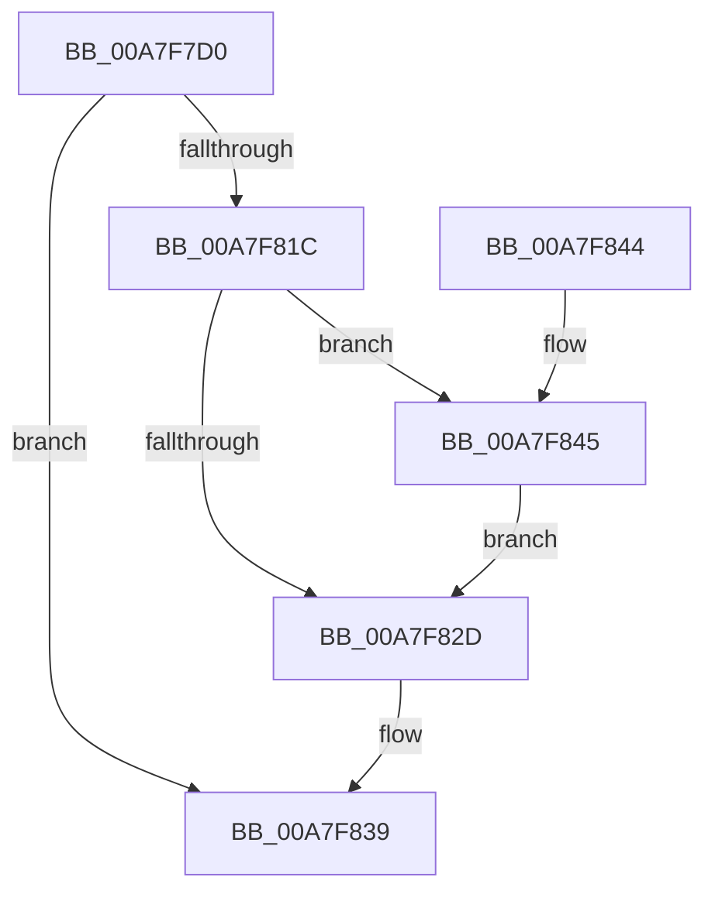

# NtMakeTemporaryObject

- RVA: `0x00A7F7D0`–`0x00A7F857` (길이 `135` bytes)
- VA: `0x0000000140A7F7D0`
- 실행 섹션: `PAGE`
- PDB 이름 있음: `예`; PDB Function 태그: `아니요`
- unwind 정보 RVA: `0x000B6E60`
- 디코드: `36`개 명령, `135/135` bytes 표시
- 미해석 바이트: `0` (있으면 어셈블리에 `.byte`로 보존)

> 이 문서는 커널 이미지의 기계어와 PDB 기호를 분석해 생성했습니다. 4번과 5번은 함수 원형과 자료형을 바이너리 사용 방식에서 추정한 C 해석이며 원본 소스 복구 결과는 아닙니다.

## 1. Dependencies

- 직접 호출 지점: **4**; 고유 호출 대상: **4**
- 직접 호출자로 확인된 함수: **1**
- RIP 상대 이미지 참조: **0**

### Outgoing calls
- `0x00A7F811` → [ObReferenceObjectByHandle](../86/ObReferenceObjectByHandle_function_00868DB0.md) (function, `0x00868DB0`)
- `0x00A7F821` → [ObMakeTemporaryObject](ObMakeTemporaryObject_function_00A7F860.md) (function, `0x00A7F860`)
- `0x00A7F832` → [ObfDereferenceObject](../../text/2F/ObfDereferenceObject_function_002F9350.md) (function, `0x002F9350`)
- `0x00A7F850` → [SeDeleteObjectAuditAlarmWithTransaction](../92/SeDeleteObjectAuditAlarmWithTransaction_function_00920830.md) (function, `0x00920830`)

### Direct callers
- [IopReassignSystemRoot](../../init/C2/IopReassignSystemRoot_function_00C2D1D0.md) at `0x00C2D359`

### Static image references
- 디코드된 RIP-relative 메모리 참조가 없습니다.

## 2. Other-region calls and transfers

- 다른 실행 섹션으로 향하는 call: **1**
  - `0x00A7F832` → [ObfDereferenceObject](../../text/2F/ObfDereferenceObject_function_002F9350.md) (`PAGE` → `.text`)
- 별도 외부 분기/꼬리 이동을 확인하지 못했습니다.

## 3. Assembly (complete function range)

```asm
00A7F7D0  4C 8B DC                        mov r11, rsp
00A7F7D3  49 89 73 08                     mov qword ptr [r11 + 8], rsi
00A7F7D7  57                              push rdi
00A7F7D8  48 83 EC 30                     sub rsp, 0x30
00A7F7DC  65 48 8B 04 25 88 01 00 00      mov rax, qword ptr gs:[0x188]
00A7F7E5  45 33 C0                        xor r8d, r8d
00A7F7E8  49 83 63 18 00                  and qword ptr [r11 + 0x18], 0
00A7F7ED  BA 00 00 01 00                  mov edx, 0x10000
00A7F7F2  49 83 63 10 00                  and qword ptr [r11 + 0x10], 0
00A7F7F7  48 8B F1                        mov rsi, rcx
00A7F7FA  44 8A 88 32 02 00 00            mov r9b, byte ptr [rax + 0x232]
00A7F801  49 8D 43 18                     lea rax, [r11 + 0x18]
00A7F805  49 89 43 F0                     mov qword ptr [r11 - 0x10], rax
00A7F809  49 8D 43 10                     lea rax, [r11 + 0x10]
00A7F80D  49 89 43 E8                     mov qword ptr [r11 - 0x18], rax
00A7F811  E8 9A 95 DE FF                  call 0x140868db0
00A7F816  8B F8                           mov edi, eax
00A7F818  85 C0                           test eax, eax
00A7F81A  78 1D                           js 0x140a7f839
00A7F81C  48 8B 4C 24 48                  mov rcx, qword ptr [rsp + 0x48]
00A7F821  E8 3A 00 00 00                  call 0x140a7f860
00A7F826  F6 44 24 50 04                  test byte ptr [rsp + 0x50], 4
00A7F82B  75 18                           jne 0x140a7f845
00A7F82D  48 8B 4C 24 48                  mov rcx, qword ptr [rsp + 0x48]
00A7F832  E8 19 9B 87 FF                  call 0x1402f9350
00A7F837  8B C7                           mov eax, edi
00A7F839  48 8B 74 24 40                  mov rsi, qword ptr [rsp + 0x40]
00A7F83E  48 83 C4 30                     add rsp, 0x30
00A7F842  5F                              pop rdi
00A7F843  C3                              ret
00A7F844  CC                              int3
00A7F845  48 8B 4C 24 48                  mov rcx, qword ptr [rsp + 0x48]
00A7F84A  45 33 C0                        xor r8d, r8d
00A7F84D  48 8B D6                        mov rdx, rsi
00A7F850  E8 DB 0F EA FF                  call 0x140920830
00A7F855  EB D6                           jmp 0x140a7f82d
```

## 4. C-style interpretation (structured pseudocode)

```c
__int64 __fastcall NtMakeTemporaryObject(__int64 a1, __int64 a2, int a3)
{
    __int64 result;
    __int64 v_rsp;
    unsigned __int64 v_stack_p10;
    unsigned __int8 v_stack_p18;
    unsigned __int64 v_stack_p48;
    unsigned __int64 v_stack_p8;

    *(unsigned __int64 *)(v_rsp + 8) = v_rsi;
    v_rsp = (v_rsp) - (48);
    a3 = 0;
    *(unsigned __int64 *)(v_rsp - 16) = v_rsp + 24;
    *(unsigned __int64 *)(v_rsp - 24) = v_rsp + 16;
    result = ObReferenceObjectByHandle(a1, (unsigned int)(0x10000ULL), a3, *(unsigned __int8 *)(*(unsigned __int64 *)(gs_base + (0 + 392)) + 562));
    if (sign_flag) goto loc_00A7F839;
    result = ObMakeTemporaryObject(v_stack_p10, (unsigned int)(0x10000ULL), a3, *(unsigned __int8 *)(*(unsigned __int64 *)(gs_base + (0 + 392)) + 562));
    if (((v_stack_p18) & (4)) != 0) goto loc_00A7F845;
loc_00A7F82D:
    result = ObfDereferenceObject(v_stack_p10, (unsigned int)(0x10000ULL), a3, *(unsigned __int8 *)(*(unsigned __int64 *)(gs_base + (0 + 392)) + 562));
loc_00A7F839:
    v_rsp = (v_rsp) + (48);
    return (unsigned int)((unsigned int)((unsigned int)((unsigned int)(result))));
loc_00A7F845:
    a3 = 0;
    result = SeDeleteObjectAuditAlarmWithTransaction(v_stack_p48, v_stack_p8, a3, *(unsigned __int8 *)(*(unsigned __int64 *)(gs_base + (0 + 392)) + 562));
    goto loc_00A7F82D;
}
```

## 5. (Beta) C Style

```c
int64_t NtMakeTemporaryObject(int64_t Arg1, int64_t Arg2, int32_t Arg3)
{
    int64_t result;
    int64_t local_rsp;
    uint64_t v_stack_p10;
    uint8_t v_stack_p18;
    uint64_t v_stack_p48;
    uint64_t v_stack_p8;

    *(uint64_t *)(local_rsp + 0x8) = local_rsi;
    local_rsp = (local_rsp) - (48);
    Arg3 = 0;
    *(uint64_t *)(local_rsp - 0x10) = local_rsp + 24;
    *(uint64_t *)(local_rsp - 0x18) = local_rsp + 16;
    result = ObReferenceObjectByHandle(Arg1, (uint32_t)(0x10000ULL), Arg3, *(uint8_t *)(*(uint64_t *)(gs_base + (0 + 0x188)) + 0x232));
    if (sign_flag) goto loc_00A7F839;
    result = ObMakeTemporaryObject(v_stack_p10, (uint32_t)(0x10000ULL), Arg3, *(uint8_t *)(*(uint64_t *)(gs_base + (0 + 0x188)) + 0x232));
    if (((v_stack_p18) & (4)) != 0) goto loc_00A7F845;
loc_00A7F82D:
    result = ObfDereferenceObject(v_stack_p10, (uint32_t)(0x10000ULL), Arg3, *(uint8_t *)(*(uint64_t *)(gs_base + (0 + 0x188)) + 0x232));
loc_00A7F839:
    local_rsp = (local_rsp) + (48);
    return (uint32_t)((uint32_t)((uint32_t)((uint32_t)(result))));
loc_00A7F845:
    Arg3 = 0;
    result = SeDeleteObjectAuditAlarmWithTransaction(v_stack_p48, v_stack_p8, Arg3, *(uint8_t *)(*(uint64_t *)(gs_base + (0 + 0x188)) + 0x232));
    goto loc_00A7F82D;
}
```

## 6. Execution-region graph

[열기: 2D/3D 그래프와 함수 탐색 컨트롤 패널](../../../control-panel.html?section=page&rva=0x00A7F7D0&view=graph)

- 2D 그래프는 위에서 아래로 흐르고, 3D 그래프는 빈 공간을 드래그해 회전합니다. Shift+드래그는 이동, 휠은 확대·축소, 함수 노드 선택은 대상 보고서 이동입니다.

### Static fallback


