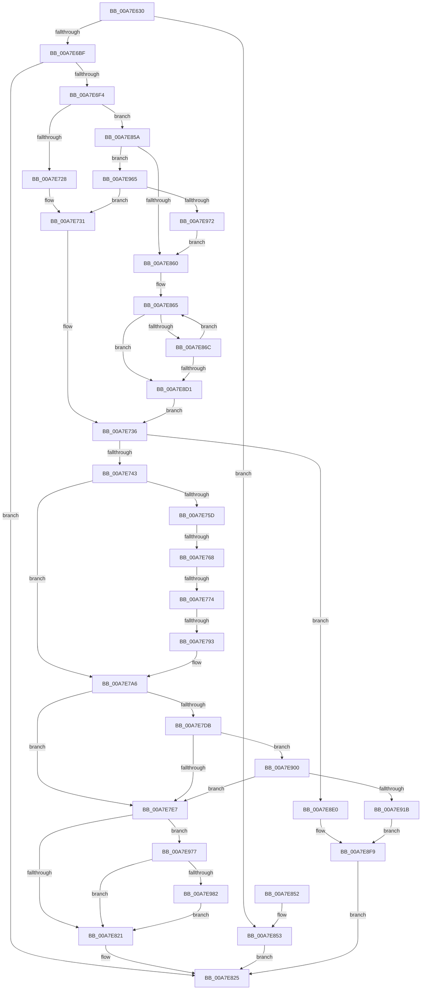

# NtNotifyChangeSession

- RVA: `0x00A7E630`–`0x00A7E991` (길이 `865` bytes)
- VA: `0x0000000140A7E630`
- 실행 섹션: `PAGE`
- PDB 이름 있음: `예`; PDB Function 태그: `예`
- unwind 정보 RVA: `0x000B6C60`
- 디코드: `198`개 명령, `865/865` bytes 표시
- 미해석 바이트: `0` (있으면 어셈블리에 `.byte`로 보존)

> 이 문서는 커널 이미지의 기계어와 PDB 기호를 분석해 생성했습니다. 4번과 5번은 함수 원형과 자료형을 바이너리 사용 방식에서 추정한 C 해석이며 원본 소스 복구 결과는 아닙니다.

## 1. Dependencies

- 직접 호출 지점: **17**; 고유 호출 대상: **12**
- 직접 호출자로 확인된 함수: **0**
- RIP 상대 이미지 참조: **4**

### Outgoing calls
- `0x00A7E690` → [memset](../../text/6C/memset_function_006C6C40.md) (function, `0x006C6C40`)
- `0x00A7E6E3` → [ObReferenceObjectByHandle](../86/ObReferenceObjectByHandle_function_00868DB0.md) (function, `0x00868DB0`)
- `0x00A7E711` → [KeWaitForSingleObject](../../text/20/KeWaitForSingleObject_function_0020E6B0.md) (function, `0x0020E6B0`)
- `0x00A7E782` → [ExAllocatePool2](../../poolcode/B8/ExAllocatePool2_function_00B820F0.md) (function, `0x00B820F0`)
- `0x00A7E7A1` → [memcpy](../../text/6C/memcpy_function_006C6840.md) (function, `0x006C6840`)
- `0x00A7E7F6` → [ExNotifyCallback](../../text/39/ExNotifyCallback_function_003926B0.md) (function, `0x003926B0`)
- `0x00A7E80B` → [KeSetEvent](../../text/33/KeSetEvent_function_0033F310.md) (function, `0x0033F310`)
- `0x00A7E813` → [ObfDereferenceObject](../../text/2F/ObfDereferenceObject_function_002F9350.md) (function, `0x002F9350`)
- `0x00A7E830` → [_security_check_cookie](../../text/6A/_security_check_cookie_function_006AC640.md) (function, `0x006AC640`)
- `0x00A7E881` → [KeSetEvent](../../text/33/KeSetEvent_function_0033F310.md) (function, `0x0033F310`)
- `0x00A7E88F` → [KeDelayExecutionThread](../../text/20/KeDelayExecutionThread_function_00209550.md) (function, `0x00209550`)
- `0x00A7E8AC` → [KeWaitForSingleObject](../../text/20/KeWaitForSingleObject_function_0020E6B0.md) (function, `0x0020E6B0`)
- `0x00A7E8EC` → [KeSetEvent](../../text/33/KeSetEvent_function_0033F310.md) (function, `0x0033F310`)
- `0x00A7E8F4` → [ObfDereferenceObject](../../text/2F/ObfDereferenceObject_function_002F9350.md) (function, `0x002F9350`)
- `0x00A7E90D` → [ExAllocatePool2](../../poolcode/B8/ExAllocatePool2_function_00B820F0.md) (function, `0x00B820F0`)
- `0x00A7E95E` → [ExQueueWorkItem](../../text/2F/ExQueueWorkItem_function_002F9520.md) (function, `0x002F9520`)
- `0x00A7E987` → [ExFreePoolWithTag](../../poolcode/B8/ExFreePoolWithTag_function_00B82870.md) (function, `0x00B82870`)

### Direct callers
- 이 함수 시작 RVA로 연결되는 직접 call은 확인되지 않았습니다. 간접 호출은 완전히 역산할 수 없습니다.

### Static image references
- `0x00A7E64A` → RVA `0x00E0A740` (`.data`; read)
- `0x00A7E6BF` → RVA `0x00FC6E08` (`ALMOSTRO`; read)
- `0x00A7E7EF` → RVA `0x00F8D110` (`.data`; read)
- `0x00A7E947` → RVA `0x004522B0` (`IopSessionChangeWorker`; read)

## 2. Other-region calls and transfers

- 다른 실행 섹션으로 향하는 call: **16**
  - `0x00A7E690` → [memset](../../text/6C/memset_function_006C6C40.md) (`PAGE` → `.text`)
  - `0x00A7E711` → [KeWaitForSingleObject](../../text/20/KeWaitForSingleObject_function_0020E6B0.md) (`PAGE` → `.text`)
  - `0x00A7E782` → [ExAllocatePool2](../../poolcode/B8/ExAllocatePool2_function_00B820F0.md) (`PAGE` → `POOLCODE`)
  - `0x00A7E7A1` → [memcpy](../../text/6C/memcpy_function_006C6840.md) (`PAGE` → `.text`)
  - `0x00A7E7F6` → [ExNotifyCallback](../../text/39/ExNotifyCallback_function_003926B0.md) (`PAGE` → `.text`)
  - `0x00A7E80B` → [KeSetEvent](../../text/33/KeSetEvent_function_0033F310.md) (`PAGE` → `.text`)
  - `0x00A7E813` → [ObfDereferenceObject](../../text/2F/ObfDereferenceObject_function_002F9350.md) (`PAGE` → `.text`)
  - `0x00A7E830` → [_security_check_cookie](../../text/6A/_security_check_cookie_function_006AC640.md) (`PAGE` → `.text`)
  - `0x00A7E881` → [KeSetEvent](../../text/33/KeSetEvent_function_0033F310.md) (`PAGE` → `.text`)
  - `0x00A7E88F` → [KeDelayExecutionThread](../../text/20/KeDelayExecutionThread_function_00209550.md) (`PAGE` → `.text`)
  - `0x00A7E8AC` → [KeWaitForSingleObject](../../text/20/KeWaitForSingleObject_function_0020E6B0.md) (`PAGE` → `.text`)
  - `0x00A7E8EC` → [KeSetEvent](../../text/33/KeSetEvent_function_0033F310.md) (`PAGE` → `.text`)
  - `0x00A7E8F4` → [ObfDereferenceObject](../../text/2F/ObfDereferenceObject_function_002F9350.md) (`PAGE` → `.text`)
  - `0x00A7E90D` → [ExAllocatePool2](../../poolcode/B8/ExAllocatePool2_function_00B820F0.md) (`PAGE` → `POOLCODE`)
  - `0x00A7E95E` → [ExQueueWorkItem](../../text/2F/ExQueueWorkItem_function_002F9520.md) (`PAGE` → `.text`)
  - `0x00A7E987` → [ExFreePoolWithTag](../../poolcode/B8/ExFreePoolWithTag_function_00B82870.md) (`PAGE` → `POOLCODE`)
- call이 아닌 외부 분기/꼬리 이동: **3**
  - `0x00A7E762` → [sub_00B42AC8](../B4/Unknown_function_00B42AC8.md) (`tail-transfer`)
  - `0x00A7E76E` → [sub_00B42AC8 + 0xB8](../B4/Unknown_function_00B42AC8.md) (`tail-transfer`)
  - `0x00A7E78D` → [sub_00B42AC8 + 0xB3](../B4/Unknown_function_00B42AC8.md) (`tail-transfer`)

## 3. Assembly (complete function range)

```asm
00A7E630  48 89 5C 24 10                  mov qword ptr [rsp + 0x10], rbx
00A7E635  48 89 74 24 18                  mov qword ptr [rsp + 0x18], rsi
00A7E63A  57                              push rdi
00A7E63B  41 54                           push r12
00A7E63D  41 55                           push r13
00A7E63F  41 56                           push r14
00A7E641  41 57                           push r15
00A7E643  48 81 EC C0 01 00 00            sub rsp, 0x1c0
00A7E64A  48 8B 05 EF C0 38 00            mov rax, qword ptr [rip + 0x38c0ef]
00A7E651  48 33 C4                        xor rax, rsp
00A7E654  48 89 84 24 B0 01 00 00         mov qword ptr [rsp + 0x1b0], rax
00A7E65C  45 8B E9                        mov r13d, r9d
00A7E65F  8B DA                           mov ebx, edx
00A7E661  48 8B F1                        mov rsi, rcx
00A7E664  44 89 4C 24 58                  mov dword ptr [rsp + 0x58], r9d
00A7E669  4C 8B BC 24 20 02 00 00         mov r15, qword ptr [rsp + 0x220]
00A7E671  44 8B A4 24 28 02 00 00         mov r12d, dword ptr [rsp + 0x228]
00A7E679  44 89 64 24 50                  mov dword ptr [rsp + 0x50], r12d
00A7E67E  33 FF                           xor edi, edi
00A7E680  40 88 7C 24 30                  mov byte ptr [rsp + 0x30], dil
00A7E685  33 D2                           xor edx, edx
00A7E687  44 8D 47 40                     lea r8d, [rdi + 0x40]
00A7E68B  48 8D 4C 24 70                  lea rcx, [rsp + 0x70]
00A7E690  E8 AB 85 C4 FF                  call 0x1406c6c40
00A7E695  66 89 7C 24 34                  mov word ptr [rsp + 0x34], di
00A7E69A  40 88 7C 24 31                  mov byte ptr [rsp + 0x31], dil
00A7E69F  65 48 8B 04 25 88 01 00 00      mov rax, qword ptr gs:[0x188]
00A7E6A8  8A 80 32 02 00 00               mov al, byte ptr [rax + 0x232]
00A7E6AE  88 44 24 32                     mov byte ptr [rsp + 0x32], al
00A7E6B2  41 81 FC 00 01 00 00            cmp r12d, 0x100
00A7E6B9  0F 87 94 01 00 00               ja 0x140a7e853
00A7E6BF  4C 8B 05 42 87 54 00            mov r8, qword ptr [rip + 0x548742]
00A7E6C6  48 89 7C 24 48                  mov qword ptr [rsp + 0x48], rdi
00A7E6CB  48 89 7C 24 28                  mov qword ptr [rsp + 0x28], rdi
00A7E6D0  48 8D 4C 24 48                  lea rcx, [rsp + 0x48]
00A7E6D5  48 89 4C 24 20                  mov qword ptr [rsp + 0x20], rcx
00A7E6DA  44 8A C8                        mov r9b, al
00A7E6DD  8D 57 02                        lea edx, [rdi + 2]
00A7E6E0  48 8B CE                        mov rcx, rsi
00A7E6E3  E8 C8 A6 DE FF                  call 0x140868db0
00A7E6E8  89 44 24 38                     mov dword ptr [rsp + 0x38], eax
00A7E6EC  85 C0                           test eax, eax
00A7E6EE  0F 88 31 01 00 00               js 0x140a7e825
00A7E6F4  4C 8B 74 24 48                  mov r14, qword ptr [rsp + 0x48]
00A7E6F9  49 8B 4E 18                     mov rcx, qword ptr [r14 + 0x18]
00A7E6FD  48 81 C1 88 00 00 00            add rcx, 0x88
00A7E704  48 89 7C 24 20                  mov qword ptr [rsp + 0x20], rdi
00A7E709  45 33 C9                        xor r9d, r9d
00A7E70C  45 33 C0                        xor r8d, r8d
00A7E70F  33 D2                           xor edx, edx
00A7E711  E8 9A FF 78 FF                  call 0x14020e6b0
00A7E716  49 8B 56 18                     mov rdx, qword ptr [r14 + 0x18]
00A7E71A  8B 8A 84 00 00 00               mov ecx, dword ptr [rdx + 0x84]
00A7E720  3B CB                           cmp ecx, ebx
00A7E722  0F 85 32 01 00 00               jne 0x140a7e85a
00A7E728  8D 41 01                        lea eax, [rcx + 1]
00A7E72B  89 82 84 00 00 00               mov dword ptr [rdx + 0x84], eax
00A7E731  BE 01 00 00 00                  mov esi, 1
00A7E736  49 8B 46 18                     mov rax, qword ptr [r14 + 0x18]
00A7E73A  45 85 ED                        test r13d, r13d
00A7E73D  0F 84 9D 01 00 00               je 0x140a7e8e0
00A7E743  8B 8C 24 10 02 00 00            mov ecx, dword ptr [rsp + 0x210]
00A7E74A  89 88 80 00 00 00               mov dword ptr [rax + 0x80], ecx
00A7E750  48 8B DF                        mov rbx, rdi
00A7E753  48 89 5C 24 40                  mov qword ptr [rsp + 0x40], rbx
00A7E758  45 85 E4                        test r12d, r12d
00A7E75B  74 49                           je 0x140a7e7a6
00A7E75D  40 38 74 24 32                  cmp byte ptr [rsp + 0x32], sil
00A7E762  0F 84 60 43 0C 00               je 0x140b42ac8
00A7E768  41 8D 45 FF                     lea eax, [r13 - 1]
00A7E76C  3B C6                           cmp eax, esi
00A7E76E  0F 86 0C 44 0C 00               jbe 0x140b42b80
00A7E774  49 8B D4                        mov rdx, r12
00A7E777  B9 00 01 00 00                  mov ecx, 0x100
00A7E77C  41 B8 49 6F 53 6E               mov r8d, 0x6e536f49
00A7E782  E8 69 39 10 00                  call 0x140b820f0
00A7E787  48 8B D8                        mov rbx, rax
00A7E78A  48 85 C0                        test rax, rax
00A7E78D  0F 84 E8 43 0C 00               je 0x140b42b7b
00A7E793  40 88 74 24 30                  mov byte ptr [rsp + 0x30], sil
00A7E798  4D 8B C4                        mov r8, r12
00A7E79B  49 8B D7                        mov rdx, r15
00A7E79E  48 8B C8                        mov rcx, rax
00A7E7A1  E8 9A 80 C4 FF                  call 0x1406c6840
00A7E7A6  44 89 AC 24 90 00 00 00         mov dword ptr [rsp + 0x90], r13d
00A7E7AE  8B 84 24 10 02 00 00            mov eax, dword ptr [rsp + 0x210]
00A7E7B5  89 84 24 94 00 00 00            mov dword ptr [rsp + 0x94], eax
00A7E7BC  44 89 A4 24 98 00 00 00         mov dword ptr [rsp + 0x98], r12d
00A7E7C4  48 89 9C 24 A0 00 00 00         mov qword ptr [rsp + 0xa0], rbx
00A7E7CC  4C 89 B4 24 A8 00 00 00         mov qword ptr [rsp + 0xa8], r14
00A7E7D4  40 38 7C 24 31                  cmp byte ptr [rsp + 0x31], dil
00A7E7D9  75 0C                           jne 0x140a7e7e7
00A7E7DB  41 8D 45 FF                     lea eax, [r13 - 1]
00A7E7DF  3B C6                           cmp eax, esi
00A7E7E1  0F 87 19 01 00 00               ja 0x140a7e900
00A7E7E7  45 33 C0                        xor r8d, r8d
00A7E7EA  48 8D 54 24 70                  lea rdx, [rsp + 0x70]
00A7E7EF  48 8B 0D 1A E9 50 00            mov rcx, qword ptr [rip + 0x50e91a]
00A7E7F6  E8 B5 3E 91 FF                  call 0x1403926b0
00A7E7FB  49 8B 4E 18                     mov rcx, qword ptr [r14 + 0x18]
00A7E7FF  48 81 C1 88 00 00 00            add rcx, 0x88
00A7E806  45 33 C0                        xor r8d, r8d
00A7E809  33 D2                           xor edx, edx
00A7E80B  E8 00 0B 8C FF                  call 0x14033f310
00A7E810  49 8B CE                        mov rcx, r14
00A7E813  E8 38 AB 87 FF                  call 0x1402f9350
00A7E818  48 85 DB                        test rbx, rbx
00A7E81B  0F 85 56 01 00 00               jne 0x140a7e977
00A7E821  8B 44 24 38                     mov eax, dword ptr [rsp + 0x38]
00A7E825  48 8B 8C 24 B0 01 00 00         mov rcx, qword ptr [rsp + 0x1b0]
00A7E82D  48 33 CC                        xor rcx, rsp
00A7E830  E8 0B DE C2 FF                  call 0x1406ac640
00A7E835  4C 8D 9C 24 C0 01 00 00         lea r11, [rsp + 0x1c0]
00A7E83D  49 8B 5B 38                     mov rbx, qword ptr [r11 + 0x38]
00A7E841  49 8B 73 40                     mov rsi, qword ptr [r11 + 0x40]
00A7E845  49 8B E3                        mov rsp, r11
00A7E848  41 5F                           pop r15
00A7E84A  41 5E                           pop r14
00A7E84C  41 5D                           pop r13
00A7E84E  41 5C                           pop r12
00A7E850  5F                              pop rdi
00A7E851  C3                              ret
00A7E852  CC                              int3
00A7E853  B8 F4 00 00 C0                  mov eax, 0xc00000f4
00A7E858  EB CB                           jmp 0x140a7e825
00A7E85A  0F 87 05 01 00 00               ja 0x140a7e965
00A7E860  BE 01 00 00 00                  mov esi, 1
00A7E865  4C 8B C2                        mov r8, rdx
00A7E868  3B CB                           cmp ecx, ebx
00A7E86A  74 65                           je 0x140a7e8d1
00A7E86C  48 C7 44 24 60 C0 BD F0 FF      mov qword ptr [rsp + 0x60], 0xfffffffffff0bdc0
00A7E875  48 8D 8A 88 00 00 00            lea rcx, [rdx + 0x88]
00A7E87C  45 33 C0                        xor r8d, r8d
00A7E87F  33 D2                           xor edx, edx
00A7E881  E8 8A 0A 8C FF                  call 0x14033f310
00A7E886  4C 8D 44 24 60                  lea r8, [rsp + 0x60]
00A7E88B  33 D2                           xor edx, edx
00A7E88D  33 C9                           xor ecx, ecx
00A7E88F  E8 BC AC 78 FF                  call 0x140209550
00A7E894  49 8B 4E 18                     mov rcx, qword ptr [r14 + 0x18]
00A7E898  48 81 C1 88 00 00 00            add rcx, 0x88
00A7E89F  48 89 7C 24 20                  mov qword ptr [rsp + 0x20], rdi
00A7E8A4  45 33 C9                        xor r9d, r9d
00A7E8A7  45 33 C0                        xor r8d, r8d
00A7E8AA  33 D2                           xor edx, edx
00A7E8AC  E8 FF FD 78 FF                  call 0x14020e6b0
00A7E8B1  0F B7 44 24 34                  movzx eax, word ptr [rsp + 0x34]
00A7E8B6  66 03 C6                        add ax, si
00A7E8B9  66 89 44 24 34                  mov word ptr [rsp + 0x34], ax
00A7E8BE  49 8B 56 18                     mov rdx, qword ptr [r14 + 0x18]
00A7E8C2  8B 8A 84 00 00 00               mov ecx, dword ptr [rdx + 0x84]
00A7E8C8  4C 8B C2                        mov r8, rdx
00A7E8CB  66 83 F8 0A                     cmp ax, 0xa
00A7E8CF  76 94                           jbe 0x140a7e865
00A7E8D1  8D 43 01                        lea eax, [rbx + 1]
00A7E8D4  41 89 80 84 00 00 00            mov dword ptr [r8 + 0x84], eax
00A7E8DB  E9 56 FE FF FF                  jmp 0x140a7e736
00A7E8E0  48 8D 88 88 00 00 00            lea rcx, [rax + 0x88]
00A7E8E7  45 33 C0                        xor r8d, r8d
00A7E8EA  33 D2                           xor edx, edx
00A7E8EC  E8 1F 0A 8C FF                  call 0x14033f310
00A7E8F1  49 8B CE                        mov rcx, r14
00A7E8F4  E8 57 AA 87 FF                  call 0x1402f9350
00A7E8F9  33 C0                           xor eax, eax
00A7E8FB  E9 25 FF FF FF                  jmp 0x140a7e825
00A7E900  BA 40 00 00 00                  mov edx, 0x40
00A7E905  8B CA                           mov ecx, edx
00A7E907  41 B8 49 6F 53 6E               mov r8d, 0x6e536f49
00A7E90D  E8 DE 37 10 00                  call 0x140b820f0
00A7E912  48 85 C0                        test rax, rax
00A7E915  0F 84 CC FE FF FF               je 0x140a7e7e7
00A7E91B  0F 28 44 24 70                  movaps xmm0, xmmword ptr [rsp + 0x70]
00A7E920  0F 11 00                        movups xmmword ptr [rax], xmm0
00A7E923  0F 28 8C 24 80 00 00 00         movaps xmm1, xmmword ptr [rsp + 0x80]
00A7E92B  0F 11 48 10                     movups xmmword ptr [rax + 0x10], xmm1
00A7E92F  0F 28 84 24 90 00 00 00         movaps xmm0, xmmword ptr [rsp + 0x90]
00A7E937  0F 11 40 20                     movups xmmword ptr [rax + 0x20], xmm0
00A7E93B  0F 28 8C 24 A0 00 00 00         movaps xmm1, xmmword ptr [rsp + 0xa0]
00A7E943  0F 11 48 30                     movups xmmword ptr [rax + 0x30], xmm1
00A7E947  48 8D 0D 62 39 9D FF            lea rcx, [rip - 0x62c69e]
00A7E94E  48 89 48 10                     mov qword ptr [rax + 0x10], rcx
00A7E952  48 89 40 18                     mov qword ptr [rax + 0x18], rax
00A7E956  48 89 38                        mov qword ptr [rax], rdi
00A7E959  8B D6                           mov edx, esi
00A7E95B  48 8B C8                        mov rcx, rax
00A7E95E  E8 BD AB 87 FF                  call 0x1402f9520
00A7E963  EB 94                           jmp 0x140a7e8f9
00A7E965  8B C1                           mov eax, ecx
00A7E967  2B C3                           sub eax, ebx
00A7E969  83 F8 FD                        cmp eax, -3
00A7E96C  0F 82 BF FD FF FF               jb 0x140a7e731
00A7E972  E9 E9 FE FF FF                  jmp 0x140a7e860
00A7E977  40 38 74 24 30                  cmp byte ptr [rsp + 0x30], sil
00A7E97C  0F 85 9F FE FF FF               jne 0x140a7e821
00A7E982  33 D2                           xor edx, edx
00A7E984  48 8B CB                        mov rcx, rbx
00A7E987  E8 E4 3E 10 00                  call 0x140b82870
00A7E98C  E9 90 FE FF FF                  jmp 0x140a7e821
```

## 4. C-style interpretation (structured pseudocode)

```c
__int64 __fastcall NtNotifyChangeSession(__int64 a1, int a2, __int64 a3, int a4, unsigned int a5, __int64 a6, __int64 a7, unsigned int a8)
{
    __int64 result;
    __int64 v_rdi;
    __int64 v_rsp;
    unsigned __int64 v_stack_m120;
    unsigned __int64 v_stack_m130;
    unsigned __int64 v_stack_m140;
    unsigned __int64 v_stack_m148;
    unsigned int v_stack_m150;
    unsigned int v_stack_m154;
    unsigned int v_stack_m158;
    unsigned __int64 v_stack_m160;
    unsigned __int64 v_stack_m178;
    unsigned __int16 v_stack_m18C;
    unsigned int v_stack_m190;
    unsigned int v_stack_m198;
    unsigned __int64 v_stack_m1A0;
    unsigned __int64 v_stack_m1A8;
    unsigned int v_stack_m1B0;
    unsigned __int16 v_stack_m1B4;
    unsigned __int8 v_stack_m1B6;
    unsigned __int8 v_stack_m1B7;
    unsigned __int8 v_stack_m1B8;
    unsigned __int64 v_stack_m1C0;
    unsigned __int64 v_stack_m1C8;
    unsigned __int64 v_stack_m28;
    unsigned __int64 v_stack_m38;
    unsigned __int64 v_stack_p10;
    unsigned __int64 v_stack_p18;

    v_stack_p10 = v_rbx;
    v_stack_p18 = v_rsi;
    v_rsp = (v_rsp) - (448);
    result = (*(unsigned __int64 *)(v_rip + 3719407)) ^ (v_rsp);
    v_stack_m38 = result;
    v_stack_m190 = a4;
    v_stack_m198 = (unsigned int)((unsigned int)(a8));
    v_rdi = 0;
    v_stack_m1B8 = 0;
    a2 = 0;
    result = memset(v_stack_m178, a2, v_rdi + 64, a4);
    v_stack_m1B4 = 0;
    v_stack_m1B7 = 0;
    v_stack_m1B6 = (unsigned __int8)(*(unsigned __int8 *)(*(unsigned __int64 *)(gs_base + (0 + 392)) + 562));
    if (((unsigned int)((unsigned int)(a8))) > 256) goto loc_00A7E853;
    v_stack_m1A0 = 0;
    v_stack_m1C0 = 0;
    v_stack_m1C8 = v_stack_m1A0;
    result = ObReferenceObjectByHandle(a1, v_rdi + 2, *(unsigned __int64 *)(v_rip + 5539650), (unsigned __int8)(*(unsigned __int8 *)(*(unsigned __int64 *)(gs_base + (0 + 392)) + 562)));
    v_stack_m1B0 = (unsigned int)(result);
    if (sign_flag) goto loc_00A7E825;
    a1 = (*(unsigned __int64 *)(v_stack_m1A0 + 24)) + (136);
    v_stack_m1C8 = 0;
    a4 = 0;
    a3 = 0;
    a2 = 0;
    result = KeWaitForSingleObject(a1, a2, a3, a4);
    if (((unsigned int)((unsigned int)(*(unsigned int *)(*(unsigned __int64 *)(v_stack_m1A0 + 24) + 132)))) != ((unsigned int)((unsigned int)(a2)))) goto loc_00A7E85A;
    *(unsigned int *)(*(unsigned __int64 *)(v_stack_m1A0 + 24) + 132) = (unsigned int)((unsigned int)(*(unsigned int *)(*(unsigned __int64 *)(v_stack_m1A0 + 24) + 132)) + 1);
loc_00A7E731:
loc_00A7E736:
    if ((unsigned int)((unsigned int)(a4)) == 0) goto loc_00A7E8E0;
    *(unsigned int *)(*(unsigned __int64 *)(v_stack_m1A0 + 24) + 128) = (unsigned int)((unsigned int)(a5));
    v_stack_m1A8 = 0;
    if ((unsigned int)((unsigned int)(a8)) == 0) goto loc_00A7E7A6;
    result = ExAllocatePool2(256, (unsigned int)(a8), (unsigned int)(0x6E536F49ULL), a4);
    v_stack_m1B8 = 1;
    result = memcpy(result, a7, (unsigned int)(a8), a4);
loc_00A7E7A6:
    v_stack_m158 = (unsigned int)((unsigned int)(a4));
    v_stack_m154 = (unsigned int)((unsigned int)(a5));
    v_stack_m150 = (unsigned int)((unsigned int)(a8));
    v_stack_m148 = result;
    v_stack_m140 = v_stack_m1A0;
    if (v_stack_m1B7 != 0) goto loc_00A7E7E7;
    if (((unsigned int)((unsigned int)(a4) - 1)) > 1) goto loc_00A7E900;
loc_00A7E7E7:
    a3 = 0;
    result = ExNotifyCallback(*(unsigned __int64 *)(v_rip + 5302554), v_stack_m178, a3, a4);
    a1 = (*(unsigned __int64 *)(v_stack_m1A0 + 24)) + (136);
    a3 = 0;
    a2 = 0;
    result = KeSetEvent(a1, a2, a3, a4);
    result = ObfDereferenceObject(v_stack_m1A0, a2, a3, a4);
    if (result != 0) goto loc_00A7E977;
loc_00A7E821:
loc_00A7E825:
    a1 = (v_stack_m38) ^ (v_rsp);
    result = _security_check_cookie(a1, a2, a3, a4);
    return result;
loc_00A7E853:
    goto loc_00A7E825;
loc_00A7E85A:
    if (condition_is_above) goto loc_00A7E965;
loc_00A7E860:
loc_00A7E865:
    if (((unsigned int)(a1)) == ((unsigned int)(*(unsigned __int64 *)(v_stack_m28 + 56)))) goto loc_00A7E8D1;
    v_stack_m160 = 0xFFFFFFFFFFF0BDC0ULL;
    a3 = 0;
    a2 = 0;
    result = KeSetEvent(a2 + 136, a2, a3, a4);
    a2 = 0;
    a1 = 0;
    result = KeDelayExecutionThread(a1, a2, v_stack_m160, a4);
    a1 = (*(unsigned __int64 *)(v_stack_m1A0 + 24)) + (136);
    v_stack_m1A0 = 0;
    a4 = 0;
    a3 = 0;
    a2 = 0;
    result = KeWaitForSingleObject(a1, a2, a3, a4);
    result = (unsigned __int16)((v_stack_m18C) + (1));
    v_stack_m18C = (unsigned __int16)(result);
    if (((unsigned __int16)(result)) <= 10) goto loc_00A7E865;
loc_00A7E8D1:
    *(unsigned int *)(*(unsigned __int64 *)(v_stack_m1A0 + 24) + 132) = (unsigned int)(*(unsigned __int64 *)(v_stack_m28 + 56) + 1);
    goto loc_00A7E736;
loc_00A7E8E0:
    a3 = 0;
    a2 = 0;
    result = KeSetEvent(*(unsigned __int64 *)(v_stack_m28 + 56) + 1 + 136, a2, a3, a4);
    result = ObfDereferenceObject(v_stack_m1A0, a2, a3, a4);
loc_00A7E8F9:
    result = 0;
    goto loc_00A7E825;
loc_00A7E900:
    result = ExAllocatePool2(64, 64, (unsigned int)(0x6E536F49ULL), a4);
    if (result == 0) goto loc_00A7E7E7;
    *(unsigned __int64 *)(result) = v_xmm0;
    *(unsigned __int64 *)(result + 16) = v_xmm1;
    *(unsigned __int64 *)(result + 32) = v_xmm0;
    *(unsigned __int64 *)(result + 48) = v_xmm1;
    *(unsigned __int64 *)(result + 16) = v_rip - 6473374;
    *(unsigned __int64 *)(result + 24) = result;
    *(unsigned __int64 *)(result) = 0;
    result = ExQueueWorkItem(result, 1, (unsigned int)(0x6E536F49ULL), a4);
    goto loc_00A7E8F9;
loc_00A7E965:
    result = (unsigned int)(((unsigned int)((unsigned int)(result))) - ((unsigned int)(*(unsigned __int64 *)(v_stack_m28 + 56))));
    if (((unsigned int)(result)) < -3) goto loc_00A7E731;
    goto loc_00A7E860;
loc_00A7E977:
    if (v_stack_m190 != 1) goto loc_00A7E821;
    a2 = 0;
    result = ExFreePoolWithTag(*(unsigned __int64 *)(v_stack_m28 + 56), a2, (unsigned int)(0x6E536F49ULL), a4);
    goto loc_00A7E821;
}
```

## 5. (Beta) C Style

```c
int64_t NtNotifyChangeSession(int64_t Arg1, void *Arg2, int64_t Arg3, int32_t Arg4, uint32_t Arg5, uint64_t Arg6, int64_t Arg7, uint32_t Arg8)
{
    uint8_t *arg2 = (uint8_t *)Arg2;

    int64_t result;
    int64_t local_rdi;
    int64_t local_rsp;
    uint64_t v_stack_m120;
    uint64_t v_stack_m130;
    uint64_t v_stack_m140;
    uint64_t v_stack_m148;
    uint32_t v_stack_m150;
    uint32_t v_stack_m154;
    uint32_t v_stack_m158;
    uint64_t v_stack_m160;
    uint64_t v_stack_m178;
    uint16_t v_stack_m18C;
    uint32_t v_stack_m190;
    uint32_t v_stack_m198;
    uint64_t v_stack_m1A0;
    uint64_t v_stack_m1A8;
    uint32_t v_stack_m1B0;
    uint16_t v_stack_m1B4;
    uint8_t v_stack_m1B6;
    uint8_t v_stack_m1B7;
    uint8_t v_stack_m1B8;
    uint64_t v_stack_m1C0;
    uint64_t v_stack_m1C8;
    uint64_t v_stack_m28;
    uint64_t v_stack_m38;
    uint64_t v_stack_p10;
    uint64_t v_stack_p18;

    v_stack_p10 = local_rbx;
    v_stack_p18 = local_rsi;
    local_rsp = (local_rsp) - (448);
    result = (*(uint64_t *)(v_rip + 0x38C0EF)) ^ (local_rsp);
    v_stack_m38 = result;
    v_stack_m190 = Arg4;
    v_stack_m198 = (uint32_t)((uint32_t)(Arg8));
    local_rdi = 0;
    v_stack_m1B8 = 0;
    Arg2 = 0;
    result = memset(v_stack_m178, Arg2, local_rdi + 64, Arg4);
    v_stack_m1B4 = 0;
    v_stack_m1B7 = 0;
    v_stack_m1B6 = (uint8_t)(*(uint8_t *)(*(uint64_t *)(gs_base + (0 + 0x188)) + 0x232));
    if (((uint32_t)((uint32_t)(Arg8))) > 256) goto loc_00A7E853;
    v_stack_m1A0 = 0;
    v_stack_m1C0 = 0;
    v_stack_m1C8 = v_stack_m1A0;
    result = ObReferenceObjectByHandle(Arg1, local_rdi + 2, *(uint64_t *)(v_rip + 0x548742), (uint8_t)(*(uint8_t *)(*(uint64_t *)(gs_base + (0 + 0x188)) + 0x232)));
    v_stack_m1B0 = (uint32_t)(result);
    if (sign_flag) goto loc_00A7E825;
    Arg1 = (*(uint64_t *)(v_stack_m1A0 + 0x18)) + (136);
    v_stack_m1C8 = 0;
    Arg4 = 0;
    Arg3 = 0;
    Arg2 = 0;
    result = KeWaitForSingleObject(Arg1, Arg2, Arg3, Arg4);
    if (((uint32_t)((uint32_t)(*(uint32_t *)(*(uint64_t *)(v_stack_m1A0 + 0x18) + 0x84)))) != ((uint32_t)((uint32_t)(Arg2)))) goto loc_00A7E85A;
    *(uint32_t *)(*(uint64_t *)(v_stack_m1A0 + 0x18) + 0x84) = (uint32_t)((uint32_t)(*(uint32_t *)(*(uint64_t *)(v_stack_m1A0 + 0x18) + 0x84)) + 1);
loc_00A7E731:
loc_00A7E736:
    if ((uint32_t)((uint32_t)(Arg4)) == 0) goto loc_00A7E8E0;
    *(uint32_t *)(*(uint64_t *)(v_stack_m1A0 + 0x18) + 0x80) = (uint32_t)((uint32_t)(Arg5));
    v_stack_m1A8 = 0;
    if ((uint32_t)((uint32_t)(Arg8)) == 0) goto loc_00A7E7A6;
    result = ExAllocatePool2(256, (uint32_t)(Arg8), (uint32_t)(0x6E536F49ULL), Arg4);
    v_stack_m1B8 = 1;
    result = memcpy(result, Arg7, (uint32_t)(Arg8), Arg4);
loc_00A7E7A6:
    v_stack_m158 = (uint32_t)((uint32_t)(Arg4));
    v_stack_m154 = (uint32_t)((uint32_t)(Arg5));
    v_stack_m150 = (uint32_t)((uint32_t)(Arg8));
    v_stack_m148 = result;
    v_stack_m140 = v_stack_m1A0;
    if (v_stack_m1B7 != 0) goto loc_00A7E7E7;
    if (((uint32_t)((uint32_t)(Arg4) - 1)) > 1) goto loc_00A7E900;
loc_00A7E7E7:
    Arg3 = 0;
    result = ExNotifyCallback(*(uint64_t *)(v_rip + 0x50E91A), v_stack_m178, Arg3, Arg4);
    Arg1 = (*(uint64_t *)(v_stack_m1A0 + 0x18)) + (136);
    Arg3 = 0;
    Arg2 = 0;
    result = KeSetEvent(Arg1, Arg2, Arg3, Arg4);
    result = ObfDereferenceObject(v_stack_m1A0, Arg2, Arg3, Arg4);
    if (result != 0) goto loc_00A7E977;
loc_00A7E821:
loc_00A7E825:
    Arg1 = (v_stack_m38) ^ (local_rsp);
    result = _security_check_cookie(Arg1, Arg2, Arg3, Arg4);
    return result;
loc_00A7E853:
    goto loc_00A7E825;
loc_00A7E85A:
    if (condition_is_above) goto loc_00A7E965;
loc_00A7E860:
loc_00A7E865:
    if (((uint32_t)(Arg1)) == ((uint32_t)(*(uint64_t *)(v_stack_m28 + 0x38)))) goto loc_00A7E8D1;
    v_stack_m160 = 0xFFFFFFFFFFF0BDC0ULL;
    Arg3 = 0;
    Arg2 = 0;
    result = KeSetEvent(Arg2 + 136, Arg2, Arg3, Arg4);
    Arg2 = 0;
    Arg1 = 0;
    result = KeDelayExecutionThread(Arg1, Arg2, v_stack_m160, Arg4);
    Arg1 = (*(uint64_t *)(v_stack_m1A0 + 0x18)) + (136);
    v_stack_m1A0 = 0;
    Arg4 = 0;
    Arg3 = 0;
    Arg2 = 0;
    result = KeWaitForSingleObject(Arg1, Arg2, Arg3, Arg4);
    result = (uint16_t)((v_stack_m18C) + (1));
    v_stack_m18C = (uint16_t)(result);
    if (((uint16_t)(result)) <= 10) goto loc_00A7E865;
loc_00A7E8D1:
    *(uint32_t *)(*(uint64_t *)(v_stack_m1A0 + 0x18) + 0x84) = (uint32_t)(*(uint64_t *)(v_stack_m28 + 0x38) + 1);
    goto loc_00A7E736;
loc_00A7E8E0:
    Arg3 = 0;
    Arg2 = 0;
    result = KeSetEvent(*(uint64_t *)(v_stack_m28 + 0x38) + 1 + 136, Arg2, Arg3, Arg4);
    result = ObfDereferenceObject(v_stack_m1A0, Arg2, Arg3, Arg4);
loc_00A7E8F9:
    result = 0;
    goto loc_00A7E825;
loc_00A7E900:
    result = ExAllocatePool2(64, 64, (uint32_t)(0x6E536F49ULL), Arg4);
    if (result == 0) goto loc_00A7E7E7;
    *(uint64_t *)(result) = v_xmm0;
    *(uint64_t *)(result + 0x10) = v_xmm1;
    *(uint64_t *)(result + 0x20) = v_xmm0;
    *(uint64_t *)(result + 0x30) = v_xmm1;
    *(uint64_t *)(result + 0x10) = v_rip - 6473374;
    *(uint64_t *)(result + 0x18) = result;
    *(uint64_t *)(result) = 0;
    result = ExQueueWorkItem(result, 1, (uint32_t)(0x6E536F49ULL), Arg4);
    goto loc_00A7E8F9;
loc_00A7E965:
    result = (uint32_t)(((uint32_t)((uint32_t)(result))) - ((uint32_t)(*(uint64_t *)(v_stack_m28 + 0x38))));
    if (((uint32_t)(result)) < -3) goto loc_00A7E731;
    goto loc_00A7E860;
loc_00A7E977:
    if (v_stack_m190 != 1) goto loc_00A7E821;
    Arg2 = 0;
    result = ExFreePoolWithTag(*(uint64_t *)(v_stack_m28 + 0x38), Arg2, (uint32_t)(0x6E536F49ULL), Arg4);
    goto loc_00A7E821;
}
```

### 관측된 메모리 오프셋

구조체 형식이 확인되지 않은 접근은 인자 기준의 오프셋으로만 기록했습니다.

| 기준 인자 | 오프셋 표현 | 폭 (bit) | 접근 |
|---|---:|---:|---|
| `Arg2` | `+ 0x1` | `32` | `R` |

## 6. Execution-region graph

[열기: 2D/3D 그래프와 함수 탐색 컨트롤 패널](../../../control-panel.html?section=page&rva=0x00A7E630&view=graph)

- 2D 그래프는 위에서 아래로 흐르고, 3D 그래프는 빈 공간을 드래그해 회전합니다. Shift+드래그는 이동, 휠은 확대·축소, 함수 노드 선택은 대상 보고서 이동입니다.

### Static fallback


