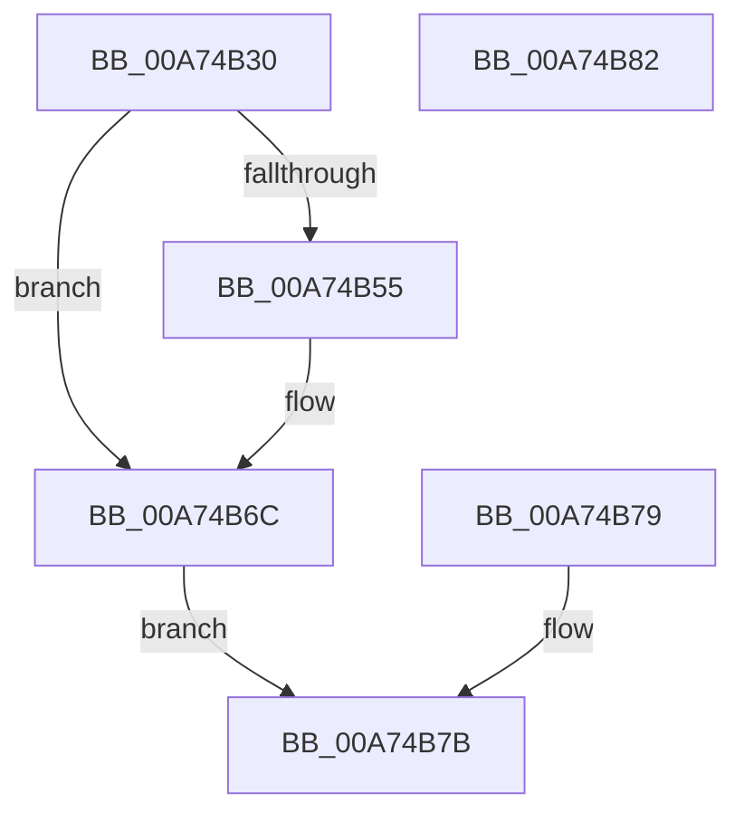

# NtQueryInstallUILanguage

- RVA: `0x00A74B30`–`0x00A74B83` (길이 `83` bytes)
- VA: `0x0000000140A74B30`
- 실행 섹션: `PAGE`
- PDB 이름 있음: `예`; PDB Function 태그: `아니요`
- unwind 정보 RVA: `0x000B58D8`
- 디코드: `22`개 명령, `83/83` bytes 표시
- 미해석 바이트: `0` (있으면 어셈블리에 `.byte`로 보존)

> 이 문서는 커널 이미지의 기계어와 PDB 기호를 분석해 생성했습니다. 4번과 5번은 함수 원형과 자료형을 바이너리 사용 방식에서 추정한 C 해석이며 원본 소스 복구 결과는 아닙니다.

## 1. Dependencies

- 직접 호출 지점: **0**; 고유 호출 대상: **0**
- 직접 호출자로 확인된 함수: **4**
- RIP 상대 이미지 참조: **1**

### Outgoing calls
- 직접 디코드된 call 명령이 없습니다.

### Direct callers
- [RtlpMuiRegPopulateBaseLanguages](../83/RtlpMuiRegPopulateBaseLanguages_function_0083FC4C.md) at `0x0083FD16`
- [RtlpMuiRegValidateInstalled](../84/RtlpMuiRegValidateInstalled_function_008404D4.md) at `0x00840577`
- [NtQueryDefaultUILanguage](NtQueryDefaultUILanguage_function_00A74B10.md) at `0x00A74B14`
- [ExpSetPendingUILanguage](../A8/ExpSetPendingUILanguage_function_00A87E70.md) at `0x00A8823C`

### Static image references
- `0x00A74B6C` → RVA `0x00FD9A60` (`PAGEDATA`; read)

## 2. Other-region calls and transfers

- 다른 실행 섹션으로 향하는 call: **0**
- 별도 외부 분기/꼬리 이동을 확인하지 못했습니다.

## 3. Assembly (complete function range)

```asm
00A74B30  48 83 EC 18                     sub rsp, 0x18
00A74B34  4C 8B C1                        mov r8, rcx
00A74B37  33 D2                           xor edx, edx
00A74B39  65 48 8B 04 25 88 01 00 00      mov rax, qword ptr gs:[0x188]
00A74B42  48 89 44 24 30                  mov qword ptr [rsp + 0x30], rax
00A74B47  8A 80 32 02 00 00               mov al, byte ptr [rax + 0x232]
00A74B4D  88 44 24 28                     mov byte ptr [rsp + 0x28], al
00A74B51  84 C0                           test al, al
00A74B53  74 17                           je 0x140a74b6c
00A74B55  48 B9 00 00 FF FF FF 7F 00 00   movabs rcx, 0x7fffffff0000
00A74B5F  4C 3B C1                        cmp r8, rcx
00A74B62  49 0F 42 C8                     cmovb rcx, r8
00A74B66  0F B7 01                        movzx eax, word ptr [rcx]
00A74B69  66 89 01                        mov word ptr [rcx], ax
00A74B6C  0F B7 05 ED 4E 56 00            movzx eax, word ptr [rip + 0x564eed]
00A74B73  66 41 89 00                     mov word ptr [r8], ax
00A74B77  EB 02                           jmp 0x140a74b7b
00A74B79  8B D0                           mov edx, eax
00A74B7B  8B C2                           mov eax, edx
00A74B7D  48 83 C4 18                     add rsp, 0x18
00A74B81  C3                              ret
00A74B82  CC                              int3
```

## 4. C-style interpretation (structured pseudocode)

```c
__int64 __fastcall NtQueryInstallUILanguage(__int64 a1, int a2)
{
    __int64 result;
    __int64 v_rsp;
    unsigned __int8 v_stack_p10;
    unsigned __int64 v_stack_p18;

    v_rsp = (v_rsp) - (24);
    a2 = 0;
    v_stack_p18 = *(unsigned __int64 *)(gs_base + (0 + 392));
    v_stack_p10 = (unsigned __int8)(*(unsigned __int8 *)(*(unsigned __int64 *)(gs_base + (0 + 392)) + 562));
    result = *(unsigned __int8 *)(*(unsigned __int64 *)(gs_base + (0 + 392)) + 562);
    if ((unsigned __int8)(*(unsigned __int8 *)(*(unsigned __int64 *)(gs_base + (0 + 392)) + 562)) != 0) {
        if (a1 < a1) { a1 = a1; }
        result = *(unsigned __int16 *)(a1);
        *(unsigned __int16 *)(a1) = (unsigned __int16)(result);
    }
    *(unsigned __int16 *)(a1) = (unsigned __int16)(*(unsigned __int16 *)(v_rip + 5656301));
    goto loc_00A74B7B;
loc_00A74B7B:
    v_rsp = (v_rsp) + (24);
    return 0;
}
```

## 5. (Beta) C Style

```c
int64_t NtQueryInstallUILanguage(int64_t Arg1, int32_t Arg2)
{
    int64_t result;
    int64_t local_rsp;
    uint8_t v_stack_p10;
    uint64_t v_stack_p18;

    local_rsp = (local_rsp) - (24);
    Arg2 = 0;
    v_stack_p18 = *(uint64_t *)(gs_base + (0 + 0x188));
    v_stack_p10 = (uint8_t)(*(uint8_t *)(*(uint64_t *)(gs_base + (0 + 0x188)) + 0x232));
    result = *(uint8_t *)(*(uint64_t *)(gs_base + (0 + 0x188)) + 0x232);
    if ((uint8_t)(*(uint8_t *)(*(uint64_t *)(gs_base + (0 + 0x188)) + 0x232)) != 0) {
        if (Arg1 < Arg1) { Arg1 = Arg1; }
        result = *(uint16_t *)(Arg1);
        *(uint16_t *)(Arg1) = (uint16_t)(result);
    }
    *(uint16_t *)(Arg1) = (uint16_t)(*(uint16_t *)(v_rip + 0x564EED));
    goto loc_00A74B7B;
loc_00A74B7B:
    local_rsp = (local_rsp) + (24);
    return 0;
}
```

## 6. Execution-region graph

[열기: 2D/3D 그래프와 함수 탐색 컨트롤 패널](../../../control-panel.html?section=page&rva=0x00A74B30&view=graph)

- 2D 그래프는 위에서 아래로 흐르고, 3D 그래프는 빈 공간을 드래그해 회전합니다. Shift+드래그는 이동, 휠은 확대·축소, 함수 노드 선택은 대상 보고서 이동입니다.

### Static fallback


