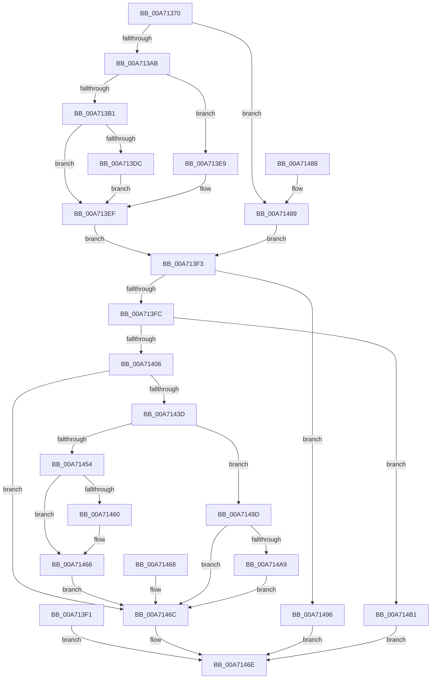

# NtQuerySemaphore

- RVA: `0x00A71370`–`0x00A714B8` (길이 `328` bytes)
- VA: `0x0000000140A71370`
- 실행 섹션: `PAGE`
- PDB 이름 있음: `예`; PDB Function 태그: `아니요`
- unwind 정보 RVA: `0x000B5378`
- 디코드: `88`개 명령, `328/328` bytes 표시
- 미해석 바이트: `0` (있으면 어셈블리에 `.byte`로 보존)

> 이 문서는 커널 이미지의 기계어와 PDB 기호를 분석해 생성했습니다. 4번과 5번은 함수 원형과 자료형을 바이너리 사용 방식에서 추정한 C 해석이며 원본 소스 복구 결과는 아닙니다.

## 1. Dependencies

- 직접 호출 지점: **3**; 고유 호출 대상: **3**
- 직접 호출자로 확인된 함수: **0**
- RIP 상대 이미지 참조: **1**

### Outgoing calls
- `0x00A713E9` → [ExRaiseDatatypeMisalignment](../89/ExRaiseDatatypeMisalignment_function_00899FD0.md) (function, `0x00899FD0`)
- `0x00A7142E` → [ObReferenceObjectByHandle](../86/ObReferenceObjectByHandle_function_00868DB0.md) (function, `0x00868DB0`)
- `0x00A7144A` → [ObfDereferenceObject](../../text/2F/ObfDereferenceObject_function_002F9350.md) (function, `0x002F9350`)

### Direct callers
- 이 함수 시작 RVA로 연결되는 직접 call은 확인되지 않았습니다. 간접 호출은 완전히 역산할 수 없습니다.

### Static image references
- `0x00A71406` → RVA `0x00FC52C0` (`ALMOSTRO`; read)

## 2. Other-region calls and transfers

- 다른 실행 섹션으로 향하는 call: **1**
  - `0x00A7144A` → [ObfDereferenceObject](../../text/2F/ObfDereferenceObject_function_002F9350.md) (`PAGE` → `.text`)
- 별도 외부 분기/꼬리 이동을 확인하지 못했습니다.

## 3. Assembly (complete function range)

```asm
00A71370  48 89 5C 24 08                  mov qword ptr [rsp + 8], rbx
00A71375  48 89 74 24 10                  mov qword ptr [rsp + 0x10], rsi
00A7137A  48 89 7C 24 18                  mov qword ptr [rsp + 0x18], rdi
00A7137F  41 54                           push r12
00A71381  41 56                           push r14
00A71383  41 57                           push r15
00A71385  48 83 EC 40                     sub rsp, 0x40
00A71389  49 8B F8                        mov rdi, r8
00A7138C  44 8B C2                        mov r8d, edx
00A7138F  4C 8B D1                        mov r10, rcx
00A71392  65 48 8B 04 25 88 01 00 00      mov rax, qword ptr gs:[0x188]
00A7139B  44 8A A0 32 02 00 00            mov r12b, byte ptr [rax + 0x232]
00A713A2  45 84 E4                        test r12b, r12b
00A713A5  0F 84 DE 00 00 00               je 0x140a71489
00A713AB  40 F6 C7 03                     test dil, 3
00A713AF  75 38                           jne 0x140a713e9
00A713B1  48 BA 00 00 FF FF FF 7F 00 00   movabs rdx, 0x7fffffff0000
00A713BB  48 8B CA                        mov rcx, rdx
00A713BE  48 3B FA                        cmp rdi, rdx
00A713C1  48 0F 42 CF                     cmovb rcx, rdi
00A713C5  8A 01                           mov al, byte ptr [rcx]
00A713C7  88 01                           mov byte ptr [rcx], al
00A713C9  8A 41 07                        mov al, byte ptr [rcx + 7]
00A713CC  88 41 07                        mov byte ptr [rcx + 7], al
00A713CF  48 8B 9C 24 80 00 00 00         mov rbx, qword ptr [rsp + 0x80]
00A713D7  48 85 DB                        test rbx, rbx
00A713DA  74 13                           je 0x140a713ef
00A713DC  48 3B DA                        cmp rbx, rdx
00A713DF  48 0F 42 D3                     cmovb rdx, rbx
00A713E3  8B 02                           mov eax, dword ptr [rdx]
00A713E5  89 02                           mov dword ptr [rdx], eax
00A713E7  EB 06                           jmp 0x140a713ef
00A713E9  E8 E2 8B E2 FF                  call 0x140899fd0
00A713EE  CC                              int3
00A713EF  EB 02                           jmp 0x140a713f3
00A713F1  EB 7B                           jmp 0x140a7146e
00A713F3  45 85 C0                        test r8d, r8d
00A713F6  0F 85 9A 00 00 00               jne 0x140a71496
00A713FC  41 83 F9 08                     cmp r9d, 8
00A71400  0F 85 AB 00 00 00               jne 0x140a714b1
00A71406  4C 8B 05 B3 3E 55 00            mov r8, qword ptr [rip + 0x553eb3]
00A7140D  48 83 64 24 38 00               and qword ptr [rsp + 0x38], 0
00A71413  48 83 64 24 28 00               and qword ptr [rsp + 0x28], 0
00A71419  48 8D 44 24 38                  lea rax, [rsp + 0x38]
00A7141E  48 89 44 24 20                  mov qword ptr [rsp + 0x20], rax
00A71423  45 8A CC                        mov r9b, r12b
00A71426  BA 01 00 00 00                  mov edx, 1
00A7142B  49 8B CA                        mov rcx, r10
00A7142E  E8 7D 79 DF FF                  call 0x140868db0
00A71433  8B F0                           mov esi, eax
00A71435  89 44 24 30                     mov dword ptr [rsp + 0x30], eax
00A71439  85 C0                           test eax, eax
00A7143B  78 2F                           js 0x140a7146c
00A7143D  48 8B 4C 24 38                  mov rcx, qword ptr [rsp + 0x38]
00A71442  44 8B 71 04                     mov r14d, dword ptr [rcx + 4]
00A71446  44 8B 79 18                     mov r15d, dword ptr [rcx + 0x18]
00A7144A  E8 01 7F 88 FF                  call 0x1402f9350
00A7144F  45 84 E4                        test r12b, r12b
00A71452  74 49                           je 0x140a7149d
00A71454  44 89 37                        mov dword ptr [rdi], r14d
00A71457  44 89 7F 04                     mov dword ptr [rdi + 4], r15d
00A7145B  48 85 DB                        test rbx, rbx
00A7145E  74 06                           je 0x140a71466
00A71460  C7 03 08 00 00 00               mov dword ptr [rbx], 8
00A71466  EB 04                           jmp 0x140a7146c
00A71468  8B 74 24 30                     mov esi, dword ptr [rsp + 0x30]
00A7146C  8B C6                           mov eax, esi
00A7146E  48 8B 5C 24 60                  mov rbx, qword ptr [rsp + 0x60]
00A71473  48 8B 74 24 68                  mov rsi, qword ptr [rsp + 0x68]
00A71478  48 8B 7C 24 70                  mov rdi, qword ptr [rsp + 0x70]
00A7147D  48 83 C4 40                     add rsp, 0x40
00A71481  41 5F                           pop r15
00A71483  41 5E                           pop r14
00A71485  41 5C                           pop r12
00A71487  C3                              ret
00A71488  CC                              int3
00A71489  48 8B 9C 24 80 00 00 00         mov rbx, qword ptr [rsp + 0x80]
00A71491  E9 5D FF FF FF                  jmp 0x140a713f3
00A71496  B8 03 00 00 C0                  mov eax, 0xc0000003
00A7149B  EB D1                           jmp 0x140a7146e
00A7149D  44 89 37                        mov dword ptr [rdi], r14d
00A714A0  44 89 7F 04                     mov dword ptr [rdi + 4], r15d
00A714A4  48 85 DB                        test rbx, rbx
00A714A7  74 C3                           je 0x140a7146c
00A714A9  C7 03 08 00 00 00               mov dword ptr [rbx], 8
00A714AF  EB BB                           jmp 0x140a7146c
00A714B1  B8 04 00 00 C0                  mov eax, 0xc0000004
00A714B6  EB B6                           jmp 0x140a7146e
```

## 4. C-style interpretation (structured pseudocode)

```c
__int64 __fastcall NtQuerySemaphore(__int64 a1, int a2, __int64 a3, int a4, __int64 a5)
{
    __int64 result;
    __int64 v_rsp;
    unsigned __int64 v_stack_m20;
    unsigned int v_stack_m28;
    unsigned __int64 v_stack_m30;
    unsigned __int64 v_stack_m38;
    unsigned __int64 v_stack_p10;
    unsigned __int64 v_stack_p18;
    unsigned __int64 v_stack_p8;

    v_stack_p8 = v_rbx;
    v_stack_p10 = v_rsi;
    v_stack_p18 = v_rdi;
    v_rsp = (v_rsp) - (64);
    if ((unsigned __int8)(*(unsigned __int8 *)(*(unsigned __int64 *)(gs_base + (0 + 392)) + 562)) == 0) goto loc_00A71489;
    if ((((unsigned __int8)(a3)) & (3)) != 0) goto loc_00A713E9;
    if (a3 < a2) { a2 = a3; }
    *(unsigned __int8 *)(a2) = (unsigned __int8)(*(unsigned __int8 *)(a2));
    *(unsigned __int8 *)(a2 + 7) = (unsigned __int8)(*(unsigned __int8 *)(a2 + 7));
    if (a5 == 0) goto loc_00A713EF;
    if (a5 < a2) { a2 = a5; }
    *(unsigned int *)(a2) = (unsigned int)((unsigned int)(*(unsigned int *)(a2)));
    goto loc_00A713EF;
loc_00A713E9:
    result = ExRaiseDatatypeMisalignment(a2, a2, (unsigned int)(a2), a4);
loc_00A713EF:
    goto loc_00A713F3;
loc_00A713F3:
    if ((unsigned int)((unsigned int)(a2)) != 0) goto loc_00A71496;
    if (a4 != 8) goto loc_00A714B1;
    v_stack_m38 = v_stack_m20;
    result = ObReferenceObjectByHandle(a1, 1, *(unsigned __int64 *)(v_rip + 5586611), (unsigned __int8)(*(unsigned __int8 *)(*(unsigned __int64 *)(gs_base + (0 + 392)) + 562)));
    v_stack_m28 = (unsigned int)(result);
    if (sign_flag) goto loc_00A7146C;
    result = ObfDereferenceObject(v_stack_m20, 1, *(unsigned __int64 *)(v_rip + 5586611), (unsigned __int8)(*(unsigned __int8 *)(*(unsigned __int64 *)(gs_base + (0 + 392)) + 562)));
    if ((unsigned __int8)(*(unsigned __int8 *)(*(unsigned __int64 *)(gs_base + (0 + 392)) + 562)) == 0) goto loc_00A7149D;
    *(unsigned int *)(a3) = (unsigned int)((unsigned int)(*(unsigned int *)(v_stack_m20 + 4)));
    *(unsigned int *)(a3 + 4) = (unsigned int)((unsigned int)(*(unsigned int *)(v_stack_m20 + 24)));
    if (a5 != 0) {
        *(unsigned int *)(a5) = 8;
    }
    goto loc_00A7146C;
loc_00A7146C:
loc_00A7146E:
    v_rsp = (v_rsp) + (64);
    return (unsigned int)((unsigned int)((unsigned int)((unsigned int)(result))));
loc_00A71489:
    goto loc_00A713F3;
loc_00A71496:
    goto loc_00A7146E;
loc_00A7149D:
    *(unsigned int *)(v_stack_p18) = (unsigned int)((unsigned int)(*(unsigned int *)(v_stack_m20 + 4)));
    *(unsigned int *)(v_stack_p18 + 4) = (unsigned int)((unsigned int)(*(unsigned int *)(v_stack_m20 + 24)));
    if (a5 == 0) goto loc_00A7146C;
    *(unsigned int *)(a5) = 8;
    goto loc_00A7146C;
loc_00A714B1:
    goto loc_00A7146E;
}
```

## 5. (Beta) C Style

```c
int64_t NtQuerySemaphore(int64_t Arg1, int32_t Arg2, int64_t Arg3, int32_t Arg4, int64_t Arg5)
{
    int64_t result;
    int64_t local_rsp;
    uint64_t v_stack_m20;
    uint32_t v_stack_m28;
    uint64_t v_stack_m30;
    uint64_t v_stack_m38;
    uint64_t v_stack_p10;
    uint64_t v_stack_p18;
    uint64_t v_stack_p8;

    v_stack_p8 = local_rbx;
    v_stack_p10 = local_rsi;
    v_stack_p18 = local_rdi;
    local_rsp = (local_rsp) - (64);
    if ((uint8_t)(*(uint8_t *)(*(uint64_t *)(gs_base + (0 + 0x188)) + 0x232)) == 0) goto loc_00A71489;
    if ((((uint8_t)(Arg3)) & (3)) != 0) goto loc_00A713E9;
    if (Arg3 < Arg2) { Arg2 = Arg3; }
    *(uint8_t *)(Arg2) = (uint8_t)(*(uint8_t *)(Arg2));
    *(uint8_t *)(Arg2 + 0x7) = (uint8_t)(*(uint8_t *)(Arg2 + 0x7));
    if (Arg5 == 0) goto loc_00A713EF;
    if (Arg5 < Arg2) { Arg2 = Arg5; }
    *(uint32_t *)(Arg2) = (uint32_t)((uint32_t)(*(uint32_t *)(Arg2)));
    goto loc_00A713EF;
loc_00A713E9:
    result = ExRaiseDatatypeMisalignment(Arg2, Arg2, (uint32_t)(Arg2), Arg4);
loc_00A713EF:
    goto loc_00A713F3;
loc_00A713F3:
    if ((uint32_t)((uint32_t)(Arg2)) != 0) goto loc_00A71496;
    if (Arg4 != 8) goto loc_00A714B1;
    v_stack_m38 = v_stack_m20;
    result = ObReferenceObjectByHandle(Arg1, 1, *(uint64_t *)(v_rip + 0x553EB3), (uint8_t)(*(uint8_t *)(*(uint64_t *)(gs_base + (0 + 0x188)) + 0x232)));
    v_stack_m28 = (uint32_t)(result);
    if (sign_flag) goto loc_00A7146C;
    result = ObfDereferenceObject(v_stack_m20, 1, *(uint64_t *)(v_rip + 0x553EB3), (uint8_t)(*(uint8_t *)(*(uint64_t *)(gs_base + (0 + 0x188)) + 0x232)));
    if ((uint8_t)(*(uint8_t *)(*(uint64_t *)(gs_base + (0 + 0x188)) + 0x232)) == 0) goto loc_00A7149D;
    *(uint32_t *)(Arg3) = (uint32_t)((uint32_t)(*(uint32_t *)(v_stack_m20 + 0x4)));
    *(uint32_t *)(Arg3 + 0x4) = (uint32_t)((uint32_t)(*(uint32_t *)(v_stack_m20 + 0x18)));
    if (Arg5 != 0) {
        *(uint32_t *)(Arg5) = 8;
    }
    goto loc_00A7146C;
loc_00A7146C:
loc_00A7146E:
    local_rsp = (local_rsp) + (64);
    return (uint32_t)((uint32_t)((uint32_t)((uint32_t)(result))));
loc_00A71489:
    goto loc_00A713F3;
loc_00A71496:
    goto loc_00A7146E;
loc_00A7149D:
    *(uint32_t *)(v_stack_p18) = (uint32_t)((uint32_t)(*(uint32_t *)(v_stack_m20 + 0x4)));
    *(uint32_t *)(v_stack_p18 + 0x4) = (uint32_t)((uint32_t)(*(uint32_t *)(v_stack_m20 + 0x18)));
    if (Arg5 == 0) goto loc_00A7146C;
    *(uint32_t *)(Arg5) = 8;
    goto loc_00A7146C;
loc_00A714B1:
    goto loc_00A7146E;
}
```

## 6. Execution-region graph

[열기: 2D/3D 그래프와 함수 탐색 컨트롤 패널](../../../control-panel.html?section=page&rva=0x00A71370&view=graph)

- 2D 그래프는 위에서 아래로 흐르고, 3D 그래프는 빈 공간을 드래그해 회전합니다. Shift+드래그는 이동, 휠은 확대·축소, 함수 노드 선택은 대상 보고서 이동입니다.

### Static fallback


